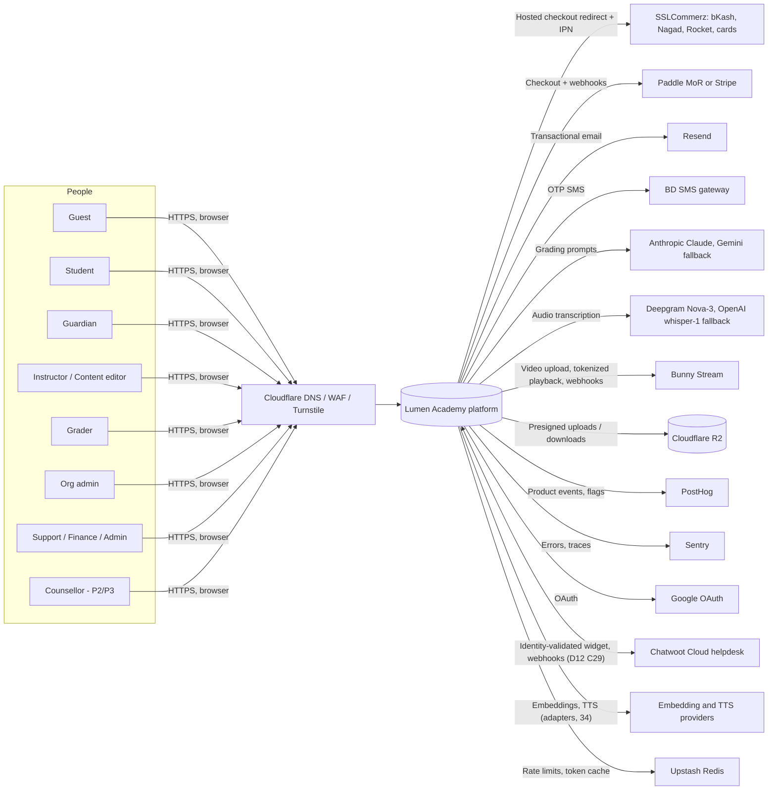
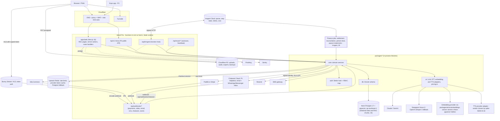
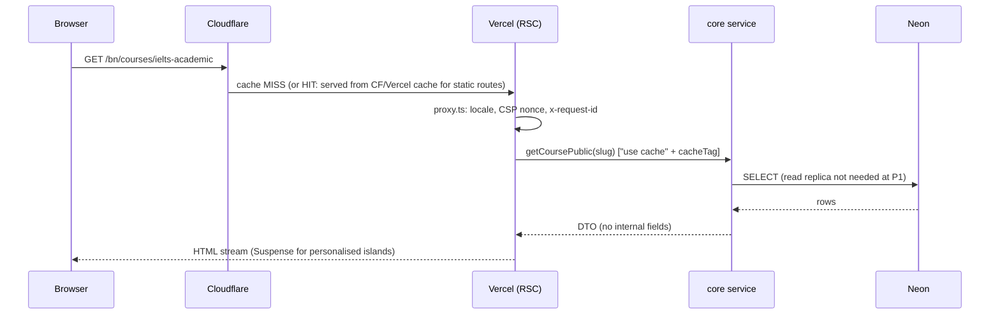
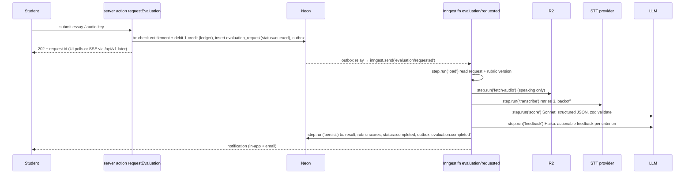

# 04 — System Architecture

> Conforms to `00-DECISIONS.md` (D1–D9). If this file disagrees with it, 00 wins.
> Audience: AI coding agents (Sonnet implementers, Opus reviewers). Everything marked **MUST** is enforced by lint rule, test or CI check; "should" is guidance.
> Brand name is a placeholder: read it only from `packages/config/brand.ts`.
> Prices and vendor limits in section 12 are planning estimates as of 2026-11-07. Re-verify against vendor pricing pages before committing budget.

---

## 1. Architectural principles

1. **Modular monolith.** One deployable web app plus Inngest functions served from the same app. No microservices (D2).
2. **Server authoritative** for identity, permissions, prices, entitlements, exam deadlines and scoring (D2, D6). The client is never trusted for any of these.
3. **Authorization lives in `packages/core` services** (`assertCan`). Next.js `proxy.ts`, layouts and UI checks are optimisations only (D7; 2026 Next.js advisories include a proxy authorization bypass via `.rsc` prefetch URLs, so nothing may depend on `proxy.ts` for security).
4. **Entitlements are the only access gate** for paid content (D5). Code never asks "did this user buy X?", only `hasEntitlement(userId, resource)`.
5. **Domains communicate only through each domain's `index.ts`.** No deep imports; enforced with `eslint-plugin-boundaries` and `dependency-cruiser` in `pnpm verify`.
6. **Side effects after commit.** Emails, AI jobs, search sync, analytics run via the transactional outbox, never inline inside a DB transaction.
7. **Everything idempotent.** Webhooks, jobs, autosaves, payments.

---

## 2. System context (C4 level 1)



---

## 3. Container diagram (C4 level 2)



Notes:
- **Chatwoot (D12 C29, 27)**: helpdesk is bought, not built, in P1; the app embeds the identity-validated widget, mirrors ticket metadata (not message bodies) into `support_ticket` through `/api/webhooks/chatwoot`, and links order/user lookup by signed deep link. Native ticketing is re-evaluated in P2.
- **pgvector RAG (34)**: the AI tutor, notebooks and search-by-meaning read `content_chunk` / `notebook_chunk` (HNSW on `halfvec`) in the same Neon database; every retrieval applies the entitlement filter in SQL, never in the prompt. The embedding model id is stored on each chunk so a model swap triggers a re-embed job.
- **Finance jobs (30)**: settlement-report import, daily/weekly reconciliation, month-end `finance_period` close, revenue-schedule recognition and monthly payout statements run as Inngest functions in `packages/core/src/finance`; manual monthly payouts in P1-P2.
- `packages/*` are libraries compiled into the single Next.js deployment. They are drawn separately only to show dependency direction.
- Vercel function region: `sin1` (Singapore) to sit beside Neon `ap-southeast-1`. `bom1` (Mumbai) is an alternative only if measured latency to Dhaka is better and Neon is moved too. Decision rule: DB and functions MUST share a region.

---

## 4. Monorepo tree

```
lumen/
├─ package.json                      # private, scripts: verify, dev, db:*, e2e
├─ pnpm-workspace.yaml               # packages globs, catalog, minimumReleaseAge, onlyBuiltDependencies
├─ pnpm-lock.yaml
├─ turbo.json                        # tasks: build, typecheck, lint, test, e2e; remote cache optional
├─ .nvmrc                            # Node 24 LTS
├─ .env.example                      # every env var, no values
├─ AGENTS.md                         # agent entry point (see 12-BUILD-PLAN-AGENTS.md)
├─ renovate.json
├─ commitlint.config.mjs
├─ docker-compose.yml                # postgres:17, mailpit, optional minio
├─ .github/
│  ├─ CODEOWNERS
│  ├─ pull_request_template.md
│  └─ workflows/ { ci.yml, e2e-preview.yml, security.yml, codeql.yml, db-backup.yml, db-migrate-prod.yml }
├─ docs/                             # 00..34 blueprint docs, PROGRESS.md, runbooks/ (secret-rotation.md, ...), ops/, legal/
├─ tooling/
│  ├─ scripts/ { seed-dev.ts, restore-drill.sh, check-boundaries.ts, gen-openapi.ts }
│  └─ codemods/
├─ apps/
│  ├─ web/
│  │  ├─ next.config.ts              # cacheComponents, security headers, images, sentry wrapper
│  │  ├─ instrumentation.ts          # Sentry server init, OTel register
│  │  ├─ instrumentation-client.ts   # Sentry browser init, PostHog init (consent gated)
│  │  ├─ proxy.ts                    # Next 16 (ex-middleware): locale redirect, CSP nonce, request id. NO authorization
│  │  ├─ messages/ { en.json, bn.json }
│  │  ├─ e2e/ { auth.spec.ts, checkout.spec.ts, exam-attempt.spec.ts, a11y.spec.ts }
│  │  └─ app/
│  │     ├─ layout.tsx, global-error.tsx, not-found.tsx, robots.ts, sitemap.ts
│  │     ├─ [locale]/                           # next-intl localePrefix 'as-needed': English at root, Bangla under /bn
│  │     │  ├─ layout.tsx                      # html lang, fonts, NextIntlClientProvider, consent banner
│  │     │  ├─ (marketing)/                    # STATIC / cached; no session reads
│  │     │  │  ├─ page.tsx                     # home
│  │     │  │  ├─ courses/page.tsx, courses/[slug]/page.tsx
│  │     │  │  ├─ ielts/…, gre/…               # landing pages by track
│  │     │  │  ├─ pricing/page.tsx
│  │     │  │  ├─ blog/[slug]/page.tsx
│  │     │  │  ├─ free-diagnostic/page.tsx     # guest diagnostic entry
│  │     │  │  ├─ tools/…                      # free tools incl. 'Which test do I need?' quiz
│  │     │  │  ├─ verify/[code]/page.tsx       # public certificate verification (D12 C11; unguessable code)
│  │     │  │  ├─ help/…, status/page.tsx, changelog/page.tsx, accessibility/page.tsx   # help centre, status mirror, changelog, accessibility statement (23 C4, 26)
│  │     │  │  ├─ guarantee/page.tsx, accuracy/page.tsx                                  # Progress/Target Promise terms and AI-accuracy statement (34)
│  │     │  │  └─ legal/{terms,privacy,refund-policy,cookies,trademark-notice,ai-scoring-policy,...}/page.tsx   # CMS-backed, versioned (26)
│  │     │  ├─ (auth)/                         # dynamic, minimal layout
│  │     │  │  ├─ sign-in/page.tsx, sign-up/page.tsx, verify-otp/page.tsx, onboarding/page.tsx   # /onboarding lives in (auth), D12 C3
│  │     │  │  ├─ two-factor/page.tsx, passkey/page.tsx, forgot/page.tsx
│  │     │  ├─ (checkout)/                       # cart, checkout, orders; marketing-minimal shell; signed-in
│  │     │  │  ├─ cart/page.tsx, checkout/page.tsx, checkout/return/page.tsx   # return page polls; never trusts the redirect
│  │     │  │  └─ orders/page.tsx, orders/[orderId]/page.tsx
│  │     │  ├─ (learner)/app/                    # role-aware dashboard + entitlement-gated player; student, guardian (read-only)
│  │     │  │  ├─ layout.tsx                     # App shell, role switcher, nav by permissions
│  │     │  │  ├─ page.tsx                       # /app home (student dashboard; guardian view for linked students)
│  │     │  │  ├─ learn/[course]/layout.tsx                  # sidebar syllabus
│  │     │  │  ├─ learn/[course]/[lesson]/page.tsx           # video / text / quiz lesson
│  │     │  │  ├─ practice/, tests/ (+ tests/[testId] pre-start, results), vocab/, plan/, progress/, settings/
│  │     │  │  ├─ evaluations/, guardian/        # AI evaluation results; linked-student views (receipts live in (checkout)/orders)
│  │     │  │  ├─ ask/, listen/, notebooks/, promise/, progress/estimate/   # AI learning features (34): Ask tutor, audio overviews, notebooks, Promise tracker, score estimate
│  │     │  │  ├─ mistakes/, support/                         # mistake notebook; learner support entry (Chatwoot widget + ticket list)
│  │     │  │  └─ admissions/ (P2)                            # student admissions workspace (21)
│  │     │  ├─ (exam)/exam/[attemptId]/          # FULL-SCREEN EXAM SHELL, own root layout chrome
│  │     │  │  ├─ layout.tsx                     # no site nav, no footer, wake-lock, beforeunload guard
│  │     │  │  ├─ page.tsx                       # exam runtime (client-heavy)
│  │     │  │  ├─ system-check/page.tsx          # audio/mic/screen check
│  │     │  │  ├─ review/page.tsx                # post-submit review (keys only after submit)
│  │     │  │  └─ submitted/page.tsx             # holding screen -> results link
│  │     │  ├─ (studio)/studio/                  # instructor (own) + content_editor+ (all)
│  │     │  │  ├─ courses/, courses/[id]/edit/, questions/, question-sets/, tests/
│  │     │  │  └─ review-queue/, media/, taxonomy/, blog/, earnings/ (P3)
│  │     │  ├─ (grader)/grader/                  # grader queue, review screen, override form
│  │     │  ├─ (staff)/                          # content_editor, support, finance
│  │     │  │  ├─ editor/**                      # editorial review/publish, SEO pages, /editor/reports (error reports inbox)
│  │     │  │  ├─ support/**                     # masked user/order lookup (/support/lookup), tickets mirror, read-only impersonation, access extension, void/credit tools, guarantee claims, disputes, moderation
│  │     │  │  └─ finance/**                     # orders, refunds, payouts, coupons, reports, settlement/reconciliation, periods, VAT exports (30)
│  │     │  ├─ (counsellor)/counsellor/**         # P2/P3: assigned students' application workspaces, essay feedback, sessions (21); 2FA required
│  │     │  ├─ (org)/org/[orgSlug]/              # org_admin: members, cohorts, assignments, analytics, seats
│  │     │  └─ (admin)/admin/                    # admin, super_admin
│  │     │     ├─ users/, roles/, orders/, refunds/, coupons/, reports/
│  │     │     ├─ feature-flags/, audit-log/, impersonation/, system/
│  │     │     ├─ ai-monitor/, ai-ops/ (raters, gold set, eval runs, budgets, disputes - 31), moderation/, policies/ (policy_version publishing, 26)
│  │     └─ api/
│  │        ├─ auth/[...all]/route.ts          # Better Auth handler
│  │        ├─ inngest/route.ts                # serve({ client, functions })
│  │        ├─ v1/[[...route]]/route.ts        # Hono app (hono/vercel handle), P3 public API
│  │        ├─ exam/attempts/[attemptId]/{responses,heartbeat,submit,...}/route.ts   # full list: 06 section 5.6
│  │        ├─ webhooks/
│  │        │  ├─ sslcommerz/ipn/route.ts
│  │        │  ├─ sslcommerz/{success,fail,cancel}/route.ts   # browser return URLs (POST), never trusted for fulfilment
│  │        │  ├─ paddle/route.ts, stripe/route.ts
│  │        │  ├─ bunny/route.ts, resend/route.ts, sms-dlr/route.ts, chatwoot/route.ts, zoom/route.ts
│  │        ├─ tutor/stream/route.ts             # AI tutor streaming (34); defineRoute limits per 09 canonical AI table
│  │        ├─ uploads/presign/route.ts
│  │        └─ health/{live,ready}/route.ts
│  └─ (apps/mobile/ added in P3: Expo, consumes /api/v1)
└─ packages/
   ├─ core/
   │  ├─ package.json                  # exports map: one entry per domain ("./identity": "./src/identity/index.ts")
   │  └─ src/
   │     ├─ identity/ rbac/ catalog/ content/ media/ assessment/ exam-engine/
   │     ├─ evaluation/ commerce/ learning/ community/ notifications/
   │     ├─ organizations/ analytics/ audit/
   │     ├─ support/ guarantee/ admissions/ finance/ ai-ops/ ai-learning/   # P1: support (27, Chatwoot sync), guarantee (D12 C13/C13b), finance (30), ai-ops (31), ai-learning (34: tutor, RAG, notebooks, SRS); P2: admissions (21)
   │     │   └─ each domain:
   │     │      ├─ index.ts           # PUBLIC API (only file other domains may import)
   │     │      ├─ service.ts         # use-cases; the only place that orchestrates repo + policy + audit
   │     │      ├─ policy.ts          # pure functions: canX(actor, resource) → boolean + reason
   │     │      ├─ schema.ts          # zod input/output schemas + inferred types (shared by forms, actions, Hono)
   │     │      ├─ repo.ts            # Drizzle queries; takes `tx: DbOrTx`; no business rules
   │     │      ├─ events.ts          # domain event names + payload schemas (outbox)
   │     │      ├─ errors.ts          # domain error codes (extends AppError)
   │     │      └─ __tests__/         # service tests against real Postgres (testcontainers or CI service)
   │     └─ shared/ { result.ts, app-error.ts, ids.ts (uuidv7), money.ts, clock.ts, outbox.ts, tx.ts, logger.ts, request-context.ts }
   ├─ db/
   │  ├─ drizzle.config.ts
   │  ├─ src/schema/*.ts              # one file per domain, re-exported from index.ts
   │  ├─ src/client.ts                # pooled client (app) and direct client (migrations)
   │  ├─ migrations/                  # generated SQL, committed, reviewed
   │  └─ seed/ { index.ts, rbac.ts, taxonomy.ts, demo-content.ts, dev-users.ts }
   ├─ auth/
   │  └─ src/ { auth.ts (betterAuth config), permissions.ts, roles.ts, session.ts (getSession, requireSession), sms-otp.ts }
   ├─ ui/
   │  └─ src/ { components/ (shadcn-derived), tokens.css, theme.ts, hooks/, exam/ (timer, palette, question renderers) }
   ├─ config/
   │  └─ { brand.ts, env.ts (zod), flags.ts, locales.ts, eslint/, tsconfig/ }
   └─ ai/
      └─ src/ { llm/{anthropic.ts,gemini.ts,router.ts}, stt/{deepgram.ts,openai-whisper.ts}, embeddings/, tts/, prompts/, rubrics/, schemas/, eval-harness/, pricing.ts (single source of AI unit costs, D12 C9), rate-limits.ts (mirror of 09 canonical table) }
```

Hard rules:
- `packages/core` MUST NOT import `next/*`, `react`, or anything under `apps/`.
- `apps/web` MUST NOT import `packages/db` directly, except `apps/web/lib/health.ts`. All data access goes through `packages/core/<domain>` exports.
- Files named `service.ts` and `repo.ts` MUST start with `import 'server-only'` equivalent (`packages/core` uses an `@lumen/core/server-only` guard module that throws in browser bundles).
- `repo.ts` functions take `tx` as first parameter and never open their own transactions.

---

## 5. Domains: responsibilities and boundaries

| Domain | Owns (tables / concerns) | Responsibilities | May import | Emits events |
|---|---|---|---|---|
| **identity** | `user`, `session`, `account`, `verification`, `two_factor`, `passkey`, `user_profile`, `guardian_link`, `consent_record`, `data_subject_request` | Better Auth integration, profiles, age band, guardian consent, data export and deletion, device list | rbac, audit | `user.created`, `user.deleted`, `guardian.linked` |
| **rbac** | `user_role`, permission map (code) | Role grants, `assertCan`, permission resolution (additive roles), 2FA-required rule (`grader`+ staff, `instructor`, `org_admin`, `counsellor`) | audit | `role.granted`, `role.revoked` |
| **catalog** | `exam`, `subject`, `tag`, `cms_page`, search index views | Public discovery: tracks (IELTS, GRE…), listings, filters, FTS + `pg_trgm` search, SEO metadata | content, commerce (read prices) | `catalog.listing_published` (cache tag bust) |
| **content** | `course`, `course_version`, `section`, `lesson`, `lesson_content`, `course_instructor`, `course_tag`, `instructor_profile`, `lesson_assessment_link` | Course authoring, versioning, review/publish workflow, lesson body (Tiptap JSON), ownership by instructor | media, assessment (reference), audit | `course.published`, `lesson.updated` |
| **media** | `media_asset` | R2 presigned uploads, Bunny Stream video lifecycle, signed playback tokens, watermark params, antivirus/type checks | audit | `media.ready`, `media.failed` |
| **assessment** | `stimulus`, `question`, `question_version`, `question_stat`, `question_set`, `question_set_item`, `score_conversion`, `test_form`, `test_form_version`, `test_form_section`, `test_form_item`, `item_exposure` | Question bank, versioning, tagging by skill/difficulty, authoring and review, test blueprint definition (IELTS linear, GRE section-adaptive rules) | media, audit | `question.published`, `test.published` |
| **exam-engine** | `test_attempt`, `attempt_section`, `attempt_response`, `attempt_event`, `attempt_score`, `attempt_session`, `attempt_annotation`, `entitlement_use` | Start/resume attempts, pin `question_version_id`s, server deadlines, autosave, submit, section routing (GRE adaptivity), objective scoring, raw to estimated band conversion | assessment, learning (read), commerce (entitlement check), evaluation (request), audit | `attempt.started`, `attempt.submitted`, `attempt.scored` |
| **evaluation** | `evaluation_request`, `evaluation_result`, `speaking_recording`, `grader_assignment`, `ai_credit_ledger`, `ai_credit_balance` | AI Writing/Speaking/AWA grading pipeline, credit debit/refund, human grader queue, overrides with rationale, prompt/rubric versions, cost tracking | ai pkg, assessment, media (audio), commerce (credits), audit | `evaluation.requested`, `evaluation.completed`, `evaluation.failed` |
| **commerce** | `product`, `product_grant`, `bundle_item`, `price`, `order`, `order_item`, `payment`, `refund`, `entitlement`, `seat_allocation`, `coupon`, `coupon_product`, `coupon_redemption`, `affiliate`, `invoice`, `invoice_counter`, `payout`, `payout_line` | Pricing (server only), orders, provider abstraction (`PaymentProvider`), webhook reconciliation, entitlements grant/expire/revoke, coupons, refunds, invoices, credit ledger grants | identity (read), audit | `order.paid`, `entitlement.granted`, `entitlement.expiring`, `refund.issued` |
| **learning** | `enrollment`, `lesson_progress`, `course_progress`, `streak`, `study_plan`, `study_plan_item`, `xp_event`, `bookmark`, `note` | Enrollment from entitlements, progress, resume position, streaks/XP (P2), study plans (P2), certificates | content, commerce (entitlement check), exam-engine (read results) | `lesson.completed`, `course.completed`, `streak.broken` |
| **community** | `question_thread`, `answer`, `review`, `report` | Q&A per lesson/course, instructor answers, reviews (only enrolled), moderation and reports | content, learning (read), identity (read) | `post.created`, `review.created` |
| **notifications** | `notification`, `notification_preference`, `email_log` | Template rendering (React Email), channel routing (in-app, email, SMS), preferences, suppression list, quiet hours, provider adapters | identity (read) | `notification.sent` |
| **organizations** | `organization`, `org_member`, `org_invitation`, `cohort`, `cohort_member`, `org_assignment` | B2B: seats, cohorts, assignments, org analytics queries, org-scoped policies (`orgId` match) | identity, commerce, learning, audit | `org.seat_assigned` |
| **analytics** | `event_outbox_export`, `report_snapshot`, `kpi_daily` | Server-side event capture to PostHog, nightly KPI snapshots, instructor/org/admin reports, data export jobs | read-only views over other domains via their exports | none |
| **audit** | `audit_log` (append-only, no UPDATE/DELETE grant) | `audit.record(tx, entry)`, query for admin, hash-chain integrity check | none | none |
| **support** (27) | `support_ticket`, `ticket_message` (metadata only in P1), `macro`, `csat_response`, `dispute`, `moderation_case`, `enforcement_action` | Chatwoot sync (signed identity, webhook upsert, SLA timers/tags), order/user lookup deep links, support-granted credit/extension limits, attempt void/credit tools, disputes, moderation, enforcement ladder | identity (read), commerce (read), exam-engine, evaluation, audit | `support.sla_breach`, `support.impersonation_started`, `dispute.*`, `enforcement.*` |
| **guarantee** (D12 C13/C13b) | `guarantee_claim`, `official_score_report` | 7-day money-back eligibility (C28 measure), Plus Target Promise, Mentor Progress Promise claim verification, extension/re-enrolment grants | commerce, learning, exam-engine, audit | `guarantee_claim.status_changed` |
| **admissions** (21, P2) | `college`, `college_cycle_requirement`, `application`, `essay_draft(_version)`, `essay_feedback`, `counsellor_profile`, `counsellor_session`, `deadline`, `recommender`, `scholarship`, ... | Application workspace, deadlines, essay **feedback** (never writing), counsellor assignment and notes; tenant check = assigned counsellor | identity, commerce (entitlements), evaluation (read), audit | `counsellor.session_reminder_due`, `essay_feedback.requested` |
| **finance** (30) | `ledger_account`, `ledger_journal`, `ledger_entry`, `finance_period`, `settlement_report`, `settlement_line`, `reconciliation_run`, `reconciliation_item`, `revenue_schedule`, `payee_profile`, `payout_statement(_line)`, `export_receipt`, `finance_setting` | Settlement import and reconciliation, month-end close, VAT/Mushak exports, manual monthly payout statements, creator/rater withholding | commerce, audit | `payment.reconciled`, `payment.reconcile_delayed` |
| **ai-ops** (31) | `gold_item`, `rater_profile`, `rating_assignment`, `eval_run`, `model_release`, `audit_sample`, `ai_dispute`, `ai_budget` | Gold-set and rater programme, eval runs/canaries, model/prompt release gates, AI budget alarms, score disputes | evaluation, audit | `model_release.promoted`, `ai_budget.threshold_crossed` |
| **ai-learning** (34) | `content_chunk`, `tutor_conversation`, `tutor_message`, `user_notebook`, `notebook_source`, `notebook_chunk`, `study_asset`, `study_asset_progress`, `srs_*`, `score_prediction`, `progress_report`, `speaking_partner_session`, `ai_fair_use_counter`, `trial_grant` | pgvector RAG with SQL entitlement filter, tutor streaming, notebooks (indirect-injection guarded), FSRS flashcards (C26), fair-use meters (C27), estimate/prediction labelled "estimated" | content (read), learning, evaluation (credit ledger), identity | `tutor.message_created`, `srs.review_logged` |

Boundary rules (machine-enforced in `tooling/scripts/check-boundaries.ts`):
1. A domain MAY import only the domains listed in the "May import" column, and only through `@lumen/core/<domain>` (the `index.ts`).
2. Cross-domain **writes** happen only via the other domain's service function or via an outbox event consumed by an Inngest function. Never write another domain's tables.
3. `audit` and `shared` are importable by all. `rbac` is importable by all (policies need it).
4. Circular imports fail CI. Where two domains need each other (commerce and learning), the lower-level one emits an event and the higher-level one subscribes.
5. Table ownership: only the owning domain's `repo.ts` queries its tables. Cross-domain reads go through exported read functions or DB views owned by the reading domain with a comment naming the source.

### 5.1 Domain `index.ts` contract

```ts
// packages/core/src/commerce/index.ts  — the ONLY public surface of the domain
export { createCheckout, grantEntitlementsForOrder, refundOrder, applyCoupon } from './service';
export { hasEntitlement, listActiveEntitlements } from './service';
export type { Order, Entitlement, CheckoutInput } from './schema';
export { checkoutInputSchema } from './schema';
export { CommerceError } from './errors';
export type { CommerceEvents } from './events';
// policy.ts, repo.ts are NOT re-exported.
```

### 5.2 Service function template (copy for every use-case)

```ts
// packages/core/src/content/service.ts
import { z } from 'zod';
import { withTx } from '../shared/tx';
import { assertCan } from '../rbac';
import { audit } from '../audit';
import { ok, err, type Result } from '../shared/result';
import { AppError } from '../shared/app-error';
import * as repo from './repo';
import { updateCourseInput } from './schema';

export async function updateCourse(
  ctx: RequestContext,                       // { actor, requestId, ip, ua }
  raw: unknown,
): Promise<Result<Course, AppError>> {
  const input = updateCourseInput.safeParse(raw);
  if (!input.success) return err(AppError.validation(input.error));

  return withTx(async (tx) => {
    const course = await repo.getCourseForUpdate(tx, input.data.id);   // SELECT … FOR UPDATE
    if (!course) return err(AppError.notFound('course'));
    assertCan(ctx.actor, 'course:update', course);                      // throws AppError('FORBIDDEN')
    const updated = await repo.updateCourse(tx, course.id, input.data.patch);
    await audit.record(tx, ctx, { action: 'course.update', target: { type: 'course', id: course.id }, diff: input.data.patch });
    await outbox.emit(tx, 'course.updated', { courseId: course.id });  // delivered after commit
    return ok(updated);
  });
}
```

---

## 6. Request lifecycles

### 6.1 RSC page read



Rules:
- Pages are Server Components. They call `@lumen/core/<domain>` read functions, never `db` directly.
- A page that needs the user MUST call `requireSession()` (redirects to sign-in) then pass `actor` to the service. Each service re-checks permissions.
- Services return **DTOs**, never raw rows (no `password_hash`, no internal notes). DTO mapping lives in `schema.ts`.
- Personalised bits inside otherwise cached pages (e.g. "Continue learning" on a course page) are client islands fetched after hydration, or `<Suspense>` dynamic holes under Cache Components.

### 6.2 Server action mutation

Pipeline, in this exact order. Every action file uses the `defineAction` helper so the order cannot be skipped.

```mermaid
flowchart LR
  A[FormData/JSON] --> B[zod parse]
  B --> C[Turnstile / rate limit if public]
  C --> D[getSession → actor]
  D --> E[service: assertCan incl. ownership]
  E --> F[db transaction]
  F --> G[audit.record in same tx]
  G --> H[outbox emit in same tx]
  H --> I[commit]
  I --> J[revalidate tags / updateTag]
  J --> K[Result to client]
```



```ts
// apps/web/lib/define-action.ts
// Plain module (no 'use server'); the exported actions live in files that carry 'use server'.
export function defineAction<S extends z.ZodTypeAny, R>(cfg: {
  name: string;                                  // e.g. 'content.updateCourse' (also the rate-limit key + log field)
  input: S;
  auth: 'public' | 'session';
  rateLimit?: { key: 'ip' | 'user'; limit: number; windowSec: number };
  handler: (args: { ctx: RequestContext; input: z.infer<S> }) => Promise<Result<R, AppError>>;
  revalidate?: (result: R) => { tags?: string[]; update?: string[] };   // revalidateTag / updateTag
}) {
  return async (raw: unknown): Promise<ActionResult<R>> => {
    const ctx = await buildRequestContext();                       // request id, ip, ua, session lookup
    const parsed = cfg.input.safeParse(raw);
    if (!parsed.success) return actionFail(AppError.validation(parsed.error));
    if (cfg.rateLimit) await enforceRateLimit(ctx, cfg.name, cfg.rateLimit);
    if (cfg.auth === 'session' && !ctx.actor) return actionFail(AppError.unauthenticated());
    const res = await cfg.handler({ ctx, input: parsed.data });    // service does assertCan + tx + audit
    if (res.ok) applyRevalidation(cfg.revalidate?.(res.value));
    return toActionResult(res, ctx);                               // maps AppError → { code, message(i18n key), fieldErrors }
  };
}
```

Rules:
- Server actions MUST NOT be used for the exam autosave/heartbeat/submit path (use route handlers, section 6.5). Next.js serialises server actions per client and they cannot be sent as `keepalive` requests with the exam CSRF header.
- Use `updateTag()` (read-your-writes) inside the action for the data the user just changed; use `revalidateTag(tag, 'max')` (stale-while-revalidate) for shared catalogue content.
- Actions return `Result` objects. They MUST NOT throw for expected failures (validation, forbidden, not found). Unexpected exceptions bubble to Sentry and return `INTERNAL` with the request id.

### 6.3 Webhook (payments, video, email, SMS delivery receipts)

```mermaid
sequenceDiagram
  participant P as Provider
  participant W as /api/webhooks/*
  participant C as commerce service
  participant DB as Neon
  participant I as Inngest
  P->>W: POST event
  W->>W: read RAW body; verify signature OR call provider validation API
  W->>W: zod-parse payload (provider-specific schema)
  W->>DB: INSERT payment_event(provider, event_id UNIQUE, raw) ON CONFLICT DO NOTHING
  alt duplicate
    W-->>P: 200 (already processed)
  else new
    W->>I: send('payment/event.received', {paymentEventId})
    W-->>P: 200 within 2 s
    I->>C: reconcile(paymentEventId) [step.run, retries]
    C->>DB: tx: mark payment, order paid, grant entitlements, ledger, outbox
  end
```

Rules:
- Handlers do **verify → record → enqueue → 200**. No business logic in the route handler; it runs in an Inngest function so retries and observability are uniform.
- **SSLCommerz**: the browser success/fail URLs are NOT proof of payment. Fulfilment happens only after the IPN is received AND the Order Validation API (`val_id`) call confirms `VALID`/`VALIDATED` with matching `tran_id`, amount and currency against our stored order. Mismatch means `payment.status = 'suspicious'` + alert, no entitlement.
- **Paddle / Stripe**: verify the signature header against the raw body with the SDK's verifier. Reject timestamps older than 5 minutes.
- Idempotency key = provider event id (or `tran_id + status` for SSLCommerz). Unique index on `payment_event(provider, event_id)`.
- Webhook routes: `export const runtime = 'nodejs'`, `export const dynamic = 'force-dynamic'`, no body parsing before signature check, excluded from CSRF/Origin checks, included in Cloudflare allow-list rules for the provider's source IPs where published.
- Always return 200 for verified-but-ignorable events; return 4xx only for failed verification (so providers do not retry attacks) and 5xx only for our transient failures.

### 6.4 Long-running AI evaluation job



```ts
// packages/core/src/evaluation/jobs.ts  (registered in apps/web/app/api/inngest/route.ts)
export const evaluateSubmission = inngest.createFunction(
  {
    id: 'evaluation-evaluate-submission',
    retries: 4,
    concurrency: [{ limit: 20 }, { key: 'event.data.userId', limit: 2 }],   // global + per-user
    idempotency: 'event.data.evaluationRequestId',
    onFailure: async ({ event, step }) => {
      await step.run('refund-credit', () => evaluation.failAndRefund(event.data.evaluationRequestId));
    },
  },
  { event: 'evaluation/requested' },
  async ({ event, step }) => {
    const req = await step.run('load', () => evaluation.loadForJob(event.data.evaluationRequestId));
    const transcript = req.kind === 'speaking'
      ? await step.run('transcribe', () => ai.stt.transcribe({ audioKey: req.audioKey, locale: 'en' }))
      : null;
    const score = await step.run('score', () => ai.llm.scoreBand({ req, transcript, rubricVersion: req.rubricVersion }));
    const feedback = await step.run('feedback', () => ai.llm.feedback({ req, score }));
    await step.run('persist', () => evaluation.complete(req.id, { score, feedback, usage: ai.cost.snapshot() }));
  },
);
```

Rules for every Inngest function: deterministic step IDs; each external call in its own `step.run`; idempotent persistence; `concurrency` limits to protect LLM rate limits; `onFailure` compensates (refund credit, notify user); no secrets or full essays in step output beyond what is needed (step state is stored by Inngest; store IDs and fetch content inside the step).

### 6.5 Exam autosave path (latency-critical)

```
PUT /api/exam/attempts/{attemptId}/responses
Body:  { sectionPosition, batchId, clientSentAt, epoch, changes: [{ itemId, seq, answer, flagged?, timeSpentMs }] }
Resp:  { serverTime, section: { position, status, endsAt, remainingMs }, results: [{ itemId, status: applied|stale|rejected, seq }], highestAppliedSeq }
```
Normative request/response shapes, error codes and the endpoint list live in `06-API-AND-SERVICES.md` section 5.6; the engine semantics in `07-TEST-ENGINE.md` section 5.3.
- Node runtime, no Next cache. Auth: session cookie. One indexed read (`test_attempt` by id + user) and one `INSERT … ON CONFLICT (attempt_id, test_form_item_id) DO UPDATE … WHERE excluded.last_seq > attempt_response.last_seq` (the guard is expressed as per-column `CASE`s in 07 so counters can use `GREATEST`).
- Client cadence: on change (debounced 1 s) and at least every 10 s while dirty. Rejects with `409 exam/section-closed` if `now() > section.ends_at + interval '30 seconds'` (D6 grace). Offline-queued batches: **exam mode** accepts them only within that 30 s grace; **practice mode** accepts replay at any time (D6).
- Per-attempt rate limit: 120 requests/min (class `exam`; in-memory per instance plus Cloudflare rule at IP level). Payload max 256 KB / 50 changes.
- Client queues unsent saves in IndexedDB, retries with backoff, flushes with `fetch(..., { keepalive: true })` on `visibilitychange`/`pagehide` (`sendBeacon` cannot set the CSRF header).
- Response carries `serverTime`; the client timer re-syncs every heartbeat (display-only).

---

## 7. Rendering strategy, caching and runtimes

### 7.1 Per route group

| Group | Mode | Cache | Notes |
|---|---|---|---|
| `(marketing)` | **Static / cached** via Cache Components (`use cache`) | `cacheLife('hours')` for catalogue, `'days'` for legal/blog; tag-revalidated | No cookies/session reads in these trees. Personalised nav state is a client island. ISR-equivalent behaviour. |
| `(auth)` | Dynamic | none | Turnstile, rate limits. `noindex`. |
| `(learner)` (`/app/**`) | Dynamic (session + entitlement); includes the lesson player | Course outline cached per course tag inside the dynamic page; progress uncached | Video via Bunny token minted per request (TTL 4 h). |
| `(exam)` (`/exam/[attemptId]`) | Dynamic shell + **client-heavy runtime** | none server-side | Attempt state in TanStack Query + reducer; question payload fetched once per section; strict CSP; `noindex`. |
| `(checkout)`, `(grader)`, `(staff)`, `(org)`, `(counsellor)` | Dynamic, streamed with Suspense per widget | per-user data uncached; shared reference data cached | TanStack Query only for live widgets (grader queue, evaluation status polling). |
| `(studio)` | Dynamic, client-heavy editors (Tiptap) | none | Autosave drafts; optimistic concurrency via `version` column. 2FA enforced in service layer (`instructor`, `content_editor`+). |
| `(admin)` | Dynamic | none | Extra: IP allow-list optional, staff sessions 12 h (students: 30-day idle / 90-day absolute), 2FA enforced in service layer for all 2FA-required roles (`grader`+, `instructor`, `org_admin`, `counsellor`). |
| `api/webhooks`, `api/exam`, `api/v1` | Dynamic, Node runtime | none (except cacheable GETs in v1 via `Cache-Control` where public) | |

### 7.2 Cache tags and revalidation

Tag naming: `<domain>:<entity>[:<id>]`, lowercase, defined once in `packages/core/src/shared/cache-tags.ts` as functions (`tags.course(id)`), never as string literals in pages.

| Tag | Used by | Revalidated on |
|---|---|---|
| `catalog:listings` | course list, home, track pages | `catalog.listing_published`, price change |
| `catalog:listing:{slug}` | course detail page | listing/course edit publish |
| `content:course:{id}` | syllabus, outline | `course.published`, `lesson.updated` |
| `commerce:prices` | pricing page, course price badges | price book change |
| `blog:posts`, `blog:post:{slug}` | blog | editor publish |
| `seo:sitemap` | `sitemap.ts` | any publish/unpublish |
| `user:{id}:enrollments` | dashboard (updateTag, read-your-writes) | enrollment, entitlement grant |

Rules:
- Revalidation is triggered from outbox consumers (Inngest function `cache/revalidate`) or directly in the server action after commit via `defineAction.revalidate`. Never inside a transaction.
- Cloudflare caches only static assets (`/_next/static/*`, fonts, images) by default. HTML caching at Cloudflare is OFF in P1 to avoid stale-after-publish and cookie-leak mistakes. Revisit in P2 with a `Cache-Control: s-maxage` + purge-by-tag design if Dhaka TTFB misses SLO (see doc 11).
- Never cache a response that depends on cookies. CI test: fetch every `(marketing)` route with a session cookie and assert byte-identical body.

### 7.3 Runtime choices

| Concern | Runtime | Reason |
|---|---|---|
| All pages, actions, route handlers | **Node.js** (Vercel Fluid Compute, region `sin1`) | Postgres driver, Better Auth, SDKs need Node APIs. One runtime = fewer surprises. |
| `proxy.ts` | Node (Next 16 default) | Optimistic only: locale redirect, CSP nonce, request id. Authorization is NOT here. |
| Edge runtime | **Not used** in P1 | Edge adds a second runtime and a DB-connectivity constraint, with little benefit when everything sits in `sin1`. Cloudflare in front covers static edge delivery. |
| DB driver | `@neondatabase/serverless` Pool (WebSocket) over Neon **pooled** endpoint for the app; `pg` over **direct** endpoint for migrations | Interactive transactions need the Pool/WebSocket path, not the HTTP driver. |
| Inngest | Same Node functions | Each step is a separate invocation, so set `maxDuration` ≥ 300 s for `/api/inngest`. |

---

## 8. Conventions

### 8.1 Errors: typed `Result` + `AppError`

```ts
// packages/core/src/shared/app-error.ts
export const ERROR_CODES = [
  'VALIDATION', 'UNAUTHENTICATED', 'FORBIDDEN', 'NOT_FOUND', 'CONFLICT', 'RATE_LIMITED',
  'PAYMENT_REQUIRED', 'ENTITLEMENT_REQUIRED', 'DEADLINE_PASSED', 'CREDITS_EXHAUSTED',
  'PROVIDER_UNAVAILABLE', 'INTERNAL',
] as const;
export type ErrorCode = (typeof ERROR_CODES)[number];

export class AppError extends Error {
  constructor(
    readonly code: ErrorCode,
    readonly messageKey: string,                 // i18n key, user-safe: 'errors.forbidden'
    readonly opts: { cause?: unknown; fields?: Record<string, string>; httpStatus?: number; meta?: Record<string, unknown> } = {},
  ) { super(code); }
  static validation(e: ZodError) { /* → code VALIDATION, fields from issues */ }
  static forbidden(reason?: string) { /* → FORBIDDEN, meta.reason logged but NEVER sent to client */ }
  // …one factory per code
}
export type Result<T, E extends AppError = AppError> = { ok: true; value: T } | { ok: false; error: E };
```

| Code | HTTP | User sees (i18n key) | Logged level |
|---|---|---|---|
| VALIDATION | 422 | field-level messages | info |
| UNAUTHENTICATED | 401 | `errors.signIn` | info |
| FORBIDDEN | 403 | `errors.forbidden` (generic, no reason) | warn |
| NOT_FOUND | 404 | `errors.notFound` (also used when resource exists but is not visible, to avoid enumeration) | info |
| CONFLICT | 409 | `errors.conflict` (stale edit) | info |
| RATE_LIMITED | 429 | `errors.tooMany` + retry-after | warn |
| ENTITLEMENT_REQUIRED | 402 | upsell CTA | info |
| DEADLINE_PASSED | 409 (problem type `exam/section-closed`; normative transport mapping in 06 section 2.2) | `errors.examClosed` | warn |
| PROVIDER_UNAVAILABLE | 503 | `errors.tryLater` | error |
| INTERNAL | 500 | `errors.internal` + request id | error (to Sentry) |

Rules: never expose stack traces, SQL, provider messages or permission names to users. Throw only for programmer errors and permission failures inside services (`assertCan` throws `AppError('FORBIDDEN')`; `defineAction` and route wrappers catch and map). Use `Result` for expected business outcomes.

### 8.2 Logging

- `pino`, JSON to stdout (Vercel log drain to Axiom or Better Stack in P1, optional). One logger from `packages/core/src/shared/logger.ts`; child loggers carry `requestId`, `userId` (UUID only), `route`, `action`, `jobId`.
- Request id: generated in `proxy.ts` (`x-request-id`, uuidv7) or taken from Cloudflare `cf-ray`; stored in `AsyncLocalStorage`; returned in response header and shown on error screens; attached to Sentry events and PostHog server events.
- **No PII in logs**: never log email, phone, name, IP (log `ipHash` = HMAC-SHA256 with daily-rotated salt), essay text, audio keys of other users, payment payloads, tokens or cookies. A pino `redact` list plus a unit test that logs a fixture containing PII fields and asserts they are removed.
- Levels: `error` = needs human attention (alerts), `warn` = abnormal but handled, `info` = business events (order paid, attempt submitted), `debug` = off in prod.
- Log line schema: `{ ts, level, msg, requestId, userId?, route?, action?, durationMs?, errorCode?, err? }`.

### 8.3 Config and environment

- All env vars declared and parsed in `packages/config/env.ts` with zod, split into `serverEnv` and `clientEnv` (`NEXT_PUBLIC_*` only). App fails to boot (and CI `build` fails) on invalid env.
- `serverEnv` is importable only from files with `server-only`. A CI check greps the client bundle for known secret prefixes (`sk_`, `re_`, `AKIA`, `-----BEGIN`).
- `.env.example` is generated from the zod schema (`pnpm env:example`) and checked in CI for drift.
- Per environment: Vercel project env scopes (Development, Preview, Production). Preview uses its own secrets (provider **sandbox** keys). Staging is a second Vercel project (`lumen-staging`) tracking the `main` branch with production-like config and sandbox providers; Production deploys by promoting from `main` after staging smoke tests.
- Secrets are never committed; rotation procedure in doc 09. Secrets for CI live in GitHub Environments with required reviewers for `production`.

```ts
// packages/config/env.ts (excerpt)
const server = z.object({
  NODE_ENV: z.enum(['development', 'test', 'production']),
  APP_ENV: z.enum(['local', 'preview', 'staging', 'production']),
  APP_URL: z.string().url(),
  DATABASE_URL: z.string().url(),             // Neon pooled
  DATABASE_URL_UNPOOLED: z.string().url(),    // migrations
  BETTER_AUTH_SECRET: z.string().min(32),
  BETTER_AUTH_URL: z.string().url(),
  GOOGLE_CLIENT_ID: z.string(), GOOGLE_CLIENT_SECRET: z.string(),
  R2_ACCOUNT_ID: z.string(), R2_ACCESS_KEY_ID: z.string(), R2_SECRET_ACCESS_KEY: z.string(), R2_BUCKET_PRIVATE: z.string(),
  BUNNY_STREAM_LIBRARY_ID: z.string(), BUNNY_STREAM_API_KEY: z.string(), BUNNY_TOKEN_KEY: z.string(), BUNNY_WEBHOOK_URL_SECRET: z.string(),
  SSLCZ_STORE_ID: z.string(), SSLCZ_STORE_PASSWORD: z.string(), SSLCZ_IS_LIVE: z.coerce.boolean(),  // must be true iff VERCEL_ENV=production
  PADDLE_API_KEY: z.string().optional(), PADDLE_WEBHOOK_SECRET: z.string().optional(),
  STRIPE_SECRET_KEY: z.string().optional(), STRIPE_WEBHOOK_SECRET: z.string().optional(),
  RESEND_API_KEY: z.string(), SMS_PROVIDER: z.enum(['sslwireless', 'alphasms', 'bulksmsbd', 'console']),  // gateway-specific keys (SSLWIRELESS_*, ALPHASMS_API_KEY, BULKSMSBD_API_KEY) per 10 15.3
  ANTHROPIC_API_KEY: z.string(), GEMINI_API_KEY: z.string().optional(), DEEPGRAM_API_KEY: z.string(), OPENAI_API_KEY: z.string().optional(),
  INNGEST_EVENT_KEY: z.string(), INNGEST_SIGNING_KEY: z.string(),
  TURNSTILE_SECRET_KEY: z.string(), SENTRY_DSN: z.string().url().optional(), SENTRY_AUTH_TOKEN: z.string().optional(),
  POSTHOG_KEY: z.string().optional(), POSTHOG_HOST: z.string().url().optional(),
  ENCRYPTION_KEY_B64: z.string().length(44), ENCRYPTION_KEY_ID: z.string(),  // base64 32 bytes, AES-256-GCM for phone/email-at-rest columns; key id enables rotation
  STORAGE_KEY_HMAC_SECRET: z.string().min(32),
  RATE_LIMIT_REDIS_URL: z.string().url(), RATE_LIMIT_REDIS_TOKEN: z.string(), RATE_LIMIT_BACKEND: z.enum(['redis', 'postgres']),  // production forces redis (28 NEW-ENV-05)
  ANALYTICS_ID_KEY: z.string().min(32),  // HMAC key for PostHog distinct_id (32 Y2); never the DB UUID
  CHATWOOT_BASE_URL: z.string().url(), CHATWOOT_ACCOUNT_ID: z.string(), CHATWOOT_API_TOKEN: z.string(), CHATWOOT_WEBHOOK_SECRET: z.string(), CHATWOOT_IDENTITY_SECRET: z.string(),  // 27 I1/I4
  EMBEDDING_PROVIDER: z.string(), EMBEDDING_MODEL: z.string(), EMBEDDING_API_KEY: z.string(), EMBEDDING_DIMENSIONS: z.coerce.number().default(1024),  // 34; pgvector halfvec
  TTS_PROVIDER: z.string().optional(), TTS_API_KEY: z.string().optional(),  // vendor TBD by NEW-AI-34
  LOG_IP_SALT_SECRET: z.string().min(32),
});
```

> **Canonical variable names live in `10-PAYMENTS-VIDEO-INTEGRATIONS.md` section 15.3.** The excerpt above is illustrative and was aligned to it in the consolidation pass (the earlier `SSLCOMMERZ_*`, `BUNNY_TOKEN_AUTH_KEY`, `BUNNY_WEBHOOK_SECRET`, `FIELD_ENCRYPTION_KEY` and `SMS_API_KEY` names are retired; see 28 section 18.2). `.env.example` is generated from the schema and CI fails on drift.

### 8.4 Feature flags

Two layers, deliberately separate:
1. **Rollout and experiments**: PostHog feature flags, evaluated server-side in RSC via `posthog-node` with local evaluation (cache 30 s), bootstrapped to the client to avoid flicker. Examples: `ai-speaking-eval`, `gre-adaptive-v2`, `bkash-direct`.
2. **Kill switches / ops**: the `feature_flag` table in 05 (D12 C10; there is no `system_setting` table) (key, jsonb value, updated_by, audit) managed in `/admin/feature-flags`, read through a 15-second in-memory cache. Examples: `checkout.disabled`, `ai.provider.primary`, `exam.new_attempts.disabled`, `signup.phone_otp.enabled`. These MUST work when PostHog is down.
Server-side flag evaluation for logged-out users buckets on a cookieless keyed hash (32 section 8.3), never a stored identifier; cache TTLs as above. New ops flags from the consolidation: `support.chatwoot_widget.enabled`, `ai.tutor.enabled`, `ai.notebooks.enabled`, `ai.speaking_partner.enabled`, `finance.auto_settlement_import.enabled`, `exam.self_serve_void.enabled`.
Flags are declared in `packages/config/flags.ts` (typed keys, default values, owner, removal date). A flag past its removal date fails the weekly lint job. Flags are never used for authorization.

---

## 9. Environments and data

| Env | Where | DB | Providers | Seed |
|---|---|---|---|---|
| **local** | `pnpm dev` (+ optional `docker compose up`: postgres:17, mailpit :8025, MinIO profile `--profile s3`) | **Default: Neon dev branch per developer** (`DB_DRIVER=neon`, GA-005 / 28); optional local Postgres 17 container (`lumen_dev`) with `DB_DRIVER=pg`, migrations applied on `pnpm db:reset` | Email to Mailpit; SMS `console` provider (prints OTP); payments sandbox keys or `FakePaymentProvider`; Bunny test library; AI keys optional (`ai.mock=true` returns canned results) | `pnpm db:seed` full demo set |
| **preview** | Vercel Preview per PR | **Neon branch per PR** created in CI from `staging` parent branch (copy-on-write, deleted on PR close) | All sandbox | Branch inherits staging data; PII-free by policy (staging has no real users) |
| **staging** | Vercel project `lumen-staging`, `staging.<domain>` | Neon branch `staging` (long-lived) | Sandbox; real Resend to allow-listed domain only | `pnpm db:seed --profile staging` nightly refresh optional |
| **production** | Vercel project `lumen-prod`, apex domain | Neon `main` branch, PITR on | Live | Only reference seeds (roles, taxonomy, price books); no demo data |

Seeding (`packages/db/seed`):
- `rbac.ts`: roles and permission rows from `packages/auth/src/permissions.ts` (idempotent upserts; runs in all envs including prod via migration step).
- `taxonomy.ts`: tracks (IELTS Academic, IELTS GT, GRE), skills, difficulty levels, price books (BDT, USD).
- `demo-content.ts` (local, preview, staging only): 2 courses, 1 full IELTS Academic mock, 1 GRE mock (2 Verbal, 2 Quant, AWA), 200 original sample questions, sample orders.
- `dev-users.ts` (local only): one user per role, password `dev-only-<role>`; 2FA bypass flag exists only when `APP_ENV=local`. The seed refuses to run when `APP_ENV=production`.
- Production data is never copied to lower environments. If a bug needs prod data, use an anonymised dump produced by `tooling/scripts/anonymise.ts` (hash emails/phones, null free text).

---

## 10. Security-relevant architecture notes

(Full treatment in `09-SECURITY-AUTH-COMPLIANCE.md`; this lists only structural decisions.)
- CSP with per-request nonce generated in `proxy.ts`; `script-src 'nonce-…' 'strict-dynamic'`; frame-ancestors `'none'` except exam shell embedding none. Bunny embed origin and Turnstile origin allow-listed explicitly.
- Cookies: `__Secure-` prefix, `HttpOnly`, `SameSite=Lax`; admin area additionally verifies `Origin` header on all mutations.
- Presigned R2 uploads: content-type allow-list, max size, key prefix `u/{userId}/{uuid}`, object scanned/validated by an Inngest job before use. Downloads of private objects are presigned GETs with 5-minute TTL.
- Bunny playback token: signed with `BUNNY_TOKEN_AUTH_KEY`, bound to expiry (4 h) and user's IP range optional; visible watermark overlay rendered by client from session (email/phone suffix).
- Next.js version policy: pin exact patched 16.x in the pnpm catalog; Renovate raises PRs for Next.js and React security releases with `minimumReleaseAge` waived for flagged security advisories (manual merge by lead). Disable Next image AVIF optimisation if the pinned version has an open advisory (`images.formats: ['image/webp']` is the default setting here until verified).

---

## 11. Mobile strategy (P3)

- **Expo (React Native, TypeScript)** in `apps/mobile`, using Expo Router. Shares `packages/ui` tokens (not components) via a generated token JSON, and shares **zod schemas** and the **generated API client** from `packages/api-client`.
- Contract: `/api/v1` Hono app. Routes are declared with `@hono/zod-openapi`; `tooling/scripts/gen-openapi.ts` emits `openapi.json`; `packages/api-client` is generated with `openapi-typescript` + `openapi-fetch` (type-safe, no runtime codegen). CI fails if the committed `openapi.json` is stale.
- Auth for mobile: Better Auth with the Expo plugin and secure storage (Keychain/Keystore), bearer session tokens, refresh rotation, device-bound; same RBAC, same `packages/core` services. Google sign-in via native SDK; phone OTP identical.
- Versioning: URL-versioned `/api/v1`; breaking change means `/api/v2`; a `X-Min-App-Version` response header plus a `GET /api/v1/meta` that returns `minSupportedVersion` drives forced-update screens.
- Exam on mobile: same server-authoritative contract (`/api/v1/exam/...` mirrors section 6.5). IELTS Writing/Listening on phones is allowed in practice mode; "full mock" mode recommends tablet/desktop.
- **Offline video caveats**:
  - Bunny HLS tokens expire; offline needs either a DRM solution or an app-managed encrypted download. Plain HLS download without DRM is trivially extractable. Decision: P3 launches with **no offline video**; ship offline for text lessons, vocabulary decks and question practice sets (SQLite + sync queue). Offline video requires turning on Bunny MediaCage DRM (Widevine/FairPlay; confirm availability and pricing at that time) and using `expo-video` with licence fetch; decide only if piracy or connectivity data justify it (D3: DRM only if piracy becomes material).
  - Offline attempts of mock tests are NOT allowed (server deadline authority, D6). Offline practice quizzes sync later and are flagged `practice_offline`, excluded from leaderboards.
- Push: Expo Push via the `notifications` domain (`push_token` table); email/SMS remain the primary channels for payment and exam events.
- Store policy: in-app purchases of digital courses on iOS/Android may be subject to platform billing rules. P3 default: mobile app lets users consume purchased content; purchasing happens on the web (verify current store policy before launch).

---

## 12. Scalability plan

| Stage | Trigger | Action |
|---|---|---|
| S0 (P1 launch, up to ~2k concurrent users) | baseline | Single Vercel project, Neon autoscaling 0.25 to 2 CU (set min 0.5 CU in prod to avoid cold starts during exams), pooled connections, no replica |
| S1 (up to ~10k MAU) | p95 DB CPU > 60% or autosave p95 > 300 ms | Raise Neon max CU; add composite indexes from `pg_stat_statements`; move heavy reports to materialised views refreshed by Inngest cron |
| S2 (up to ~50k MAU) | read-heavy dashboards dominate | Neon read replica for analytics/reporting reads (`repo.readonly.ts`); Cloudflare HTML caching with tag purge for marketing; table partitioning for `attempt_event` and `audit_log` by month |
| S3 (100k+ MAU) | cost or limits | Evaluate dedicated Postgres (Neon Scale/Business or self-managed in Singapore), Meilisearch for search, split `exam` autosave handler onto a dedicated small service (Hono on Fly/Hetzner) behind same domain **only if** Vercel function cost or latency is the bottleneck. This is the first permitted deviation from the single deployable and requires an ADR |

Hot-spot notes:
- Exam start storm: 2,000 simultaneous starts = question payload fetch. Pre-render each `test_form_section` payload to JSON in R2/CDN keyed by `question_version_id` set hash (immutable, `Cache-Control: public, max-age=31536000, immutable`); answers (correct keys) are NEVER in this payload. Scoring uses a separate server-only key map.
- AI evaluations: global concurrency cap in Inngest (20), per-user cap (2), daily per-user cap enforced in `evaluation` policy, circuit breaker toggles `ai.provider.primary` to Gemini on repeated 5xx.
- Video: all delivery bytes go to Bunny; the origin never proxies video.

### 12.1 Cost model (monthly, USD, planning estimates)

**Assumptions (change them in the sheet `docs/cost-model.csv` if created; numbers below follow them):**

| Assumption | Value |
|---|---|
| Video watchers | 50% of MAU; 4 h/month each; HLS average 0.7 GB/h (about 1.5 Mbps blended) so 1.4 GB per MAU per month |
| Bunny delivery rate | $0.03/GB (Asia, per brief); storage and encoding negligible versus delivery; no volume discount assumed |
| Evaluations | 0.8 per MAU per month; mix 70% writing, 30% speaking |
| Writing evaluation cost | **Planning value $0.06** (D12 C9). Component sketch: Sonnet-class scoring ($3/M input, $15/M output assumed: 3k in, 1.2k out = $0.027) + Haiku feedback (3k in, 1k out = $0.008) = about $0.04 raw, plus retries, rubric/few-shot prompt overhead and the second-pass consistency check, giving $0.06. Live figures come from `packages/ai/src/pricing.ts` (updated monthly), not from this table |
| Speaking evaluation cost | **Planning value $0.20 per full speaking test** (D12 C9). Component sketch: Deepgram Nova-3 about $0.0077/min x 14 min = $0.108 + Sonnet scoring on transcript (6k in, 1.5k out = $0.04) = about $0.15 raw, plus overhead and retries to $0.20 |
| Blended evaluation cost | 0.7 x 0.06 + 0.3 x 0.20 = about $0.102 |
| AI tutor, notebooks, embeddings, TTS | **Not in the table below.** Metered by daily fair-use meters (D12 C27), costed in 34 section 11 and reflected in `pricing.ts`; add them once NEW-AI-02 (embedding benchmark) and NEW-AI-34 (TTS spike) fix vendors |
| Chatwoot Cloud (P1 helpdesk) | Per-agent subscription **[U: price from memory, verify before purchase, 27 S1]**; not in the infrastructure total |
| Emails | about 6 per MAU per month (receipts, reminders, evaluation done) |
| SMS OTP | 1.5 per MAU per month at about $0.004 each (BD gateway, verify rate) |
| PostHog events | about 150 per MAU per month |
| Storage (R2) | 50 GB at 1k MAU, 500 GB at 10k, 5 TB at 100k (user audio, uploads, exports, backups); $0.015/GB-month plus operations |
| Inngest executions | about 8 steps per evaluation plus about 10 executions per MAU for emails/webhooks/crons |

| Line item | 1,000 MAU | 10,000 MAU | 100,000 MAU | Basis |
|---|---:|---:|---:|---|
| Vercel Pro | 25 | 60 | 400 | $20/seat + usage credit; 100k assumes heavy function and bandwidth overage |
| Neon Postgres | 15 | 60 | 400 | Usage-based compute + storage; 100k assumes 2 to 4 CU average + replica |
| Cloudflare (Pro at 1k/10k, Business at 100k) | 25 | 25 | 250 | WAF managed rules need a paid plan |
| R2 storage + ops | 2 | 10 | 100 | See assumptions; zero egress |
| Bunny Stream delivery | 45 | 420 | 4,200 | 1.4 TB / 14 TB / 140 TB x $0.03 plus minimums; negotiate at 100k |
| Resend | 20 | 90 | 350 | Pro / Scale tiers; at 100k consider Amazon SES (fallback in D3) which would cut this to under 100 |
| Inngest | 0 | 75 | 250 | Free tier at 1k; Pro plan plus overage above |
| PostHog | 0 | 25 | 450 | 1M free events/month, then usage-priced |
| Sentry | 26 | 80 | 250 | Team / Business plan plus overage |
| LLM + STT (evaluations) | 82 | 816 | 8,160 | 800 / 8,000 / 80,000 evaluations x $0.102 |
| SMS OTP | 6 | 60 | 600 | |
| **Total** | **246** | **1,721** | **15,410** | |
| Cost per MAU | $0.25 | $0.17 | $0.15 | |

Reading the table:
- Two lines dominate at scale: **video delivery** (about 27% at 100k MAU) and **AI evaluation** (about 53% at 100k MAU). Everything else is under 7% each. Control levers: cap 480p default on mobile data, 720p max for lessons; price AI credits at at least 4x cost (about $0.25 per writing evaluation and about $0.80 per full speaking test at the C9 planning values; see 17); cache Haiku feedback on identical resubmissions; use Haiku-only for "quick feedback" tier.
- Domain, legal, accounting, SMS sender ID registration and payment gateway fees (SSLCommerz percentage per transaction, Paddle about 5% + $0.50 per transaction MoR fee, to be verified) are not in the infrastructure total.
- Sanity check on unit economics: if 4% of MAU pay an average $15 per month equivalent, revenue at 1k MAU is about $600 vs $246 cost; at 10k about $6,000 vs $1,721. Validate with real conversion before relying on this.

### 12.2 Budget path (Hetzner Singapore + Coolify)

Use when runway is short or Vercel costs spike. Same codebase; only the deployment target changes (Next.js `output: 'standalone'` in a Docker image).

| Component | Choice | Cost (est./month) |
|---|---|---:|
| App server | Hetzner Cloud, Singapore, 4 vCPU / 8 GB class, running Coolify (Docker, Traefik, auto TLS) | 15 to 25 |
| Postgres | Postgres 17 container on a second Hetzner Singapore server with volume + `pgBackRest`/WAL-G to R2 (PITR) | 10 to 20 |
| Jobs | **pg-boss** worker container (D3 fallback to Inngest); `packages/core` jobs are written against a thin `JobRunner` interface so the swap is a wiring change | 0 (same host) |
| Storage / video | R2 + Bunny Stream (unchanged) | same as above |
| CDN / WAF | Cloudflare Free or Pro | 0 to 25 |
| Email, errors, analytics | Resend free to Pro, Sentry free/Team, PostHog free tier | 0 to 46 |
| **Infra total at ~1k MAU** | excluding Bunny and AI usage | **about 60 to 120** (vs about 120 for Vercel + Neon + Cloudflare + Resend + Sentry at 1k MAU, i.e. savings are small at 1k and grow at 10k+) |

Trade-offs: you own patching, backups, failover and Next.js image/cache behaviour (set `cacheHandler` for multi-instance); on-call burden rises. Swap path: Dockerfile + `coolify.json` committed from P1 so the move takes under a day. Image optimisation needs `sharp` at a patched version; keep AVIF disabled until advisories for the pinned Next.js are clear.

---

## 13. Architecture Decision Records: alternatives considered

### ADR-001: Modular monolith on Next.js + Drizzle + Neon (chosen)
Status: accepted (D2, D3). Consequence: one deployable, fast agent iteration, shared types end to end; risk is boundary erosion, mitigated by lint-enforced domain imports.

### ADR-002: Supabase all-in (Auth + DB + Storage + Edge Functions) — rejected
- Pros: fastest start, RLS, bundled auth/storage/realtime.
- Cons: business rules (entitlements, exam deadlines, pricing) end up in RLS policies and SQL functions that are hard for coding agents to test and review; phone OTP for BD gateways is not native (custom hook anyway); Free tier pauses after a week of inactivity and Pro is $25/month minimum before compute add-ons; egress limits conflict with media-heavy usage (we already use R2 and Bunny); couples auth to the platform.
- Decision: authorization in TypeScript services with tests. Supabase Postgres (DB only) remains the documented fallback for Neon (D3).

### ADR-003: Separate NestJS API + Next.js frontend — rejected for P0 to P2
- Pros: clear API boundary, DI, familiar to enterprise teams, independent scaling.
- Cons: two deployables, duplicated types or an OpenAPI codegen step on day one, more infra and CI, slower agent loops, no benefit while there is one client (web). 
- Decision: server actions + RSC for web; Hono `/api/v1` over the same services for mobile in P3. If scale demands, extract the exam handler (see S3) behind the same domain, not a full rewrite.

### ADR-004: Fork an open-source LMS (LearnHouse, Frappe LMS, Open edX, Moodle) — rejected

| Candidate | Licence | Implication for us |
|---|---|---|
| LearnHouse | AGPL-3.0 (+ separate Enterprise licence for payments/SSO/multi-org) | AGPL section 13: users interacting with a modified version over a network must be offered the corresponding source. Our proprietary mock-test engine, question bank logic and AI grading prompts embedded in the fork would have to be published. Payments and multi-org are enterprise-licensed, so the features we need are paywalled. |
| ClassroomIO | AGPL-3.0 | Same. Closest stack match (SvelteKit/Hono/Better Auth) but Svelte. |
| Frappe LMS | AGPL-3.0 | Same; Frappe framework/Python/Vue stack mismatch. |
| Open edX | AGPL-3.0 | Same; very heavy Django/microfrontend deployment; no IELTS/GRE CBT; poor fit for solo operation. |
| Moodle | GPL-3.0 | GPL has no network clause, so private SaaS modification is permitted without publishing, but any distributed copy (e.g. an on-prem institution build) triggers source obligations; PHP stack, dated UX, plugin model mismatched to Apple-grade UI and agent workflow. |

- Wider reasons: none contains an IELTS/GRE computer-based test engine (research notes: no open-source CBT engine found); our differentiators (server-timed sections, GRE section adaptivity, AI band scoring, BD payments) all sit in the core of the data model, which a fork would fight against.
- Allowed reuse: read them for UX and data-model ideas only; do not copy code. Third-party dependencies we do use are MIT/Apache-2.0/BSD (Better Auth MIT, Drizzle Apache-2.0, Hono MIT, Tiptap core MIT, shadcn/ui MIT). CI runs `license-checker` and fails on AGPL/GPL/SSPL transitive dependencies in the production bundle.
- Legal review item: this table is an engineering reading of the licences, not legal advice; confirm with counsel before any decision to link, embed or run AGPL software next to the platform (including as a separate service).

### ADR-005: Prisma instead of Drizzle — rejected (D3 locks Drizzle)
Prisma 7 is Rust-free and improved, but needs driver adapters, a codegen step, and per research notes its speed claims are vendor-reported. Drizzle is SQL-first, no codegen, has a Better Auth adapter, and migrations are plain reviewable SQL, which suits the expand/contract process in doc 11.

### ADR-006: Cache Components (`use cache`) instead of legacy ISR segment config — accepted
Next.js 16's model gives per-function cache lifetimes and tags that map to our domain tags. Risk: newer API surface. Mitigation: the cache wrapper lives in `apps/web/lib/cached.ts` (`cached(tagFn, life, fn)`); if a defect appears, only that file changes.

### ADR-007: Transactional outbox + Inngest instead of calling Inngest inline — accepted
Sending to Inngest inside a request can succeed while the DB transaction rolls back (or the reverse). The outbox table is written in the same transaction; an Inngest cron (every 10 s) plus an after-commit fast path relays events. Consumers dedupe by event id.
