# 05 — Database: Canonical Schema & Data Rules

> **Status:** canonical. The test-engine doc (`07-*`), the API/service doc (`06-API-AND-SERVICES.md`), security doc (`09-*`) and every implementation task MUST conform to the table, column and enum names below. If something here conflicts with `00-DECISIONS.md`, that file wins; fix this file in the same PR.
> **Engine:** PostgreSQL 17+ on Neon (`ap-southeast-1`). **ORM:** Drizzle (`drizzle-orm` + `drizzle-kit`). **Auth tables:** Better Auth, remapped as noted in §3.1.
> **Machine check:** the code blocks in §4 are the single source; `packages/db/src/schema/*.ts` is copied from them verbatim. They were cross-checked mechanically (every import resolves, every enum exists, every FK column is the leading column of an index) but not compiled in the authoring sandbox — the first implementation task must run `pnpm --filter @lumen/db typecheck` and fix any Drizzle-version drift before anything else.

> **Scope (final consolidation, 2026-11-07):** **188 tables** (101 original + 87 added by the consolidation pass: identity/legal 3, assessment 1, commerce 8, community 1, notifications 5, AI learning 19, support 8, finance 14, AI ops 8, admissions 16, analytics 4), **150+ native enums**, 20 schema files (`taxonomy` … `analytics`) and two SQL views (`v_promise_full_mocks`, `analytics.*`). Binding inputs: `00-DECISIONS.md` D4 (roles incl. `counsellor`), D5 (product kinds incl. `human_review_credits`, `service`, `physical_book`), D10 and D12 C1–C32; added tables are sourced from docs 16, 17, 21, 26, 27, 29, 30, 31, 32, 33, 34 and `25-GAP-AUDIT`. Where two docs proposed the same table, one merged design is given and the sources are named in its row.

## Contents

1. Conventions
2. Entity-relationship diagrams (by domain)
3. Domain notes (identity/Better Auth mapping, rbac, org, content, test form, engine, commerce)
4. Schema by domain — table reference + Drizzle code (4.0 shared, 4.1–4.14 core domains, 4.15–4.20 AI learning, support, finance, AI ops, admissions, analytics, 4.21 barrel)
5. Custom SQL migrations (extensions, roles, triggers, exclusion constraints, tuning)
6. Data-integrity rules
7. PII inventory, encryption, export & delete procedure
8. Retention summary
9. Migration & seeding strategy, seed set
10. Query patterns & performance notes
11. Deferred tables (P2/P3 additions)

---

## 1. Conventions

| Topic | Rule |
|---|---|
| Naming | Tables and columns `snake_case`, singular table names (`order_item`, not `order_items`). Drizzle TS keys are `camelCase` of the column. Reserved-word tables (`user`, `order`) are always quoted by Drizzle; hand-written SQL must quote them (`"user"`, `"order"`). |
| Primary keys | `id uuid` (Postgres type `uuid`), generated **app-side as UUIDv7** (`uuidv7` npm package) via `pk()` in `_shared.ts` → time-ordered, index-friendly, no enumeration of creation order across tenants beyond coarse time. Exceptions: `attempt_event.id` (`bigint generated always as identity`, append-only high volume), natural PKs on 1:1 satellite tables (`question_stat.question_version_id`, `ai_credit_balance.user_id`, `streak.user_id`), `rate_limit_bucket.key`. Better Auth is configured with `advanced.database.generateId: () => uuidv7()` so its tables use the same type. |
| Timestamps | `created_at`, `updated_at` are `timestamptz NOT NULL DEFAULT now()`; `updated_at` uses Drizzle `$onUpdate` (application-level — raw SQL updates must set it explicitly). All instants are `timestamptz`; calendar facts (exam date, streak day, fiscal period) are `date`. Server clock (`now()`) is authoritative for every deadline. |
| Soft delete | Only where recovery or referential history matters: `user.deleted_at` (anonymisation tombstone), `course.deleted_at`, `media_asset.deleted_at`, `question_thread.deleted_at`, `answer.deleted_at`. Everything else is hard-deleted or has an explicit lifecycle (`archived_at`, `revoked_at`, `released_at`, `retired`). Soft-deleted rows are excluded by partial indexes and by the repository layer (`whereNotDeleted()` helper). |
| Money | `amount_minor bigint` (Drizzle `mode: 'number'`, safe to 9×10^15 minor units) + `currency char(3)` with `CHECK (currency ~ '^[A-Z]{3}$')`. BDT minor unit = poisha (×100), USD = cent. Never `float`/`numeric` for money. Percentages are basis points (`*_bps`, 1500 = 15%). AI cost is `cost_micros` (millionths of `cost_currency`). A single order has a single currency; service layer asserts every item currency equals the order currency. |
| Enums | Postgres native enums (`pgEnum`) for closed sets that the code switches on. Open/extensible sets (`exam.code`, `tag.kind`, `audit_log.action`, `notification.type`, `rubric_key`) are `text` with a `CHECK` or zod validation. Adding an enum value = `ALTER TYPE ... ADD VALUE` migration (non-transactional; own migration file). Never remove/rename values — add new + migrate data + stop using. |
| jsonb | Allowed **only** for (a) versioned content payloads (question content, Tiptap docs, adaptive rules), (b) provider/AI snapshots, (c) small structured config. Every jsonb column that stores a payload has a sibling `*_schema_version smallint NOT NULL DEFAULT 1` (or is the table's `schema_version`). Each (column, version) has a zod schema in `packages/core/<domain>/schemas/` and reads go through `parseXxx(version, value)`. Anything filtered/joined/sorted on is a real column, not jsonb. |
| Foreign keys | Every FK column is the **leading column of at least one index** (checked by CI test `db-fk-indexed`, §6). Default `ON DELETE`: `CASCADE` for owned children, `RESTRICT` for content/financial references, `SET NULL` for optional actor/audit-ish pointers (`granted_by`, `reviewed_by`). `audit_log` has **no FKs** by design. Soft/polymorphic references without FK are explicitly marked in the schema comments: `lesson_key` (see §3.3), `report.target_id`. |
| Indexes | Names `<table>_<cols>_idx` / `_uq` / `_gin` / `_brin`. Partial unique indexes carry business invariants (one active attempt, one published version). Index creation on tables > 1M rows uses `CREATE INDEX CONCURRENTLY` in a hand-written migration (outside the transaction). |
| Authorization | **No Postgres RLS.** Authorization is enforced in `packages/core` services (`assertCan`). Defence-in-depth is least-privilege DB roles (§5.2). Every repository function that reads a user-owned table takes `actor`/`userId` explicitly; there is no "get by id" without a scope argument for user-owned data. |
| Multi-tenancy | Institutions are tenants by `org_id` columns on `entitlement`, `cohort`, `test_attempt`, `enrollment`, `order`, `user_role`. A tenant check is part of the policy function, not the query alone. |
| Content versioning | Courses, test forms and questions are *versioned*; published versions are immutable (DB trigger §5.4). Attempts pin `test_form_version_id` and `question_version_id`. Learner state that must survive course edits keys on `lesson.stable_key`. |
| Text & language | Bilingual fields are `*_en` / `*_bn` columns for short strings (searchable, indexable) and one-row-per-locale tables for long content (`lesson_content`). `bn` is never required to be non-null in the DB (validated at publish time instead). |
| AI credits & fair use | One **integer** pool `ai_credit` (D12 C1/C27): `ai_credit_ledger.delta` and balances are `integer`; never fractional. Free tier = 2 credits at sign-up + 1 per month, granted as ledger `bonus` rows with idempotency keys `free:signup:{user}` / `free:month:{user}:{yyyymm}`. Coaching chat, tutor and speaking partner use **daily fair-use meters** (`ai_fair_use_counter`), never credits (C22). |
| Regions & price books | Every `price` and `order` carries `region` ∈ `BD|A|B|C` (D12 C16). `BD` ⇔ BDT (SSLCommerz/bKash/Nagad); `A|B|C` ⇔ USD (Paddle/Stripe). Region resolves from the **billing country**, not IP. Region C price ≥ BD price converted to USD (C25), checked by CI test `price-floor`. 17's YAML price book loads 1:1 into `product`/`price`/`product_grant` (§9.2). |
| Vectors | pgvector (`vector` extension) with `halfvec(1024)` columns via a local `customType` (`content_chunk`, `notebook_chunk`); HNSW indexes created in a custom migration (§5.5); embeddings carry `embedding_model` so a model swap = reindex. |
| Natural keys | Exceptions to `pk()` UUIDv7: `attempt_event.id` and `ledger_entry.id` (identity), `audit_chain_head.id` (=1), `ai_fair_use_counter` and `study_asset_progress` (composite PK), `access_fund_budget.quarter` (e.g. `2027Q1`), `internal_user.user_id`, `srs_user_settings.user_id`, per-user singleton tables. |
| Search | `pg_trgm` + `to_tsvector('simple', …)` (no Bangla stemmer exists in core Postgres; `simple` + trigram handles Bangla tokens acceptably for P1). |

---

## 2. Entity-relationship diagrams

Diagrams show keys and the columns that matter for reading the model; the Drizzle code in §4 is exhaustive. Relationship labels are the FK column.

### 2.1 Identity, RBAC, organisations

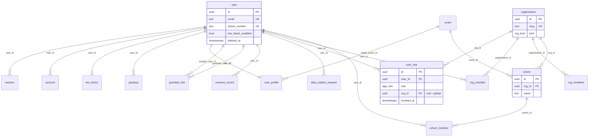

### 2.2 Catalogue & content

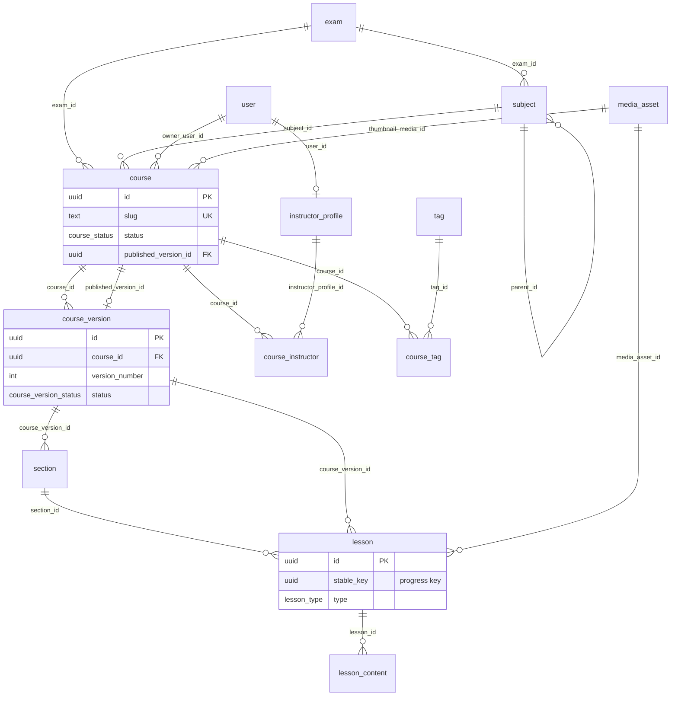

### 2.3 Assessment (question bank & test forms)

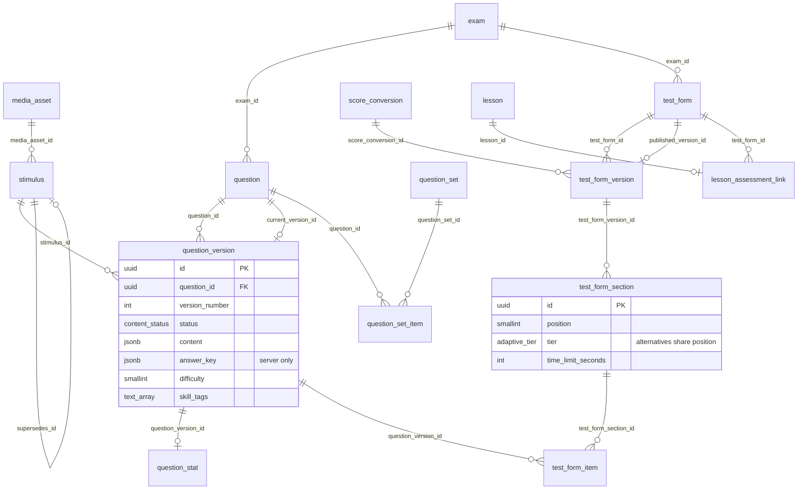

### 2.4 Exam engine & evaluation

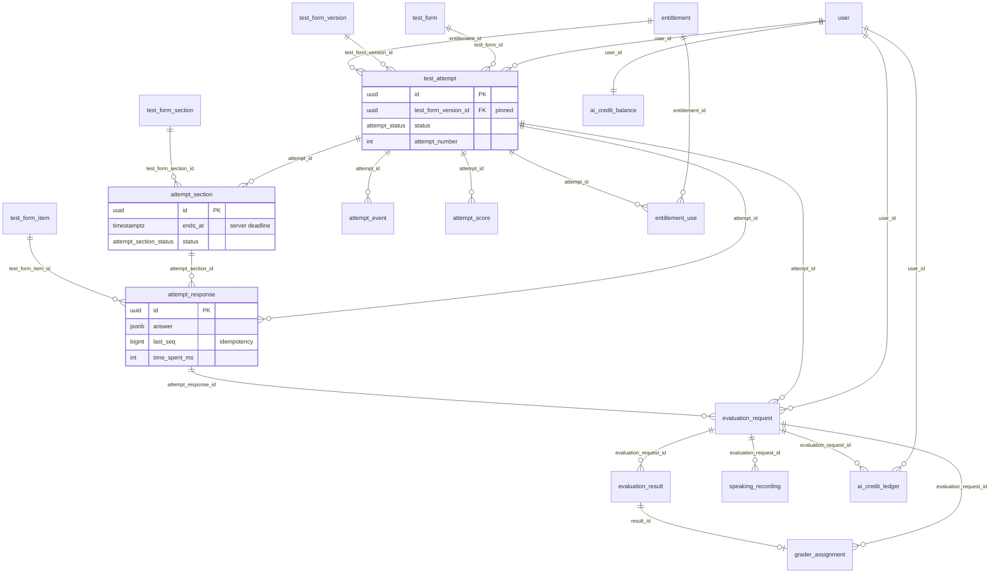

### 2.5 Learning

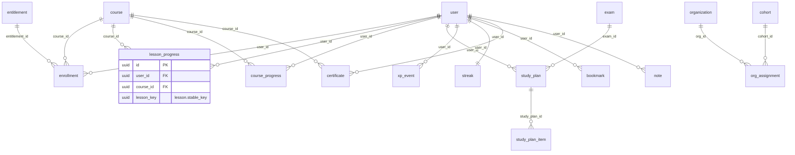

### 2.6 Commerce

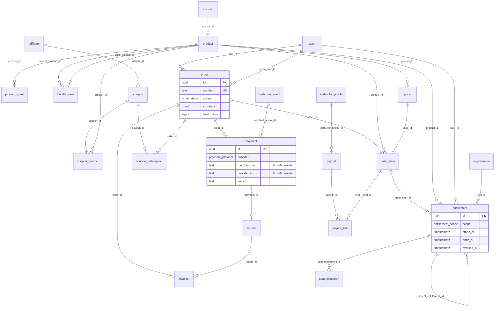

### 2.7 Community, notifications, audit, system

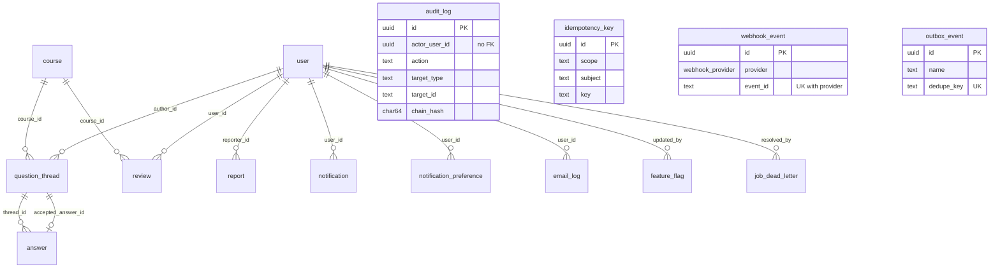

### 2.8 Commerce extensions (regions, instalments, scholarships, partners, services)

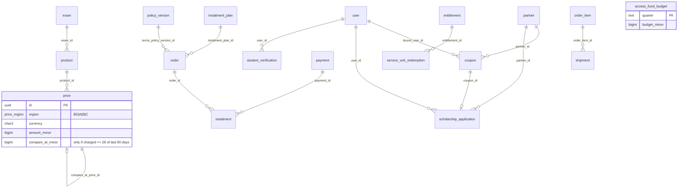

### 2.9 AI learning (retrieval, tutor, FSRS, study assets, notebooks)

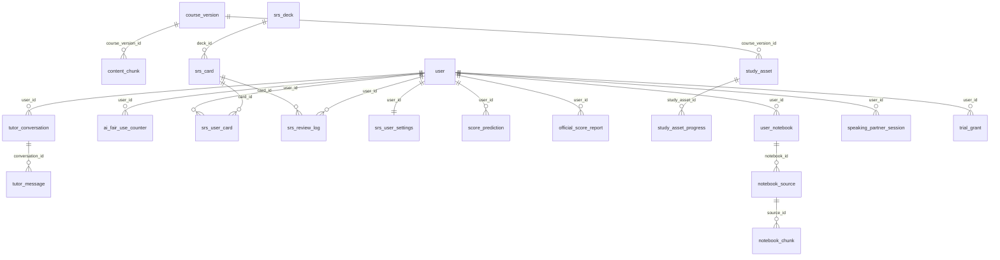

### 2.10 Support, disputes, guarantees, accommodations

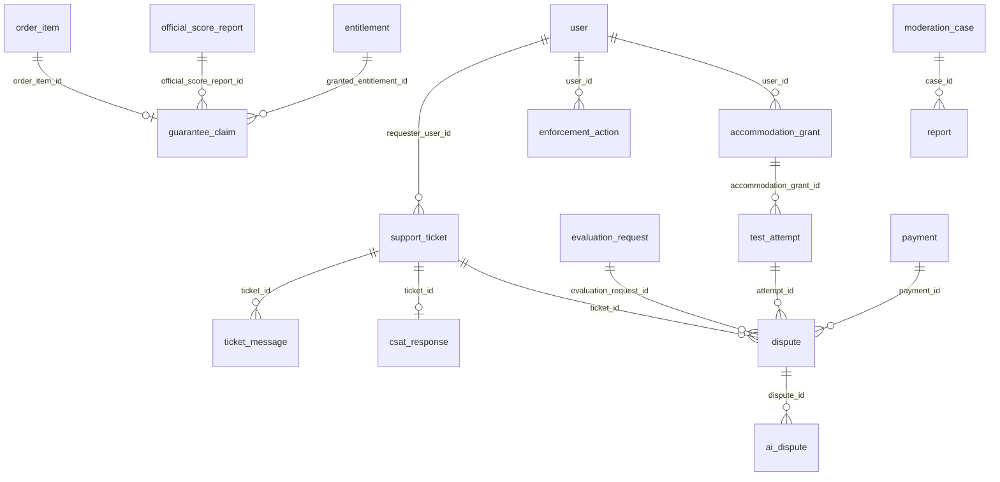

### 2.11 Finance (ledger, settlement, payouts)

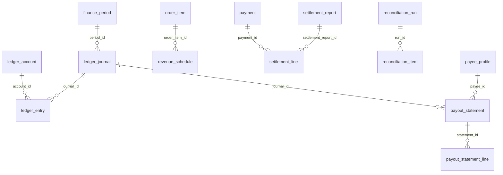

### 2.12 AI operations and admissions

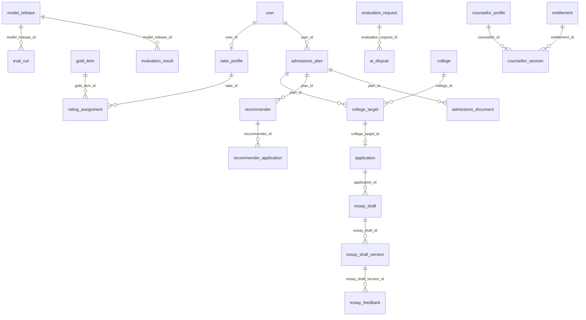

---

## 3. Domain notes (read before the code)

### 3.1 Better Auth mapping (identity)

* Tables `user`, `session`, `account`, `verification`, `two_factor`, `passkey`, `rate_limit` are the Better Auth core + plugin tables. **TS property names equal Better Auth field names** (the Drizzle adapter maps by key, e.g. `credentialID`, `emailVerified`); DB columns are snake_case. Pass the whole schema: `drizzleAdapter(db, { provider: 'pg', schema })`.
* Plugins assumed: `admin`, `twoFactor`, `passkey`, `phoneNumber`, `emailOTP`, `organization`, `anonymous` (guest free-diagnostic attempts; `onLinkAccount` re-parents `test_attempt`/`evaluation_request` rows to the real user), `bearer` (mobile, P3), `rateLimit({ storage: 'database' })`.
* **Confirm with the generator, do not trust this file blindly:** `pnpm dlx @better-auth/cli generate --config packages/auth/src/auth.ts --output tooling/.tmp/ba.generated.ts`. CI job `auth-schema-drift` regenerates and diffs the *set of column names per table* against `identity.ts`/`organizations.ts`; any column Better Auth wants that we lack fails the build. Extra Lumen columns on `user` (`deleted_at`, `anonymized_at`, `last_seen_at`) are declared in `user.additionalFields` (`input: false`).
* Config that makes the mapping work:
  ```ts
  betterAuth({
    database: drizzleAdapter(db, { provider: 'pg', schema }),
    advanced: { database: { generateId: () => uuidv7() } },
    plugins: [
      organization({ schema: { organization: { modelName: 'organization' },
                               member: { modelName: 'orgMember' },
                               invitation: { modelName: 'orgInvitation' } } }),
      admin({ /* we use Lumen RBAC; keep plugin only for ban + impersonation primitives */ }),
      phoneNumber({ signUpOnVerification: { getTempEmail: (p) => `${p.replace('+', '')}@phone.lumen.invalid`,
                                            getTempName: (p) => p } }),
      /* twoFactor, passkey, emailOTP, bearer */
    ],
    session: { expiresIn: 60 * 60 * 24 * 30 /* 30-day idle (sliding); 90-day absolute cap enforced in a hook */, updateAge: 60 * 60 * 24 /* rotation */ },
    account: { encryptOAuthTokens: true },
  })
  ```
* `user.role` (admin plugin) is **not** used for authorization and stays `'user'`. **Authoritative roles are `user_role`.** The admin plugin's `impersonateUser` endpoint is disabled (`disabledPaths`) and replaced by `support.startImpersonation` (read-only, reason required, audited, 30-minute session with `session.impersonated_by` set).
* Phone-only sign-ups get a placeholder email on the reserved `.invalid` TLD; `isPlaceholderEmail(email)` (`endsWith('@phone.lumen.invalid')`) gates all email sending.
* Student sessions (D7): 30-day idle (sliding `expiresIn`) and 90-day absolute (a `session.update.before`/`resolveActor` check rejects sessions whose `created_at` is older than 90 days). Staff sessions: 12 h absolute (D7) enforced by overriding `expiresAt` when any non-student/non-guardian role is held (incl. `instructor`, `org_admin`); `session.create.before` hook reads `user_role`.
* `org_member.role` / `org_invitation.role` are informational mirrors; **a role change is only real when `user_role` changes** (`grantRole` service updates both in one transaction).

### 3.2 RBAC

`user_role` rows are additive, soft-revoked (`revoked_at`) for history. A `student` row is inserted at sign-up. Staff roles (`grader` and above) **plus `instructor`, `counsellor` and `org_admin`** (D4, updated 2026-11-07; `counsellor` sits between `finance` and `org_admin` in the role enum) require `user.two_factor_enabled = true`; `resolveActor()` drops staff roles from the `Actor` when 2FA is not enabled/verified in the session. `org_admin` rows require `org_id` (CHECK). `guest` is never persisted as a role: an anonymous visitor taking the free diagnostic is a real `user` row with `is_anonymous = true` and **no** `user_role` rows; `resolveActor` maps it to the `guest` role plus ownership of its own attempt. The permission map (`resource:action` → roles + ownership predicate) lives in `packages/auth/src/permissions.ts` (generated from the matrix in `06-API-AND-SERVICES.md` §9).

### 3.3 Versioning and `lesson.stable_key`

`course_version` → `section`/`lesson` rows are **cloned** when a new draft is created from the published version (new `id`s, same `stable_key`s). Learner state (`lesson_progress`, `course_progress.last_lesson_key`, `bookmark`, `note`, `question_thread.lesson_key`, `study_plan_item.lesson_key`) stores `(course_id, lesson_key)` and therefore survives edits/re-publishing. There is deliberately **no FK** on `lesson_key` (it is not unique across versions); integrity is validated in services on write and by a nightly orphan report. This is the only structural FK exception besides `report.target_id`.

### 3.4 Test forms and adaptivity (contract for the test-engine doc)

* `test_form` = identity/commercial flags; `test_form_version` = immutable content; `test_form_section` rows with the **same `position`** are alternatives (`tier` low/medium/high) among which adaptive routing chooses; `test_form_item` pins `question_version_id`.
* IELTS Academic / GT: linear, `adaptive_mode = 'none'`, one section per position (`tier IS NULL`). Listening: `allow_back_navigation = false`. Speaking is a section with `skill='speaking'`, items of type `speaking_part1..3`, answered with recordings.
* GRE: `adaptive_mode = 'section_level'`; position 1 = AWA; 2 = Verbal-1; 3 = Quant-1; 4 = Verbal-2 (3 tiers); 5 = Quant-2 (3 tiers) (order configurable). `adaptive_rules` (schema_version 1): `{"routes":[{"fromPosition":2,"targetPosition":4,"measure":"verbal","metric":"raw_pct","thresholds":[{"lt":0.4,"tier":"low"},{"lt":0.75,"tier":"medium"},{"lte":1,"tier":"high"}]},{"fromPosition":3,"targetPosition":5,"measure":"quant",...}]}`. When the learner submits the `fromPosition` section the server computes the metric, writes `attempt_section.chosen_tier/routing_basis` for the target position, and creates the target `attempt_section` pointing at the chosen `test_form_section`.
* Scores: objective items scored by `scoreAttempt`; `attempt_score` rows for each section/skill/overall; writing/speaking/AWA scored asynchronously via `evaluation_*` and merged by inserting superseding `attempt_score` rows (`is_complete=true`).

### 3.5 Entitlement model (contract for commerce & access)

`entitlement` is the only access source (D5). Scopes: `course` (course_id), `test_form` (test_form_id), `exam_tests` (all mock tests of an exam; may carry `uses_total` for test packs), `exam_all` (courses + tests + AI features for one exam), `all_content` (pass), `org_seats` (B2B pool; holder is the org), `live_batch` (P2). Access resolution is in `packages/core/entitlements/resolve.ts` (`hasAccess(userId, resource)`) and implements exactly the predicate in §6.R6. Free content: `course.is_free`/`test_form.is_free`/`lesson.is_free_preview` are checked *before* entitlements; enrolling in a free course still inserts a `source='free'` entitlement so reporting and revocation are uniform.

### 3.6 Regions, price book and the reference-price rule (D12 C14, C16, C25)

`price` rows are never edited. A change closes the current window (`valid_to`) and inserts a new row, so the table is the price history. Uniqueness of windows is per `(product, region, currency, price_book)` (§5.3). `compare_at_minor` may be set only if that exact amount was **actually charged for at least 28 consecutive days within the last 90 days**; `compare_at_price_id` points at the earlier row that proves it and the service re-checks against paid `order_item`s (`assertGenuineCompareAt`). It is never an anchor for a launch price and never set on a product under a price experiment. The YAML price book in 17 §13 carries no `compare_at`; the seed loads it as `NULL`.

### 3.7 Instalments, scholarships, partners (D10, 17 §7–§8)

* **Instalments** (`instalment_plan`, `instalment`): only for Live, Mentor and standalone batches, 2–3 parts at offsets 0/30/60 days. An unpaid part sets `entitlement.paused_at` on that order's `live_batch` and `service_units` entitlements after a 3-day grace; library access is never locked. Payment of the part clears the pause; after 14 days overdue the order lapses.
* **Scholarships** (`scholarship_application`, `access_fund_budget`, `partner`, `student_verification`): approval creates one account-bound single-use `coupon` (`mechanism='scholarship'`, 50/75/100 %) funded by `funded_by`; quota per quarter; one scholarship per person (`identity_hash`); evidence in private R2 with the retention in §7.2/§8.
* **Services and counted human units**: `human_review_credits` and `service` products grant `service_units` entitlements (`unit_kind`, `uses_total`); every use writes a `service_unit_redemption` row in the same transaction as the decrement. `service` rows with `extend_days` extend the matching entitlement instead.
* **Physical books**: `physical_book` products need a `shipment` (COD allowed, Bangladesh only); address and phone are envelope-encrypted.

### 3.8 AI credits, fair use and guarantees (D12 C1, C13, C22, C27, C28, C30)

* One integer `ai_credit` pool; `ai_credit_ledger` is append-only and every row has an idempotency key. Free-tier grants are ledger `bonus` rows. Credits are charged for evaluations (writing/speaking) and study-asset generation only; tutor chat and speaking partner are metered per day in `ai_fair_use_counter`.
* **Refund eligibility** (C28): `within 7 days ∧ max(% lessons, % included AI credits used, % included mocks taken) < 20 % ∧ ≤ 1 full mock`; the verdict and inputs are stored in `refund.consumption`.
* **Guarantees** (C13/C13b): `guarantee_claim.kind` = `target_promise` (Plus: extension) or `progress_promise` (Mentor: free re-enrolment). Eligible full mocks are counted by `v_promise_full_mocks` (§5.6), which excludes voided sections and counts a form once.
* **Void flow** (C30, GA-007): a section interrupted by connection loss > 2 min in exam mode may be voided once per attempt by the learner (`void_kind='self_serve'`), additionally by support/admin; the replacement `attempt_section` points back with `reissued_from_section_id`; whole attempts are voided with `test_attempt.voided_*`.

### 3.9 Pointers to doc-specific design notes

Ledger/journal rules: 30 §4–§6 (summarised in R28). Rater and gold-set protocol: 31. Notification decision ledger: 29 §8. Support tiers and SLAs: 27. Admissions workflow: 21. Retrieval and tutor: 34.

---

## 4. Schema by domain

All files live in `packages/db/src/schema/`. Dependency order (no import cycles): `enums` → `_shared` → `taxonomy` → `identity` → `organizations` → `rbac` → `catalog` → `assessment` → `system` → `commerce` → `exam-engine` → `evaluation` → `learning` → `community` → `notifications` → `audit` → `ai-learning` → `support` → `finance` → `ai-ops` → `admissions` → `analytics` → `index`. `seat_allocation` (logically organisations) lives in `commerce.ts`; `lesson_assessment_link` (logically catalog) lives in `assessment.ts`; both for cycle avoidance.

### 4.0 Shared helpers & enums

```ts
// packages/db/src/schema/_shared.ts
import { sql } from 'drizzle-orm';
import { bigint, char, smallint, timestamp, uuid } from 'drizzle-orm/pg-core';
import { uuidv7 } from 'uuidv7';

/** UUIDv7 primary key generated app-side (time-ordered => index-friendly). */
export const pk = () =>
  uuid('id')
    .primaryKey()
    .$defaultFn(() => uuidv7());

/** timestamptz, JS Date mode. */
export const tstz = (name: string) => timestamp(name, { withTimezone: true, mode: 'date' });

export const createdAtCol = () => tstz('created_at').notNull().defaultNow();
export const updatedAtCol = () =>
  tstz('updated_at')
    .notNull()
    .defaultNow()
    .$onUpdate(() => new Date());

/** Spread into every mutable table: `...timestamps()` */
export const timestamps = () => ({ createdAt: createdAtCol(), updatedAt: updatedAtCol() });

/** Money: minor units as bigint (mode number is safe to 9e15 minor units) + ISO-4217 currency. */
export const amountMinor = (name = 'amount_minor') => bigint(name, { mode: 'number' });
export const currencyCol = (name = 'currency') => char(name, { length: 3 });

/** Versioned jsonb payload marker; pair with a jsonb column and a zod discriminated union per version. */
export const schemaVersionCol = (name = 'schema_version') => smallint(name).notNull().default(1);

/** SQL helpers for CHECK constraints. */
export const isIso4217 = (col: string) => sql.raw(`${col} ~ '^[A-Z]{3}$'`);
```

```ts
// packages/db/src/schema/enums.ts
import { pgEnum } from 'drizzle-orm/pg-core';

/* ---------- identity / rbac / orgs ---------- */
export const appRoleEnum = pgEnum('app_role', [
  'student', 'guardian', 'instructor', 'grader', 'content_editor',
  'support', 'finance', 'counsellor', 'org_admin', 'admin', 'super_admin',
]); // `guest` is never persisted. `counsellor` added by D4 (2026-11-07; admissions services, 21); 2FA mandatory.
export const appLocaleEnum = pgEnum('app_locale', ['en', 'bn']);
export const ageBandEnum = pgEnum('age_band', ['under_13', '13_15', '16_17', '18_plus']);
export const consentStatusEnum = pgEnum('consent_status', ['pending', 'granted', 'declined', 'revoked', 'expired']);
export const consentKindEnum = pgEnum('consent_kind', [
  'terms', 'privacy', 'marketing', 'ai_processing', 'recording_retention', 'analytics_cookies',
  // 26 §19.3 (policy acceptance): honour code before exam-mode attempts, live-class conduct, guardian flows, EU/UK digital-content waiver, refund-policy acknowledgement, community rules
  'honour_code', 'live_conduct', 'guardian_minor_use', 'guardian_admissions_share', 'admissions_authorship',
  'digital_content_waiver', 'refund_policy_ack', 'community_rules',
  // 29 §8.1 (channel consents; evidence for opt-in/opt-out)
  'sms_service', 'whatsapp_messages', 'push_notifications', 'email_product_updates_eu',
  // 31 (gold-set / calibration research use; this is also the explicit consent that extends audio retention beyond 90 days, D12 C6) and 34 (notebook upload terms)
  'research_use', 'notebook_terms',
]);
export const dsrKindEnum = pgEnum('dsr_kind', ['export', 'delete']);
export const dsrStatusEnum = pgEnum('dsr_status', ['requested', 'cooling_off', 'processing', 'completed', 'cancelled', 'failed']);
export const orgKindEnum = pgEnum('org_kind', ['coaching_centre', 'university', 'school', 'company']);
export const orgStatusEnum = pgEnum('org_status', ['active', 'suspended', 'closed']);
export const cohortRoleEnum = pgEnum('cohort_role', ['student', 'mentor']);

/* ---------- catalog ---------- */
export const examCategoryEnum = pgEnum('exam_category', ['english_proficiency', 'graduate_admission', 'tech', 'university']);
export const courseStatusEnum = pgEnum('course_status', ['draft', 'published', 'archived']);
export const courseVersionStatusEnum = pgEnum('course_version_status', ['draft', 'in_review', 'published', 'archived']);
export const courseLevelEnum = pgEnum('course_level', ['beginner', 'intermediate', 'advanced', 'all_levels']);
export const lessonTypeEnum = pgEnum('lesson_type', ['video', 'article', 'quiz', 'practice_set', 'live_session', 'resource', 'code_notebook']);
export const mediaKindEnum = pgEnum('media_kind', ['video', 'audio', 'image', 'document', 'caption', 'other']);
export const mediaStatusEnum = pgEnum('media_status', ['pending_upload', 'processing', 'ready', 'failed']);
export const instructorStatusEnum = pgEnum('instructor_status', ['pending', 'approved', 'suspended']);
export const cmsPageKindEnum = pgEnum('cms_page_kind', ['blog', 'landing', 'legal', 'help']);
export const publishStatusEnum = pgEnum('publish_status', ['draft', 'published', 'archived']);

/* ---------- assessment ---------- */
export const skillAreaEnum = pgEnum('skill_area', ['listening', 'reading', 'writing', 'speaking', 'verbal', 'quant', 'awa', 'general']);
export const questionTypeEnum = pgEnum('question_type', [
  'mcq_single', 'mcq_multi', 'true_false_not_given', 'yes_no_not_given', 'matching', 'matching_headings',
  'sentence_completion', 'summary_completion', 'table_completion', 'short_answer', 'diagram_label',
  'numeric_entry', 'gre_quant_comparison', 'gre_text_completion', 'gre_sentence_equivalence', 'gre_reading_multi',
  'writing_task', 'awa_issue', 'awa_argument', 'speaking_part1', 'speaking_part2', 'speaking_part3',
]);
export const contentStatusEnum = pgEnum('content_status', ['draft', 'in_review', 'published', 'retired']);
export const stimulusKindEnum = pgEnum('stimulus_kind', ['reading_passage', 'listening_audio', 'chart_image', 'data_table', 'cue_card', 'text']);
export const licenseKindEnum = pgEnum('license_kind', ['original', 'licensed', 'public_domain']);
export const testFormKindEnum = pgEnum('test_form_kind', ['full_mock', 'section_test', 'diagnostic', 'practice']);
export const adaptiveModeEnum = pgEnum('adaptive_mode', ['none', 'section_level']);
export const adaptiveTierEnum = pgEnum('adaptive_tier', ['low', 'medium', 'high']);

/* ---------- exam engine ---------- */
export const attemptStatusEnum = pgEnum('attempt_status', ['not_started', 'in_progress', 'paused', 'submitted', 'expired', 'scored', 'voided']);   // voided: whole attempt voided by support/admin (D12 C30)
export const attemptModeEnum = pgEnum('attempt_mode', ['exam', 'practice']);
export const attemptSectionStatusEnum = pgEnum('attempt_section_status', ['not_started', 'in_progress', 'submitted', 'expired', 'voided']);   // voided: GA-007 / C30 self-serve once per attempt
export const annotationKindEnum = pgEnum('annotation_kind', ['highlight', 'note']);
export const attemptEventTypeEnum = pgEnum('attempt_event_type', [
  'attempt_started', 'attempt_resumed', 'attempt_paused', 'section_started', 'section_submitted', 'section_expired',
  'item_viewed', 'navigated', 'flagged', 'unflagged', 'focus_lost', 'focus_gained', 'fullscreen_exit',
  'offline', 'online', 'heartbeat_gap', 'late_write_rejected', 'time_extended', 'attempt_submitted',
  'section_voided', 'section_reissued', 'attempt_voided',   // D12 C30 / GA-007
]);
export const scoreScopeEnum = pgEnum('score_scope', ['overall', 'section', 'skill']);
export const scoredByEnum = pgEnum('scored_by', ['system', 'ai', 'human']);

/* ---------- evaluation ---------- */
export const evaluationKindEnum = pgEnum('evaluation_kind', ['writing', 'speaking', 'awa']);
export const evaluationModeEnum = pgEnum('evaluation_mode', ['ai', 'human', 'ai_then_human']);
export const evaluationStatusEnum = pgEnum('evaluation_status', ['queued', 'processing', 'awaiting_review', 'completed', 'failed', 'cancelled']);
export const evaluationSourceEnum = pgEnum('evaluation_source', ['ai', 'human']);
export const recordingStatusEnum = pgEnum('recording_status', ['pending_upload', 'uploaded', 'transcribing', 'transcribed', 'failed', 'deleted']);
export const graderAssignmentStatusEnum = pgEnum('grader_assignment_status', ['assigned', 'in_progress', 'completed', 'reassigned', 'expired']);
export const creditReasonEnum = pgEnum('credit_reason', ['purchase', 'consume', 'refund_return', 'admin_grant', 'admin_debit', 'bonus', 'reversal']);

/* ---------- learning ---------- */
export const enrollmentStatusEnum = pgEnum('enrollment_status', ['active', 'completed', 'suspended', 'expired']);
export const progressStatusEnum = pgEnum('progress_status', ['not_started', 'in_progress', 'completed']);
export const studyPlanStatusEnum = pgEnum('study_plan_status', ['active', 'paused', 'completed', 'abandoned']);
export const studyPlanItemTypeEnum = pgEnum('study_plan_item_type', ['lesson', 'test', 'practice', 'review', 'evaluation']);
export const studyPlanItemStatusEnum = pgEnum('study_plan_item_status', ['pending', 'done', 'skipped', 'missed']);
export const xpEventTypeEnum = pgEnum('xp_event_type', ['lesson_completed', 'test_completed', 'evaluation_reviewed', 'daily_goal', 'streak_bonus', 'review_written']);
export const assignmentKindEnum = pgEnum('assignment_kind', ['course', 'test_form']);

/* ---------- commerce ---------- */
export const productKindEnum = pgEnum('product_kind', [
  'course', 'bundle', 'test_pack', 'ai_credits', 'pass', 'live_batch', 'org_seat_pack',
  'human_review_credits',   // D5 (2026-11-07): essay reviews / speaking mocks / 1:1 sessions / club slots (counted units, NOT ai_credit)
  'service',                // D5: admissions & counselling packages, extensions, certificate re-issue
  'physical_book',          // D5: shipped goods; COD allowed; BD only
]);
export const productStatusEnum = pgEnum('product_status', ['draft', 'active', 'archived']);
export const priceIntervalEnum = pgEnum('price_interval', ['one_time', 'month', 'year']);
export const discountTypeEnum = pgEnum('discount_type', ['percent', 'fixed']);
export const couponStatusEnum = pgEnum('coupon_status', ['active', 'paused', 'expired']);
export const redemptionStatusEnum = pgEnum('redemption_status', ['reserved', 'applied', 'released']);
export const orderStatusEnum = pgEnum('order_status', ['pending', 'paid', 'failed', 'cancelled', 'expired', 'partially_refunded', 'refunded']);
export const paymentProviderEnum = pgEnum('payment_provider', ['sslcommerz', 'bkash', 'paddle', 'stripe', 'manual', 'cod']);   // cod: cash-on-delivery for physical_book (17 §6)
export const paymentStatusEnum = pgEnum('payment_status', ['initiated', 'pending', 'succeeded', 'failed', 'cancelled', 'expired', 'risk_hold', 'disputed']);
export const refundStatusEnum = pgEnum('refund_status', ['requested', 'approved', 'processing', 'succeeded', 'rejected', 'failed']);
export const entitlementScopeEnum = pgEnum('entitlement_scope', ['course', 'test_form', 'exam_tests', 'exam_all', 'all_content', 'org_seats', 'live_batch', 'service_units']);   // service_units: counted human-delivered units (entitlement.unit_kind)
export const entitlementSourceEnum = pgEnum('entitlement_source', [
  'purchase', 'free', 'org_seat', 'admin_grant', 'support_extension', 'promo', 'bundle', 'subscription', 'migration',
  'trial',                // 7-day Plus trial (34 §9; no card)
  'guarantee_extension',  // Target Promise 3-month extension / Progress Promise re-enrolment (D12 C13/C13b)
  'scholarship',          // Access programme (17 §8)
  'partner_code',         // partner / UDC / NGO cohort codes (17 §8)
]);
export const invoiceKindEnum = pgEnum('invoice_kind', ['invoice', 'credit_note']);
export const invoiceStatusEnum = pgEnum('invoice_status', ['draft', 'issued', 'void']);
export const payoutStatusEnum = pgEnum('payout_status', ['pending', 'approved', 'paid', 'failed', 'on_hold']);
export const affiliateStatusEnum = pgEnum('affiliate_status', ['pending', 'active', 'suspended']);

/* ---------- community / notifications / system ---------- */
export const threadStatusEnum = pgEnum('thread_status', ['open', 'answered', 'resolved', 'hidden']);
export const reviewStatusEnum = pgEnum('review_status', ['pending', 'published', 'hidden']);
export const reportTargetEnum = pgEnum('report_target', ['thread', 'answer', 'review', 'user', 'live_message', 'ticket_attachment', 'external_group_post']);   // last three: 27 §19
export const reportStatusEnum = pgEnum('report_status', ['open', 'actioned', 'dismissed']);
export const notificationChannelEnum = pgEnum('notification_channel', ['in_app', 'email', 'sms', 'push', 'whatsapp']);   // whatsapp: P2 outbound templates (29 §8.1; P1 = support intake only)
export const notificationCategoryEnum = pgEnum('notification_category', ['transactional', 'security', 'learning', 'billing', 'marketing', 'community']);
export const emailStatusEnum = pgEnum('email_status', ['queued', 'sent', 'delivered', 'bounced', 'complained', 'failed', 'suppressed']);
export const actorTypeEnum = pgEnum('actor_type', ['user', 'system', 'webhook']);
export const webhookProviderEnum = pgEnum('webhook_provider', ['sslcommerz', 'paddle', 'stripe', 'bunny', 'resend', 'whatsapp', 'sms', 'chatwoot', 'other']);   // whatsapp/sms: 29 §8.3; chatwoot: helpdesk webhook (27 C29)
export const webhookStatusEnum = pgEnum('webhook_status', ['received', 'processing', 'processed', 'failed', 'ignored']);
export const idempotencyStatusEnum = pgEnum('idempotency_status', ['in_progress', 'completed']);
export const dlqStatusEnum = pgEnum('dlq_status', ['open', 'retried', 'discarded']);


/* ---------- consolidation additions (D12 / docs 16–34; see §4.0) ---------- */
export const guaranteeKindEnum = pgEnum('guarantee_kind', ['target_promise', 'progress_promise']);   // Plus / Mentor (D12 C13)
export const accommodationStatusEnum = pgEnum('accommodation_status', ['active', 'expired', 'revoked']);
export const digitPrefEnum = pgEnum('digit_pref', ['latn', 'beng']);   // 33: Latin digits default; Bangla digits only on opt-in
export const policyKindEnum = pgEnum('policy_kind', ['terms', 'privacy', 'cookies', 'refund', 'progress_promise', 'ai_scoring', 'acceptable_use', 'trademark_notice', 'community_guidelines', 'live_conduct', 'creator_terms', 'admissions_terms', 'accessibility', 'copyright', 'dpa']);
export const policyStatusEnum = pgEnum('policy_status', ['draft', 'counsel_review', 'approved', 'published', 'retired']);
export const creatorAgreementKindEnum = pgEnum('creator_agreement_kind', ['per_asset', 'lead_instructor_royalty', 'grader', 'item_writer', 'counsellor']);
export const productTierEnum = pgEnum('product_tier', ['free', 'core', 'plus', 'live', 'crash', 'mentor']);   // D10
export const priceRegionEnum = pgEnum('price_region', ['BD', 'A', 'B', 'C']);   // D12 C16: BD = BDT; A/B/C = USD bands
export const vatClassEnum = pgEnum('vat_class', ['standard', 'reduced', 'exempt', 'zero_rated', 'out_of_scope']);
export const couponMechanismEnum = pgEnum('coupon_mechanism', ['coupon', 'campaign', 'partner', 'scholarship', 'referral', 'early_bird', 'group', 'bundle', 'student']);
export const serviceUnitKindEnum = pgEnum('service_unit_kind', ['essay_review', 'speaking_mock', 'one_to_one_45', 'club_slot', 'counsellor_session', 'admissions_package', 'certificate_reissue', 'other']);
export const partnerKindEnum = pgEnum('partner_kind', ['udc', 'ngo', 'bmet_ttc', 'university', 'school', 'employer', 'community_group', 'other']);
export const partnerStatusEnum = pgEnum('partner_status', ['pending', 'active', 'paused', 'ended']);
export const instalmentStatusEnum = pgEnum('instalment_status', ['scheduled', 'due', 'paid', 'overdue', 'waived', 'cancelled']);
export const scholarshipBasisEnum = pgEnum('scholarship_basis', ['documented_need', 'partner_verified', 'partner_nominated', 'access_fund_sponsor', 'hsc_scholar']);
export const scholarshipStatusEnum = pgEnum('scholarship_status', ['submitted', 'in_review', 'waitlisted', 'approved', 'activated', 'rejected', 'revoked', 'expired']);
export const fundingSourceEnum = pgEnum('funding_source', ['access_fund', 'partner', 'founder_grant', 'sponsor', 'marketing']);
export const studentVerificationMethodEnum = pgEnum('student_verification_method', ['edu_email', 'ac_bd_email', 'student_id']);
export const studentVerificationStatusEnum = pgEnum('student_verification_status', ['pending', 'verified', 'rejected', 'expired']);
export const shipmentStatusEnum = pgEnum('shipment_status', ['pending', 'packed', 'handed_over', 'in_transit', 'delivered', 'returned', 'cancelled', 'failed']);

export const appSystemEnum = pgEnum('app_system', ['common_app', 'ucas', 'direct', 'ouac', 'uni_assist', 'grad_portal', 'other']);
export const applicationLevelEnum = pgEnum('application_level', ['undergraduate', 'masters', 'phd', 'other']);
export const admitPlanEnum = pgEnum('admit_plan', ['ed', 'ed2', 'ea', 'rea', 'rd', 'rolling', 'other']);
export const targetBandEnum = pgEnum('target_band', ['reach', 'target', 'safety', 'unclassified']);
export const applicationStatusEnum = pgEnum('application_status', ['planned', 'in_progress', 'submitted', 'decision_received', 'withdrawn']);
export const decisionEnum = pgEnum('decision_result', ['admitted', 'waitlisted', 'deferred', 'denied', 'withdrawn']);
export const essayKindEnum = pgEnum('essay_kind', ['personal_statement', 'supplement', 'additional_info', 'sop', 'ucas_q1', 'ucas_q2', 'ucas_q3', 'scholarship', 'other']);
export const draftStatusEnum = pgEnum('draft_status', ['drafting', 'feedback_requested', 'in_review', 'final']);
export const recommenderRoleEnum = pgEnum('recommender_role', ['counselor', 'teacher', 'professor', 'employer', 'other']);
export const recommenderStatusEnum = pgEnum('recommender_status', ['planned', 'asked', 'agreed', 'submitted', 'declined']);
export const docKindEnum = pgEnum('document_kind', ['transcript', 'translation', 'passport', 'test_report', 'financial', 'cv', 'recommendation_brief', 'other']);
export const docStatusEnum = pgEnum('document_status', ['needed', 'in_progress', 'uploaded', 'verified_by_counsellor', 'submitted']);
export const feedbackSourceEnum = pgEnum('feedback_source', ['ai', 'human']);
export const counsellorSessionStatusEnum = pgEnum('counsellor_session_status', ['booked', 'completed', 'cancelled_student', 'cancelled_counsellor', 'no_show']);
export const supportTierEnum = pgEnum('support_tier', ['free', 'core', 'plus', 'live', 'crash', 'mentor', 'org']);
export const ticketChannelEnum = pgEnum('ticket_channel', ['in_app', 'email', 'whatsapp', 'messenger', 'phone', 'web_form', 'system']);
export const ticketStatusEnum = pgEnum('ticket_status', ['new', 'open', 'pending_customer', 'pending_internal', 'on_hold', 'resolved', 'closed', 'spam']);
export const ticketPriorityEnum = pgEnum('ticket_priority', ['p0', 'p1', 'p2', 'p3']);
export const ticketDirectionEnum = pgEnum('ticket_direction', ['inbound', 'outbound', 'internal_note', 'system']);
export const moderationStatusEnum = pgEnum('moderation_status', ['open', 'in_review', 'actioned', 'dismissed', 'appealed', 'appeal_upheld', 'appeal_rejected']);
export const moderationActionEnum = pgEnum('moderation_action', ['none', 'hide', 'remove', 'warn_user', 'mute_user', 'suspend_user', 'ban_user', 'escalate_safeguarding', 'escalate_legal']);
export const disputeKindEnum = pgEnum('dispute_kind', ['score', 'exam_technical', 'payment_card', 'payment_wallet']);
export const disputeStatusEnum = pgEnum('dispute_status', ['opened', 'triage', 'human_review', 'evidence_gathering', 'submitted_to_provider', 'decided', 'closed', 'reopened']);
export const disputeOutcomeEnum = pgEnum('dispute_outcome', ['upheld', 'partially_upheld', 'rejected', 'won', 'lost', 'withdrawn']);
export const guaranteeStatusEnum = pgEnum('guarantee_status', ['draft', 'submitted', 'under_review', 'approved', 'rejected', 'appealed', 'reenrolled', 'extended', 'expired', 'withdrawn']);   // merged 27 + 34 (Target Promise -> extended, Progress Promise -> reenrolled)
export const enforcementKindEnum = pgEnum('enforcement_kind', ['nudge', 'warning', 'limit', 'suspend', 'terminate', 'reinstate']);
export const dispatchStatusEnum = pgEnum('dispatch_status', ['sent', 'deferred', 'skipped', 'suppressed', 'dropped', 'failed']);
export const suppressionReasonEnum = pgEnum('suppression_reason',
  ['hard_bounce', 'complaint', 'unsubscribe', 'sms_stop', 'wa_stop', 'invalid_number', 'deleted', 'manual']);
export const ledgerAccountTypeEnum = pgEnum('ledger_account_type', ['asset', 'liability', 'equity', 'revenue', 'cost_of_revenue', 'expense', 'other']);
export const journalStatusEnum = pgEnum('journal_status', ['posted', 'reversed']);
export const periodStatusEnum = pgEnum('finance_period_status', ['open', 'closing', 'closed']);
export const settlementReportStatusEnum = pgEnum('settlement_report_status', ['uploaded', 'parsed', 'matched', 'posted', 'rejected']);
export const reconRunKindEnum = pgEnum('reconciliation_run_kind', ['integrity', 'provider_daily', 'settlement', 'bank', 'month_end']);
export const reconItemKindEnum = pgEnum('reconciliation_item_kind', [
  'paid_not_fulfilled', 'fulfilled_not_paid', 'duplicate_payment', 'duplicate_purchase', 'amount_mismatch',
  'fee_variance', 'settlement_unmatched_provider', 'settlement_unmatched_system', 'bank_unmatched', 'unsettled_aged',
  'refund_stuck', 'chargeback', 'missing_invoice', 'journal_imbalance', 'credit_balance_drift', 'other']);
export const reconItemStatusEnum = pgEnum('reconciliation_item_status', ['open', 'investigating', 'resolved', 'written_off']);
export const engagementTypeEnum = pgEnum('engagement_type', ['asset_fee', 'royalty', 'grader_item', 'rater_item', 'hourly', 'bonus', 'partner_commission', 'other']);
export const payoutMethodEnum = pgEnum('payout_method', ['bank', 'bkash', 'nagad', 'foreign_remittance']);
export const payoutStatementStatusEnum = pgEnum('payout_statement_status', ['draft', 'sent_for_review', 'disputed', 'approved_pending', 'approved', 'paid', 'failed', 'void']);   // maker-checker: finance prepares (draft -> sent_for_review -> approved_pending), admin approves
export const taskFamilyEnum = pgEnum('task_family', ['ielts_t1_academic', 'ielts_t1_gt', 'ielts_t2', 'gre_awa_issue', 'ielts_speaking']);
export const goldSplitEnum = pgEnum('gold_split', ['dev', 'locked_test', 'anchor', 'unassigned']);
export const goldItemStatusEnum = pgEnum('gold_item_status', ['collected', 'in_rating', 'adjudication', 'labelled', 'rejected', 'withdrawn']);
export const ratingModeEnum = pgEnum('rating_mode', ['qualification', 'gold', 'audit', 'anchor_training', 'dispute']);
export const releaseStatusEnum = pgEnum('model_release_status', ['draft', 'dev_passed', 'locked_passed', 'shadow', 'canary', 'live', 'ready_standby', 'retired', 'failed']);
export const evalRunKindEnum = pgEnum('eval_run_kind', ['smoke', 'dev_full', 'locked', 'canary', 'shadow', 'suite']);
export const evalVerdictEnum = pgEnum('eval_verdict', ['pass', 'pass_with_warnings', 'fail', 'running']);
export const aiDisputeStatusEnum = pgEnum('ai_dispute_status', ['open', 'triaged', 'in_regrade', 'upheld', 'revised', 'rejected', 'withdrawn']);
export const chunkSourceEnum   = pgEnum('chunk_source', ['lesson_text', 'lesson_transcript', 'question_explanation', 'vocab_card', 'study_asset']);
export const tutorModeEnum     = pgEnum('tutor_mode', ['explain', 'check_reasoning', 'hint', 'vocab', 'study_help']);
export const tutorOutcomeEnum  = pgEnum('tutor_outcome', ['ok', 'no_grounding', 'blocked_exam_mode', 'refused_exam_leak', 'refused_injection', 'refused_off_topic', 'refused_band_claim', 'safety_escalation', 'provider_error']);
export const srsStateEnum      = pgEnum('srs_state', ['new', 'learning', 'review', 'relearning']);
export const srsRatingEnum     = pgEnum('srs_rating', ['again', 'hard', 'good', 'easy']);
export const studyAssetKindEnum   = pgEnum('study_asset_kind', ['audio_overview', 'mind_map', 'study_guide', 'briefing', 'faq', 'quiz', 'video_overview']);
export const studyAssetStatusEnum = pgEnum('study_asset_status', ['draft', 'in_review', 'published', 'stale', 'retired']);
export const sourceStatusEnum  = pgEnum('notebook_source_status', ['uploading', 'scanning', 'indexing', 'ready', 'rejected', 'deleted']);
export const trialStatusEnum   = pgEnum('trial_status', ['active', 'expired', 'converted', 'revoked']);
```

### 4.1 Taxonomy — `taxonomy.ts` (catalogue reference data)

| Table | Purpose | Key constraints & indexes | Retention |
|---|---|---|---|
| `exam` | Exams we teach/test: `IELTS_ACADEMIC`, `IELTS_GT`, `GRE`, `PTE`, `DET`, `TOEFL`, tech/university tracks. Carries the score scale used for "estimated" labelling. | UQ `code` (`^[A-Z0-9_]+$`); `score_max > score_min`. | Permanent (archive via `status`). |
| `subject` | Track/subject/topic tree (self-referencing). | UQ `slug`; FK indexes on `parent_id`, `exam_id`. | Permanent. |
| `tag` | Free taxonomy (skill, topic, grammar, vocab). | UQ `slug`. | Permanent. |

```ts
// packages/db/src/schema/taxonomy.ts
import { sql } from 'drizzle-orm';
import { type AnyPgColumn, boolean, check, index, integer, numeric, pgTable, smallint, text, uniqueIndex, uuid } from 'drizzle-orm/pg-core';
import {
  examCategoryEnum, publishStatusEnum,
} from './enums';
import { pk, timestamps } from './_shared';

/** Reference data. No FKs to other domains so identity/profile can depend on it without cycles. */
export const exam = pgTable('exam', {
  id: pk(),
  code: text('code').notNull(),                 // IELTS_ACADEMIC | IELTS_GT | GRE | PTE | DET | TOEFL | ...
  category: examCategoryEnum('category').notNull(),
  nameEn: text('name_en').notNull(),
  nameBn: text('name_bn'),
  scoreUnit: text('score_unit').notNull(),      // 'band' | 'scaled'
  scoreMin: numeric('score_min', { precision: 6, scale: 1 }).notNull(),
  scoreMax: numeric('score_max', { precision: 6, scale: 1 }).notNull(),
  scoreStep: numeric('score_step', { precision: 4, scale: 1 }).notNull().default('0.5'),
  status: publishStatusEnum('status').notNull().default('draft'),
  disclaimerKey: text('disclaimer_key'),        // i18n key for trademark / "estimated" disclaimer
  sortOrder: smallint('sort_order').notNull().default(0),
  ...timestamps(),
}, (t) => [
  uniqueIndex('exam_code_uq').on(t.code),
  check('exam_code_fmt', sql`${t.code} ~ '^[A-Z0-9_]+$'`),
  check('exam_score_range', sql`${t.scoreMax} > ${t.scoreMin}`),
]);

/** Tracks / subjects / topics tree (e.g. "Machine Learning" > "Supervised learning"). */
export const subject = pgTable('subject', {
  id: pk(),
  parentId: uuid('parent_id').references((): AnyPgColumn => subject.id, { onDelete: 'restrict' }),
  examId: uuid('exam_id').references(() => exam.id, { onDelete: 'set null' }),
  slug: text('slug').notNull(),
  kind: text('kind').notNull().default('subject'),   // 'track' | 'subject' | 'topic'
  nameEn: text('name_en').notNull(),
  nameBn: text('name_bn'),
  sortOrder: smallint('sort_order').notNull().default(0),
  isActive: boolean('is_active').notNull().default(true),
  ...timestamps(),
}, (t) => [
  uniqueIndex('subject_slug_uq').on(t.slug),
  index('subject_parent_idx').on(t.parentId),
  index('subject_exam_idx').on(t.examId),
]);

export const tag = pgTable('tag', {
  id: pk(),
  slug: text('slug').notNull(),
  kind: text('kind').notNull().default('topic'),     // 'skill' | 'topic' | 'grammar' | 'vocab' | 'cefr' | 'subtype' (16 R1; open set, zod-validated)
  nameEn: text('name_en').notNull(),
  nameBn: text('name_bn'),
  usageCount: integer('usage_count').notNull().default(0),
  ...timestamps(),
}, (t) => [uniqueIndex('tag_slug_uq').on(t.slug)]);
```

### 4.2 Identity — `identity.ts`

| Table | Purpose | Key constraints & indexes | Retention |
|---|---|---|---|
| `user` | Better Auth user. Login identifiers + ban flags. | UQ `email`, UQ `lower(email)`, partial UQ `phone_number`; `deleted_at` partial idx. | Life of account; on deletion **anonymised, not removed** (financial FKs are `RESTRICT`). |
| `session` | DB-backed sessions (cookie token). | UQ `token`; idx `user_id`, `expires_at`. | Delete rows expired > 7 days (daily job). `ip_address/user_agent` die with the row. |
| `account` | OAuth/credential links. | UQ `(provider_id, account_id)`. | With user. Tokens encrypted (`encryptOAuthTokens`). |
| `verification` | OTP/magic-link/verification tokens. | idx `identifier`, `expires_at`. | Delete expired after 24 h. |
| `two_factor` | TOTP secret + backup codes. | UQ `user_id`. | With user. |
| `passkey` | WebAuthn credentials. | UQ `credential_id`. | With user. |
| `rate_limit` | Better Auth rate-limit counters (auth endpoints only). | UQ `key`. | Delete `last_request` older than 1 day. |
| `user_profile` | Learner/instructor profile: display name, locale, **digit preference (`latn`/`beng`, 33 §6.2)**, "explain in Bangla" toggle (33 §11.4), age band, target exam/score/date, contact phone (encrypted), marketing opt-in, staff `support_level` (27). | UQ `user_id`; CHECK: minors cannot opt in to marketing (D7); CHECK `support_level` ∈ `l1|l2|lead`. | With user; hard-deleted on erasure. |
| `guardian_link` | (+ `consent_policy_version_id`, 26) Parent ↔ student link with consent state machine `pending → granted | declined | revoked | expired`. Guardian powers (progress, receipts, pay) require `status='granted'`. | Partial UQ open links `(student, lower(guardian_email))`; partial UQ invite token hash; CHECK not self. | While active + 3 years after revocation (consent evidence); email nulled on erasure. |
| `policy_version` | **(26 §19.3)** One row per `(kind, locale, version)` of every legal text: hash of the rendered MDX, effective/notice dates, material/re-accept flags, counsel sign-off id. Text itself lives in the repo (`packages/content/legal`). | UQ `(kind, locale, version)`; partial UQ one **published** row per `(kind, locale)`; CHECK published ⇒ sign-off + approval. | **Permanent** (past versions stay viewable at `/legal/<kind>/v/<version>`). |
| `consent_record` | Immutable consent/acceptance ledger (terms, privacy, marketing, AI processing, recording retention, cookies, **honour code, live conduct, guardian flows, waivers, channel consents, research use** — see `consent_kind`). Latest per `(user, kind)` wins. Rows now carry the **policy version**, locale, source and method (26 §19.3 + 29 §8.4 merged: this table *is* the `policy_acceptance` record; no second table). Withdrawal appends `granted=false`; never updated. | idx `(user_id, kind, created_at)`; idx `policy_version_id`; CHECK `source`/`method` in allowed sets. | 5 years after last entry (evidence); anonymised with user. |
| `cookie_consent_event` | **(26 §19.3)** Guest/visitor cookie-choice proof (HMAC of the consent cookie id; no raw IP). | idx `(visitor_hash, created_at)`; idx policy version. | **24 months**. |
| `creator_agreement` | **(26 §19.3)** Signed instructor / lead-royalty / grader / item-writer / counsellor agreements (PDF in private R2; P1 signed off-platform); royalty bps (D12 C19: default 1000 = 10% of net on own course). | idx `(user_id, kind)`; CHECK royalty 0–10000. | Contract life + 7 years; `tax_profile_enc` finance-only. |
| `data_subject_request` | Export/delete requests and their execution state. | Partial UQ: one open request per `(user, kind)`. | 3 years (compliance evidence). |

```ts
// packages/db/src/schema/identity.ts
import { sql } from 'drizzle-orm';
import { bigint, boolean, char, check, date, index, integer, jsonb, numeric, pgTable, smallint, text, uniqueIndex, uuid } from 'drizzle-orm/pg-core';
import {
  ageBandEnum, appLocaleEnum, consentKindEnum, consentStatusEnum, creatorAgreementKindEnum,
  digitPrefEnum, dsrKindEnum, dsrStatusEnum, policyKindEnum, policyStatusEnum,
} from './enums';
import { createdAtCol, pk, timestamps, tstz, updatedAtCol } from './_shared';
import { exam } from './taxonomy';

/* =====================================================================
 * Better Auth core + plugin tables.
 * TS property names MUST equal Better Auth field names (the Drizzle adapter maps by key);
 * DB column names are snake_case. Re-verify with:
 *   pnpm dlx @better-auth/cli generate --config packages/auth/src/auth.ts --output /tmp/ba.generated.ts
 * and diff column sets (CI job `auth-schema-drift`).
 * Plugins assumed: admin, twoFactor, passkey, phoneNumber, emailOTP, organization, bearer, rateLimit(database).
 * ===================================================================== */

export const user = pgTable('user', {
  id: pk(),
  name: text('name').notNull(),
  email: text('email').notNull(),                       // phone-only signups get a placeholder `<e164>@phone.lumen.invalid`
  emailVerified: boolean('email_verified').notNull().default(false),
  image: text('image'),
  // phoneNumber plugin
  phoneNumber: text('phone_number'),
  phoneNumberVerified: boolean('phone_number_verified').notNull().default(false),
  // twoFactor plugin
  twoFactorEnabled: boolean('two_factor_enabled').notNull().default(false),
  // admin plugin (its `role` is NOT used for authorization; see user_role). Keep default 'user'.
  role: text('role').notNull().default('user'),
  banned: boolean('banned').notNull().default(false),
  banReason: text('ban_reason'),
  banExpires: tstz('ban_expires'),
  // anonymous plugin: guests taking the free diagnostic get an anonymous user (linked to the real user on sign-up)
  isAnonymous: boolean('is_anonymous').notNull().default(false),
  // Lumen extensions (must be declared in Better Auth `user.additionalFields` if read via the auth API)
  deletedAt: tstz('deleted_at'),                        // set at delete-request execution; row is anonymised, not removed
  anonymizedAt: tstz('anonymized_at'),
  lastSeenAt: tstz('last_seen_at'),
  createdAt: createdAtCol(),
  updatedAt: updatedAtCol(),
}, (t) => [
  uniqueIndex('user_email_uq').on(t.email),
  uniqueIndex('user_email_lower_uq').on(sql`lower(${t.email})`),
  uniqueIndex('user_phone_uq').on(t.phoneNumber).where(sql`${t.phoneNumber} is not null`),
  index('user_created_idx').on(t.createdAt),
  index('user_anonymous_idx').on(t.createdAt).where(sql`${t.isAnonymous}`),
  index('user_deleted_idx').on(t.deletedAt).where(sql`${t.deletedAt} is not null`),
]);

export const session = pgTable('session', {
  id: pk(),
  userId: uuid('user_id').notNull().references(() => user.id, { onDelete: 'cascade' }),
  token: text('token').notNull(),
  expiresAt: tstz('expires_at').notNull(),
  ipAddress: text('ip_address'),
  userAgent: text('user_agent'),
  impersonatedBy: uuid('impersonated_by').references(() => user.id, { onDelete: 'set null' }), // admin plugin
  activeOrganizationId: uuid('active_organization_id'),                                       // organization plugin (soft ref, no FK to avoid cycle)
  createdAt: createdAtCol(),
  updatedAt: updatedAtCol(),
}, (t) => [
  uniqueIndex('session_token_uq').on(t.token),
  index('session_user_idx').on(t.userId),
  index('session_expires_idx').on(t.expiresAt),
  index('session_impersonated_by_idx').on(t.impersonatedBy).where(sql`${t.impersonatedBy} is not null`),
]);

export const account = pgTable('account', {
  id: pk(),
  userId: uuid('user_id').notNull().references(() => user.id, { onDelete: 'cascade' }),
  accountId: text('account_id').notNull(),              // provider's user id ('credential' => user id)
  providerId: text('provider_id').notNull(),            // 'google' | 'credential' | ...
  accessToken: text('access_token'),
  refreshToken: text('refresh_token'),
  idToken: text('id_token'),
  accessTokenExpiresAt: tstz('access_token_expires_at'),
  refreshTokenExpiresAt: tstz('refresh_token_expires_at'),
  scope: text('scope'),
  password: text('password'),                           // argon2id/scrypt hash (Better Auth); null for OAuth/OTP-only
  createdAt: createdAtCol(),
  updatedAt: updatedAtCol(),
}, (t) => [
  uniqueIndex('account_provider_uq').on(t.providerId, t.accountId),
  index('account_user_idx').on(t.userId),
]);

export const verification = pgTable('verification', {
  id: pk(),
  identifier: text('identifier').notNull(),
  value: text('value').notNull(),
  expiresAt: tstz('expires_at').notNull(),
  createdAt: createdAtCol(),
  updatedAt: updatedAtCol(),
}, (t) => [
  index('verification_identifier_idx').on(t.identifier),
  index('verification_expires_idx').on(t.expiresAt),
]);

export const twoFactor = pgTable('two_factor', {
  id: pk(),
  userId: uuid('user_id').notNull().references(() => user.id, { onDelete: 'cascade' }),
  secret: text('secret').notNull(),                     // encrypted by Better Auth with BETTER_AUTH_SECRET
  backupCodes: text('backup_codes').notNull(),          // encrypted JSON array
}, (t) => [uniqueIndex('two_factor_user_uq').on(t.userId)]);

export const passkey = pgTable('passkey', {
  id: pk(),
  name: text('name'),
  publicKey: text('public_key').notNull(),
  userId: uuid('user_id').notNull().references(() => user.id, { onDelete: 'cascade' }),
  credentialID: text('credential_id').notNull(),
  counter: bigint('counter', { mode: 'number' }).notNull(),
  deviceType: text('device_type').notNull(),
  backedUp: boolean('backed_up').notNull(),
  transports: text('transports'),
  aaguid: text('aaguid'),
  createdAt: createdAtCol(),
}, (t) => [
  uniqueIndex('passkey_credential_uq').on(t.credentialID),
  index('passkey_user_idx').on(t.userId),
]);

/** Better Auth `rateLimit.storage = 'database'` table (auth endpoints only; app routes use system.rate_limit_bucket). */
export const rateLimit = pgTable('rate_limit', {
  id: pk(),
  key: text('key').notNull(),
  count: integer('count').notNull(),
  lastRequest: bigint('last_request', { mode: 'number' }).notNull(),
}, (t) => [uniqueIndex('rate_limit_key_uq').on(t.key)]);

/* =====================================================================
 * Lumen identity tables
 * ===================================================================== */

export const userProfile = pgTable('user_profile', {
  id: pk(),
  userId: uuid('user_id').notNull().references(() => user.id, { onDelete: 'cascade' }),
  displayName: text('display_name').notNull(),
  locale: appLocaleEnum('locale').notNull().default('en'),
  timezone: text('timezone').notNull().default('Asia/Dhaka'),
  country: char('country', { length: 2 }),                     // ISO 3166-1 alpha-2
  ageBand: ageBandEnum('age_band'),                            // self-declared; null until onboarding
  contactPhoneEnc: text('contact_phone_enc'),                  // app-level envelope encryption (AES-256-GCM); NOT the login phone
  contactPhoneHash: char('contact_phone_hash', { length: 64 }),// HMAC-SHA256 blind index for lookup
  targetExamId: uuid('target_exam_id').references(() => exam.id, { onDelete: 'set null' }),
  targetScore: numeric('target_score', { precision: 5, scale: 1 }),   // band (0-9) or scaled score per exam.score_unit
  examDate: date('exam_date', { mode: 'string' }),
  dailyGoalMinutes: smallint('daily_goal_minutes').notNull().default(30),
  marketingOptIn: boolean('marketing_opt_in').notNull().default(false),         // CACHED latest marketing consent; consent_record(kind='marketing') is the evidence (29 §8.3)
  digitPref: digitPrefEnum('digit_pref').notNull().default('latn'),             // 33 §6.2 / F-ACC-08: 'beng' only when the user opts in; exam shell, invoices, OTPs are always Latin
  explainInBangla: boolean('explain_in_bangla').notNull().default(false),       // 33 §11.4: AI feedback summary/tips in Bangla (error spans and rewrites stay English)
  supportLevel: text('support_level'),                                           // staff only: 'l1' | 'l2' | 'lead' (27 §19.2; caps on extensions/refunds)
  onboardingCompletedAt: tstz('onboarding_completed_at'),
  ...timestamps(),
}, (t) => [
  uniqueIndex('user_profile_user_uq').on(t.userId),
  index('user_profile_target_exam_idx').on(t.targetExamId),
  index('user_profile_phone_hash_idx').on(t.contactPhoneHash).where(sql`${t.contactPhoneHash} is not null`),
  check('user_profile_target_score_chk', sql`${t.targetScore} is null or ${t.targetScore} >= 0`),
  check('user_profile_marketing_minor_chk', sql`${t.ageBand} not in ('under_13','13_15','16_17') or ${t.marketingOptIn} = false`),
  check('user_profile_support_level_chk', sql`${t.supportLevel} is null or ${t.supportLevel} in ('l1','l2','lead')`),
]);

/** One row per (kind, locale, version). Text lives in the repo (MDX); the DB holds identity, hash, dates and approval. */
export const policyVersion = pgTable('policy_version', {
  id: pk(),
  kind: policyKindEnum('kind').notNull(),
  locale: appLocaleEnum('locale').notNull(),
  version: text('version').notNull(),                         // 'terms-2026-11-01'; equals consent_record.document_version
  status: policyStatusEnum('status').notNull().default('draft'), // draft | counsel_review | approved | published | retired
  isMaterial: boolean('is_material').notNull().default(false),
  requiresReacceptance: boolean('requires_reacceptance').notNull().default(false),
  noticeStartsAt: tstz('notice_starts_at'),                   // >= 30 days before effective_at when material
  effectiveAt: tstz('effective_at'),
  retiredAt: tstz('retired_at'),
  contentHash: char('content_hash', { length: 64 }).notNull(), // sha256 of rendered MDX body
  sourcePath: text('source_path').notNull(),                  // packages/content/legal/terms/2026-11-01.en.mdx
  changeSummaryEn: text('change_summary_en'),
  changeSummaryBn: text('change_summary_bn'),
  signoffId: text('signoff_id'),                              // 'LEG-terms-2026-11-01' -> docs/legal/signoffs/
  approvedBy: uuid('approved_by').references(() => user.id, { onDelete: 'set null' }),
  approvedAt: tstz('approved_at'),
  ...timestamps(),
}, (t) => [
  uniqueIndex('policy_version_uq').on(t.kind, t.locale, t.version),
  uniqueIndex('policy_version_current_uq').on(t.kind, t.locale).where(sql`${t.status} = 'published' and ${t.retiredAt} is null`),
  index('policy_version_approved_by_idx').on(t.approvedBy),
  check('policy_version_published_signoff_chk', sql`${t.status} <> 'published' or (${t.signoffId} is not null and ${t.approvedAt} is not null)`),
]);

/** Guests and logged-in visitors: proof of cookie choice (consent_record requires a user). Retain 24 months. */
export const cookieConsentEvent = pgTable('cookie_consent_event', {
  id: pk(),
  visitorHash: char('visitor_hash', { length: 64 }).notNull(),   // HMAC of the lumen-consent cookie id; no raw IP
  userId: uuid('user_id').references(() => user.id, { onDelete: 'set null' }),
  policyVersionId: uuid('policy_version_id').notNull().references(() => policyVersion.id, { onDelete: 'restrict' }),
  bannerVersion: text('banner_version').notNull(),
  analytics: boolean('analytics').notNull(),
  region: char('region', { length: 2 }),
  createdAt: createdAtCol(),
}, (t) => [
  index('cookie_consent_event_visitor_idx').on(t.visitorHash, t.createdAt),
  index('cookie_consent_event_user_idx').on(t.userId).where(sql`${t.userId} is not null`),
  index('cookie_consent_event_policy_idx').on(t.policyVersionId),
]);

/** Signed creator/grader/counsellor agreements (P1: signed off-platform, PDF in private R2). */
export const creatorAgreement = pgTable('creator_agreement', {
  id: pk(),
  userId: uuid('user_id').notNull().references(() => user.id, { onDelete: 'restrict' }),
  kind: creatorAgreementKindEnum('kind').notNull(),             // per_asset | lead_instructor_royalty | grader | item_writer | counsellor
  templateVersion: text('template_version').notNull(),
  signedAt: tstz('signed_at').notNull(),
  endedAt: tstz('ended_at'),
  royaltyBps: smallint('royalty_bps'),                           // 1000 = 10% (D12 C19)
  documentR2Key: text('document_r2_key').notNull(),
  taxProfileEnc: text('tax_profile_enc'),                        // envelope-encrypted JSON {tin?, withholding?, country}; P3 secret class, finance-only (D7)
  taxProfileSchemaVersion: smallint('tax_profile_schema_version').notNull().default(1),
  ...timestamps(),
}, (t) => [
  index('creator_agreement_user_idx').on(t.userId, t.kind),
  check('creator_agreement_royalty_chk', sql`${t.royaltyBps} is null or ${t.royaltyBps} between 0 and 10000`),
]);


export const guardianLink = pgTable('guardian_link', {
  id: pk(),
  studentUserId: uuid('student_user_id').notNull().references(() => user.id, { onDelete: 'cascade' }),
  guardianUserId: uuid('guardian_user_id').references(() => user.id, { onDelete: 'cascade' }), // null until invitee signs up
  guardianEmail: text('guardian_email').notNull(),             // lower-cased; invitation target
  relationship: text('relationship'),                          // 'mother' | 'father' | 'other'
  status: consentStatusEnum('status').notNull().default('pending'),
  consentMethod: text('consent_method'),                       // 'student_confirm' | 'guardian_otp' | 'org'
  canViewProgress: boolean('can_view_progress').notNull().default(true),
  canViewReceipts: boolean('can_view_receipts').notNull().default(true),
  canPay: boolean('can_pay').notNull().default(true),
  inviteTokenHash: char('invite_token_hash', { length: 64 }),
  requestedAt: tstz('requested_at').notNull().defaultNow(),
  grantedAt: tstz('granted_at'),
  revokedAt: tstz('revoked_at'),
  expiresAt: tstz('expires_at'),                               // pending invites expire in 14 days
  consentPolicyVersionId: uuid('consent_policy_version_id').references(() => policyVersion.id, { onDelete: 'restrict' }),   // 26 §19.3: guardian-use terms accepted
  ...timestamps(),
}, (t) => [
  index('guardian_link_policy_version_idx').on(t.consentPolicyVersionId),
  index('guardian_link_student_idx').on(t.studentUserId),
  index('guardian_link_guardian_idx').on(t.guardianUserId),
  uniqueIndex('guardian_link_open_uq').on(t.studentUserId, sql`lower(${t.guardianEmail})`).where(sql`${t.status} in ('pending','granted')`),
  uniqueIndex('guardian_link_token_uq').on(t.inviteTokenHash).where(sql`${t.inviteTokenHash} is not null`),
  check('guardian_link_not_self', sql`${t.guardianUserId} is null or ${t.guardianUserId} <> ${t.studentUserId}`),
]);

/** Immutable consent ledger (terms / privacy / marketing / AI processing ...). Latest row per (user, kind) wins. */
export const consentRecord = pgTable('consent_record', {
  id: pk(),
  userId: uuid('user_id').notNull().references(() => user.id, { onDelete: 'cascade' }),
  kind: consentKindEnum('kind').notNull(),
  documentVersion: text('document_version').notNull(),         // e.g. 'privacy-2026-11-01'
  granted: boolean('granted').notNull(),
  givenByUserId: uuid('given_by_user_id').references(() => user.id, { onDelete: 'set null' }), // guardian for minors
  ipHash: char('ip_hash', { length: 64 }),                     // HMAC of IP, never raw
  /** 26 §19.3: exact legal text accepted. `document_version` (text) is kept = policy_version.version for backwards compatibility until backfilled. */
  policyVersionId: uuid('policy_version_id').references(() => policyVersion.id, { onDelete: 'restrict' }),
  locale: appLocaleEnum('locale'),                             // locale of the text shown
  /** Where the choice was made. Merged vocabulary of 26 (`context`) and 29 (`source`). */
  source: text('source'),                                      // 'signup' | 'checkout' | 'reaccept' | 'exam_start' | 'banner' | 'guardian_flow' | 'settings' | 'unsubscribe_link' | 'wa_stop' | 'sms_stop' | 'import' | 'live_enrolment' | 'admissions_draft'
  method: text('method'),                                      // 'checkbox' | 'otp' | 'link' | 'banner' | 'org' | 'reply_stop' | 'import'
  /** Per-order waivers/acknowledgements (EU/UK digital-content waiver, refund_policy_ack). Soft reference: `order` is defined later in commerce.ts; FK added in 0006_deferred_fks.sql. */
  orderId: uuid('order_id'),
  createdAt: createdAtCol(),
}, (t) => [
  index('consent_record_user_kind_idx').on(t.userId, t.kind, t.createdAt),
  index('consent_record_given_by_idx').on(t.givenByUserId).where(sql`${t.givenByUserId} is not null`),
  index('consent_record_policy_version_idx').on(t.policyVersionId).where(sql`${t.policyVersionId} is not null`),
  index('consent_record_order_idx').on(t.orderId).where(sql`${t.orderId} is not null`),
  check('consent_record_source_chk', sql`${t.source} is null or ${t.source} ~ '^[a-z_]+$'`),
]);

/** GDPR/PDPA-style data subject requests: export & delete. */
export const dataSubjectRequest = pgTable('data_subject_request', {
  id: pk(),
  userId: uuid('user_id').notNull().references(() => user.id, { onDelete: 'cascade' }),
  kind: dsrKindEnum('kind').notNull(),
  status: dsrStatusEnum('status').notNull().default('requested'),
  requestedByUserId: uuid('requested_by_user_id').references(() => user.id, { onDelete: 'set null' }),
  executeAfter: tstz('execute_after'),                         // delete: requested_at + 14 days cooling-off
  completedAt: tstz('completed_at'),
  exportR2Key: text('export_r2_key'),                          // encrypted zip, 7-day signed URL (re-auth required; 26 X3 resolved: 7 days)
  exportExpiresAt: tstz('export_expires_at'),
  failureReason: text('failure_reason'),
  report: jsonb('report').$type<{ tables: Record<string, number> }>(),   // row counts erased/anonymised; no PII
  reportSchemaVersion: smallint('report_schema_version').notNull().default(1),
  ...timestamps(),
}, (t) => [
  index('dsr_user_idx').on(t.userId),
  index('dsr_requested_by_idx').on(t.requestedByUserId),
  index('dsr_due_idx').on(t.status, t.executeAfter),
  uniqueIndex('dsr_open_uq').on(t.userId, t.kind).where(sql`${t.status} in ('requested','cooling_off','processing')`),
]);
```

### 4.3 Organisations — `organizations.ts` (+ `seat_allocation` in commerce)

| Table | Purpose | Key constraints & indexes | Retention |
|---|---|---|---|
| `organization` | Institution (coaching centre/university/school/company); Better Auth organization model. | UQ `slug`. | Permanent; `status='closed'` instead of delete. |
| `org_member` | Membership (Better Auth `member`). | Partial UQ `(organization_id, user_id) WHERE removed_at IS NULL`. | 2 years after removal. |
| `org_invitation` | Pending invites (Better Auth `invitation`). | idx `(organization_id, status)`, `lower(email)`. | Delete 90 days after expiry/acceptance. |
| `cohort` | Class/batch inside an org. | Partial UQ `(org_id, name) WHERE archived_at IS NULL`. | Permanent. |
| `cohort_member` | Learner/mentor in a cohort. | Partial UQ active `(cohort_id, user_id)`. | 2 years after leaving. |
| `seat_allocation` | Which user occupies which seat of an `org_seats` entitlement. See §4.9. | Partial UQ `(seat_entitlement_id, user_id) WHERE released_at IS NULL`. | 2 years after release. |

```ts
// packages/db/src/schema/organizations.ts
import { sql } from 'drizzle-orm';
import { char, date, index, pgTable, text, uniqueIndex, uuid } from 'drizzle-orm/pg-core';
import {
  cohortRoleEnum, orgKindEnum, orgStatusEnum,
} from './enums';
import { createdAtCol, pk, timestamps, tstz } from './_shared';
import { exam } from './taxonomy';
import { user } from './identity';

/** Better Auth organization plugin: model `organization`. */
export const organization = pgTable('organization', {
  id: pk(),
  name: text('name').notNull(),
  slug: text('slug').notNull(),
  logo: text('logo'),
  metadata: text('metadata'),                                   // Better Auth stores JSON string; Lumen does not use it
  kind: orgKindEnum('kind').notNull().default('coaching_centre'),
  status: orgStatusEnum('status').notNull().default('active'),
  country: char('country', { length: 2 }).notNull().default('BD'),
  billingEmail: text('billing_email'),
  taxId: text('tax_id'),                                        // BIN / TIN for B2B invoices
  createdBy: uuid('created_by').references(() => user.id, { onDelete: 'set null' }),
  createdAt: createdAtCol(),
  updatedAt: tstz('updated_at').notNull().defaultNow().$onUpdate(() => new Date()),
}, (t) => [
  uniqueIndex('organization_slug_uq').on(t.slug),
  index('organization_created_by_idx').on(t.createdBy),
  index('organization_status_idx').on(t.status),
]);

/**
 * Better Auth organization plugin `member` model, remapped:
 *   organization({ schema: { member: { modelName: 'orgMember' }, invitation: { modelName: 'orgInvitation' } } })
 * `role` here is informational ('owner'|'admin'|'member'); AUTHORIZATION READS user_role ONLY.
 */
export const orgMember = pgTable('org_member', {
  id: pk(),
  organizationId: uuid('organization_id').notNull().references(() => organization.id, { onDelete: 'cascade' }),
  userId: uuid('user_id').notNull().references(() => user.id, { onDelete: 'cascade' }),
  role: text('role').notNull().default('member'),
  externalRef: text('external_ref'),                            // institution's roll number
  createdAt: createdAtCol(),
  removedAt: tstz('removed_at'),
}, (t) => [
  uniqueIndex('org_member_active_uq').on(t.organizationId, t.userId).where(sql`${t.removedAt} is null`),
  index('org_member_user_idx').on(t.userId),
]);

/** Better Auth `invitation` model, remapped to org_invitation. */
export const orgInvitation = pgTable('org_invitation', {
  id: pk(),
  organizationId: uuid('organization_id').notNull().references(() => organization.id, { onDelete: 'cascade' }),
  email: text('email').notNull(),
  role: text('role'),
  status: text('status').notNull().default('pending'),
  expiresAt: tstz('expires_at').notNull(),
  inviterId: uuid('inviter_id').notNull().references(() => user.id, { onDelete: 'cascade' }),
  createdAt: createdAtCol(),
}, (t) => [
  index('org_invitation_org_idx').on(t.organizationId, t.status),
  index('org_invitation_inviter_idx').on(t.inviterId),
  index('org_invitation_email_idx').on(sql`lower(${t.email})`),
]);

export const cohort = pgTable('cohort', {
  id: pk(),
  orgId: uuid('org_id').notNull().references(() => organization.id, { onDelete: 'cascade' }),
  name: text('name').notNull(),
  description: text('description'),
  examId: uuid('exam_id').references(() => exam.id, { onDelete: 'set null' }),
  startsOn: date('starts_on', { mode: 'string' }),
  endsOn: date('ends_on', { mode: 'string' }),
  archivedAt: tstz('archived_at'),
  createdBy: uuid('created_by').references(() => user.id, { onDelete: 'set null' }),
  ...timestamps(),
}, (t) => [
  uniqueIndex('cohort_org_name_uq').on(t.orgId, t.name).where(sql`${t.archivedAt} is null`),
  index('cohort_exam_idx').on(t.examId),
  index('cohort_created_by_idx').on(t.createdBy),
]);

export const cohortMember = pgTable('cohort_member', {
  id: pk(),
  cohortId: uuid('cohort_id').notNull().references(() => cohort.id, { onDelete: 'cascade' }),
  userId: uuid('user_id').notNull().references(() => user.id, { onDelete: 'cascade' }),
  role: cohortRoleEnum('role').notNull().default('student'),
  joinedAt: tstz('joined_at').notNull().defaultNow(),
  leftAt: tstz('left_at'),
}, (t) => [
  uniqueIndex('cohort_member_active_uq').on(t.cohortId, t.userId).where(sql`${t.leftAt} is null`),
  index('cohort_member_user_idx').on(t.userId),
]);

// NOTE: seat_allocation is physically defined in commerce.ts (it references entitlement); logically part of this domain.
```

### 4.4 RBAC — `rbac.ts`

| Table | Purpose | Key constraints & indexes | Retention |
|---|---|---|---|
| `user_role` | Additive role grants; `org_id` null = global role. Permission map is code. | Partial UQ `(user_id, role) WHERE org_id IS NULL AND revoked_at IS NULL`; partial UQ `(user_id, role, org_id)` for org-scoped; CHECK `org_admin ⇒ org_id`. | Forever (history; every change also in `audit_log`). |

```ts
// packages/db/src/schema/rbac.ts
import { sql } from 'drizzle-orm';
import { check, index, pgTable, text, uniqueIndex, uuid } from 'drizzle-orm/pg-core';
import {
  appRoleEnum,
} from './enums';
import { pk, tstz } from './_shared';
import { user } from './identity';
import { organization } from './organizations';

/**
 * Additive role grants. Permission map lives in code (packages/auth/src/permissions.ts).
 * Every user gets a `student` row at sign-up so role resolution is a single indexed query.
 */
export const userRole = pgTable('user_role', {
  id: pk(),
  userId: uuid('user_id').notNull().references(() => user.id, { onDelete: 'cascade' }),
  role: appRoleEnum('role').notNull(),
  orgId: uuid('org_id').references(() => organization.id, { onDelete: 'cascade' }),   // required for org_admin
  grantedBy: uuid('granted_by').references(() => user.id, { onDelete: 'set null' }),  // null => system (sign-up default)
  grantedAt: tstz('granted_at').notNull().defaultNow(),
  revokedAt: tstz('revoked_at'),
  revokedBy: uuid('revoked_by').references(() => user.id, { onDelete: 'set null' }),
  reason: text('reason'),
}, (t) => [
  index('user_role_user_idx').on(t.userId).where(sql`${t.revokedAt} is null`),
  index('user_role_org_idx').on(t.orgId).where(sql`${t.orgId} is not null`),
  index('user_role_granted_by_idx').on(t.grantedBy),
  index('user_role_revoked_by_idx').on(t.revokedBy),
  uniqueIndex('user_role_global_uq').on(t.userId, t.role).where(sql`${t.orgId} is null and ${t.revokedAt} is null`),
  uniqueIndex('user_role_org_uq').on(t.userId, t.role, t.orgId).where(sql`${t.orgId} is not null and ${t.revokedAt} is null`),
  check('user_role_org_admin_needs_org', sql`${t.role} <> 'org_admin' or ${t.orgId} is not null`),
  check('user_role_org_only_org_admin', sql`${t.orgId} is null or ${t.role} in ('org_admin','student','instructor','grader')`),
]);
```

### 4.5 Catalogue & content — `catalog.ts`

| Table | Purpose | Key constraints & indexes | Retention |
|---|---|---|---|
| `instructor_profile` | Public instructor identity + P3 marketplace payout config. | UQ `user_id`, UQ `slug`; share 0–10000 bps. | With user (bio anonymised on erasure; courses keep attribution only if consented). |
| `media_asset` | Every file: Bunny video id or R2 object key, duration, captions (jsonb versioned). | Partial UQ `bunny_video_id`; partial UQ `(r2_bucket, r2_key)`; CHECK storage present once uploaded. | Soft delete → R2/Bunny object purge after 30 days if unreferenced. |
| `course` | Sellable/learnable course identity; pointer to the live version; denormalised card fields + counters; generated `search_tsv`. | UQ `slug`; catalogue partial idx; GIN on `search_tsv`; GIN trigram on titles. | Soft delete; permanent for purchased courses (customers keep access). |
| `course_version` | Immutable-once-published snapshot: `draft → in_review → published → archived`. | UQ `(course_id, version_number)`; partial UQ one open (`draft|in_review`) and one `published` per course. | Keep all published versions; purge abandoned drafts after 180 days. |
| `section` / `lesson` | Ordered tree inside a version, with `stable_key`. | UQ `(course_version_id, stable_key)`; idx `(parent, position)`. Position uniqueness is *not* enforced (set-based reorder in a tx). | With version. |
| `lesson_content` | Tiptap JSON per locale (`schema_version`). | UQ `(lesson_id, locale)`. | With version. |
| `course_instructor` | Co-instructors, TA, P3 revenue share. | UQ `(course_id, instructor_profile_id)`. | With course. |
| `course_tag` | M:N course ↔ tag. | UQ pair. | With course. |
| `cms_page` | Blog/landing/legal/help pages (bilingual). | UQ `(kind, slug, locale)`. | Permanent; legal pages versioned by new rows. |

```ts
// packages/db/src/schema/catalog.ts
import { sql } from 'drizzle-orm';
import { type AnyPgColumn, bigint, boolean, check, customType, index, integer, jsonb, numeric, pgTable, smallint, text, uniqueIndex, uuid } from 'drizzle-orm/pg-core';
import {
  appLocaleEnum, cmsPageKindEnum, courseLevelEnum, courseStatusEnum, courseVersionStatusEnum,
  instructorStatusEnum, lessonTypeEnum, mediaKindEnum, mediaStatusEnum, publishStatusEnum,
} from './enums';
import { pk, schemaVersionCol, timestamps, tstz } from './_shared';
import { exam, subject, tag } from './taxonomy';
import { user } from './identity';

const tsvector = customType<{ data: string }>({ dataType: () => 'tsvector' });

export const instructorProfile = pgTable('instructor_profile', {
  id: pk(),
  userId: uuid('user_id').notNull().references(() => user.id, { onDelete: 'cascade' }),
  slug: text('slug').notNull(),
  headline: text('headline'),
  bioEn: text('bio_en'),
  bioBn: text('bio_bn'),
  status: instructorStatusEnum('status').notNull().default('pending'),
  approvedBy: uuid('approved_by').references(() => user.id, { onDelete: 'set null' }),
  approvedAt: tstz('approved_at'),
  revenueShareBps: smallint('revenue_share_bps').notNull().default(0),   // P3 marketplace; 0 = salaried/in-house
  payoutAccountEnc: text('payout_account_enc'),                           // P3; envelope-encrypted JSON (bank/bKash)
  ...timestamps(),
}, (t) => [
  uniqueIndex('instructor_profile_user_uq').on(t.userId),
  uniqueIndex('instructor_profile_slug_uq').on(t.slug),
  index('instructor_profile_approved_by_idx').on(t.approvedBy),
  check('instructor_profile_share_chk', sql`${t.revenueShareBps} between 0 and 10000`),
]);

/** Every uploaded/managed file. Video bytes live in Bunny Stream; everything else in private R2. */
export const mediaAsset = pgTable('media_asset', {
  id: pk(),
  kind: mediaKindEnum('kind').notNull(),
  status: mediaStatusEnum('status').notNull().default('pending_upload'),
  ownerId: uuid('owner_id').references(() => user.id, { onDelete: 'set null' }),
  bunnyLibraryId: text('bunny_library_id'),
  bunnyVideoId: text('bunny_video_id'),
  r2Bucket: text('r2_bucket'),
  r2Key: text('r2_key'),
  mimeType: text('mime_type'),
  sizeBytes: bigint('size_bytes', { mode: 'number' }),
  sha256: text('sha256'),
  durationMs: integer('duration_ms'),
  width: integer('width'),
  height: integer('height'),
  originalFilename: text('original_filename'),
  /** [{lang:'en'|'bn', label, r2Key, source:'manual'|'auto'}] */
  captions: jsonb('captions').$type<Array<{ lang: string; label: string; r2Key: string; source: 'manual' | 'auto' }>>().notNull().default(sql`'[]'::jsonb`),
  captionsSchemaVersion: schemaVersionCol('captions_schema_version'),
  deletedAt: tstz('deleted_at'),
  ...timestamps(),
}, (t) => [
  uniqueIndex('media_asset_bunny_uq').on(t.bunnyVideoId).where(sql`${t.bunnyVideoId} is not null`),
  uniqueIndex('media_asset_r2_uq').on(t.r2Bucket, t.r2Key).where(sql`${t.r2Key} is not null`),
  index('media_asset_owner_idx').on(t.ownerId),
  index('media_asset_status_idx').on(t.status).where(sql`${t.status} in ('pending_upload','processing')`),
  check('media_asset_storage_chk', sql`${t.bunnyVideoId} is not null or ${t.r2Key} is not null or ${t.status} = 'pending_upload'`),
]);

export const course = pgTable('course', {
  id: pk(),
  slug: text('slug').notNull(),
  status: courseStatusEnum('status').notNull().default('draft'),
  examId: uuid('exam_id').references(() => exam.id, { onDelete: 'set null' }),
  subjectId: uuid('subject_id').references(() => subject.id, { onDelete: 'set null' }),
  ownerUserId: uuid('owner_user_id').notNull().references(() => user.id, { onDelete: 'restrict' }),
  level: courseLevelEnum('level').notNull().default('all_levels'),
  language: text('language').notNull().default('bn'),                  // 'en' | 'bn' | 'bn_en' (mixed)
  isFree: boolean('is_free').notNull().default(false),
  publishedVersionId: uuid('published_version_id').references((): AnyPgColumn => courseVersion.id, { onDelete: 'set null' }),
  // Denormalised from the published version for catalogue queries (refreshed at publish):
  titleEn: text('title_en'),
  titleBn: text('title_bn'),
  summaryEn: text('summary_en'),
  summaryBn: text('summary_bn'),
  thumbnailMediaId: uuid('thumbnail_media_id').references(() => mediaAsset.id, { onDelete: 'set null' }),
  // Denormalised counters (maintained by events, reconciled nightly):
  enrollmentCount: integer('enrollment_count').notNull().default(0),
  ratingCount: integer('rating_count').notNull().default(0),
  ratingAvg: numeric('rating_avg', { precision: 3, scale: 2 }).notNull().default('0'),
  searchTsv: tsvector('search_tsv').generatedAlwaysAs(
    sql`to_tsvector('simple', coalesce(title_en,'') || ' ' || coalesce(title_bn,'') || ' ' || coalesce(summary_en,'') || ' ' || coalesce(summary_bn,''))`,
  ),
  publishedAt: tstz('published_at'),
  deletedAt: tstz('deleted_at'),
  ...timestamps(),
}, (t) => [
  uniqueIndex('course_slug_uq').on(t.slug),
  index('course_exam_idx').on(t.examId),
  index('course_subject_idx').on(t.subjectId),
  index('course_owner_idx').on(t.ownerUserId),
  index('course_published_version_idx').on(t.publishedVersionId),
  index('course_thumbnail_idx').on(t.thumbnailMediaId),
  index('course_catalogue_idx').on(t.examId, t.publishedAt).where(sql`${t.status} = 'published' and ${t.deletedAt} is null`),
  index('course_search_gin').using('gin', t.searchTsv),
  index('course_title_trgm').using('gin', sql`(coalesce(${t.titleEn},'') || ' ' || coalesce(${t.titleBn},'')) gin_trgm_ops`),
  check('course_rating_chk', sql`${t.ratingAvg} between 0 and 5`),
]);

/** Immutable once `published`; edits happen on a new draft version cloned from the published one. */
export const courseVersion = pgTable('course_version', {
  id: pk(),
  courseId: uuid('course_id').notNull().references(() => course.id, { onDelete: 'cascade' }),
  versionNumber: integer('version_number').notNull(),
  status: courseVersionStatusEnum('status').notNull().default('draft'),
  titleEn: text('title_en').notNull(),
  titleBn: text('title_bn'),
  subtitleEn: text('subtitle_en'),
  subtitleBn: text('subtitle_bn'),
  summaryEn: text('summary_en'),
  summaryBn: text('summary_bn'),
  /** Landing-page payload: {outcomes:[], requirements:[], faq:[]} (versioned). */
  landing: jsonb('landing').$type<Record<string, unknown>>().notNull().default(sql`'{}'::jsonb`),
  landingSchemaVersion: schemaVersionCol('landing_schema_version'),
  previewMediaId: uuid('preview_media_id').references(() => mediaAsset.id, { onDelete: 'set null' }),
  changeNote: text('change_note'),
  createdBy: uuid('created_by').notNull().references(() => user.id, { onDelete: 'restrict' }),
  submittedAt: tstz('submitted_at'),
  reviewedBy: uuid('reviewed_by').references(() => user.id, { onDelete: 'set null' }),
  reviewedAt: tstz('reviewed_at'),
  reviewNotes: text('review_notes'),
  publishedBy: uuid('published_by').references(() => user.id, { onDelete: 'set null' }),
  publishedAt: tstz('published_at'),
  archivedAt: tstz('archived_at'),
  ...timestamps(),
}, (t) => [
  uniqueIndex('course_version_number_uq').on(t.courseId, t.versionNumber),
  uniqueIndex('course_version_open_uq').on(t.courseId).where(sql`${t.status} in ('draft','in_review')`),   // one working copy
  uniqueIndex('course_version_published_uq').on(t.courseId).where(sql`${t.status} = 'published'`),         // one live version
  index('course_version_preview_idx').on(t.previewMediaId),
  index('course_version_created_by_idx').on(t.createdBy),
  index('course_version_reviewed_by_idx').on(t.reviewedBy),
  index('course_version_published_by_idx').on(t.publishedBy),
  index('course_version_review_queue_idx').on(t.submittedAt).where(sql`${t.status} = 'in_review'`),
]);

export const section = pgTable('section', {
  id: pk(),
  courseVersionId: uuid('course_version_id').notNull().references(() => courseVersion.id, { onDelete: 'cascade' }),
  stableKey: uuid('stable_key').notNull(),                  // survives cloning across versions
  titleEn: text('title_en').notNull(),
  titleBn: text('title_bn'),
  position: integer('position').notNull(),
  ...timestamps(),
}, (t) => [
  index('section_version_pos_idx').on(t.courseVersionId, t.position),
  uniqueIndex('section_version_key_uq').on(t.courseVersionId, t.stableKey),
]);

export const lesson = pgTable('lesson', {
  id: pk(),
  courseVersionId: uuid('course_version_id').notNull().references(() => courseVersion.id, { onDelete: 'cascade' }),
  sectionId: uuid('section_id').notNull().references(() => section.id, { onDelete: 'cascade' }),
  stableKey: uuid('stable_key').notNull(),                  // lesson_progress / bookmark / note reference THIS, not lesson.id
  type: lessonTypeEnum('type').notNull(),
  titleEn: text('title_en').notNull(),
  titleBn: text('title_bn'),
  position: integer('position').notNull(),
  isFreePreview: boolean('is_free_preview').notNull().default(false),
  isRequired: boolean('is_required').notNull().default(true),     // counts toward completion %
  estimatedSeconds: integer('estimated_seconds'),
  mediaAssetId: uuid('media_asset_id').references(() => mediaAsset.id, { onDelete: 'set null' }),  // video / resource file
  /** Type-specific config: live_session {startsAt, joinUrl, provider}, code_notebook {runtime, starterRef}, quiz {passPct}. */
  config: jsonb('config').$type<Record<string, unknown>>().notNull().default(sql`'{}'::jsonb`),
  configSchemaVersion: schemaVersionCol('config_schema_version'),
  ...timestamps(),
}, (t) => [
  index('lesson_section_pos_idx').on(t.sectionId, t.position),
  uniqueIndex('lesson_version_key_uq').on(t.courseVersionId, t.stableKey),
  index('lesson_media_idx').on(t.mediaAssetId),
  index('lesson_free_preview_idx').on(t.courseVersionId).where(sql`${t.isFreePreview}`),
]);

/** One row per (lesson, locale). `body` is a Tiptap/ProseMirror JSON doc. */
export const lessonContent = pgTable('lesson_content', {
  id: pk(),
  lessonId: uuid('lesson_id').notNull().references(() => lesson.id, { onDelete: 'cascade' }),
  locale: appLocaleEnum('locale').notNull(),
  schemaVersion: schemaVersionCol(),
  body: jsonb('body').$type<Record<string, unknown>>().notNull(),
  bodyText: text('body_text'),                              // extracted plain text for search / AI context
  ...timestamps(),
}, (t) => [uniqueIndex('lesson_content_uq').on(t.lessonId, t.locale)]);

export const courseInstructor = pgTable('course_instructor', {
  id: pk(),
  courseId: uuid('course_id').notNull().references(() => course.id, { onDelete: 'cascade' }),
  instructorProfileId: uuid('instructor_profile_id').notNull().references(() => instructorProfile.id, { onDelete: 'restrict' }),
  role: text('role').notNull().default('lead'),             // 'lead' | 'co' | 'ta'
  revenueShareBps: smallint('revenue_share_bps').notNull().default(0),   // P3; sum per course <= 10000 (service-enforced)
  position: smallint('position').notNull().default(0),
  createdAt: tstz('created_at').notNull().defaultNow(),
}, (t) => [
  uniqueIndex('course_instructor_uq').on(t.courseId, t.instructorProfileId),
  index('course_instructor_profile_idx').on(t.instructorProfileId),
]);

export const courseTag = pgTable('course_tag', {
  courseId: uuid('course_id').notNull().references(() => course.id, { onDelete: 'cascade' }),
  tagId: uuid('tag_id').notNull().references(() => tag.id, { onDelete: 'cascade' }),
}, (t) => [
  uniqueIndex('course_tag_uq').on(t.courseId, t.tagId),
  index('course_tag_tag_idx').on(t.tagId),
]);

/** Blog / landing / legal / help pages managed by content_editor (Tiptap JSON, bilingual). */
export const cmsPage = pgTable('cms_page', {
  id: pk(),
  kind: cmsPageKindEnum('kind').notNull(),
  slug: text('slug').notNull(),
  locale: appLocaleEnum('locale').notNull(),
  status: publishStatusEnum('status').notNull().default('draft'),
  title: text('title').notNull(),
  schemaVersion: schemaVersionCol(),
  body: jsonb('body').$type<Record<string, unknown>>().notNull(),
  seo: jsonb('seo').$type<{ title?: string; description?: string; ogMediaId?: string }>().notNull().default(sql`'{}'::jsonb`),
  authorId: uuid('author_id').references(() => user.id, { onDelete: 'set null' }),
  publishedAt: tstz('published_at'),
  ...timestamps(),
}, (t) => [
  uniqueIndex('cms_page_slug_uq').on(t.kind, t.slug, t.locale),
  index('cms_page_author_idx').on(t.authorId),
  index('cms_page_published_idx').on(t.kind, t.publishedAt).where(sql`${t.status} = 'published'`),
]);
```

### 4.6 Assessment (question bank & test forms) — `assessment.ts`

| Table | Purpose | Key constraints & indexes | Retention |
|---|---|---|---|
| `stimulus` | Passage / audio / chart / table / cue card. **Immutable once referenced by a published question version** (`locked_at`); edit = new row with `supersedes_id`. Licence tracked (D6: original or licensed only). | CHECK `license <> 'original' ⇒ license_ref NOT NULL`. | Permanent while referenced by any attempt. |
| `question` | Stable identity: exam, skill, type, owner, pointer to latest published version. | UQ `code`; partial idx on non-archived. | Permanent. |
| `question_version` | Content + `answer_key` (server-only) + explanation + difficulty + skill tags + time estimate. Immutable when `published|retired` (trigger). | UQ `(question_id, version_number)`; partial UQ one open version per question; GIN `skill_tags`; CHECK key present for objective types. | **Permanent** (attempts pin it). |
| `question_stat` | Item analysis (p-value, point-biserial, avg time) plus Rasch calibration output (`irt_b_se`, `infit`, `outfit`, `calibrated_at`) and `distractor_stats`. | PK `question_version_id`. | Rebuilt nightly. |
| `item_exposure` | Daily administered/eligible counts per question version for exposure control in `pool_assembled` forms. | UQ `(question_version_id, window_start)`; idx `window_start`. | 90 days. |
| `question_set` / `question_set_item` | Authoring/browse groupings; optional pinned version. | UQ `(question_set_id, question_id)`. | Permanent. |
| `score_conversion` | Raw → band/scaled lookup tables (IELTS raw-to-band; GRE equating tables). | UQ `(exam_id, name)`. | Permanent (attempts reference). |
| `test_form` | Mock/diagnostic/section test identity, retake policy, free flag, pointer to published version. | UQ `code`. | Permanent. |
| `test_form_version` | Immutable content: timing, adaptive rules, scoring conversion, delivery config. | UQ `(test_form_id, version_number)`; partial UQ one `published`, one open. | **Permanent** (attempts pin it). |
| `test_form_section` | Timed section; same `position` + different `tier` = adaptive alternatives. | UQ `(version, position, coalesce(tier,''))`; CHECK `time_limit_seconds > 0`. | With version. |
| `test_form_item` | Ordered item pinning a `question_version_id`, points, group key. | UQ `(section, position)`; idx `question_version_id`. | With version. |
| `lesson_assessment_link` | Lesson (quiz/practice_set) → practice `test_form`. | UQ `lesson_id`. | With lesson. |
| `content_provenance` | **(16 §4.6/R1)** Per-subject authorship + AI-assistance record: model id, prompt template/version/hash, fact-ledger id, similarity report, human edit share, fact-check / bias / key-verification / editor sign-off. Subjects: `question_version`, `stimulus`, `media_asset`, `lesson`, `pdf`. | UQ `(subject_type, subject_id)`; CHECK `ai_assisted ⇒ ai_tasks`; CHECK editor ≠ author; publish gate in service (07 §8.1). Tag kinds `topic`, `cefr`, `subtype` are values of the open-set `tag.kind` (R1; no schema change). | Life of the subject (kept for audit of AI-assisted content). |

```ts
// packages/db/src/schema/assessment.ts
import { sql } from 'drizzle-orm';
import { type AnyPgColumn, boolean, char, check, date, index, integer, jsonb, numeric, pgTable, smallint, text, uniqueIndex, uuid } from 'drizzle-orm/pg-core';
import {
  adaptiveModeEnum, adaptiveTierEnum, contentStatusEnum, licenseKindEnum, questionTypeEnum,
  skillAreaEnum, stimulusKindEnum, testFormKindEnum,
} from './enums';
import { createdAtCol, pk, schemaVersionCol, timestamps, tstz } from './_shared';
import { exam } from './taxonomy';
import { user } from './identity';
import { lesson, mediaAsset } from './catalog';

/**
 * Stimulus = shared material (reading passage, listening audio, chart image, data table, speaking cue card).
 * IMMUTABLE once any published question_version references it: edit => insert a new row with supersedes_id.
 */
export const stimulus = pgTable('stimulus', {
  id: pk(),
  kind: stimulusKindEnum('kind').notNull(),
  examId: uuid('exam_id').references(() => exam.id, { onDelete: 'set null' }),
  title: text('title').notNull(),
  schemaVersion: schemaVersionCol(),
  /** reading_passage/text: Tiptap doc; data_table: {columns, rows}; chart_image: {alt, caption}; listening_audio: {sections:[{startMs,endMs,label}]} */
  body: jsonb('body').$type<Record<string, unknown>>().notNull(),
  mediaAssetId: uuid('media_asset_id').references(() => mediaAsset.id, { onDelete: 'restrict' }),
  transcript: text('transcript'),                          // listening transcript; shown only post-test
  wordCount: integer('word_count'),
  license: licenseKindEnum('license').notNull().default('original'),
  licenseRef: text('license_ref'),                         // contract / attribution (required unless 'original')
  supersedesId: uuid('supersedes_id').references((): AnyPgColumn => stimulus.id, { onDelete: 'set null' }),
  lockedAt: tstz('locked_at'),                             // set when first published question_version references it
  ownerId: uuid('owner_id').references(() => user.id, { onDelete: 'set null' }),
  ...timestamps(),
}, (t) => [
  index('stimulus_exam_kind_idx').on(t.examId, t.kind),
  index('stimulus_media_idx').on(t.mediaAssetId),
  index('stimulus_supersedes_idx').on(t.supersedesId),
  index('stimulus_owner_idx').on(t.ownerId),
  check('stimulus_license_ref_chk', sql`${t.license} = 'original' or ${t.licenseRef} is not null`),
]);

/** Stable identity of a question; content lives in question_version. */
export const question = pgTable('question', {
  id: pk(),
  code: text('code').notNull(),                            // human id, e.g. 'IEL-R-000123'
  examId: uuid('exam_id').notNull().references(() => exam.id, { onDelete: 'restrict' }),
  skill: skillAreaEnum('skill').notNull(),
  type: questionTypeEnum('type').notNull(),
  ownerId: uuid('owner_id').notNull().references(() => user.id, { onDelete: 'restrict' }),
  currentVersionId: uuid('current_version_id').references((): AnyPgColumn => questionVersion.id, { onDelete: 'set null' }), // latest published
  archivedAt: tstz('archived_at'),
  ...timestamps(),
}, (t) => [
  uniqueIndex('question_code_uq').on(t.code),
  index('question_exam_skill_type_idx').on(t.examId, t.skill, t.type).where(sql`${t.archivedAt} is null`),
  index('question_owner_idx').on(t.ownerId),
  index('question_current_version_idx').on(t.currentVersionId),
]);

/** IMMUTABLE once status in ('published','retired') (DB trigger, see 05 §Triggers). Attempts pin these ids. */
export const questionVersion = pgTable('question_version', {
  id: pk(),
  questionId: uuid('question_id').notNull().references(() => question.id, { onDelete: 'cascade' }),
  versionNumber: integer('version_number').notNull(),
  status: contentStatusEnum('status').notNull().default('draft'),
  type: questionTypeEnum('type').notNull(),                // must equal question.type (service + trigger)
  stimulusId: uuid('stimulus_id').references(() => stimulus.id, { onDelete: 'restrict' }),
  schemaVersion: schemaVersionCol(),
  /** Per-type payload validated by zod discriminated union in packages/core/assessment/question-content.ts */
  content: jsonb('content').$type<Record<string, unknown>>().notNull(),
  /** NEVER sent to the client. null for writing/speaking (rubric-scored). */
  answerKey: jsonb('answer_key').$type<Record<string, unknown>>(),
  explanation: jsonb('explanation').$type<Record<string, unknown>>(),   // Tiptap doc; shown after submission
  hintsJson: jsonb('hints_json').$type<Array<{ tier: 1 | 2 | 3; text: string }>>(), // D13 progressive 3-tier hints
  choiceExplanationsJson: jsonb('choice_explanations_json').$type<Record<string, { explanation: string; trapTag?: string }>>(), // D13 per-choice trap diagnostics
  stepsJson: jsonb('steps_json').$type<Array<{ step: number; prompt: string; question: string; options: string[]; answer: string }>>(), // D13 Socratic walkthrough
  videoExplanationUrl: text('video_explanation_url'), // Magoosh-style video solution embed slot
  difficulty: smallint('difficulty').notNull().default(3),              // 1 (easy) .. 5 (hard); authoring estimate
  irtB: numeric('irt_b', { precision: 5, scale: 3 }),                   // calibrated difficulty (P2)
  estTimeSeconds: integer('est_time_seconds').notNull().default(60),
  maxPoints: numeric('max_points', { precision: 6, scale: 2 }).notNull().default('1'),
  skillTags: text('skill_tags').array().notNull().default(sql`'{}'::text[]`),   // tag.slug values where tag.kind='skill'
  contentHash: char('content_hash', { length: 64 }),
  changeNote: text('change_note'),
  createdBy: uuid('created_by').notNull().references(() => user.id, { onDelete: 'restrict' }),
  reviewedBy: uuid('reviewed_by').references(() => user.id, { onDelete: 'set null' }),
  publishedAt: tstz('published_at'),
  retiredAt: tstz('retired_at'),
  createdAt: createdAtCol(),
}, (t) => [
  uniqueIndex('question_version_number_uq').on(t.questionId, t.versionNumber),
  uniqueIndex('question_version_open_uq').on(t.questionId).where(sql`${t.status} in ('draft','in_review')`),
  index('question_version_stimulus_idx').on(t.stimulusId),
  index('question_version_created_by_idx').on(t.createdBy),
  index('question_version_reviewed_by_idx').on(t.reviewedBy),
  index('question_version_pick_idx').on(t.type, t.difficulty).where(sql`${t.status} = 'published'`),
  index('question_version_tags_gin').using('gin', t.skillTags),
  check('question_version_difficulty_chk', sql`${t.difficulty} between 1 and 5`),
  check('question_version_points_chk', sql`${t.maxPoints} >= 0`),
  check('question_version_key_chk', sql`${t.status} not in ('published','retired') or ${t.answerKey} is not null or ${t.type} in ('writing_task','awa_issue','awa_argument','speaking_part1','speaking_part2','speaking_part3')`),
]);

/** Aggregate item statistics, refreshed nightly by `analytics.refresh-question-stats`. */
export const questionStat = pgTable('question_stat', {
  questionVersionId: uuid('question_version_id').primaryKey().references(() => questionVersion.id, { onDelete: 'cascade' }),
  attempts: integer('attempts').notNull().default(0),
  correct: integer('correct').notNull().default(0),
  avgTimeMs: integer('avg_time_ms'),
  pValue: numeric('p_value', { precision: 4, scale: 3 }),        // proportion correct
  pointBiserial: numeric('point_biserial', { precision: 4, scale: 3 }),
  // Rasch calibration output (07 section 3.3.2); the point estimate itself lives in question_version.irt_b
  irtBSe: numeric('irt_b_se', { precision: 5, scale: 3 }),           // standard error of irt_b
  infit: numeric('infit', { precision: 5, scale: 3 }),
  outfit: numeric('outfit', { precision: 5, scale: 3 }),
  calibratedAt: tstz('calibrated_at'),                               // null until calibrated (n >= 300)
  /** Per-option selection rates: {A:{rate:0.21,n:480},...}; schema-versioned. */
  distractorStats: jsonb('distractor_stats').$type<Record<string, unknown>>(),
  distractorStatsSchemaVersion: schemaVersionCol('distractor_stats_schema_version'),
  refreshedAt: tstz('refreshed_at').notNull().defaultNow(),
});

/** Exposure counts for pool_assembled forms (07 section 4.5). One row per (question version, window). Written by the assembler; rolled up nightly. */
export const itemExposure = pgTable('item_exposure', {
  id: pk(),
  questionVersionId: uuid('question_version_id').notNull().references(() => questionVersion.id, { onDelete: 'cascade' }),
  windowStart: date('window_start', { mode: 'string' }).notNull(),       // UTC day bucket; rolling 30-day rate = sum over buckets
  administered: integer('administered').notNull().default(0),
  eligible: integer('eligible').notNull().default(0),
}, (t) => [
  uniqueIndex('item_exposure_uq').on(t.questionVersionId, t.windowStart),
  index('item_exposure_window_idx').on(t.windowStart),
  check('item_exposure_counts_chk', sql`${t.administered} >= 0 and ${t.eligible} >= ${t.administered}`),
]);

/** Authoring/browse grouping (e.g. "Cambridge-style Reading Passage 1 with 13 questions"). Not delivery-pinned. */
export const questionSet = pgTable('question_set', {
  id: pk(),
  title: text('title').notNull(),
  kind: text('kind').notNull().default('group'),           // 'group' | 'practice' | 'section_bank'
  examId: uuid('exam_id').references(() => exam.id, { onDelete: 'set null' }),
  skill: skillAreaEnum('skill'),
  stimulusId: uuid('stimulus_id').references(() => stimulus.id, { onDelete: 'set null' }),
  instructions: jsonb('instructions').$type<Record<string, unknown>>(),
  instructionsSchemaVersion: schemaVersionCol('instructions_schema_version'),
  status: contentStatusEnum('status').notNull().default('draft'),
  ownerId: uuid('owner_id').notNull().references(() => user.id, { onDelete: 'restrict' }),
  ...timestamps(),
}, (t) => [
  index('question_set_exam_idx').on(t.examId, t.skill),
  index('question_set_stimulus_idx').on(t.stimulusId),
  index('question_set_owner_idx').on(t.ownerId),
]);

export const questionSetItem = pgTable('question_set_item', {
  id: pk(),
  questionSetId: uuid('question_set_id').notNull().references(() => questionSet.id, { onDelete: 'cascade' }),
  questionId: uuid('question_id').notNull().references(() => question.id, { onDelete: 'restrict' }),
  pinnedVersionId: uuid('pinned_version_id').references(() => questionVersion.id, { onDelete: 'restrict' }), // null => follow question.current_version_id
  position: integer('position').notNull(),
}, (t) => [
  uniqueIndex('question_set_item_uq').on(t.questionSetId, t.questionId),
  index('question_set_item_pos_idx').on(t.questionSetId, t.position),
  index('question_set_item_question_idx').on(t.questionId),
  index('question_set_item_pinned_idx').on(t.pinnedVersionId),
]);

/** Raw -> band/scaled conversion tables (IELTS raw-to-band; GRE section scaled via equating tables). */
export const scoreConversion = pgTable('score_conversion', {
  id: pk(),
  examId: uuid('exam_id').notNull().references(() => exam.id, { onDelete: 'restrict' }),
  name: text('name').notNull(),
  skill: skillAreaEnum('skill'),
  schemaVersion: schemaVersionCol(),
  /** {kind:'lookup', rows:[{minRaw,maxRaw,scaled}]} | {kind:'linear', ...} */
  mapping: jsonb('mapping').$type<Record<string, unknown>>().notNull(),
  status: contentStatusEnum('status').notNull().default('draft'),
  ...timestamps(),
}, (t) => [
  uniqueIndex('score_conversion_name_uq').on(t.examId, t.name),
  index('score_conversion_exam_skill_idx').on(t.examId, t.skill),
]);

/** Identity of a mock/diagnostic/section test. Content = test_form_version. */
export const testForm = pgTable('test_form', {
  id: pk(),
  code: text('code').notNull(),                            // 'ielts-ac-mock-001'
  examId: uuid('exam_id').notNull().references(() => exam.id, { onDelete: 'restrict' }),
  kind: testFormKindEnum('kind').notNull(),
  titleEn: text('title_en').notNull(),
  titleBn: text('title_bn'),
  descriptionEn: text('description_en'),
  descriptionBn: text('description_bn'),
  isFree: boolean('is_free').notNull().default(false),     // free diagnostic: guest can start; results gated behind sign-up
  allowRetake: boolean('allow_retake').notNull().default(true),
  retakeCooldownHours: integer('retake_cooldown_hours').notNull().default(0),
  maxAttempts: smallint('max_attempts'),                   // null = unlimited
  publishedVersionId: uuid('published_version_id').references((): AnyPgColumn => testFormVersion.id, { onDelete: 'set null' }),
  ownerId: uuid('owner_id').notNull().references(() => user.id, { onDelete: 'restrict' }),
  archivedAt: tstz('archived_at'),
  ...timestamps(),
}, (t) => [
  uniqueIndex('test_form_code_uq').on(t.code),
  index('test_form_exam_kind_idx').on(t.examId, t.kind).where(sql`${t.archivedAt} is null`),
  index('test_form_published_version_idx').on(t.publishedVersionId),
  index('test_form_owner_idx').on(t.ownerId),
]);

/** Immutable once published. Attempts pin test_form_version_id. */
export const testFormVersion = pgTable('test_form_version', {
  id: pk(),
  testFormId: uuid('test_form_id').notNull().references(() => testForm.id, { onDelete: 'cascade' }),
  versionNumber: integer('version_number').notNull(),
  status: contentStatusEnum('status').notNull().default('draft'),
  totalDurationSeconds: integer('total_duration_seconds').notNull(),
  adaptiveMode: adaptiveModeEnum('adaptive_mode').notNull().default('none'),
  /** section_level routing: {routes:[{fromPosition:2, metric:'raw_pct', thresholds:[{lt:0.4,tier:'low'},{lt:0.75,tier:'medium'},{lte:1,tier:'high'}], targetPosition:4, measure:'verbal'}]}; thresholds are evaluated in order, first match wins (`lt` = strict, `lte` = inclusive; `max` is NOT used) */
  adaptiveRules: jsonb('adaptive_rules').$type<Record<string, unknown>>(),
  adaptiveRulesSchemaVersion: schemaVersionCol('adaptive_rules_schema_version'),
  scoreConversionId: uuid('score_conversion_id').references(() => scoreConversion.id, { onDelete: 'restrict' }),
  /** Delivery rules: {sectionBreakSeconds, instructionsKey, calculator:'gre'|null, ...} */
  deliveryConfig: jsonb('delivery_config').$type<Record<string, unknown>>().notNull().default(sql`'{}'::jsonb`),
  deliveryConfigSchemaVersion: schemaVersionCol('delivery_config_schema_version'),
  contentHash: char('content_hash', { length: 64 }),
  changeNote: text('change_note'),
  createdBy: uuid('created_by').notNull().references(() => user.id, { onDelete: 'restrict' }),
  publishedBy: uuid('published_by').references(() => user.id, { onDelete: 'set null' }),
  publishedAt: tstz('published_at'),
  retiredAt: tstz('retired_at'),
  createdAt: createdAtCol(),
}, (t) => [
  uniqueIndex('test_form_version_number_uq').on(t.testFormId, t.versionNumber),
  uniqueIndex('test_form_version_published_uq').on(t.testFormId).where(sql`${t.status} = 'published'`),
  uniqueIndex('test_form_version_open_uq').on(t.testFormId).where(sql`${t.status} in ('draft','in_review')`),
  index('test_form_version_conversion_idx').on(t.scoreConversionId),
  index('test_form_version_created_by_idx').on(t.createdBy),
  index('test_form_version_published_by_idx').on(t.publishedBy),
  check('test_form_version_duration_chk', sql`${t.totalDurationSeconds} > 0`),
]);

/**
 * Sections sharing the same `position` are ALTERNATIVES chosen by adaptive routing (tier distinguishes them).
 * Non-adaptive forms: exactly one row per position with tier null.
 */
export const testFormSection = pgTable('test_form_section', {
  id: pk(),
  testFormVersionId: uuid('test_form_version_id').notNull().references(() => testFormVersion.id, { onDelete: 'cascade' }),
  position: smallint('position').notNull(),                // 1-based delivery order
  tier: adaptiveTierEnum('tier'),                          // null unless adaptive alternative
  skill: skillAreaEnum('skill').notNull(),
  titleEn: text('title_en').notNull(),
  titleBn: text('title_bn'),
  instructions: jsonb('instructions').$type<Record<string, unknown>>(),
  instructionsSchemaVersion: schemaVersionCol('instructions_schema_version'),
  timeLimitSeconds: integer('time_limit_seconds').notNull(),
  allowBackNavigation: boolean('allow_back_navigation').notNull().default(true),   // IELTS Listening: false; GRE within section: true
  allowFlagging: boolean('allow_flagging').notNull().default(true),
  isBreakable: boolean('is_breakable').notNull().default(false),                   // pause allowed *before* starting this section
  ...timestamps(),
}, (t) => [
  uniqueIndex('test_form_section_pos_uq').on(t.testFormVersionId, t.position, sql`coalesce(${t.tier}::text, '')`),
  check('test_form_section_time_chk', sql`${t.timeLimitSeconds} > 0`),
]);

export const testFormItem = pgTable('test_form_item', {
  id: pk(),
  testFormSectionId: uuid('test_form_section_id').notNull().references(() => testFormSection.id, { onDelete: 'cascade' }),
  position: smallint('position').notNull(),                // 1-based within section
  questionVersionId: uuid('question_version_id').notNull().references(() => questionVersion.id, { onDelete: 'restrict' }),
  points: numeric('points', { precision: 6, scale: 2 }).notNull().default('1'),
  groupKey: text('group_key'),                             // items with same key render together (shared stimulus / "Questions 1-5")
  isScored: boolean('is_scored').notNull().default(true),  // false => unscored pretest item
}, (t) => [
  uniqueIndex('test_form_item_pos_uq').on(t.testFormSectionId, t.position),
  index('test_form_item_qv_idx').on(t.questionVersionId),
]);

/** Links a lesson (type quiz | practice_set) to the test_form of kind practice/section_test it launches. */
export const lessonAssessmentLink = pgTable('lesson_assessment_link', {
  id: pk(),
  lessonId: uuid('lesson_id').notNull().references(() => lesson.id, { onDelete: 'cascade' }),
  testFormId: uuid('test_form_id').notNull().references(() => testForm.id, { onDelete: 'restrict' }),
  passScorePct: smallint('pass_score_pct'),
}, (t) => [
  uniqueIndex('lesson_assessment_link_uq').on(t.lessonId),
  index('lesson_assessment_link_form_idx').on(t.testFormId),
]);

/** AI-assistance / authorship / sign-off record per content subject (16 §4.6–4.7, request R1). `publishQuestionVersion()` refuses when ai_assisted and (signed_off_at or reviewed_by is null). Polymorphic subject: no FK, validated in service. */
export const contentProvenance = pgTable('content_provenance', {
  id: pk(),
  subjectType: text('subject_type').notNull(),      // 'question_version' | 'stimulus' | 'media_asset' | 'lesson' | 'pdf'
  subjectId: uuid('subject_id').notNull(),
  authorId: uuid('author_id').references(() => user.id),            // human author
  aiAssisted: boolean('ai_assisted').notNull().default(false),
  aiTasks: text('ai_tasks').array(),                // ['draft_passage','draft_items','explanation','translation','tts','captions']
  modelId: text('model_id'),                        // e.g. 'claude-…' / 'eleven_…' (exact id string)
  promptTemplate: text('prompt_template'),          // 'passage-draft'
  promptVersion: text('prompt_version'),            // 'v1'
  promptHash: char('prompt_hash', { length: 64 }),
  factLedgerId: text('fact_ledger_id'),
  humanEditShare: numeric('human_edit_share', { precision: 3, scale: 2 }),   // optional estimate 0.00-1.00
  fictional: boolean('fictional').notNull().default(false),
  sourceNote: text('source_note'),
  similarityReport: jsonb('similarity_report'),     // {internalMax, webMax, checkedAt}
  similarityReportSchemaVersion: schemaVersionCol('similarity_report_schema_version'),
  factCheckedBy: uuid('fact_checked_by').references(() => user.id),
  biasReviewedBy: uuid('bias_reviewed_by').references(() => user.id),
  keyVerifiedBy: uuid('key_verified_by').references(() => user.id),
  reviewedBy: uuid('reviewed_by').references(() => user.id),        // editor sign-off
  signedOffAt: tstz('signed_off_at'),
  licenseNote: text('license_note'),
  ...timestamps(),
}, (t) => [
  uniqueIndex('content_provenance_subject_uq').on(t.subjectType, t.subjectId),
  index('content_provenance_author_idx').on(t.authorId),
  index('content_provenance_fact_checked_by_idx').on(t.factCheckedBy),
  index('content_provenance_bias_reviewed_by_idx').on(t.biasReviewedBy),
  index('content_provenance_key_verified_by_idx').on(t.keyVerifiedBy),
  index('content_provenance_reviewed_by_idx').on(t.reviewedBy),
  index('content_provenance_unsigned_idx').on(t.createdAt).where(sql`${t.signedOffAt} is null`),
  check('content_provenance_subject_chk', sql`${t.subjectType} in ('question_version','stimulus','media_asset','lesson','pdf')`),
  check('content_provenance_ai_tasks_chk', sql`${t.aiAssisted} = false or ${t.aiTasks} is not null`),
  check('content_provenance_editor_chk', sql`${t.reviewedBy} is null or ${t.authorId} is null or ${t.reviewedBy} <> ${t.authorId}`),   // sign-off by someone other than the author (16 §4.6)
]);
```

### 4.7 System — `system.ts`

| Table | Purpose | Key constraints & indexes | Retention |
|---|---|---|---|
| `idempotency_key` | Replay protection for mutating HTTP calls; stores the first response. | UQ `(scope, subject, key)`; idx `expires_at`. | 48 h (checkout/refund scopes: 30 days). |
| `webhook_event` | Inbound provider events; **UQ `(provider, event_id)` is the replay guard**. | Partial idx on unprocessed; payload nulled after 90 days (hash kept). | Row 2 years; payload 90 days. |
| `feature_flag` | Ops kill-switches (experiments live in PostHog). | UQ `key`; CHECK 0–100. | Permanent. |
| `outbox_event` | Transactional outbox: events written in the same tx as the state change, relayed to Inngest. | UQ `dedupe_key`; partial idx unpublished. | Delete published rows after 14 days. |
| `job_dead_letter` | Exhausted Inngest runs for manual replay. | Partial idx `status='open'`. | 1 year. |
| `rate_limit_bucket` | App-level fixed-window counters (UNLOGGED, §5.5). | PK `key`; idx `expires_at`. | Delete expired every 10 min. |

```ts
// packages/db/src/schema/system.ts
import { sql } from 'drizzle-orm';
import { boolean, char, check, index, integer, jsonb, pgTable, smallint, text, uniqueIndex, uuid } from 'drizzle-orm/pg-core';
import {
  dlqStatusEnum, idempotencyStatusEnum, webhookProviderEnum, webhookStatusEnum,
} from './enums';
import { createdAtCol, pk, schemaVersionCol, timestamps, tstz } from './_shared';
import { user } from './identity';

/** HTTP-level idempotency for mutating endpoints (checkout.create, attempt.start, evaluation.request, uploads.presign...). */
export const idempotencyKey = pgTable('idempotency_key', {
  id: pk(),
  scope: text('scope').notNull(),                        // 'checkout.create' | 'attempt.start' | ...
  subject: text('subject').notNull(),                    // user id, or 'anon:<ipHash>'
  key: text('key').notNull(),                            // client-supplied `Idempotency-Key` (8..128 chars)
  requestHash: char('request_hash', { length: 64 }).notNull(),   // sha256(method+path+canonical body); mismatch => 422
  status: idempotencyStatusEnum('status').notNull().default('in_progress'),
  responseStatus: integer('response_status'),
  responseBody: jsonb('response_body').$type<Record<string, unknown>>(),
  responseSchemaVersion: schemaVersionCol('response_schema_version'),
  lockedUntil: tstz('locked_until'),
  createdAt: createdAtCol(),
  expiresAt: tstz('expires_at').notNull(),
}, (t) => [
  uniqueIndex('idempotency_key_uq').on(t.scope, t.subject, t.key),
  index('idempotency_expiry_idx').on(t.expiresAt),
]);

/** Inbound provider webhooks; the unique index IS the replay protection. */
export const webhookEvent = pgTable('webhook_event', {
  id: pk(),
  provider: webhookProviderEnum('provider').notNull(),
  eventId: text('event_id').notNull(),                   // provider id; SSLCommerz (no id): `${tran_id}:${status}:${sha256(body).slice(0,16)}`
  eventType: text('event_type').notNull(),
  signatureValid: boolean('signature_valid').notNull(),
  status: webhookStatusEnum('status').notNull().default('received'),
  payload: jsonb('payload').$type<Record<string, unknown>>(),   // nulled after 90 days; hash kept
  payloadHash: char('payload_hash', { length: 64 }).notNull(),
  payloadSchemaVersion: schemaVersionCol('payload_schema_version'),
  attempts: smallint('attempts').notNull().default(0),
  error: text('error'),
  receivedAt: tstz('received_at').notNull().defaultNow(),
  processedAt: tstz('processed_at'),
}, (t) => [
  uniqueIndex('webhook_event_uq').on(t.provider, t.eventId),
  index('webhook_event_pending_idx').on(t.receivedAt).where(sql`${t.status} in ('received','processing','failed')`),
  index('webhook_event_received_idx').on(t.receivedAt),
]);

/** Kill-switches and ops flags only. Product experiments/rollouts live in PostHog. */
export const featureFlag = pgTable('feature_flag', {
  id: pk(),
  key: text('key').notNull(),                            // 'payments.sslcommerz.enabled', 'ai.evaluation.enabled'
  description: text('description'),
  enabled: boolean('enabled').notNull().default(false),
  rolloutPct: smallint('rollout_pct').notNull().default(100),
  rules: jsonb('rules').$type<Record<string, unknown>>().notNull().default(sql`'{}'::jsonb`),   // {allowUserIds:[], allowRoles:[], countries:[]}
  rulesSchemaVersion: schemaVersionCol('rules_schema_version'),
  updatedBy: uuid('updated_by').references(() => user.id, { onDelete: 'set null' }),
  ...timestamps(),
}, (t) => [
  uniqueIndex('feature_flag_key_uq').on(t.key),
  index('feature_flag_updated_by_idx').on(t.updatedBy),
  check('feature_flag_pct_chk', sql`${t.rolloutPct} between 0 and 100`),
]);

/** Transactional outbox: domain events are inserted in the same tx as the state change, relayed to Inngest after commit. */
export const outboxEvent = pgTable('outbox_event', {
  id: pk(),
  name: text('name').notNull(),                          // 'order.paid'
  payload: jsonb('payload').$type<Record<string, unknown>>().notNull(),
  payloadSchemaVersion: schemaVersionCol('payload_schema_version'),
  dedupeKey: text('dedupe_key').notNull(),               // e.g. `order.paid:${orderId}` => becomes the Inngest event id
  occurredAt: tstz('occurred_at').notNull().defaultNow(),
  publishedAt: tstz('published_at'),
  attempts: smallint('attempts').notNull().default(0),
}, (t) => [
  uniqueIndex('outbox_event_dedupe_uq').on(t.dedupeKey),
  index('outbox_event_unpublished_idx').on(t.occurredAt).where(sql`${t.publishedAt} is null`),
]);

/** Failed Inngest runs after retries are exhausted (written by the global onFailure handler). */
export const jobDeadLetter = pgTable('job_dead_letter', {
  id: pk(),
  functionId: text('function_id').notNull(),
  eventName: text('event_name').notNull(),
  eventId: text('event_id'),
  runId: text('run_id'),
  payload: jsonb('payload').$type<Record<string, unknown>>().notNull(),
  payloadSchemaVersion: schemaVersionCol('payload_schema_version'),
  error: text('error').notNull(),
  attempts: smallint('attempts').notNull().default(0),
  status: dlqStatusEnum('status').notNull().default('open'),
  firstFailedAt: tstz('first_failed_at').notNull().defaultNow(),
  lastFailedAt: tstz('last_failed_at').notNull().defaultNow(),
  resolvedBy: uuid('resolved_by').references(() => user.id, { onDelete: 'set null' }),
  resolvedAt: tstz('resolved_at'),
}, (t) => [
  index('job_dead_letter_open_idx').on(t.lastFailedAt).where(sql`${t.status} = 'open'`),
  index('job_dead_letter_function_idx').on(t.functionId, t.status),
  index('job_dead_letter_resolved_by_idx').on(t.resolvedBy),
]);

/** Fixed-window counters for app-level rate limits (UNLOGGED via custom migration). */
export const rateLimitBucket = pgTable('rate_limit_bucket', {
  key: text('key').primaryKey(),                         // `${routeClass}:${userId|ipHash}:${windowStartEpoch}`
  count: integer('count').notNull().default(0),
  expiresAt: tstz('expires_at').notNull(),
}, (t) => [index('rate_limit_bucket_expiry_idx').on(t.expiresAt)]);
```

### 4.8 Commerce — `commerce.ts`

| Table | Purpose | Key constraints & indexes | Retention |
|---|---|---|---|
| `product` | Sellable. Kinds (D5): `course`, `bundle`, `test_pack`, `ai_credits`, `pass`, `live_batch`, `org_seat_pack`, **`human_review_credits`** (essay reviews / speaking mocks / 1:1 / club slots), **`service`** (admissions & counselling packages, extensions, certificate re-issue), **`physical_book`** (shipped; COD allowed). D10 attributes: `tier` (`free|core|plus|live|crash|mentor`), `exam_id` (family), `phase`, `duration_days`, `allowances` (the 17 §13 YAML block, zod-versioned), `vat_class` (30), `max_discount_bps` (17 §11 cap), `money_back_days` / `refund_rule` (C13b), `guarantee_kind` (Target / Progress Promise). Live-tier rows are `bundle` (course + `live_batch` entitlement). | UQ `sku`, UQ `slug`; partial UQ one live product per course; CHECK `kind='course' ⇔ course_id NOT NULL`; CHECK `requires_shipping ⇔ kind='physical_book'`; CHECK tier only on course/bundle/live_batch. | Permanent (archive). |
| `product_grant` | What a leaf product grants (scope, ref, duration, uses, **integer** credits, seats, **`service_units`** with `unit_kind`/`units`, `extend_days` for extension products). `expandAllowances()` turns `product.allowances` into these rows at seed/publish time. | CHECK scope ↔ reference columns (`service_units` ⇒ `unit_kind`). | Permanent. |
| `bundle_item` | Bundle → child products (depth 1 only; service-enforced). | UQ pair; no self. | Permanent. |
| `price` | Price book entries per **region (`BD`/`A`/`B`/`C`, D12 C16)** and currency with validity window and optional provider price id. `compare_at_minor` ("was" price) is allowed **only** if that price was actually charged for ≥ 28 consecutive days in the last 90 (C14) and must point at the earlier price row (`compare_at_price_id`). Rows are never edited — a change closes the window and inserts a new row (this is the price history that proves the rule). | CHECK window; CHECK `region='BD' ⇔ currency='BDT'`; CHECK `compare_at_minor > amount_minor` and paired with `compare_at_price_id`; **GiST exclusion: no overlapping windows per `(product, region, currency, price_book)`** (§5.3). | Permanent. |
| `partner` | **(17 §8)** Access-programme partner (UDC, NGO, BMET TTC, university, employer) with commission terms; its codes are `coupon` rows (`mechanism='partner'`). | UQ `slug`; CHECK commission 0–10000 bps. | Contract life + 7 years. |
| `instalment_plan` | **(D10/17 §7)** 2–3-part bKash/SSLCommerz plans for Live / Mentor / standalone batch: per-part amounts, offsets (0/30/60), grace 3 days, reactivation 14 days. | UQ `code`; CHECK parts/array shape; seed validator: Σ amounts = BD list price. | Permanent. |
| `affiliate` (P2) | Referral partner. | UQ `lower(code)`. | Permanent. |
| `coupon` | Percent or fixed discount, limits, window; `mechanism` (`coupon|campaign|partner|scholarship|referral|early_bird|group|bundle|student`) drives the 17 §11 stacking rule (one price-reducing mechanism + at most one automatic discount); `partner_id`; `bound_user_id` for account-bound scholarship/referral codes. Hard total-discount caps live in `product.max_discount_bps`. | UQ `lower(code)`; shape CHECK; `redeemed_count ≤ max_redemptions`. | Permanent. |
| `coupon_product` | Restrict coupon to products (empty = all). | UQ pair. | With coupon. |
| `coupon_redemption` | Reserve/apply/release per order. | UQ `(coupon_id, order_id)`. | 10 years (financial). |
| `order` | Checkout/order header; `user_id` = recipient, `payer_user_id` = buyer (guardian flow). Carries `region`, `billing_country`, `price_set` (quote provenance), optional `instalment_plan_id`, and the **terms / refund policy versions accepted at purchase** (26). | UQ `number`; UQ `(payer, idempotency_key)`; CHECK `total = subtotal − discount + tax`; CHECK `region='BD' ⇔ currency='BDT'`; partial idx pending expiry. | **Up to 10 years** (tax records; pending accountant decision L-09, 26 X4). |
| `order_item` | Lines with frozen product snapshot. | CHECK line total formula. | 10 years. |
| `payment` | One provider attempt for an order. | **UQ `(provider, merchant_ref)`; partial UQ `(provider, provider_txn_id)`**; `raw_payload_hash`; `webhook_event_id`. | 10 years. |
| `refund` | Refund request → approval → provider result. | UQ `(payment_id, idempotency_key)`; partial UQ provider refund id. | 10 years. |
| `entitlement` | Access grants (see §3.5, §6.R6). New: `scope='service_units'` + `unit_kind` for counted human-delivered units; `paused_at` / `pause_reason` for instalment locks (R26). | Partial indexes for active lookups; **UQ `(order_item_id, grant_key)`** for replay-safe grants; CHECKs: single holder, window, uses, scope refs, `service_units ⇒ unit_kind + uses_total`, support ≤ 7 days. | 10 years after `ends_at` if order-linked; else 3 years. |
| `instalment` | **(17 §7)** One row per part of an instalment order; due/paid/overdue state, reminders sent, access-lock timestamps. | UQ `(order_id, part_no)`; due partial idx; CHECK paid ⇒ payment. | 10 years (financial). |
| `scholarship_application` | **(17 §8; merges 30's `scholarship_award`)** Need-based scholarship case: basis, discount (50/75/100%), quota quarter, evidence (private R2), identity/device hashes (one scholarship per person), activation rule (3 lessons in 14 days), audit result, 12-month cool-down; approval creates a single-use account-bound `coupon`. | Partial UQ `identity_hash` while approved/activated; CHECK discount ∈ {5000,7500,10000}; queue idx `(quarter, status)`. | Decision + 24 months; evidence file deleted 90 days after a rejection / 12 months after an approval audit; hashes kept for the 12-month cool-down. |
| `access_fund_budget` | **(17 §8)** Quarterly Access Fund budget, seat cap and spend (natural PK = quarter label). | CHECK quarter format; counts ≥ 0. | Permanent (public quarterly counts). |
| `student_verification` | **(17 §8)** Student-ID / `.edu` / `.ac.bd` discount eligibility; stores the e-mail **domain** only; re-verify yearly. | idx `(user_id, status)`; expiry partial idx. | Until expiry + 30 days; ID photo deleted when decided. |
| `service_unit_redemption` | **(D5 `human_review_credits`/`service`)** Consumption of counted human units (essay review, speaking mock, 1:1, club slot, counsellor session); decrements `entitlement.uses_remaining` in the same tx; reversible. | UQ `(entitlement_id, idempotency_key)`; idx `(ref_type, ref_id)`. | 10 years (financial-adjacent). |
| `shipment` | **(17 §6, D5 `physical_book`)** Physical-goods shipment/COD record (Steadfast): encrypted recipient, phone, address; fees; COD settlement. | idx order / order item; UQ `(carrier, tracking_code)`; CHECK COD ⇔ amount. | 10 years for the order link; address/phone fields nulled 24 months after delivery. |
| `seat_allocation` | Seat pool usage. | Partial UQ active. | 2 years after release. |
| `invoice_counter` | Gap-free numbering per fiscal year & kind. | UQ `(fiscal_year, kind)`. | Permanent. |
| `invoice` | Tax invoice / credit note with VAT fields. | UQ `number`; UQ `(fiscal_year, kind, sequence_no)`; partial UQ one live invoice per order; CHECK `total = taxable + vat`. | 10 years. |
| `payout`, `payout_line` (P3) | Instructor **marketplace** payouts and per-order-item lines (negative = clawback). **P1–P2 manual monthly payouts (C19/GA-008) use `payout_statement` / `payout_statement_line` / `payee_profile` in §4.17 (finance.ts)**; at P3 the automated calculator writes `payout_statement` rows and these two tables are kept only as the marketplace aggregation snapshot (decision recorded in §11). | UQ `(instructor, period, currency)`; CHECK net formula. | 10 years. |

```ts
// packages/db/src/schema/commerce.ts
import { sql } from 'drizzle-orm';
import { type AnyPgColumn, bigint, boolean, char, check, date, index, integer, jsonb, pgTable, smallint, text, uniqueIndex, uuid } from 'drizzle-orm/pg-core';
import {
  affiliateStatusEnum, couponMechanismEnum, couponStatusEnum, discountTypeEnum, entitlementScopeEnum,
  entitlementSourceEnum, fundingSourceEnum, guaranteeKindEnum, instalmentStatusEnum, invoiceKindEnum,
  invoiceStatusEnum, orderStatusEnum, partnerKindEnum, partnerStatusEnum, paymentProviderEnum,
  paymentStatusEnum, payoutStatusEnum, priceIntervalEnum, priceRegionEnum, productKindEnum,
  productStatusEnum, productTierEnum, redemptionStatusEnum, refundStatusEnum, scholarshipBasisEnum,
  scholarshipStatusEnum, serviceUnitKindEnum, shipmentStatusEnum, studentVerificationMethodEnum, studentVerificationStatusEnum,
  vatClassEnum,
} from './enums';
import { amountMinor, createdAtCol, currencyCol, pk, schemaVersionCol, timestamps, tstz } from './_shared';
import { exam } from './taxonomy';
import { consentRecord, policyVersion, user } from './identity';
import { cohort, organization } from './organizations';
import { course, instructorProfile, mediaAsset } from './catalog';
import { testForm } from './assessment';
import { webhookEvent } from './system';

/* ---------------------------- catalogue of sellables ---------------------------- */

export const product = pgTable('product', {
  id: pk(),
  sku: text('sku').notNull(),
  kind: productKindEnum('kind').notNull(),
  status: productStatusEnum('status').notNull().default('draft'),
  slug: text('slug').notNull(),
  nameEn: text('name_en').notNull(),
  nameBn: text('name_bn'),
  descriptionEn: text('description_en'),
  descriptionBn: text('description_bn'),
  courseId: uuid('course_id').references(() => course.id, { onDelete: 'restrict' }),   // kind='course' only
  thumbnailMediaId: uuid('thumbnail_media_id').references(() => mediaAsset.id, { onDelete: 'set null' }),
  isRecurring: boolean('is_recurring').notNull().default(false),                         // international auto-renew passes
  taxCategory: text('tax_category').notNull().default('digital_education'),
  sortOrder: smallint('sort_order').notNull().default(0),
  /** ---- D10 / 17 attributes (GA-001) ---- */
  tier: productTierEnum('tier'),                                                  // free|core|plus|live|crash|mentor; null for passes, add-ons, books, services
  examId: uuid('exam_id').references(() => exam.id, { onDelete: 'restrict' }),   // course family (exam); null for passes / generic add-ons. Seed YAML `exam: ielts_academic` => exam.code 'IELTS_ACADEMIC'
  phase: text('phase').notNull().default('P1'),                                   // launch phase label as in 17 ('P1' | 'P2' | 'P3' | 'P1 pilot / P2 scale'); sellability is also gated by status + feature_flag
  durationDays: integer('duration_days'),                                         // access window from purchase (17 `duration_days`); null = lifetime / not applicable
  /** Verbatim 17 §13 `allowances` block (ai_credits, full_mocks, human_essay_reviews, live_classes, ai_daily_cap, ai_tutor_msgs_per_day, ...). Source of truth for display + limits; typed grants are derived into product_grant. */
  allowances: jsonb('allowances').$type<Record<string, unknown>>(),
  allowancesSchemaVersion: schemaVersionCol('allowances_schema_version'),
  vatClass: vatClassEnum('vat_class').notNull().default('standard'),             // 30 §8.1: per-product VAT regime hook
  maxDiscountBps: smallint('max_discount_bps'),                                   // 17 §11 hard cap on TOTAL stacked discount (Core 4000, Plus 3000, pass 3000, live batch 2000, Live 1500, Crash 1000, Mentor 1000, books 2500); null = no discounts allowed
  moneyBackDays: smallint('money_back_days'),                                     // 7 for self-paced digital products (C13b); null = not covered by the self-serve guarantee
  refundRule: text('refund_rule'),                                                // 'self_paced_7d' | 'before_class_3' (Live/Crash) | 'none'
  guaranteeKind: guaranteeKindEnum('guarantee_kind'),                             // 'target_promise' (Plus) | 'progress_promise' (Mentor); no guarantee on Free/Core/Live (C13)
  requiresShipping: boolean('requires_shipping').notNull().default(false),
  ...timestamps(),
}, (t) => [
  index('product_exam_idx').on(t.examId),
  index('product_tier_idx').on(t.tier, t.status).where(sql`${t.tier} is not null`),
  check('product_shipping_chk', sql`${t.requiresShipping} = (${t.kind} = 'physical_book')`),
  check('product_tier_kind_chk', sql`${t.tier} is null or ${t.kind} in ('course','bundle','live_batch')`),
  check('product_discount_cap_chk', sql`${t.maxDiscountBps} is null or ${t.maxDiscountBps} between 0 and 10000`),
  uniqueIndex('product_sku_uq').on(t.sku),
  uniqueIndex('product_slug_uq').on(t.slug),
  uniqueIndex('product_course_uq').on(t.courseId).where(sql`${t.kind} = 'course' and ${t.status} <> 'archived'`),
  index('product_thumbnail_idx').on(t.thumbnailMediaId),
  index('product_kind_status_idx').on(t.kind, t.status),
  check('product_course_kind_chk', sql`(${t.kind} = 'course') = (${t.courseId} is not null)`),
]);

/** What buying a product gives. Leaf products have >=1 grant; bundles have none (they use bundle_item). */
export const productGrant = pgTable('product_grant', {
  id: pk(),
  productId: uuid('product_id').notNull().references(() => product.id, { onDelete: 'cascade' }),
  scope: entitlementScopeEnum('scope').notNull(),
  courseId: uuid('course_id').references(() => course.id, { onDelete: 'restrict' }),
  testFormId: uuid('test_form_id').references(() => testForm.id, { onDelete: 'restrict' }),
  examId: uuid('exam_id').references(() => exam.id, { onDelete: 'restrict' }),
  durationDays: integer('duration_days'),                   // null = lifetime
  uses: integer('uses'),                                    // test_pack: distinct mock tests allowed
  aiCredits: integer('ai_credits'),                         // ai_credits (and credits bundled in other products)
  seats: integer('seats'),                                  // org_seat_pack
  unitKind: serviceUnitKindEnum('unit_kind'),               // scope='service_units': what kind of counted unit
  units: integer('units'),                                  // number of units granted (essay reviews, 1:1 sessions, club slots ...)
  extendDays: integer('extend_days'),                       // extension products (+30 / +91 days) extend the buyer's matching entitlement end
  position: smallint('position').notNull().default(0),
}, (t) => [
  index('product_grant_product_idx').on(t.productId, t.position),
  index('product_grant_course_idx').on(t.courseId),
  index('product_grant_test_form_idx').on(t.testFormId),
  index('product_grant_exam_idx').on(t.examId),
  check('product_grant_scope_chk', sql`
    (${t.scope} = 'course' and ${t.courseId} is not null)
    or (${t.scope} = 'test_form' and ${t.testFormId} is not null)
    or (${t.scope} in ('exam_tests','exam_all') and ${t.examId} is not null)
    or (${t.scope} = 'service_units' and ${t.unitKind} is not null)
    or (${t.scope} in ('all_content','org_seats','live_batch'))`),
]);

export const bundleItem = pgTable('bundle_item', {
  id: pk(),
  bundleProductId: uuid('bundle_product_id').notNull().references(() => product.id, { onDelete: 'cascade' }),
  childProductId: uuid('child_product_id').notNull().references(() => product.id, { onDelete: 'restrict' }),
  quantity: smallint('quantity').notNull().default(1),
}, (t) => [
  uniqueIndex('bundle_item_uq').on(t.bundleProductId, t.childProductId),
  index('bundle_item_child_idx').on(t.childProductId),
  check('bundle_item_no_self', sql`${t.bundleProductId} <> ${t.childProductId}`),
  check('bundle_item_qty_chk', sql`${t.quantity} > 0`),
]);

/** Price book. No overlapping validity windows per (product, currency, price_book): GiST exclusion in custom SQL. */
export const price = pgTable('price', {
  id: pk(),
  productId: uuid('product_id').notNull().references(() => product.id, { onDelete: 'cascade' }),
  priceBook: text('price_book').notNull().default('default'),   // 'default' | 'campaign-eid-2026' | 'org-contract-<id>' | 'exp-<key>-<variant>' (32 §9.4 price sets)
  /** D12 C16: BD (BDT via SSLCommerz) | A | B | C (USD via Paddle/Stripe). Resolved from the BILLING country (merchant of record); IP is a hint only.
   *  C25 floor: region C price >= BD price converted to USD; B ~ 1.5 x C; A ~ 2.5 x C (CI test `price-floor` on the seed + service check on create). */
  region: priceRegionEnum('region').notNull().default('BD'),
  currency: currencyCol().notNull(),                            // 'BDT' for region BD; 'USD' for A / B / C (CHECK price_region_currency_chk)
  amountMinor: amountMinor().notNull(),                         // BDT poisha / USD cents; 17 §13 YAML `prices.<region>` loads here 1:1
  /** D12 C14 "was" price: NULL unless exactly this amount was ACTUALLY CHARGED for >= 28 consecutive days within the last 90 days.
   *  Proof = the earlier price row it points to (`compare_at_price_id`) + paid order_items at that price. Enforced in the service (`assertGenuineCompareAt`) on write;
   *  never a marketing anchor, never set on products under a price experiment (32 R-P4). */
  compareAtMinor: amountMinor('compare_at_minor'),
  compareAtPriceId: uuid('compare_at_price_id').references((): AnyPgColumn => price.id, { onDelete: 'restrict' }),
  interval: priceIntervalEnum('interval').notNull().default('one_time'),
  intervalCount: smallint('interval_count').notNull().default(1),
  taxInclusive: boolean('tax_inclusive').notNull().default(true),
  providerPriceId: text('provider_price_id'),                   // Paddle/Stripe price id for recurring/intl
  validFrom: tstz('valid_from').notNull().defaultNow(),
  validTo: tstz('valid_to'),
  createdBy: uuid('created_by').references(() => user.id, { onDelete: 'set null' }),
  createdAt: createdAtCol(),
}, (t) => [
  index('price_lookup_idx').on(t.productId, t.region, t.currency, t.priceBook, t.validFrom),
  index('price_created_by_idx').on(t.createdBy),
  index('price_compare_at_price_idx').on(t.compareAtPriceId).where(sql`${t.compareAtPriceId} is not null`),
  uniqueIndex('price_provider_uq').on(t.providerPriceId).where(sql`${t.providerPriceId} is not null`),
  check('price_currency_chk', sql`${t.currency} ~ '^[A-Z]{3}$'`),
  check('price_amount_chk', sql`${t.amountMinor} >= 0`),
  check('price_window_chk', sql`${t.validTo} is null or ${t.validTo} > ${t.validFrom}`),
  check('price_region_currency_chk', sql`(${t.region} = 'BD') = (${t.currency} = 'BDT')`),
  check('price_compare_at_chk', sql`(${t.compareAtMinor} is null) = (${t.compareAtPriceId} is null) and (${t.compareAtMinor} is null or ${t.compareAtMinor} > ${t.amountMinor})`),
]);

/* ---------------------------- partners & instalment plans (17 §7–§8; GA-001) ---------------------------- */

/** Access-programme partners: Union Digital Centres, NGOs, BMET TTCs, universities, employers (17 §8). A partner's codes are `coupon` rows with `mechanism='partner'` and `partner_id` set. */
export const partner = pgTable('partner', {
  id: pk(),
  slug: text('slug').notNull(),
  name: text('name').notNull(),
  kind: partnerKindEnum('kind').notNull(),
  status: partnerStatusEnum('status').notNull().default('pending'),
  country: char('country', { length: 2 }).notNull().default('BD'),
  dashboardUserId: uuid('dashboard_user_id').references(() => user.id, { onDelete: 'set null' }),   // partner login for its code dashboard (read-only counts)
  contactEmailEnc: text('contact_email_enc'),                                                         // envelope-encrypted (P1)
  commissionBps: smallint('commission_bps').notNull().default(0),                                      // UDC entrepreneur 2000 = 20% of net (17 §8)
  commissionAfterDays: smallint('commission_after_days').notNull().default(8),                         // accrues only after the 7-day refund window
  payeeId: uuid('payee_id'),                                                                           // -> payee_profile.id (finance.ts); FK added in 0006_deferred_fks.sql (cycle avoidance)
  agreementMediaId: uuid('agreement_media_id').references(() => mediaAsset.id, { onDelete: 'set null' }),
  startsOn: date('starts_on', { mode: 'string' }),
  endsOn: date('ends_on', { mode: 'string' }),
  notes: text('notes'),
  ...timestamps(),
}, (t) => [
  uniqueIndex('partner_slug_uq').on(t.slug),
  index('partner_dashboard_user_idx').on(t.dashboardUserId),
  index('partner_payee_idx').on(t.payeeId),
  index('partner_agreement_media_idx').on(t.agreementMediaId),
  index('partner_kind_status_idx').on(t.kind, t.status),
  check('partner_commission_chk', sql`${t.commissionBps} between 0 and 10000`),
]);

/** bKash/SSLCommerz instalment templates for Live / Mentor / standalone batch (D10; 17 §7). No financing fee: the list price is the cash price. */
export const instalmentPlan = pgTable('instalment_plan', {
  id: pk(),
  productId: uuid('product_id').notNull().references(() => product.id, { onDelete: 'cascade' }),
  code: text('code').notNull(),                                    // 'live-3x' | 'live-2x' | 'mentor-3x' | 'batch-2x'
  parts: smallint('parts').notNull(),                              // 2 or 3
  currency: currencyCol().notNull().default('BDT'),
  amountsMinor: bigint('amounts_minor', { mode: 'number' }).array().notNull(),   // per part, e.g. {560000,420000,419000}; seed validator asserts SUM = BD list price
  offsetDays: smallint('offset_days').array().notNull(),           // {0,30,60}
  graceDays: smallint('grace_days').notNull().default(3),          // unpaid 3 days after due date => live/tier access paused
  reactivationDays: smallint('reactivation_days').notNull().default(14),  // free reactivation within 14 days of paying; later: balance due or transfer
  channel: text('channel').notNull().default('sslcommerz_paylink'),       // P1 pay-link per part; 'bkash_agreement' P2 (auto-debit)
  active: boolean('active').notNull().default(true),
  ...timestamps(),
}, (t) => [
  uniqueIndex('instalment_plan_code_uq').on(t.code),
  index('instalment_plan_product_idx').on(t.productId),
  check('instalment_plan_shape_chk', sql`${t.parts} between 2 and 3 and cardinality(${t.amountsMinor}) = ${t.parts} and cardinality(${t.offsetDays}) = ${t.parts} and ${t.offsetDays}[1] = 0`),
]);

/* ---------------------------- affiliates / coupons ---------------------------- */

/** P2. */
export const affiliate = pgTable('affiliate', {
  id: pk(),
  userId: uuid('user_id').references(() => user.id, { onDelete: 'set null' }),
  code: text('code').notNull(),
  name: text('name').notNull(),
  status: affiliateStatusEnum('status').notNull().default('pending'),
  commissionBps: smallint('commission_bps').notNull().default(0),
  cookieDays: smallint('cookie_days').notNull().default(30),
  payoutAccountEnc: text('payout_account_enc'),
  ...timestamps(),
}, (t) => [
  uniqueIndex('affiliate_code_uq').on(sql`lower(${t.code})`),
  index('affiliate_user_idx').on(t.userId),
  check('affiliate_commission_chk', sql`${t.commissionBps} between 0 and 10000`),
]);

export const coupon = pgTable('coupon', {
  id: pk(),
  code: text('code').notNull(),
  status: couponStatusEnum('status').notNull().default('active'),
  discountType: discountTypeEnum('discount_type').notNull(),
  percentBps: smallint('percent_bps'),                           // 1500 = 15%
  fixedAmountMinor: amountMinor('fixed_amount_minor'),
  currency: currencyCol(),                                       // required when fixed
  minOrderMinor: amountMinor('min_order_minor').notNull().default(0),
  maxRedemptions: integer('max_redemptions'),
  perUserLimit: smallint('per_user_limit').notNull().default(1),
  redeemedCount: integer('redeemed_count').notNull().default(0), // incremented under row lock; counts reserved+applied
  validFrom: tstz('valid_from').notNull().defaultNow(),
  validTo: tstz('valid_to'),
  affiliateId: uuid('affiliate_id').references(() => affiliate.id, { onDelete: 'set null' }),
  /** 17 §11 stacking: ONE price-reducing mechanism (coupon | campaign | partner | scholarship | referral) + at most ONE automatic discount (early_bird | group | bundle | student). Enforced in `priceOrder()`. */
  mechanism: couponMechanismEnum('mechanism').notNull().default('coupon'),
  partnerId: uuid('partner_id').references(() => partner.id, { onDelete: 'set null' }),
  boundUserId: uuid('bound_user_id').references(() => user.id, { onDelete: 'cascade' }),   // single-use codes bound to one account (scholarship, referral)
  createdBy: uuid('created_by').references(() => user.id, { onDelete: 'set null' }),
  ...timestamps(),
}, (t) => [
  uniqueIndex('coupon_code_uq').on(sql`lower(${t.code})`),
  index('coupon_partner_idx').on(t.partnerId),
  index('coupon_bound_user_idx').on(t.boundUserId).where(sql`${t.boundUserId} is not null`),
  index('coupon_affiliate_idx').on(t.affiliateId),
  index('coupon_created_by_idx').on(t.createdBy),
  check('coupon_shape_chk', sql`
    (${t.discountType} = 'percent' and ${t.percentBps} between 1 and 10000 and ${t.fixedAmountMinor} is null)
    or (${t.discountType} = 'fixed' and ${t.fixedAmountMinor} > 0 and ${t.currency} is not null and ${t.percentBps} is null)`),
  check('coupon_redeemed_chk', sql`${t.maxRedemptions} is null or ${t.redeemedCount} <= ${t.maxRedemptions}`),
]);

export const couponProduct = pgTable('coupon_product', {
  couponId: uuid('coupon_id').notNull().references(() => coupon.id, { onDelete: 'cascade' }),
  productId: uuid('product_id').notNull().references(() => product.id, { onDelete: 'cascade' }),
}, (t) => [
  uniqueIndex('coupon_product_uq').on(t.couponId, t.productId),
  index('coupon_product_product_idx').on(t.productId),
]);

/* ---------------------------- orders & payments ---------------------------- */

export const order = pgTable('order', {
  id: pk(),
  number: text('number').notNull(),                              // `${ORDER_PREFIX}-${yymm}-${nextval('order_number_seq')}`
  userId: uuid('user_id').notNull().references(() => user.id, { onDelete: 'restrict' }),        // RECIPIENT of entitlements
  payerUserId: uuid('payer_user_id').notNull().references(() => user.id, { onDelete: 'restrict' }), // buyer (guardian may differ)
  orgId: uuid('org_id').references(() => organization.id, { onDelete: 'restrict' }),            // B2B purchase
  status: orderStatusEnum('status').notNull().default('pending'),
  currency: currencyCol().notNull(),
  subtotalMinor: amountMinor('subtotal_minor').notNull(),
  discountMinor: amountMinor('discount_minor').notNull().default(0),
  taxMinor: amountMinor('tax_minor').notNull().default(0),
  totalMinor: amountMinor('total_minor').notNull(),
  couponId: uuid('coupon_id').references(() => coupon.id, { onDelete: 'set null' }),
  affiliateId: uuid('affiliate_id').references(() => affiliate.id, { onDelete: 'set null' }),
  idempotencyKey: text('idempotency_key'),
  /** {name,email,phone,country,address?,taxId?} frozen for invoicing. PII. */
  billing: jsonb('billing').$type<Record<string, unknown>>().notNull().default(sql`'{}'::jsonb`),
  billingSchemaVersion: schemaVersionCol('billing_schema_version'),
  ipCountry: char('ip_country', { length: 2 }),                  // hint only
  billingCountry: char('billing_country', { length: 2 }),         // authoritative for region (D12 C16)
  region: priceRegionEnum('region').notNull().default('BD'),      // price region of this order; BD <=> BDT
  priceSet: text('price_set').notNull().default('default'),       // price_book of the quote (32 R-P2: shown = charged)
  instalmentPlanId: uuid('instalment_plan_id').references(() => instalmentPlan.id, { onDelete: 'restrict' }),   // Live/Mentor 2–3 part plans; see R26
  termsPolicyVersionId: uuid('terms_policy_version_id').references(() => policyVersion.id, { onDelete: 'restrict' }),    // 26 §19.3
  refundPolicyVersionId: uuid('refund_policy_version_id').references(() => policyVersion.id, { onDelete: 'restrict' }),
  placedAt: tstz('placed_at').notNull().defaultNow(),
  expiresAt: tstz('expires_at'),                                 // pending orders auto-expire (30 min)
  paidAt: tstz('paid_at'),
  cancelledAt: tstz('cancelled_at'),
  ...timestamps(),
}, (t) => [
  uniqueIndex('order_number_uq').on(t.number),
  uniqueIndex('order_idempotency_uq').on(t.payerUserId, t.idempotencyKey).where(sql`${t.idempotencyKey} is not null`),
  index('order_user_idx').on(t.userId, t.placedAt),
  index('order_payer_idx').on(t.payerUserId),
  index('order_org_idx').on(t.orgId),
  index('order_coupon_idx').on(t.couponId),
  index('order_affiliate_idx').on(t.affiliateId),
  index('order_instalment_plan_idx').on(t.instalmentPlanId).where(sql`${t.instalmentPlanId} is not null`),
  index('order_terms_policy_idx').on(t.termsPolicyVersionId).where(sql`${t.termsPolicyVersionId} is not null`),
  index('order_refund_policy_idx').on(t.refundPolicyVersionId).where(sql`${t.refundPolicyVersionId} is not null`),
  check('order_region_currency_chk', sql`(${t.region} = 'BD') = (${t.currency} = 'BDT')`),
  index('order_pending_expiry_idx').on(t.expiresAt).where(sql`${t.status} = 'pending'`),
  index('order_status_paid_idx').on(t.status, t.paidAt),
  check('order_currency_chk', sql`${t.currency} ~ '^[A-Z]{3}$'`),
  check('order_totals_chk', sql`${t.totalMinor} = ${t.subtotalMinor} - ${t.discountMinor} + ${t.taxMinor} and ${t.totalMinor} >= 0 and ${t.discountMinor} <= ${t.subtotalMinor}`),
]);

export const orderItem = pgTable('order_item', {
  id: pk(),
  orderId: uuid('order_id').notNull().references(() => order.id, { onDelete: 'cascade' }),
  productId: uuid('product_id').notNull().references(() => product.id, { onDelete: 'restrict' }),
  priceId: uuid('price_id').notNull().references(() => price.id, { onDelete: 'restrict' }),
  quantity: integer('quantity').notNull().default(1),
  unitAmountMinor: amountMinor('unit_amount_minor').notNull(),
  discountMinor: amountMinor('discount_minor').notNull().default(0),
  taxMinor: amountMinor('tax_minor').notNull().default(0),
  totalMinor: amountMinor('total_minor').notNull(),
  currency: currencyCol().notNull(),
  /** Frozen {sku,kind,name,grants:[...]} so later product edits never change what was sold. */
  productSnapshot: jsonb('product_snapshot').$type<Record<string, unknown>>().notNull(),
  snapshotSchemaVersion: schemaVersionCol('snapshot_schema_version'),
  recognitionMethod: text('recognition_method'),                 // 30 §15.4: 'straight_line_daily' | 'on_consumption' | 'on_delivery' (default by product kind)
  createdAt: createdAtCol(),
}, (t) => [
  index('order_item_order_idx').on(t.orderId),
  index('order_item_product_idx').on(t.productId),
  index('order_item_price_idx').on(t.priceId),
  check('order_item_qty_chk', sql`${t.quantity} > 0`),
  check('order_item_total_chk', sql`${t.totalMinor} = ${t.unitAmountMinor} * ${t.quantity} - ${t.discountMinor} + ${t.taxMinor}`),
]);

export const couponRedemption = pgTable('coupon_redemption', {
  id: pk(),
  couponId: uuid('coupon_id').notNull().references(() => coupon.id, { onDelete: 'restrict' }),
  userId: uuid('user_id').notNull().references(() => user.id, { onDelete: 'restrict' }),
  orderId: uuid('order_id').notNull().references(() => order.id, { onDelete: 'cascade' }),
  status: redemptionStatusEnum('status').notNull().default('reserved'),
  discountMinor: amountMinor('discount_minor').notNull(),
  currency: currencyCol().notNull(),
  createdAt: createdAtCol(),
  appliedAt: tstz('applied_at'),
  releasedAt: tstz('released_at'),
}, (t) => [
  uniqueIndex('coupon_redemption_order_uq').on(t.couponId, t.orderId),
  index('coupon_redemption_user_idx').on(t.userId, t.couponId),
  index('coupon_redemption_order_idx').on(t.orderId),
]);

export const payment = pgTable('payment', {
  id: pk(),
  orderId: uuid('order_id').notNull().references(() => order.id, { onDelete: 'restrict' }),
  provider: paymentProviderEnum('provider').notNull(),
  /** Merchant-generated reference we send to the provider (SSLCommerz `tran_id`). Always set at creation. */
  merchantRef: text('merchant_ref').notNull(),
  /** Provider-side transaction id (SSLCommerz `bank_tran_id`, Paddle `txn_...`, Stripe `pi_...`). Null until known. */
  providerTxnId: text('provider_txn_id'),
  valId: text('val_id'),                                         // SSLCommerz validation id (needed for Order Validation API)
  status: paymentStatusEnum('status').notNull().default('initiated'),
  amountMinor: amountMinor().notNull(),
  currency: currencyCol().notNull(),
  method: text('method'),                                        // 'bkash' | 'nagad' | 'rocket' | 'visa' | 'card' ... (no PAN/last4 stored)
  providerFeeMinor: amountMinor('provider_fee_minor'),
  riskLevel: text('risk_level'),
  rawPayloadHash: char('raw_payload_hash', { length: 64 }),       // sha256 of the validated provider payload
  webhookEventId: uuid('webhook_event_id').references(() => webhookEvent.id, { onDelete: 'set null' }),
  failureReason: text('failure_reason'),
  initiatedAt: tstz('initiated_at').notNull().defaultNow(),
  paidAt: tstz('paid_at'),
  ...timestamps(),
}, (t) => [
  uniqueIndex('payment_merchant_ref_uq').on(t.provider, t.merchantRef),
  uniqueIndex('payment_provider_txn_uq').on(t.provider, t.providerTxnId).where(sql`${t.providerTxnId} is not null`),
  index('payment_order_idx').on(t.orderId),
  index('payment_status_idx').on(t.status, t.initiatedAt).where(sql`${t.status} in ('initiated','pending','risk_hold')`),
  index('payment_webhook_event_idx').on(t.webhookEventId),
  check('payment_amount_chk', sql`${t.amountMinor} > 0`),
]);

export const refund = pgTable('refund', {
  id: pk(),
  paymentId: uuid('payment_id').notNull().references(() => payment.id, { onDelete: 'restrict' }),
  orderId: uuid('order_id').notNull().references(() => order.id, { onDelete: 'restrict' }),
  orderItemId: uuid('order_item_id').references(() => orderItem.id, { onDelete: 'restrict' }),   // null = whole order
  amountMinor: amountMinor().notNull(),
  currency: currencyCol().notNull(),
  status: refundStatusEnum('status').notNull().default('requested'),
  reason: text('reason').notNull(),
  withinPolicy: boolean('within_policy').notNull(),              // 7 days && consumption < 20% (D12 C28) && <= 1 full mock taken; evaluated by evaluateRefundEligibility()
  consumedPct: smallint('consumed_pct'),                         // = max(lessons %, included AI credits used %, included mocks taken %) (C28)
  /** C28 audit trail: {lessonsPct, creditsUsedPct, mocksPct, fullMocksTaken, guarantee:'self_paced_7d'|'before_class_3'|...} */
  consumption: jsonb('consumption').$type<Record<string, unknown>>(),
  consumptionSchemaVersion: schemaVersionCol('consumption_schema_version'),
  requestedBy: uuid('requested_by').notNull().references(() => user.id, { onDelete: 'restrict' }),
  approvedBy: uuid('approved_by').references(() => user.id, { onDelete: 'restrict' }),
  providerRefundId: text('provider_refund_id'),
  idempotencyKey: text('idempotency_key').notNull(),
  processedAt: tstz('processed_at'),
  ...timestamps(),
}, (t) => [
  uniqueIndex('refund_idem_uq').on(t.paymentId, t.idempotencyKey),
  uniqueIndex('refund_provider_uq').on(t.paymentId, t.providerRefundId).where(sql`${t.providerRefundId} is not null`),
  index('refund_order_idx').on(t.orderId),
  index('refund_item_idx').on(t.orderItemId),
  index('refund_requested_by_idx').on(t.requestedBy),
  index('refund_approved_by_idx').on(t.approvedBy),
  index('refund_queue_idx').on(t.status, t.createdAt).where(sql`${t.status} in ('requested','approved','processing')`),
  check('refund_amount_chk', sql`${t.amountMinor} > 0`),
]);

/* ---------------------------- entitlements ---------------------------- */

/**
 * The ONLY thing access checks read. Holder is exactly one of user_id / org_id.
 * Active  <=> revoked_at IS NULL AND starts_at <= now() AND (ends_at IS NULL OR ends_at > now()).
 * Rows are never updated to "extend"; extension = new row (stacked) except admin revoke / uses_remaining decrement.
 */
export const entitlement = pgTable('entitlement', {
  id: pk(),
  userId: uuid('user_id').references(() => user.id, { onDelete: 'cascade' }),
  orgId: uuid('org_id').references(() => organization.id, { onDelete: 'cascade' }),
  productId: uuid('product_id').references(() => product.id, { onDelete: 'restrict' }),
  orderItemId: uuid('order_item_id').references(() => orderItem.id, { onDelete: 'restrict' }),
  parentEntitlementId: uuid('parent_entitlement_id').references((): AnyPgColumn => entitlement.id, { onDelete: 'restrict' }), // seat child -> org_seats parent
  grantKey: text('grant_key'),                                   // `${orderItemId}:${productGrantId}:${n}` => idempotent webhook replays
  scope: entitlementScopeEnum('scope').notNull(),
  courseId: uuid('course_id').references(() => course.id, { onDelete: 'restrict' }),
  testFormId: uuid('test_form_id').references(() => testForm.id, { onDelete: 'restrict' }),
  examId: uuid('exam_id').references(() => exam.id, { onDelete: 'restrict' }),
  source: entitlementSourceEnum('source').notNull(),
  startsAt: tstz('starts_at').notNull().defaultNow(),
  endsAt: tstz('ends_at'),                                       // null = lifetime
  usesTotal: integer('uses_total'),
  usesRemaining: integer('uses_remaining'),
  seatsTotal: integer('seats_total'),                            // scope='org_seats'
  unitKind: serviceUnitKindEnum('unit_kind'),                    // scope='service_units' (uses_total / uses_remaining count the units)
  pausedAt: tstz('paused_at'),                                   // instalment lock (17 §7): live_batch + service_units entitlements are INACTIVE while set; library access is unaffected (R26)
  pauseReason: text('pause_reason'),
  grantedBy: uuid('granted_by').references(() => user.id, { onDelete: 'set null' }),
  reason: text('reason'),
  revokedAt: tstz('revoked_at'),
  revokedBy: uuid('revoked_by').references(() => user.id, { onDelete: 'set null' }),
  revokeReason: text('revoke_reason'),
  ...timestamps(),
}, (t) => [
  index('entitlement_user_active_idx').on(t.userId, t.scope, t.endsAt).where(sql`${t.revokedAt} is null`),
  index('entitlement_user_course_idx').on(t.userId, t.courseId).where(sql`${t.courseId} is not null and ${t.revokedAt} is null`),
  index('entitlement_user_form_idx').on(t.userId, t.testFormId).where(sql`${t.testFormId} is not null and ${t.revokedAt} is null`),
  index('entitlement_org_idx').on(t.orgId).where(sql`${t.orgId} is not null`),
  index('entitlement_product_idx').on(t.productId),
  index('entitlement_course_idx').on(t.courseId),
  index('entitlement_form_idx').on(t.testFormId),
  index('entitlement_exam_idx').on(t.examId),
  index('entitlement_parent_idx').on(t.parentEntitlementId),
  index('entitlement_granted_by_idx').on(t.grantedBy),
  index('entitlement_revoked_by_idx').on(t.revokedBy),
  index('entitlement_expiry_idx').on(t.endsAt).where(sql`${t.revokedAt} is null and ${t.endsAt} is not null`),
  uniqueIndex('entitlement_order_item_uq').on(t.orderItemId, t.grantKey).where(sql`${t.orderItemId} is not null`),
  check('entitlement_holder_chk', sql`(${t.userId} is not null) <> (${t.orgId} is not null)`),
  check('entitlement_window_chk', sql`${t.endsAt} is null or ${t.endsAt} > ${t.startsAt}`),
  check('entitlement_uses_chk', sql`${t.usesTotal} is null or (${t.usesRemaining} between 0 and ${t.usesTotal})`),
  check('entitlement_scope_ref_chk', sql`
    (${t.scope} = 'course' and ${t.courseId} is not null)
    or (${t.scope} = 'test_form' and ${t.testFormId} is not null)
    or (${t.scope} in ('exam_tests','exam_all') and ${t.examId} is not null)
    or (${t.scope} = 'service_units' and ${t.unitKind} is not null)
    or (${t.scope} in ('all_content','org_seats','live_batch'))`),
  check('entitlement_org_seats_chk', sql`${t.scope} <> 'org_seats' or (${t.orgId} is not null and ${t.seatsTotal} > 0)`),
  check('entitlement_service_units_chk', sql`${t.scope} <> 'service_units' or (${t.unitKind} is not null and ${t.usesTotal} > 0)`),
  check('entitlement_pause_scope_chk', sql`${t.pausedAt} is null or ${t.scope} in ('live_batch','service_units')`),
  check('entitlement_support_cap_chk', sql`${t.source} <> 'support_extension' or (${t.endsAt} is not null and ${t.endsAt} <= ${t.startsAt} + interval '7 days')`),
]);

/** Logical member of the organizations domain; lives here because it references entitlement. */
export const seatAllocation = pgTable('seat_allocation', {
  id: pk(),
  orgId: uuid('org_id').notNull().references(() => organization.id, { onDelete: 'cascade' }),
  seatEntitlementId: uuid('seat_entitlement_id').notNull().references(() => entitlement.id, { onDelete: 'restrict' }),  // the org_seats parent
  userId: uuid('user_id').notNull().references(() => user.id, { onDelete: 'cascade' }),
  userEntitlementId: uuid('user_entitlement_id').references(() => entitlement.id, { onDelete: 'set null' }),             // child entitlement created for the user
  cohortId: uuid('cohort_id').references(() => cohort.id, { onDelete: 'set null' }),
  allocatedBy: uuid('allocated_by').notNull().references(() => user.id, { onDelete: 'restrict' }),
  allocatedAt: tstz('allocated_at').notNull().defaultNow(),
  releasedAt: tstz('released_at'),
}, (t) => [
  uniqueIndex('seat_allocation_active_uq').on(t.seatEntitlementId, t.userId).where(sql`${t.releasedAt} is null`),
  index('seat_allocation_org_idx').on(t.orgId),
  index('seat_allocation_user_idx').on(t.userId),
  index('seat_allocation_user_ent_idx').on(t.userEntitlementId),
  index('seat_allocation_allocated_by_idx').on(t.allocatedBy),
  index('seat_allocation_cohort_idx').on(t.cohortId),
]);

/* ---------------------------- instalments, scholarships, services, shipping (GA-001) ---------------------------- */

/** One row per part of an instalment order. Part 1 is the first `payment`; the order is fulfilled (entitlements granted) on part 1 and `live_batch`/`service_units` entitlements are paused on lock (R26). */
export const instalment = pgTable('instalment', {
  id: pk(),
  orderId: uuid('order_id').notNull().references(() => order.id, { onDelete: 'cascade' }),
  planId: uuid('plan_id').notNull().references(() => instalmentPlan.id, { onDelete: 'restrict' }),
  partNo: smallint('part_no').notNull(),
  amountMinor: amountMinor().notNull(),
  currency: currencyCol().notNull(),
  dueAt: tstz('due_at').notNull(),
  status: instalmentStatusEnum('status').notNull().default('scheduled'),
  paymentId: uuid('payment_id').references(() => payment.id, { onDelete: 'set null' }),   // the payment that settled this part
  paidAt: tstz('paid_at'),
  remindersSent: smallint('reminders_sent').notNull().default(0),                            // T-3, day-of, +1, +3, +7 (29 N-COM-16/17)
  lockedAt: tstz('locked_at'),                                                              // access paused at this instant (grace elapsed)
  reactivatedAt: tstz('reactivated_at'),
  waivedBy: uuid('waived_by').references(() => user.id, { onDelete: 'set null' }),
  waiveReason: text('waive_reason'),
  ...timestamps(),
}, (t) => [
  uniqueIndex('instalment_order_part_uq').on(t.orderId, t.partNo),
  index('instalment_plan_idx').on(t.planId),
  index('instalment_payment_idx').on(t.paymentId),
  index('instalment_waived_by_idx').on(t.waivedBy),
  index('instalment_due_idx').on(t.status, t.dueAt).where(sql`${t.status} in ('scheduled','due','overdue')`),
  check('instalment_amount_chk', sql`${t.amountMinor} > 0 and ${t.partNo} >= 1`),
  check('instalment_paid_chk', sql`${t.status} <> 'paid' or (${t.paidAt} is not null and ${t.paymentId} is not null)`),
]);

/** Verified-need scholarship (Access programme, D10; 17 §8). Approval creates a single-use, account-bound 100%/75%/50% `coupon` (mechanism='scholarship'); this row is the case file and the finance record (replaces 30's `scholarship_award`). Evidence files are private R2 objects. */
export const scholarshipApplication = pgTable('scholarship_application', {
  id: pk(),
  userId: uuid('user_id').notNull().references(() => user.id, { onDelete: 'restrict' }),
  targetProductId: uuid('target_product_id').references(() => product.id, { onDelete: 'restrict' }),   // Core / Plus / pass / English Foundation (never Live/Mentor, books, services)
  basis: scholarshipBasisEnum('basis').notNull(),
  discountBps: smallint('discount_bps'),                                 // 5000 documented need | 7500 partner-verified | 10000 partner-nominated / Access Fund sponsor
  status: scholarshipStatusEnum('status').notNull().default('submitted'),
  fundedBy: fundingSourceEnum('funded_by'),
  partnerId: uuid('partner_id').references(() => partner.id, { onDelete: 'set null' }),
  quarter: text('quarter').notNull(),                                    // '2027Q1' quota window (<= 8% of paid Core/Plus enrolments)
  needScore: smallint('need_score'),
  evidenceKind: text('evidence_kind'),                                   // 'union_parishad' | 'udc' | 'ngo_letter' | 'bmet_ttc_slip' | 'hsc_scholar' | 'guardian_nid'
  evidenceMediaId: uuid('evidence_media_id').references(() => mediaAsset.id, { onDelete: 'set null' }),   // private; purged per retention (§7.2)
  statement: text('statement'),                                          // short statement of the target test
  identityHash: char('identity_hash', { length: 64 }),                   // HMAC(phone | NID / guardian id): one scholarship per person
  deviceHash: char('device_hash', { length: 64 }),
  guardianConsentId: uuid('guardian_consent_id').references(() => consentRecord.id, { onDelete: 'set null' }),   // required when applicant is a minor
  waitlistRank: integer('waitlist_rank'),
  decidedBy: uuid('decided_by').references(() => user.id, { onDelete: 'set null' }),
  decidedAt: tstz('decided_at'),
  decisionNote: text('decision_note'),
  couponId: uuid('coupon_id').references(() => coupon.id, { onDelete: 'set null' }),
  activationDeadlineAt: tstz('activation_deadline_at'),                  // complete 3 lessons within 14 days or the seat returns to the pool
  activatedAt: tstz('activated_at'),
  auditSelected: boolean('audit_selected').notNull().default(false),     // random 10% document call-back
  auditOutcome: text('audit_outcome'),                                   // 'passed' | 'failed' | 'forged'
  revokedAt: tstz('revoked_at'),
  revokeReason: text('revoke_reason'),
  reapplyAfter: date('reapply_after', { mode: 'string' }),               // 12-month cool-down
  ...timestamps(),
}, (t) => [
  index('scholarship_application_user_idx').on(t.userId, t.createdAt),
  index('scholarship_application_product_idx').on(t.targetProductId),
  index('scholarship_application_partner_idx').on(t.partnerId),
  index('scholarship_application_evidence_idx').on(t.evidenceMediaId),
  index('scholarship_application_consent_idx').on(t.guardianConsentId),
  index('scholarship_application_decided_by_idx').on(t.decidedBy),
  index('scholarship_application_coupon_idx').on(t.couponId),
  index('scholarship_application_queue_idx').on(t.quarter, t.status, t.createdAt),
  uniqueIndex('scholarship_application_person_uq').on(t.identityHash).where(sql`${t.identityHash} is not null and ${t.status} in ('approved','activated')`),
  check('scholarship_application_bps_chk', sql`${t.discountBps} is null or ${t.discountBps} in (5000, 7500, 10000)`),
  check('scholarship_application_approved_chk', sql`${t.status} not in ('approved','activated') or (${t.discountBps} is not null and ${t.decidedBy} is not null and ${t.fundedBy} is not null)`),
]);

/** Access Fund: 1.5% of net revenue + donor/CSR top-ups, allocated per quarter (17 §8). Natural PK = quarter label. */
export const accessFundBudget = pgTable('access_fund_budget', {
  quarter: text('quarter').primaryKey(),                                 // '2027Q1'
  currency: currencyCol().notNull().default('BDT'),
  budgetMinor: amountMinor('budget_minor').notNull(),
  seatCap: integer('seat_cap').notNull(),
  seatsGranted: integer('seats_granted').notNull().default(0),
  estCostMinor: amountMinor('est_cost_minor').notNull().default(0),      // ~BDT 430 per 100% Core seat (17)
  topUpMinor: amountMinor('top_up_minor').notNull().default(0),
  closedAt: tstz('closed_at'),
  ...timestamps(),
}, (t) => [check('access_fund_budget_chk', sql`${t.budgetMinor} >= 0 and ${t.seatCap} >= 0 and ${t.seatsGranted} >= 0 and ${t.quarter} ~ '^[0-9]{4}Q[1-4]$'`)]);

/** Student-ID / .edu / .ac.bd discount eligibility (17 §8): 15% BD, 20% international; re-verified yearly. Stores the e-mail DOMAIN only. */
export const studentVerification = pgTable('student_verification', {
  id: pk(),
  userId: uuid('user_id').notNull().references(() => user.id, { onDelete: 'cascade' }),
  method: studentVerificationMethodEnum('method').notNull(),
  status: studentVerificationStatusEnum('status').notNull().default('pending'),
  emailDomain: text('email_domain'),
  institutionName: text('institution_name'),
  evidenceMediaId: uuid('evidence_media_id').references(() => mediaAsset.id, { onDelete: 'set null' }),   // ID-card photo; deleted when decided
  verifiedBy: uuid('verified_by').references(() => user.id, { onDelete: 'set null' }),
  verifiedAt: tstz('verified_at'),
  expiresAt: tstz('expires_at'),                                         // verified_at + 12 months
  ...timestamps(),
}, (t) => [
  index('student_verification_user_idx').on(t.userId, t.status),
  index('student_verification_media_idx').on(t.evidenceMediaId),
  index('student_verification_verified_by_idx').on(t.verifiedBy),
  index('student_verification_expiry_idx').on(t.expiresAt).where(sql`${t.status} = 'verified'`),
]);

/** Consumption of counted human-delivered units (essay reviews, speaking mocks, 1:1 sessions, club slots, counsellor sessions). Decrements `entitlement.uses_remaining` in the same tx; reversal on cancel/no-fault. */
export const serviceUnitRedemption = pgTable('service_unit_redemption', {
  id: pk(),
  entitlementId: uuid('entitlement_id').notNull().references(() => entitlement.id, { onDelete: 'restrict' }),
  userId: uuid('user_id').notNull().references(() => user.id, { onDelete: 'restrict' }),
  unitKind: serviceUnitKindEnum('unit_kind').notNull(),
  units: smallint('units').notNull().default(1),
  refType: text('ref_type').notNull(),                                   // 'evaluation_request' | 'counsellor_session' | 'one_to_one' | 'speaking_club' (polymorphic, no FK)
  refId: uuid('ref_id'),
  idempotencyKey: text('idempotency_key').notNull(),
  redeemedAt: tstz('redeemed_at').notNull().defaultNow(),
  reversedAt: tstz('reversed_at'),
  reverseReason: text('reverse_reason'),
}, (t) => [
  uniqueIndex('service_unit_redemption_idem_uq').on(t.entitlementId, t.idempotencyKey),
  index('service_unit_redemption_user_idx').on(t.userId, t.redeemedAt),
  index('service_unit_redemption_ref_idx').on(t.refType, t.refId),
  check('service_unit_redemption_units_chk', sql`${t.units} > 0`),
]);

/** Physical goods (`physical_book`; COD allowed; Digital Commerce Guidelines 2021). Address/phone are envelope-encrypted P1 PII. */
export const shipment = pgTable('shipment', {
  id: pk(),
  orderId: uuid('order_id').notNull().references(() => order.id, { onDelete: 'restrict' }),
  orderItemId: uuid('order_item_id').notNull().references(() => orderItem.id, { onDelete: 'restrict' }),
  status: shipmentStatusEnum('status').notNull().default('pending'),
  carrier: text('carrier').notNull().default('steadfast'),
  consignmentId: text('consignment_id'),
  trackingCode: text('tracking_code'),
  isCod: boolean('is_cod').notNull().default(false),
  codAmountMinor: amountMinor('cod_amount_minor'),
  currency: currencyCol().notNull().default('BDT'),
  recipientNameEnc: text('recipient_name_enc').notNull(),
  phoneEnc: text('phone_enc').notNull(),
  addressEnc: text('address_enc').notNull(),                             // JSON {line1, district, upazila, postcode}, AES-256-GCM
  district: text('district'),                                            // coarse, plaintext, for delivery-fee tiers (Dhaka 60 / outside 115)
  deliveryFeeMinor: amountMinor('delivery_fee_minor').notNull().default(0),
  handedOverAt: tstz('handed_over_at'),
  deliveredAt: tstz('delivered_at'),
  returnedAt: tstz('returned_at'),
  codSettledAt: tstz('cod_settled_at'),
  ...timestamps(),
}, (t) => [
  index('shipment_order_idx').on(t.orderId),
  index('shipment_order_item_idx').on(t.orderItemId),
  uniqueIndex('shipment_tracking_uq').on(t.carrier, t.trackingCode).where(sql`${t.trackingCode} is not null`),
  index('shipment_queue_idx').on(t.status, t.createdAt).where(sql`${t.status} in ('pending','packed','handed_over')`),
  check('shipment_cod_chk', sql`${t.isCod} = (${t.codAmountMinor} is not null)`),
]);

/* ---------------------------- invoices / payouts ---------------------------- */

export const invoiceCounter = pgTable('invoice_counter', {
  fiscalYear: smallint('fiscal_year').notNull(),                 // BD fiscal year starts 1 July => store start year
  kind: invoiceKindEnum('kind').notNull(),
  lastNo: integer('last_no').notNull().default(0),
}, (t) => [uniqueIndex('invoice_counter_uq').on(t.fiscalYear, t.kind)]);

/** Gap-free numbering: `UPDATE invoice_counter SET last_no = last_no + 1 ... RETURNING` inside the issuing transaction. */
export const invoice = pgTable('invoice', {
  id: pk(),
  orderId: uuid('order_id').notNull().references(() => order.id, { onDelete: 'restrict' }),
  refundId: uuid('refund_id').references(() => refund.id, { onDelete: 'restrict' }),        // credit notes
  relatedInvoiceId: uuid('related_invoice_id').references((): AnyPgColumn => invoice.id, { onDelete: 'restrict' }),
  kind: invoiceKindEnum('kind').notNull().default('invoice'),
  status: invoiceStatusEnum('status').notNull().default('draft'),
  fiscalYear: smallint('fiscal_year').notNull(),
  sequenceNo: integer('sequence_no').notNull(),
  number: text('number').notNull(),                              // e.g. 'INV-2026-000123'
  issuedAt: tstz('issued_at'),
  currency: currencyCol().notNull(),
  taxableMinor: amountMinor('taxable_minor').notNull(),
  vatRateBps: smallint('vat_rate_bps').notNull().default(0),     // 1500 = 15% (BD standard VAT; confirm with accountant)
  vatMinor: amountMinor('vat_minor').notNull().default(0),
  totalMinor: amountMinor('total_minor').notNull(),
  sellerBin: text('seller_bin'),                                 // Business Identification Number
  buyerName: text('buyer_name').notNull(),
  buyerEmail: text('buyer_email'),
  buyerAddress: text('buyer_address'),
  buyerTaxId: text('buyer_tax_id'),
  placeOfSupply: char('place_of_supply', { length: 2 }),
  /** 30 §8.3 / §15.4 (05 wins on names): numbering series, VAT regime used (frozen at issue), exemption legend printed on the PDF. */
  series: text('series'),                                        // e.g. 'INV' | 'CN'
  taxMode: text('tax_mode'),                                     // 'standard_15' | 'startup_exempt' | 'turnover_tax' | 'zero_rated_export'
  exemptionLegend: text('exemption_legend'),
  pdfR2Key: text('pdf_r2_key'),
  ...timestamps(),
}, (t) => [
  uniqueIndex('invoice_number_uq').on(t.number),
  uniqueIndex('invoice_seq_uq').on(t.fiscalYear, t.kind, t.sequenceNo),
  uniqueIndex('invoice_order_uq').on(t.orderId).where(sql`${t.kind} = 'invoice' and ${t.status} <> 'void'`),
  index('invoice_refund_idx').on(t.refundId),
  index('invoice_related_idx').on(t.relatedInvoiceId),
  check('invoice_total_chk', sql`${t.totalMinor} = ${t.taxableMinor} + ${t.vatMinor}`),
]);

/** P3 marketplace. */
export const payout = pgTable('payout', {
  id: pk(),
  instructorProfileId: uuid('instructor_profile_id').notNull().references(() => instructorProfile.id, { onDelete: 'restrict' }),
  periodStart: date('period_start', { mode: 'string' }).notNull(),
  periodEnd: date('period_end', { mode: 'string' }).notNull(),
  currency: currencyCol().notNull(),
  grossMinor: amountMinor('gross_minor').notNull(),
  platformFeeMinor: amountMinor('platform_fee_minor').notNull(),
  withholdingTaxMinor: amountMinor('withholding_tax_minor').notNull().default(0),
  netMinor: amountMinor('net_minor').notNull(),
  status: payoutStatusEnum('status').notNull().default('pending'),
  approvedBy: uuid('approved_by').references(() => user.id, { onDelete: 'restrict' }),
  paidAt: tstz('paid_at'),
  providerRef: text('provider_ref'),
  statementMediaId: uuid('statement_media_id').references(() => mediaAsset.id, { onDelete: 'set null' }),
  ...timestamps(),
}, (t) => [
  uniqueIndex('payout_period_uq').on(t.instructorProfileId, t.periodStart, t.periodEnd, t.currency),
  index('payout_approved_by_idx').on(t.approvedBy),
  index('payout_statement_idx').on(t.statementMediaId),
  index('payout_status_idx').on(t.status),
  check('payout_net_chk', sql`${t.netMinor} = ${t.grossMinor} - ${t.platformFeeMinor} - ${t.withholdingTaxMinor}`),
]);

export const payoutLine = pgTable('payout_line', {
  id: pk(),
  payoutId: uuid('payout_id').notNull().references(() => payout.id, { onDelete: 'cascade' }),
  orderItemId: uuid('order_item_id').notNull().references(() => orderItem.id, { onDelete: 'restrict' }),
  courseId: uuid('course_id').references(() => course.id, { onDelete: 'restrict' }),
  shareBps: smallint('share_bps').notNull(),
  amountMinor: amountMinor().notNull(),                          // negative for refund clawbacks
}, (t) => [
  uniqueIndex('payout_line_uq').on(t.payoutId, t.orderItemId),
  index('payout_line_item_idx').on(t.orderItemId),
  index('payout_line_course_idx').on(t.courseId),
]);
```

### 4.9 Exam engine — `exam-engine.ts`

| Table | Purpose | Key constraints & indexes | Retention |
|---|---|---|---|
| `test_attempt` | One sitting of a form version. Pins `test_form_version_id`. `accommodation_multiplier` is copied at start from the learner's active `accommodation_grant` (support-granted 1.25×/1.5×/2.0×, D12 C18; org_admin/admin may also set it, audited); `void_count` caps self-serve voids at 1 (C30). | **Partial UQ `(user_id, test_form_id) WHERE status IN ('not_started','in_progress','paused')`** = one live attempt; UQ `(user, form, attempt_number)`; UQ `(user, idempotency_key)`; expiry sweep idx. | Account life (+ anonymised aggregates). |
| `entitlement_use` | Consumption of `uses_remaining` once per distinct form. | UQ `(entitlement_id, test_form_id)`. | With entitlement. |
| `attempt_section` | Chosen section instance with **server deadline `ends_at`**, adaptive routing basis. **Voiding (D12 C30 / GA-007):** a section interrupted by connection loss > 2 min in exam mode is `voided` and re-issued **once per attempt** (self-serve, rate-limited) at the same position; otherwise support/admin only; always audited. | **Partial UQ `(attempt_id, position) WHERE status <> 'voided'`**; partial idx on running deadlines; CHECK running ⇒ deadline set; CHECK voided ⇒ `voided_at`. | With attempt. |
| `attempt_response` | Answer per item; **upsert target `(attempt_id, test_form_item_id)`**, guarded by `last_seq`. fillfactor 70. | UQ `(attempt_id, test_form_item_id)`. | With attempt. |
| `attempt_session` | Single active client session per attempt (device claim, takeover, `epoch`). `epoch` is packed into the high digits of `attempt_response.last_seq` by the engine. Exam mode records the **honour-code acceptance** (policy version + consent row; GA-051/26). | **Partial UQ `(attempt_id) WHERE ended_at IS NULL`**; UQ `(attempt_id, epoch)`. | With attempt. |
| `attempt_annotation` | IELTS highlights/notes and the section notepad (`kind='note'`, `anchor` null). Autosaved with the same `last_seq` rules. | Partial UQ `(attempt_section_id) WHERE kind='note' AND anchor IS NULL` (one notepad per section); idx `(attempt_id, stimulus_id)`. | With attempt. |
| `attempt_event` | Append-only behavioural log (navigation, focus loss, late-write rejection, heartbeat gaps). | PK bigint identity; idx `(attempt_id, id)`; partial idx integrity types; REVOKE UPDATE/DELETE. | **12 months** (then dropped by retention role); score-relevant summaries live in `attempt_score.breakdown`. |
| `attempt_score` | Raw, scaled/band, estimate range, per-skill breakdown; supersede on re-score. | Partial UQ current row per `(attempt, scope, skill, section)`. | With attempt. |

```ts
// packages/db/src/schema/exam-engine.ts
import { sql } from 'drizzle-orm';
import { type AnyPgColumn, bigint, boolean, char, check, index, integer, jsonb, numeric, pgTable, smallint, text, uniqueIndex, uuid } from 'drizzle-orm/pg-core';
import {
  adaptiveTierEnum, annotationKindEnum, attemptEventTypeEnum, attemptModeEnum, attemptSectionStatusEnum,
  attemptStatusEnum, scoreScopeEnum, scoredByEnum, skillAreaEnum,
} from './enums';
import { createdAtCol, pk, schemaVersionCol, timestamps, tstz } from './_shared';
import { consentRecord, policyVersion, user } from './identity';
import { cohort, organization } from './organizations';
import { questionVersion, scoreConversion, stimulus, testForm, testFormItem, testFormSection, testFormVersion } from './assessment';
import { entitlement } from './commerce';

export const testAttempt = pgTable('test_attempt', {
  id: pk(),
  userId: uuid('user_id').notNull().references(() => user.id, { onDelete: 'cascade' }),
  testFormId: uuid('test_form_id').notNull().references(() => testForm.id, { onDelete: 'restrict' }),
  testFormVersionId: uuid('test_form_version_id').notNull().references(() => testFormVersion.id, { onDelete: 'restrict' }),   // PINNED at start
  attemptNumber: integer('attempt_number').notNull(),                       // 1-based per (user, form)
  mode: attemptModeEnum('mode').notNull().default('exam'),
  status: attemptStatusEnum('status').notNull().default('not_started'),
  entitlementId: uuid('entitlement_id').references(() => entitlement.id, { onDelete: 'set null' }),   // what authorised it (null for free forms)
  orgId: uuid('org_id').references(() => organization.id, { onDelete: 'set null' }),
  cohortId: uuid('cohort_id').references(() => cohort.id, { onDelete: 'set null' }),
  currentAttemptSectionId: uuid('current_attempt_section_id').references((): AnyPgColumn => attemptSection.id, { onDelete: 'set null' }),
  startedAt: tstz('started_at'),
  lastActivityAt: tstz('last_activity_at'),
  pausedAt: tstz('paused_at'),
  submittedAt: tstz('submitted_at'),
  expiresAt: tstz('expires_at'),                                            // hard overall deadline (started_at + total + breaks + 24h pause allowance)
  scoredAt: tstz('scored_at'),
  accommodationMultiplier: numeric('accommodation_multiplier', { precision: 3, scale: 2 }).notNull().default('1.00'),   // extra-time accommodation: copied from the active accommodation_grant (support, C18) or set by admin/org_admin (audited)
  accommodationGrantId: uuid('accommodation_grant_id'),                     // -> accommodation_grant.id (support.ts); soft here, FK in 0006_deferred_fks.sql
  voidCount: smallint('void_count').notNull().default(0),                   // self-serve voids used (max 1 per attempt, C30)
  /** Whole-attempt void (06 `voidAttempt`; status='voided'): excluded from stats, estimates and promise eligibility. */
  voidedAt: tstz('voided_at'),
  voidedBy: uuid('voided_by').references(() => user.id, { onDelete: 'set null' }),
  voidKind: text('void_kind'),                                              // 'support' | 'admin' | 'system'
  voidReason: text('void_reason'),
  reissuedFromAttemptId: uuid('reissued_from_attempt_id').references((): AnyPgColumn => testAttempt.id, { onDelete: 'set null' }),   // replacement attempt after a whole-attempt void
  idempotencyKey: text('idempotency_key'),
  ...timestamps(),
}, (t) => [
  uniqueIndex('test_attempt_number_uq').on(t.userId, t.testFormId, t.attemptNumber),
  uniqueIndex('test_attempt_active_uq').on(t.userId, t.testFormId).where(sql`${t.status} in ('not_started','in_progress','paused')`),   // one live attempt per form
  uniqueIndex('test_attempt_idem_uq').on(t.userId, t.idempotencyKey).where(sql`${t.idempotencyKey} is not null`),
  index('test_attempt_user_idx').on(t.userId, t.createdAt),
  index('test_attempt_form_idx').on(t.testFormId),
  index('test_attempt_version_idx').on(t.testFormVersionId),
  index('test_attempt_entitlement_idx').on(t.entitlementId),
  index('test_attempt_org_idx').on(t.orgId, t.cohortId),
  index('test_attempt_cohort_idx').on(t.cohortId),
  index('test_attempt_current_section_idx').on(t.currentAttemptSectionId),
  index('test_attempt_expiry_idx').on(t.expiresAt).where(sql`${t.status} in ('in_progress','paused')`),
  index('test_attempt_scoring_idx').on(t.submittedAt).where(sql`${t.status} in ('submitted','expired')`),
  check('test_attempt_submitted_chk', sql`${t.status} not in ('submitted','scored') or ${t.submittedAt} is not null`),
  check('test_attempt_multiplier_chk', sql`${t.accommodationMultiplier} between 1.00 and 3.00`),
  check('test_attempt_void_count_chk', sql`${t.voidCount} between 0 and 3`),
  index('test_attempt_accommodation_idx').on(t.accommodationGrantId).where(sql`${t.accommodationGrantId} is not null`),
  index('test_attempt_voided_by_idx').on(t.voidedBy).where(sql`${t.voidedBy} is not null`),
  index('test_attempt_reissued_idx').on(t.reissuedFromAttemptId).where(sql`${t.reissuedFromAttemptId} is not null`),
  index('test_attempt_promise_idx').on(t.entitlementId, t.testFormId).where(sql`${t.mode} = 'exam' and ${t.status} in ('submitted','scored')`),   // v_promise_full_mocks
  check('test_attempt_void_chk', sql`${t.status} <> 'voided' or (${t.voidedAt} is not null and ${t.voidKind} in ('support','admin','system'))`),
]);

/** A test_pack use is consumed once per distinct form (retakes of the same form are free). */
export const entitlementUse = pgTable('entitlement_use', {
  id: pk(),
  entitlementId: uuid('entitlement_id').notNull().references(() => entitlement.id, { onDelete: 'cascade' }),
  testFormId: uuid('test_form_id').notNull().references(() => testForm.id, { onDelete: 'restrict' }),
  attemptId: uuid('attempt_id').notNull().references(() => testAttempt.id, { onDelete: 'cascade' }),
  createdAt: createdAtCol(),
}, (t) => [
  uniqueIndex('entitlement_use_uq').on(t.entitlementId, t.testFormId),
  index('entitlement_use_form_idx').on(t.testFormId),
  index('entitlement_use_attempt_idx').on(t.attemptId),
]);

export const attemptSection = pgTable('attempt_section', {
  id: pk(),
  attemptId: uuid('attempt_id').notNull().references(() => testAttempt.id, { onDelete: 'cascade' }),
  testFormSectionId: uuid('test_form_section_id').notNull().references(() => testFormSection.id, { onDelete: 'restrict' }),   // the CHOSEN alternative
  position: smallint('position').notNull(),
  status: attemptSectionStatusEnum('status').notNull().default('not_started'),
  chosenTier: adaptiveTierEnum('chosen_tier'),
  /** Why this tier: {fromAttemptSectionId, metric:'raw_pct', value:0.62, ruleIndex:1} */
  routingBasis: jsonb('routing_basis').$type<Record<string, unknown>>(),
  routingSchemaVersion: schemaVersionCol('routing_schema_version'),
  startedAt: tstz('started_at'),
  endsAt: tstz('ends_at'),                                      // SERVER deadline = started_at + time_limit * multiplier + extensions
  extraSeconds: integer('extra_seconds').notNull().default(0),  // support/admin granted, audited
  submittedAt: tstz('submitted_at'),
  rawScore: numeric('raw_score', { precision: 7, scale: 2 }),
  /** D12 C30 / GA-007: voided sections keep their responses for audit but are excluded from scoring; the re-issued section points back via reissued_from_section_id. */
  voidedAt: tstz('voided_at'),
  voidedBy: uuid('voided_by').references(() => user.id, { onDelete: 'set null' }),     // null = the learner (self-serve)
  voidKind: text('void_kind'),                                                          // 'self_serve' | 'support' | 'admin' (07 App. B names); 'system' for outage bulk re-issue
  voidReason: text('void_reason'),
  reissuedFromSectionId: uuid('reissued_from_section_id').references((): AnyPgColumn => attemptSection.id, { onDelete: 'set null' }),
  ...timestamps(),
}, (t) => [
  uniqueIndex('attempt_section_pos_uq').on(t.attemptId, t.position).where(sql`${t.status} <> 'voided'`),
  index('attempt_section_voided_by_idx').on(t.voidedBy).where(sql`${t.voidedBy} is not null`),
  index('attempt_section_reissued_idx').on(t.reissuedFromSectionId).where(sql`${t.reissuedFromSectionId} is not null`),
  check('attempt_section_void_chk', sql`${t.status} <> 'voided' or (${t.voidedAt} is not null and ${t.voidKind} in ('self_serve','support','admin','system'))`),
  index('attempt_section_form_section_idx').on(t.testFormSectionId),
  index('attempt_section_deadline_idx').on(t.endsAt).where(sql`${t.status} = 'in_progress'`),
  check('attempt_section_deadline_chk', sql`${t.status} <> 'in_progress' or (${t.startedAt} is not null and ${t.endsAt} is not null)`),
]);

/** HOT PATH. One row per (attempt, item). Upsert guarded by seq. fillfactor=70 (custom SQL). */
export const attemptResponse = pgTable('attempt_response', {
  id: pk(),
  attemptId: uuid('attempt_id').notNull().references(() => testAttempt.id, { onDelete: 'cascade' }),
  attemptSectionId: uuid('attempt_section_id').notNull().references(() => attemptSection.id, { onDelete: 'cascade' }),
  testFormItemId: uuid('test_form_item_id').notNull().references(() => testFormItem.id, { onDelete: 'restrict' }),
  questionVersionId: uuid('question_version_id').notNull().references(() => questionVersion.id, { onDelete: 'restrict' }),    // denormalised pin
  answer: jsonb('answer').$type<Record<string, unknown>>(),     // per-type shape, e.g. {choice:'B'} | {choices:['A','C']} | {text:'...'} | {recordingIds:[...]}
  answerSchemaVersion: schemaVersionCol('answer_schema_version'),
  isFlagged: boolean('is_flagged').notNull().default(false),
  timeSpentMs: integer('time_spent_ms').notNull().default(0),
  hintsUsedCount: smallint('hints_used_count').notNull().default(0), // 0-3 (D13 practice mode only)
  secondChanceUsed: boolean('second_chance_used').notNull().default(false), // D13 Tutor mode retry
  trapTagsTriggered: text('trap_tags_triggered').array().notNull().default(sql`'{}'::text[]`), // D13
  lastSeq: bigint('last_seq', { mode: 'number' }).notNull().default(0),   // client sequence (per attempt, monotonic); stale writes ignored
  answeredAt: tstz('answered_at'),
  updatedAt: tstz('updated_at').notNull().defaultNow(),
  // Filled by scoring (never by autosave):
  isCorrect: boolean('is_correct'),
  pointsAwarded: numeric('points_awarded', { precision: 6, scale: 2 }),
  scoringDetail: jsonb('scoring_detail').$type<Record<string, unknown>>(),
  scoringSchemaVersion: schemaVersionCol('scoring_schema_version'),
}, (t) => [
  uniqueIndex('attempt_response_item_uq').on(t.attemptId, t.testFormItemId),   // ON CONFLICT target
  index('attempt_response_section_idx').on(t.attemptSectionId),
  index('attempt_response_item_idx').on(t.testFormItemId),
  index('attempt_response_qv_idx').on(t.questionVersionId),                    // item-analysis queries
  check('attempt_response_time_chk', sql`${t.timeSpentMs} >= 0`),
]);

/** One active client session per attempt (07 section 5.5). Takeover ends the old row (ended_reason='superseded') and inserts epoch+1 in one transaction. */
export const attemptSession = pgTable('attempt_session', {
  id: pk(),
  attemptId: uuid('attempt_id').notNull().references(() => testAttempt.id, { onDelete: 'cascade' }),
  epoch: integer('epoch').notNull(),                           // 1-based, previous epoch + 1; packed into attempt_response.last_seq
  deviceId: text('device_id').notNull(),                       // client-generated, stored in IndexedDB
  userAgent: text('user_agent'),
  ipHash: char('ip_hash', { length: 64 }),                     // sha-256 of ip + pepper; never the raw IP
  claimedAt: tstz('claimed_at').notNull().defaultNow(),
  lastSeenAt: tstz('last_seen_at').notNull().defaultNow(),     // bumped by autosave/heartbeat; > 45 s old = stale (takeover without prompt)
  endedAt: tstz('ended_at'),
  endedReason: text('ended_reason'),                           // 'superseded' | 'submitted' | 'expired' | 'stale_replaced'
  /** GA-051 / 26: honour code accepted before an exam-mode attempt (null in practice mode). */
  honourCodePolicyVersionId: uuid('honour_code_policy_version_id').references(() => policyVersion.id, { onDelete: 'restrict' }),
  honourCodeConsentId: uuid('honour_code_consent_id').references(() => consentRecord.id, { onDelete: 'set null' }),
}, (t) => [
  index('attempt_session_honour_policy_idx').on(t.honourCodePolicyVersionId).where(sql`${t.honourCodePolicyVersionId} is not null`),
  index('attempt_session_honour_consent_idx').on(t.honourCodeConsentId).where(sql`${t.honourCodeConsentId} is not null`),
  uniqueIndex('attempt_session_active_uq').on(t.attemptId).where(sql`${t.endedAt} is null`),   // exactly one active session per attempt
  uniqueIndex('attempt_session_epoch_uq').on(t.attemptId, t.epoch),
  check('attempt_session_epoch_chk', sql`${t.epoch} >= 1 and ${t.epoch} < 90000000`),
]);

/** IELTS highlights / inline notes anchored in a stimulus, and the per-section notepad (kind='note', anchor null). Same last_seq guard as attempt_response. */
export const attemptAnnotation = pgTable('attempt_annotation', {
  id: pk(),
  attemptId: uuid('attempt_id').notNull().references(() => testAttempt.id, { onDelete: 'cascade' }),
  attemptSectionId: uuid('attempt_section_id').notNull().references(() => attemptSection.id, { onDelete: 'cascade' }),
  stimulusId: uuid('stimulus_id').references(() => stimulus.id, { onDelete: 'restrict' }),   // null for the notepad
  kind: annotationKindEnum('kind').notNull(),
  /** {stimulusId, blockId, start, end} UTF-16 offsets within the block text (stimulus content is immutable per version). */
  anchor: jsonb('anchor').$type<Record<string, unknown>>(),
  anchorSchemaVersion: schemaVersionCol('anchor_schema_version'),
  color: text('color'),
  text: text('text'),                                          // note body (<= 20 000 chars, service-validated)
  lastSeq: bigint('last_seq', { mode: 'number' }).notNull().default(0),   // packSeq(epoch, counter); stale writes ignored
  deletedAt: tstz('deleted_at'),                               // tombstone so deletes replicate under the seq guard
  ...timestamps(),
}, (t) => [
  uniqueIndex('attempt_annotation_notepad_uq').on(t.attemptSectionId).where(sql`${t.kind} = 'note' and ${t.anchor} is null`),
  index('attempt_annotation_attempt_idx').on(t.attemptId, t.stimulusId),
  index('attempt_annotation_stimulus_idx').on(t.stimulusId),
  check('attempt_annotation_anchor_chk', sql`${t.kind} = 'note' or ${t.anchor} is not null`),
]);

/** APPEND-ONLY (REVOKE UPDATE, DELETE from app role). Coarse behavioural log; not per-keystroke. */
export const attemptEvent = pgTable('attempt_event', {
  id: bigint('id', { mode: 'number' }).primaryKey().generatedAlwaysAsIdentity(),
  attemptId: uuid('attempt_id').notNull().references(() => testAttempt.id, { onDelete: 'cascade' }),
  attemptSectionId: uuid('attempt_section_id').references(() => attemptSection.id, { onDelete: 'cascade' }),
  type: attemptEventTypeEnum('type').notNull(),
  meta: jsonb('meta').$type<Record<string, unknown>>().notNull().default(sql`'{}'::jsonb`),   // <= 1 KB: {itemId, from, to, durationMs}
  metaSchemaVersion: schemaVersionCol('meta_schema_version'),
  clientTs: tstz('client_ts'),
  occurredAt: tstz('occurred_at').notNull().defaultNow(),     // server time
}, (t) => [
  index('attempt_event_attempt_idx').on(t.attemptId, t.id),
  index('attempt_event_section_idx').on(t.attemptSectionId),
  index('attempt_event_integrity_idx').on(t.attemptId, t.type).where(sql`${t.type} in ('focus_lost','fullscreen_exit','late_write_rejected','heartbeat_gap')`),
  index('attempt_event_occurred_idx').on(t.occurredAt),        // retention sweep
]);

/** Computed scores; re-scoring inserts new rows and supersedes old ones (history preserved). All labelled "estimated" in UI. */
export const attemptScore = pgTable('attempt_score', {
  id: pk(),
  attemptId: uuid('attempt_id').notNull().references(() => testAttempt.id, { onDelete: 'cascade' }),
  scope: scoreScopeEnum('scope').notNull(),
  skill: skillAreaEnum('skill'),
  attemptSectionId: uuid('attempt_section_id').references(() => attemptSection.id, { onDelete: 'cascade' }),
  rawScore: numeric('raw_score', { precision: 7, scale: 2 }),
  maxRaw: numeric('max_raw', { precision: 7, scale: 2 }),
  scaledScore: numeric('scaled_score', { precision: 5, scale: 1 }),         // IELTS band 0-9 (0.5 step) | GRE 130-170 | etc.
  estimateLow: numeric('estimate_low', { precision: 5, scale: 1 }),
  estimateHigh: numeric('estimate_high', { precision: 5, scale: 1 }),
  /** per question-type / topic / skill-tag breakdown: {byType:{...}, byTag:{...}, timing:{...}} */
  breakdown: jsonb('breakdown').$type<Record<string, unknown>>().notNull().default(sql`'{}'::jsonb`),
  breakdownSchemaVersion: schemaVersionCol('breakdown_schema_version'),
  conversionId: uuid('conversion_id').references(() => scoreConversion.id, { onDelete: 'set null' }),
  scoredBy: scoredByEnum('scored_by').notNull().default('system'),
  isComplete: boolean('is_complete').notNull().default(true),               // false while a writing/speaking evaluation is pending
  supersededAt: tstz('superseded_at'),
  createdAt: createdAtCol(),
}, (t) => [
  uniqueIndex('attempt_score_current_uq').on(t.attemptId, t.scope, sql`coalesce(${t.skill}::text,'')`, sql`coalesce(${t.attemptSectionId}::text,'')`).where(sql`${t.supersededAt} is null`),
  index('attempt_score_section_idx').on(t.attemptSectionId),
  index('attempt_score_conversion_idx').on(t.conversionId),
  check('attempt_score_scope_chk', sql`(${t.scope} = 'section') = (${t.attemptSectionId} is not null)`),
]);
```

### 4.10 Evaluation — `evaluation.ts`

| Table | Purpose | Key constraints & indexes | Retention |
|---|---|---|---|
| `evaluation_request` | One writing/speaking/AWA evaluation (ai / human / ai_then_human) with immutable submission snapshot. | UQ `(user_id, idempotency_key)`; queue partial idx. | Account life; submission text erased on user erasure. |
| `evaluation_result` | AI and/or human result: criterion scores, band estimate, feedback, model/prompt/cost provenance (`model_release_id` → `model_release`, 31). | **Partial UQ one `is_final` per request**; human results require grader + rationale. | Account life. |
| `speaking_recording` | Per-part recordings (R2 key), transcript, word timings. Optional **retention hold** (`audio_hold_reason`): open dispute, calibration/research consent (`research_use` / `recording_retention`), or legal hold. | UQ `r2_key`; retention partial idx; CHECK hold ⇒ reason. | **Audio: 90 days after completion** (D12 C6; user can delete earlier; longer only with explicit consent or an open dispute); transcript with the evaluation. |
| `grader_assignment` | Human review queue item. | Partial UQ one active assignment per request; idx `(grader, status, due_at)`. | 2 years. |
| `ai_credit_ledger` | **Append-only** credit movements in **whole `ai_credit` units only** (D12 C1/C22/C27: one pool; writing eval = 1, speaking part = 1, full speaking test = 2, GRE AWA = 1; speaking-partner session and notebook audio overview use integer costs from 34; coaching chat uses fair-use meters, never credits). Free tier: 2 at sign-up (`bonus`, key `free:signup:{user}`) + 1 per calendar month (`bonus`, key `free:month:{user}:{yyyymm}`, no rollover). Non-evaluation spends carry `feature_ref_kind/id` (34). | UQ `idempotency_key`; CHECK `delta <> 0`, `balance_after >= 0`; `integer` columns (no fractions, ever). | 10 years (financial-adjacent). |
| `ai_credit_balance` | Locked-row running balance (fast path). | CHECK `balance >= 0`. | With user. |

```ts
// packages/db/src/schema/evaluation.ts
import { sql } from 'drizzle-orm';
import { type AnyPgColumn, bigint, boolean, check, index, integer, jsonb, numeric, pgTable, smallint, text, uniqueIndex, uuid } from 'drizzle-orm/pg-core';
import {
  creditReasonEnum, evaluationKindEnum, evaluationModeEnum, evaluationSourceEnum, evaluationStatusEnum,
  graderAssignmentStatusEnum, recordingStatusEnum,
} from './enums';
import { createdAtCol, currencyCol, pk, schemaVersionCol, timestamps, tstz } from './_shared';
import { exam } from './taxonomy';
import { consentRecord, user } from './identity';
import { questionVersion } from './assessment';
import { orderItem } from './commerce';
import { attemptResponse, testAttempt } from './exam-engine';

export const evaluationRequest = pgTable('evaluation_request', {
  id: pk(),
  userId: uuid('user_id').notNull().references(() => user.id, { onDelete: 'cascade' }),
  kind: evaluationKindEnum('kind').notNull(),                 // writing | speaking | awa
  mode: evaluationModeEnum('mode').notNull().default('ai'),
  status: evaluationStatusEnum('status').notNull().default('queued'),
  examId: uuid('exam_id').references(() => exam.id, { onDelete: 'set null' }),
  attemptId: uuid('attempt_id').references(() => testAttempt.id, { onDelete: 'set null' }),               // from a mock test, or null for standalone practice
  attemptResponseId: uuid('attempt_response_id').references(() => attemptResponse.id, { onDelete: 'set null' }),
  questionVersionId: uuid('question_version_id').references(() => questionVersion.id, { onDelete: 'restrict' }),   // the prompt being answered
  /** Writing/AWA: user text snapshot (immutable once queued). Speaking: null (see speaking_recording). PII/user content. */
  submissionText: text('submission_text'),
  wordCount: integer('word_count'),
  rubricKey: text('rubric_key').notNull(),                    // 'ielts_writing_task2' | 'gre_awa_issue' | 'ielts_speaking' ...
  creditsCharged: smallint('credits_charged').notNull().default(1),
  priority: smallint('priority').notNull().default(5),        // 1 high .. 9 low
  idempotencyKey: text('idempotency_key').notNull(),
  attemptsCount: smallint('attempts_count').notNull().default(0),
  lastError: text('last_error'),
  slaDueAt: tstz('sla_due_at'),                               // human reviews
  queuedAt: tstz('queued_at').notNull().defaultNow(),
  startedAt: tstz('started_at'),
  completedAt: tstz('completed_at'),
  ...timestamps(),
}, (t) => [
  uniqueIndex('evaluation_request_idem_uq').on(t.userId, t.idempotencyKey),
  index('evaluation_request_user_idx').on(t.userId, t.createdAt),
  index('evaluation_request_exam_idx').on(t.examId),
  index('evaluation_request_attempt_idx').on(t.attemptId),
  index('evaluation_request_response_idx').on(t.attemptResponseId),
  index('evaluation_request_qv_idx').on(t.questionVersionId),
  index('evaluation_request_queue_idx').on(t.priority, t.queuedAt).where(sql`${t.status} in ('queued','processing','awaiting_review')`),
  check('evaluation_request_text_chk', sql`${t.kind} = 'speaking' or ${t.submissionText} is not null`),
]);

/** One AI result (+ optional human result). Exactly one `is_final` per request. */
export const evaluationResult = pgTable('evaluation_result', {
  id: pk(),
  evaluationRequestId: uuid('evaluation_request_id').notNull().references(() => evaluationRequest.id, { onDelete: 'cascade' }),
  source: evaluationSourceEnum('source').notNull(),
  isFinal: boolean('is_final').notNull().default(false),
  /** IELTS Writing: {task_response, coherence_cohesion, lexical_resource, grammar_range_accuracy}; Speaking: {fluency_coherence, lexical, grammar, pronunciation}; AWA: {score}. */
  criterionScores: jsonb('criterion_scores').$type<Record<string, number>>().notNull(),
  criterionSchemaVersion: schemaVersionCol('criterion_schema_version'),
  overallBand: numeric('overall_band', { precision: 3, scale: 1 }),
  bandLow: numeric('band_low', { precision: 3, scale: 1 }),     // "estimated" range shown to user
  bandHigh: numeric('band_high', { precision: 3, scale: 1 }),
  /** {summary, strengths[], improvements[], annotations:[{start,end,type,comment}], rewrites[]} */
  feedback: jsonb('feedback').$type<Record<string, unknown>>().notNull(),
  feedbackSchemaVersion: schemaVersionCol('feedback_schema_version'),
  locale: text('locale').notNull().default('en'),               // language of feedback
  modelProvider: text('model_provider'),                        // 'anthropic' | 'google'
  modelId: text('model_id'),                                    // 'claude-sonnet-...'
  promptVersion: text('prompt_version'),                        // 'writing-t2@2026-11-01'
  rubricVersion: text('rubric_version'),
  inputTokens: integer('input_tokens'),
  outputTokens: integer('output_tokens'),
  costMicros: bigint('cost_micros', { mode: 'number' }),        // millionths of cost_currency (USD), COGS tracking
  costCurrency: currencyCol('cost_currency').default('USD'),
  latencyMs: integer('latency_ms'),
  /** 31 §14: pins the exact model_release (model id + prompt + rubric + calibration map) that produced this result. Soft here (ai-ops.ts is defined later); FK + index in 0006_deferred_fks.sql. */
  modelReleaseId: uuid('model_release_id'),
  graderUserId: uuid('grader_user_id').references(() => user.id, { onDelete: 'set null' }),
  overridesResultId: uuid('overrides_result_id').references((): AnyPgColumn => evaluationResult.id, { onDelete: 'set null' }),
  overrideRationale: text('override_rationale'),
  createdAt: createdAtCol(),
}, (t) => [
  index('evaluation_result_request_idx').on(t.evaluationRequestId),
  uniqueIndex('evaluation_result_final_uq').on(t.evaluationRequestId).where(sql`${t.isFinal}`),
  index('evaluation_result_grader_idx').on(t.graderUserId),
  index('evaluation_result_overrides_idx').on(t.overridesResultId),
  index('evaluation_result_model_release_idx').on(t.modelReleaseId).where(sql`${t.modelReleaseId} is not null`),
  check('evaluation_result_human_chk', sql`${t.source} <> 'human' or (${t.graderUserId} is not null and ${t.overrideRationale} is not null)`),
]);

export const speakingRecording = pgTable('speaking_recording', {
  id: pk(),
  userId: uuid('user_id').notNull().references(() => user.id, { onDelete: 'cascade' }),
  evaluationRequestId: uuid('evaluation_request_id').references(() => evaluationRequest.id, { onDelete: 'set null' }),
  attemptResponseId: uuid('attempt_response_id').references(() => attemptResponse.id, { onDelete: 'set null' }),
  part: smallint('part').notNull(),                             // 1 | 2 | 3
  status: recordingStatusEnum('status').notNull().default('pending_upload'),
  r2Key: text('r2_key').notNull(),                              // private bucket: speaking/{userId}/{recordingId}.webm
  mimeType: text('mime_type').notNull(),
  sizeBytes: bigint('size_bytes', { mode: 'number' }),
  durationMs: integer('duration_ms'),
  transcript: text('transcript'),
  /** [{w, startMs, endMs, conf}] word timings for fluency metrics */
  transcriptWords: jsonb('transcript_words').$type<Array<{ w: string; startMs: number; endMs: number; conf?: number }>>(),
  transcriptSchemaVersion: schemaVersionCol('transcript_schema_version'),
  sttProvider: text('stt_provider'),                       // 'deepgram' (default, nova-3) | 'openai' (whisper-1 fallback)
  sttModel: text('stt_model'),
  sttLanguage: text('stt_language'),
  audioDeleteAfter: tstz('audio_delete_after'),                 // default completed_at + 90 days (D12 C6); pushed out only by a hold below
  audioDeletedAt: tstz('audio_deleted_at'),
  audioHoldReason: text('audio_hold_reason'),                   // null | 'dispute' | 'research_consent' | 'recording_retention_consent' | 'legal_hold'; while set, purge-audio skips the row
  audioHoldConsentId: uuid('audio_hold_consent_id').references(() => consentRecord.id, { onDelete: 'set null' }),   // consent_record(kind='research_use'|'recording_retention')
  audioHoldSetAt: tstz('audio_hold_set_at'),
  ...timestamps(),
}, (t) => [
  uniqueIndex('speaking_recording_key_uq').on(t.r2Key),
  index('speaking_recording_user_idx').on(t.userId, t.createdAt),
  index('speaking_recording_request_idx').on(t.evaluationRequestId),
  index('speaking_recording_response_idx').on(t.attemptResponseId),
  index('speaking_recording_retention_idx').on(t.audioDeleteAfter).where(sql`${t.audioDeletedAt} is null and ${t.audioHoldReason} is null`),
  index('speaking_recording_hold_consent_idx').on(t.audioHoldConsentId).where(sql`${t.audioHoldConsentId} is not null`),
  check('speaking_recording_part_chk', sql`${t.part} between 1 and 3`),
  check('speaking_recording_hold_chk', sql`${t.audioHoldReason} is null or ${t.audioHoldSetAt} is not null`),
]);

export const graderAssignment = pgTable('grader_assignment', {
  id: pk(),
  evaluationRequestId: uuid('evaluation_request_id').notNull().references(() => evaluationRequest.id, { onDelete: 'cascade' }),
  graderUserId: uuid('grader_user_id').notNull().references(() => user.id, { onDelete: 'restrict' }),
  assignedBy: uuid('assigned_by').references(() => user.id, { onDelete: 'set null' }),     // null => auto-assigner
  status: graderAssignmentStatusEnum('status').notNull().default('assigned'),
  assignedAt: tstz('assigned_at').notNull().defaultNow(),
  dueAt: tstz('due_at'),
  startedAt: tstz('started_at'),
  completedAt: tstz('completed_at'),
  resultId: uuid('result_id').references(() => evaluationResult.id, { onDelete: 'set null' }),
}, (t) => [
  uniqueIndex('grader_assignment_active_uq').on(t.evaluationRequestId).where(sql`${t.status} in ('assigned','in_progress')`),
  index('grader_assignment_queue_idx').on(t.graderUserId, t.status, t.dueAt),
  index('grader_assignment_assigned_by_idx').on(t.assignedBy),
  index('grader_assignment_result_idx').on(t.resultId),
]);

/** APPEND-ONLY. Balance = SUM(delta); fast path = ai_credit_balance (locked row, same tx). */
export const aiCreditLedger = pgTable('ai_credit_ledger', {
  id: pk(),
  userId: uuid('user_id').notNull().references(() => user.id, { onDelete: 'restrict' }),
  delta: integer('delta').notNull(),
  balanceAfter: integer('balance_after').notNull(),
  reason: creditReasonEnum('reason').notNull(),
  evaluationRequestId: uuid('evaluation_request_id').references(() => evaluationRequest.id, { onDelete: 'restrict' }),
  orderItemId: uuid('order_item_id').references(() => orderItem.id, { onDelete: 'restrict' }),
  actorUserId: uuid('actor_user_id').references(() => user.id, { onDelete: 'set null' }),
  idempotencyKey: text('idempotency_key').notNull(),             // `consume:${evaluationRequestId}` | `grant:${orderItemId}:${grantId}` | `consume:{kind}:{id}` (34) | `free:signup:{user}` | `free:month:{user}:{yyyymm}`
  /** 34 §13: documented soft pointer for non-evaluation spends ('notebook_audio', 'speaking_partner') and for grants ('trial', 'guarantee'); polymorphic, no FK. */
  featureRefKind: text('feature_ref_kind'),
  featureRefId: uuid('feature_ref_id'),
  note: text('note'),
  createdAt: createdAtCol(),
}, (t) => [
  uniqueIndex('ai_credit_ledger_idem_uq').on(t.idempotencyKey),
  index('ai_credit_ledger_user_idx').on(t.userId, t.createdAt),
  index('ai_credit_ledger_request_idx').on(t.evaluationRequestId),
  index('ai_credit_ledger_order_item_idx').on(t.orderItemId),
  index('ai_credit_ledger_actor_idx').on(t.actorUserId),
  check('ai_credit_ledger_delta_chk', sql`${t.delta} <> 0 and ${t.balanceAfter} >= 0`),
]);

export const aiCreditBalance = pgTable('ai_credit_balance', {
  userId: uuid('user_id').primaryKey().references(() => user.id, { onDelete: 'cascade' }),
  balance: integer('balance').notNull().default(0),
  updatedAt: tstz('updated_at').notNull().defaultNow().$onUpdate(() => new Date()),
}, (t) => [check('ai_credit_balance_chk', sql`${t.balance} >= 0`)]);
```

### 4.11 Learning — `learning.ts`

| Table | Purpose | Key constraints & indexes | Retention |
|---|---|---|---|
| `enrollment` | User ↔ course relation (UI/analytics); access still gated by entitlement. | UQ `(user_id, course_id)`. | Account life. |
| `lesson_progress` | Per-lesson state keyed by `lesson_key`; video resume position. | UQ `(user, course, lesson_key)`. | Account life. |
| `course_progress` | Denormalised completion counters. | UQ `(user, course)`. | Account life. |
| `study_plan`, `study_plan_item` | Generated schedule (**P1: generated read-only plan from onboarding, D12 C5**; P2: adaptive rescheduling + calendar sync). | Partial UQ one active plan per `(user, exam)`. | Account life. |
| `xp_event`, `streak` | Gamification ledger and counters (P2). | UQ `(user, type, source_id)`. | Account life. |
| `bookmark`, `note` | Learner bookmarks and notes. | XOR target CHECK; note ≤ 5000 chars. | Account life; hard-deleted on erasure. |
| `org_assignment` | org_admin assigns a course or test to a cohort/org. | XOR CHECK. | 2 years after due. |
| `certificate` | Issued course-completion certificate; public verification at `/verify/[certId]` (public `code`, never the UUID); LinkedIn add-to-profile and Open Badges 3.0 (P3) payload. | UQ `code`; UQ `(user_id, course_id)` where `revoked_at is null`; revoked on refund (D5). | Permanent (verification must keep working); PII limited to display name snapshot; on erasure set `recipient_name` to 'Redacted' and `revoked_at`. |

```ts
// packages/db/src/schema/learning.ts
import { sql } from 'drizzle-orm';
import { bigint, check, date, index, integer, jsonb, numeric, pgTable, smallint, text, uniqueIndex, uuid } from 'drizzle-orm/pg-core';
import {
  assignmentKindEnum, enrollmentStatusEnum, entitlementSourceEnum, progressStatusEnum, studyPlanItemStatusEnum,
  studyPlanItemTypeEnum, studyPlanStatusEnum, xpEventTypeEnum,
} from './enums';
import { createdAtCol, pk, schemaVersionCol, timestamps, tstz } from './_shared';
import { exam } from './taxonomy';
import { user } from './identity';
import { cohort, organization } from './organizations';
import { course } from './catalog';
import { question, testForm } from './assessment';
import { entitlement } from './commerce';

export const enrollment = pgTable('enrollment', {
  id: pk(),
  userId: uuid('user_id').notNull().references(() => user.id, { onDelete: 'cascade' }),
  courseId: uuid('course_id').notNull().references(() => course.id, { onDelete: 'restrict' }),
  status: enrollmentStatusEnum('status').notNull().default('active'),
  source: entitlementSourceEnum('source').notNull(),
  entitlementId: uuid('entitlement_id').references(() => entitlement.id, { onDelete: 'set null' }),   // basis at enrol time; access is re-checked per request
  orgId: uuid('org_id').references(() => organization.id, { onDelete: 'set null' }),
  cohortId: uuid('cohort_id').references(() => cohort.id, { onDelete: 'set null' }),
  enrolledAt: tstz('enrolled_at').notNull().defaultNow(),
  completedAt: tstz('completed_at'),
  lastAccessedAt: tstz('last_accessed_at'),
  ...timestamps(),
}, (t) => [
  uniqueIndex('enrollment_user_course_uq').on(t.userId, t.courseId),
  index('enrollment_course_idx').on(t.courseId, t.status),
  index('enrollment_entitlement_idx').on(t.entitlementId),
  index('enrollment_org_idx').on(t.orgId),
  index('enrollment_cohort_idx').on(t.cohortId),
  index('enrollment_recent_idx').on(t.userId, t.lastAccessedAt),
]);

/** Keyed by lesson.stable_key (NOT lesson.id) so progress survives new course versions. No FK on lesson_key by design. */
export const lessonProgress = pgTable('lesson_progress', {
  id: pk(),
  userId: uuid('user_id').notNull().references(() => user.id, { onDelete: 'cascade' }),
  courseId: uuid('course_id').notNull().references(() => course.id, { onDelete: 'cascade' }),
  lessonKey: uuid('lesson_key').notNull(),
  status: progressStatusEnum('status').notNull().default('not_started'),
  progressPct: smallint('progress_pct').notNull().default(0),
  positionMs: integer('position_ms').notNull().default(0),          // video resume point
  watchedMs: integer('watched_ms').notNull().default(0),
  firstViewedAt: tstz('first_viewed_at'),
  lastViewedAt: tstz('last_viewed_at'),
  completedAt: tstz('completed_at'),
  updatedAt: tstz('updated_at').notNull().defaultNow().$onUpdate(() => new Date()),
}, (t) => [
  uniqueIndex('lesson_progress_uq').on(t.userId, t.courseId, t.lessonKey),
  index('lesson_progress_course_idx').on(t.courseId, t.status),
  check('lesson_progress_pct_chk', sql`${t.progressPct} between 0 and 100`),
]);

/** Denormalised; recomputed by `learning.recompute-course-progress` on lesson.completed. */
export const courseProgress = pgTable('course_progress', {
  id: pk(),
  userId: uuid('user_id').notNull().references(() => user.id, { onDelete: 'cascade' }),
  courseId: uuid('course_id').notNull().references(() => course.id, { onDelete: 'cascade' }),
  completedLessons: integer('completed_lessons').notNull().default(0),
  totalLessons: integer('total_lessons').notNull().default(0),
  progressPct: smallint('progress_pct').notNull().default(0),
  lastLessonKey: uuid('last_lesson_key'),
  updatedAt: tstz('updated_at').notNull().defaultNow().$onUpdate(() => new Date()),
}, (t) => [
  uniqueIndex('course_progress_uq').on(t.userId, t.courseId),
  index('course_progress_course_idx').on(t.courseId),
]);

export const studyPlan = pgTable('study_plan', {
  id: pk(),
  userId: uuid('user_id').notNull().references(() => user.id, { onDelete: 'cascade' }),
  examId: uuid('exam_id').notNull().references(() => exam.id, { onDelete: 'restrict' }),
  status: studyPlanStatusEnum('status').notNull().default('active'),
  targetScore: numeric('target_score', { precision: 5, scale: 1 }),
  examDate: date('exam_date', { mode: 'string' }),
  weeklyMinutes: integer('weekly_minutes').notNull().default(300),
  generatedBy: text('generated_by').notNull().default('template'),   // 'template' | 'ai' | 'manual'
  /** Inputs used to generate (diagnostic scores, availability) — versioned. */
  generationInput: jsonb('generation_input').$type<Record<string, unknown>>().notNull().default(sql`'{}'::jsonb`),
  generationSchemaVersion: schemaVersionCol('generation_schema_version'),
  startsOn: date('starts_on', { mode: 'string' }).notNull(),
  endsOn: date('ends_on', { mode: 'string' }),
  ...timestamps(),
}, (t) => [
  uniqueIndex('study_plan_active_uq').on(t.userId, t.examId).where(sql`${t.status} = 'active'`),
  index('study_plan_exam_idx').on(t.examId),
]);

export const studyPlanItem = pgTable('study_plan_item', {
  id: pk(),
  studyPlanId: uuid('study_plan_id').notNull().references(() => studyPlan.id, { onDelete: 'cascade' }),
  scheduledFor: date('scheduled_for', { mode: 'string' }).notNull(),
  itemType: studyPlanItemTypeEnum('item_type').notNull(),
  title: text('title').notNull(),
  courseId: uuid('course_id').references(() => course.id, { onDelete: 'set null' }),
  lessonKey: uuid('lesson_key'),
  testFormId: uuid('test_form_id').references(() => testForm.id, { onDelete: 'set null' }),
  estMinutes: smallint('est_minutes').notNull().default(30),
  status: studyPlanItemStatusEnum('status').notNull().default('pending'),
  completedAt: tstz('completed_at'),
  position: smallint('position').notNull().default(0),
}, (t) => [
  index('study_plan_item_plan_idx').on(t.studyPlanId, t.scheduledFor),
  index('study_plan_item_course_idx').on(t.courseId),
  index('study_plan_item_form_idx').on(t.testFormId),
]);

/** Append-only points ledger (dedup by (user, type, source_id)). */
export const xpEvent = pgTable('xp_event', {
  id: pk(),
  userId: uuid('user_id').notNull().references(() => user.id, { onDelete: 'cascade' }),
  type: xpEventTypeEnum('type').notNull(),
  points: integer('points').notNull(),
  sourceId: uuid('source_id').notNull(),                            // lesson stable key / attempt id / evaluation id ...
  occurredOn: date('occurred_on', { mode: 'string' }).notNull(),    // learner-local date (profile.timezone)
  createdAt: createdAtCol(),
}, (t) => [
  uniqueIndex('xp_event_dedupe_uq').on(t.userId, t.type, t.sourceId),
  index('xp_event_user_day_idx').on(t.userId, t.occurredOn),
]);

export const streak = pgTable('streak', {
  userId: uuid('user_id').primaryKey().references(() => user.id, { onDelete: 'cascade' }),
  currentStreak: integer('current_streak').notNull().default(0),
  longestStreak: integer('longest_streak').notNull().default(0),
  lastActiveOn: date('last_active_on', { mode: 'string' }),
  freezesLeft: smallint('freezes_left').notNull().default(1),
  totalXp: bigint('total_xp', { mode: 'number' }).notNull().default(0),
  level: smallint('level').notNull().default(1),
  updatedAt: tstz('updated_at').notNull().defaultNow().$onUpdate(() => new Date()),
}, (t) => [index('streak_leaderboard_idx').on(t.totalXp)]);

/** Exactly one target: a lesson (course_id + lesson_key) or a question. */
export const bookmark = pgTable('bookmark', {
  id: pk(),
  userId: uuid('user_id').notNull().references(() => user.id, { onDelete: 'cascade' }),
  courseId: uuid('course_id').references(() => course.id, { onDelete: 'cascade' }),
  lessonKey: uuid('lesson_key'),
  questionId: uuid('question_id').references(() => question.id, { onDelete: 'cascade' }),
  createdAt: createdAtCol(),
}, (t) => [
  uniqueIndex('bookmark_lesson_uq').on(t.userId, t.courseId, t.lessonKey).where(sql`${t.lessonKey} is not null`),
  uniqueIndex('bookmark_question_uq').on(t.userId, t.questionId).where(sql`${t.questionId} is not null`),
  index('bookmark_course_idx').on(t.courseId),
  index('bookmark_question_idx').on(t.questionId),
  check('bookmark_target_chk', sql`(${t.lessonKey} is not null and ${t.courseId} is not null and ${t.questionId} is null) or (${t.questionId} is not null and ${t.lessonKey} is null)`),
]);

export const note = pgTable('note', {
  id: pk(),
  userId: uuid('user_id').notNull().references(() => user.id, { onDelete: 'cascade' }),
  courseId: uuid('course_id').notNull().references(() => course.id, { onDelete: 'cascade' }),
  lessonKey: uuid('lesson_key').notNull(),
  body: text('body').notNull(),                                     // plain text / limited markdown, <= 5000 chars
  videoTimestampMs: integer('video_timestamp_ms'),
  ...timestamps(),
}, (t) => [
  index('note_user_lesson_idx').on(t.userId, t.courseId, t.lessonKey),
  index('note_course_idx').on(t.courseId),
  check('note_len_chk', sql`char_length(${t.body}) <= 5000`),
]);

/** org_admin assigns a course or a test to a cohort (or whole org) with a window. */
export const orgAssignment = pgTable('org_assignment', {
  id: pk(),
  orgId: uuid('org_id').notNull().references(() => organization.id, { onDelete: 'cascade' }),
  cohortId: uuid('cohort_id').references(() => cohort.id, { onDelete: 'cascade' }),   // null => whole org
  kind: assignmentKindEnum('kind').notNull(),
  courseId: uuid('course_id').references(() => course.id, { onDelete: 'restrict' }),
  testFormId: uuid('test_form_id').references(() => testForm.id, { onDelete: 'restrict' }),
  opensAt: tstz('opens_at'),
  dueAt: tstz('due_at'),
  assignedBy: uuid('assigned_by').notNull().references(() => user.id, { onDelete: 'restrict' }),
  cancelledAt: tstz('cancelled_at'),
  createdAt: createdAtCol(),
}, (t) => [
  index('org_assignment_org_idx').on(t.orgId, t.cohortId),
  index('org_assignment_cohort_idx').on(t.cohortId),
  index('org_assignment_course_idx').on(t.courseId),
  index('org_assignment_form_idx').on(t.testFormId),
  index('org_assignment_assigned_by_idx').on(t.assignedBy),
  check('org_assignment_target_chk', sql`(${t.kind} = 'course' and ${t.courseId} is not null and ${t.testFormId} is null) or (${t.kind} = 'test_form' and ${t.testFormId} is not null and ${t.courseId} is null)`),
]);

// Added by lead review 2026-11-07: certificates (03 certificates feature, 04 /verify/[certId], 10 §13)
export const certificate = pgTable('certificate', {
  id: pk(),
  code: text('code').notNull(),                       // public verification code, e.g. 'LMN-7Q4K-9XPA' (Crockford base32, 10+ chars, random)
  userId: uuid('user_id').notNull().references(() => user.id, { onDelete: 'restrict' }),
  courseId: uuid('course_id').notNull().references(() => course.id, { onDelete: 'restrict' }),
  enrollmentId: uuid('enrollment_id').references(() => enrollment.id, { onDelete: 'set null' }),
  recipientName: text('recipient_name').notNull(),    // snapshot at issue time
  courseTitle: text('course_title').notNull(),        // snapshot at issue time
  issuedAt: tstz('issued_at').notNull().defaultNow(),
  expiresAt: tstz('expires_at'),
  revokedAt: tstz('revoked_at'),
  revokedReason: text('revoked_reason'),
  pdfR2Key: text('pdf_r2_key'),
  badgePayload: jsonb('badge_payload'),               // Open Badges 3.0 / W3C VC 2.0 credential (P3); signed server-side
  schemaVersion: schemaVersionCol(),
  createdAt: createdAtCol(),
}, (t) => [
  uniqueIndex('certificate_code_uq').on(t.code),
  uniqueIndex('certificate_user_course_active_uq').on(t.userId, t.courseId).where(sql`${t.revokedAt} is null`),
  index('certificate_course_idx').on(t.courseId),
  index('certificate_enrollment_idx').on(t.enrollmentId),
]);
```

### 4.12 Community — `community.ts`

| Table | Purpose | Key constraints & indexes | Retention |
|---|---|---|---|
| `question_thread` | Lesson/course Q&A. | Partial idx unanswered queue; soft delete. | Content kept after erasure with author reassigned to "Deleted user" tombstone (shared educational value) unless user opts to delete posts. |
| `answer` | Reply; `is_staff_answer` snapshot. | idx `(thread_id, created_at)`. | Same as thread. |
| `review` | Course rating (1–5) — one per user/course. | UQ `(course_id, user_id)`; CHECK 1–5. | Same. |
| `report` | Moderation report on thread/answer/review/user/live message/ticket attachment/external group post (polymorphic `target_id`, no FK); optional `case_id` → `moderation_case`. | UQ `(reporter, target_type, target_id)`; queue partial idx; idx `case_id`. | 2 years after resolution. |
| `moderation_case` | **(27 §19.2)** One case per moderated target: rule code R01–R12, severity 0 (safeguarding)–3, decision, appeal, content snapshot, safeguarding flag. | Queue partial idx `(severity, first_reported_at)`; idx `(target_type, target_id)`; CHECK target or external ref. | 2 years after decision (honour `retain_until`); safeguarding cases per 26 L-25. |

```ts
// packages/db/src/schema/community.ts
import { sql } from 'drizzle-orm';
import { type AnyPgColumn, boolean, check, index, integer, jsonb, pgTable, smallint, text, uniqueIndex, uuid } from 'drizzle-orm/pg-core';
import {
  moderationActionEnum, moderationStatusEnum, reportStatusEnum, reportTargetEnum, reviewStatusEnum,
  threadStatusEnum,
} from './enums';
import { createdAtCol, pk, timestamps, tstz } from './_shared';
import { user } from './identity';
import { course } from './catalog';

export const questionThread = pgTable('question_thread', {
  id: pk(),
  courseId: uuid('course_id').notNull().references(() => course.id, { onDelete: 'cascade' }),
  lessonKey: uuid('lesson_key'),                                  // null => course-level thread
  authorId: uuid('author_id').notNull().references(() => user.id, { onDelete: 'cascade' }),
  title: text('title').notNull(),
  body: text('body').notNull(),                                   // sanitised limited markdown
  status: threadStatusEnum('status').notNull().default('open'),
  acceptedAnswerId: uuid('accepted_answer_id').references((): AnyPgColumn => answer.id, { onDelete: 'set null' }),
  isPinned: boolean('is_pinned').notNull().default(false),
  answerCount: integer('answer_count').notNull().default(0),
  deletedAt: tstz('deleted_at'),
  ...timestamps(),
}, (t) => [
  index('question_thread_lesson_idx').on(t.courseId, t.lessonKey, t.createdAt).where(sql`${t.deletedAt} is null`),
  index('question_thread_author_idx').on(t.authorId),
  index('question_thread_accepted_idx').on(t.acceptedAnswerId),
  index('question_thread_unanswered_idx').on(t.courseId, t.createdAt).where(sql`${t.status} = 'open' and ${t.deletedAt} is null`),
]);

export const answer = pgTable('answer', {
  id: pk(),
  threadId: uuid('thread_id').notNull().references(() => questionThread.id, { onDelete: 'cascade' }),
  authorId: uuid('author_id').notNull().references(() => user.id, { onDelete: 'cascade' }),
  body: text('body').notNull(),
  isStaffAnswer: boolean('is_staff_answer').notNull().default(false),   // instructor/editor at post time
  editedAt: tstz('edited_at'),
  deletedAt: tstz('deleted_at'),
  ...timestamps(),
}, (t) => [
  index('answer_thread_idx').on(t.threadId, t.createdAt),
  index('answer_author_idx').on(t.authorId),
]);

export const review = pgTable('review', {
  id: pk(),
  courseId: uuid('course_id').notNull().references(() => course.id, { onDelete: 'cascade' }),
  userId: uuid('user_id').notNull().references(() => user.id, { onDelete: 'cascade' }),
  rating: smallint('rating').notNull(),
  title: text('title'),
  body: text('body'),
  status: reviewStatusEnum('status').notNull().default('published'),
  isVerifiedPurchase: boolean('is_verified_purchase').notNull().default(false),
  ...timestamps(),
}, (t) => [
  uniqueIndex('review_user_course_uq').on(t.courseId, t.userId),
  index('review_user_idx').on(t.userId),
  index('review_course_pub_idx').on(t.courseId, t.createdAt).where(sql`${t.status} = 'published'`),
  check('review_rating_chk', sql`${t.rating} between 1 and 5`),
]);

/** One case per moderated target; many `report` rows can point at it via report.case_id. */
export const moderationCase = pgTable('moderation_case', {
  id: pk(),
  targetType: text('target_type').notNull(),                     // 'thread'|'answer'|'review'|'user'|'live_message'|'ticket_attachment'|'external_group_post'
  targetId: uuid('target_id'),                                   // polymorphic, no FK; null for external posts
  externalRef: text('external_ref'),                             // URL/ID for FB/Discord posts
  authorUserId: uuid('author_user_id').references(() => user.id, { onDelete: 'set null' }),
  ruleCode: text('rule_code').notNull(),                         // 'R01'..'R12' (27 §10.1)
  severity: smallint('severity').notNull().default(3),           // 0 = safeguarding .. 3 = low
  status: moderationStatusEnum('status').notNull().default('open'),
  reportCount: integer('report_count').notNull().default(1),
  firstReportedAt: tstz('first_reported_at').notNull().defaultNow(),
  assignedTo: uuid('assigned_to').references(() => user.id, { onDelete: 'set null' }),
  action: moderationActionEnum('action').notNull().default('none'),
  decidedBy: uuid('decided_by').references(() => user.id, { onDelete: 'set null' }),
  decidedAt: tstz('decided_at'),
  decisionNote: text('decision_note'),
  safeguardingFlag: boolean('safeguarding_flag').notNull().default(false),
  contentSnapshot: jsonb('content_snapshot').$type<{ text?: string; title?: string; capturedAt: string; media?: string[] }>(),
  contentSnapshotSchemaVersion: smallint('content_snapshot_schema_version').notNull().default(1),
  appealNote: text('appeal_note'),
  appealDecidedBy: uuid('appeal_decided_by').references(() => user.id, { onDelete: 'set null' }),
  appealDecidedAt: tstz('appeal_decided_at'),
  enforcementActionId: uuid('enforcement_action_id'),            // set when a sanction was created (no FK: enforcement_action is in support.ts, defined later)
  retainUntil: tstz('retain_until'),
  ...timestamps(),
}, (t) => [
  index('moderation_case_queue_idx').on(t.severity, t.firstReportedAt).where(sql`${t.status} in ('open','in_review')`),
  index('moderation_case_target_idx').on(t.targetType, t.targetId),
  index('moderation_case_author_idx').on(t.authorUserId).where(sql`${t.authorUserId} is not null`),
  index('moderation_case_assigned_idx').on(t.assignedTo).where(sql`${t.assignedTo} is not null`),
  index('moderation_case_decided_idx').on(t.decidedBy),
  index('moderation_case_appeal_idx').on(t.appealDecidedBy),
  check('moderation_case_severity_chk', sql`${t.severity} between 0 and 3`),
  check('moderation_case_target_chk', sql`${t.targetId} is not null or ${t.externalRef} is not null`),
]);

/** Moderation. `target_id` is polymorphic (no FK) — validated in service per target_type. `case_id` groups reports into a moderation_case (27 §19.2). */
export const report = pgTable('report', {
  id: pk(),
  reporterId: uuid('reporter_id').notNull().references(() => user.id, { onDelete: 'cascade' }),
  targetType: reportTargetEnum('target_type').notNull(),
  targetId: uuid('target_id').notNull(),
  reason: text('reason').notNull(),                                // 'spam' | 'abuse' | 'off_topic' | 'copyright' | 'other'
  details: text('details'),
  status: reportStatusEnum('status').notNull().default('open'),
  resolvedBy: uuid('resolved_by').references(() => user.id, { onDelete: 'set null' }),
  resolvedAt: tstz('resolved_at'),
  resolutionNote: text('resolution_note'),
  caseId: uuid('case_id').references(() => moderationCase.id, { onDelete: 'set null' }),
  createdAt: createdAtCol(),
}, (t) => [
  index('report_case_idx').on(t.caseId).where(sql`${t.caseId} is not null`),
  uniqueIndex('report_dedupe_uq').on(t.reporterId, t.targetType, t.targetId),
  index('report_queue_idx').on(t.createdAt).where(sql`${t.status} = 'open'`),
  index('report_target_idx').on(t.targetType, t.targetId),
  index('report_resolved_by_idx').on(t.resolvedBy),
]);
```

### 4.13 Notifications — `notifications.ts`

| Table | Purpose | Key constraints & indexes | Retention |
|---|---|---|---|
| `notification` | In-app inbox; content is i18n key + params. | Partial UQ `(user, dedupe_key)`; unread partial idx. | 180 days. |
| `notification_preference` | Per category × channel opt-in/out. `security`/`transactional` cannot be disabled (service rule). | UQ `(user, category, channel)`. | Account life. |
| `email_log` | Delivery log (masked address + HMAC); `template_locale`, `stream` (29). | Partial UQ `dedupe_key` (no double-send); UQ provider message id. | 13 months. |
| `notification_dispatch` | **(29 §8.2)** Decision ledger: one row per intended send per channel (sent, deferred, skipped, suppressed, dropped, failed). Source for frequency caps, "why didn't I get it", SMS/WhatsApp spend. Never stores addresses or bodies. | Partial UQ `(dedupe_key, channel)` where status in (`sent`,`deferred`); idx `(user_id, created_at)`; cap idx `(user_id, cap_class, created_at)`; deferred idx `(release_at)`; CHECK opt-out class T/S/P/M. | 13 months (aligned with `email_log`). `user_id` set null on erasure. |
| `notification_setting` | **(29)** Per-user delivery settings outside the category × channel matrix: quiet hours, pause-until, reminder time, digest day/hour, sunset. | UQ `user_id`; CHECK hours 0–23; `paused_until` partial idx. | Account life. |
| `contact_suppression` | **(29 §8.2; replaces the `email_suppression` requested in GA-036 / 10 §11.1)** Hard suppressions that outlive the user row — HMAC of email/phone only, never the address. Covers email, SMS and WhatsApp. | UQ `(channel, contact_hash, scope)`; idx `(reason, created_at)`. | Permanent for hash entries (legal basis: suppression compliance); soft bounces expire in 30 days. **Retained on erasure.** |
| `push_subscription` | **(29, P2)** Web-push endpoints (envelope-encrypted). | UQ `endpoint_hash`; partial idx `user_id` where not revoked. | Until revoked or push service returns 404/410; deleted on erasure. |
| `lifecycle_enrolment` | **(29)** Durable state of onboarding / abandoned-checkout / win-back / post-purchase runs for reporting and support. | Partial UQ `(user_id, sequence_key, entity_id)` where active; due idx `(sequence_key, next_step_at)`. | 13 months after exit. |

```ts
// packages/db/src/schema/notifications.ts
import { sql } from 'drizzle-orm';
import { boolean, char, check, index, integer, jsonb, pgTable, smallint, text, uniqueIndex, uuid } from 'drizzle-orm/pg-core';
import {
  dispatchStatusEnum, emailStatusEnum, notificationCategoryEnum, notificationChannelEnum, suppressionReasonEnum,
} from './enums';
import { createdAtCol, pk, schemaVersionCol, timestamps, tstz } from './_shared';
import { user } from './identity';

export const notification = pgTable('notification', {
  id: pk(),
  userId: uuid('user_id').notNull().references(() => user.id, { onDelete: 'cascade' }),
  category: notificationCategoryEnum('category').notNull(),
  type: text('type').notNull(),                                   // 'order.paid' | 'evaluation.completed' | ...
  /** i18n key + params, rendered client-side in the user's locale: {titleKey, bodyKey, params, href} */
  content: jsonb('content').$type<Record<string, unknown>>().notNull(),
  contentSchemaVersion: schemaVersionCol('content_schema_version'),
  readAt: tstz('read_at'),
  dedupeKey: text('dedupe_key'),
  createdAt: createdAtCol(),
}, (t) => [
  index('notification_inbox_idx').on(t.userId, t.createdAt),
  index('notification_unread_idx').on(t.userId).where(sql`${t.readAt} is null`),
  uniqueIndex('notification_dedupe_uq').on(t.userId, t.dedupeKey).where(sql`${t.dedupeKey} is not null`),
]);

/** Absence of a row = default (all on, except marketing which defaults off). security/transactional cannot be disabled. */
export const notificationPreference = pgTable('notification_preference', {
  id: pk(),
  userId: uuid('user_id').notNull().references(() => user.id, { onDelete: 'cascade' }),
  category: notificationCategoryEnum('category').notNull(),
  channel: notificationChannelEnum('channel').notNull(),
  enabled: boolean('enabled').notNull(),
  ...timestamps(),
}, (t) => [uniqueIndex('notification_preference_uq').on(t.userId, t.category, t.channel)]);

export const emailLog = pgTable('email_log', {
  id: pk(),
  userId: uuid('user_id').references(() => user.id, { onDelete: 'set null' }),
  templateKey: text('template_key').notNull(),                    // 'receipt' | 'otp' | 'renewal_t7' ...
  toEmailMasked: text('to_email_masked').notNull(),               // 'a***@gmail.com'
  toEmailHash: char('to_email_hash', { length: 64 }).notNull(),   // HMAC for suppression / lookup
  provider: text('provider').notNull().default('resend'),
  providerMessageId: text('provider_message_id'),
  status: emailStatusEnum('status').notNull().default('queued'),
  dedupeKey: text('dedupe_key'),                                  // e.g. `receipt:${orderId}` => never double-send
  templateLocale: text('template_locale'),                        // 29 §8.3: locale actually rendered
  stream: text('stream'),                                         // 'transactional' | 'notification' | 'marketing' (deliverability slicing, 29 §9.1)
  error: text('error'),
  sentAt: tstz('sent_at'),
  deliveredAt: tstz('delivered_at'),
  bouncedAt: tstz('bounced_at'),
  createdAt: createdAtCol(),
}, (t) => [
  uniqueIndex('email_log_provider_msg_uq').on(t.provider, t.providerMessageId).where(sql`${t.providerMessageId} is not null`),
  uniqueIndex('email_log_dedupe_uq').on(t.dedupeKey).where(sql`${t.dedupeKey} is not null`),
  index('email_log_user_idx').on(t.userId, t.createdAt),
  index('email_log_hash_idx').on(t.toEmailHash),
]);

/** Decision ledger. One row per (intended message x channel). Never stores addresses or bodies. */
export const notificationDispatch = pgTable('notification_dispatch', {
  id: pk(),
  userId: uuid('user_id').references(() => user.id, { onDelete: 'set null' }),
  catalogueId: text('catalogue_id').notNull(),                       // 'N-COM-10'
  templateId: text('template_id').notNull(),                         // 'renewal_reminder_7d'
  channel: notificationChannelEnum('channel').notNull(),
  optOutClass: text('opt_out_class').notNull(),                      // 'T' | 'S' | 'P' | 'M'  (CHECK)
  capClass: text('cap_class'),                                       // 'nudge' | 'marketing' | 'sms' | null
  locale: text('locale').notNull(),
  status: dispatchStatusEnum('status').notNull(),
  reason: text('reason'),                                            // 'quiet_hours' | 'paused' | 'cap_c1' | 'no_consent' | 'minor' | 'suppressed:hard_bounce' ...
  releaseAt: tstz('release_at'),                                     // for deferred rows
  dedupeKey: text('dedupe_key').notNull(),                           // `${template}:${entityId}[:${slot}]`
  eventName: text('event_name').notNull(),                           // 'entitlement.expiring'
  eventId: text('event_id'),                                         // outbox/Inngest event id
  emailLogId: uuid('email_log_id').references(() => emailLog.id, { onDelete: 'set null' }),
  providerMessageId: text('provider_message_id'),                    // sms/whatsapp/push id (email lives in email_log)
  segments: smallint('segments'),                                    // SMS
  costMinor: integer('cost_minor'),                                  // SMS/WhatsApp, BDT minor units
  sentAt: tstz('sent_at'),
  createdAt: createdAtCol(),
}, (t) => [
  uniqueIndex('notification_dispatch_dedupe_uq').on(t.dedupeKey, t.channel).where(sql`${t.status} in ('sent','deferred')`),
  index('notification_dispatch_user_idx').on(t.userId, t.createdAt),
  index('notification_dispatch_cap_idx').on(t.userId, t.capClass, t.createdAt).where(sql`${t.status} = 'sent'`),
  index('notification_dispatch_deferred_idx').on(t.releaseAt).where(sql`${t.status} = 'deferred'`),
  index('notification_dispatch_email_log_idx').on(t.emailLogId).where(sql`${t.emailLogId} is not null`),
  check('notification_dispatch_class_chk', sql`${t.optOutClass} in ('T','S','P','M')`),
]);

export const notificationSetting = pgTable('notification_setting', {
  id: pk(),
  userId: uuid('user_id').notNull().references(() => user.id, { onDelete: 'cascade' }),
  quietStartHour: smallint('quiet_start_hour').notNull().default(22),
  quietEndHour: smallint('quiet_end_hour').notNull().default(8),
  pausedUntil: tstz('paused_until'),
  reminderLocalTime: text('reminder_local_time'),                    // 'HH:MM', null = no reminders
  digestDow: smallint('digest_dow').notNull().default(0),            // 0 = Sunday
  digestHour: smallint('digest_hour').notNull().default(18),
  sunsetAt: tstz('sunset_at'),                                       // marketing/digest suppressed after non-engagement
  ...timestamps(),
}, (t) => [
  uniqueIndex('notification_setting_user_uq').on(t.userId),
  index('notification_setting_paused_idx').on(t.pausedUntil).where(sql`${t.pausedUntil} is not null`),
  check('notification_setting_hours_chk', sql`${t.quietStartHour} between 0 and 23 and ${t.quietEndHour} between 0 and 23 and ${t.digestDow} between 0 and 6 and ${t.digestHour} between 0 and 23`),
]);

/** Outlives the user row on purpose: stores only an HMAC of the contact, so we never re-contact a deleted/complained address. */
export const contactSuppression = pgTable('contact_suppression', {
  id: pk(),
  channel: notificationChannelEnum('channel').notNull(),             // email | sms | whatsapp
  contactHash: char('contact_hash', { length: 64 }).notNull(),       // HMAC-SHA256 with PII_HMAC_KEY (as email_log.to_email_hash)
  reason: suppressionReasonEnum('reason').notNull(),
  scope: text('scope').notNull().default('all'),                     // 'all' | 'marketing' (unsubscribe affects P/M only)
  expiresAt: tstz('expires_at'),                                     // soft bounces: 30 days; null = permanent
  createdAt: createdAtCol(),
}, (t) => [
  uniqueIndex('contact_suppression_uq').on(t.channel, t.contactHash, t.scope),
  index('contact_suppression_reason_idx').on(t.reason, t.createdAt),
]);

export const pushSubscription = pgTable('push_subscription', {
  id: pk(),
  userId: uuid('user_id').notNull().references(() => user.id, { onDelete: 'cascade' }),
  endpointHash: char('endpoint_hash', { length: 64 }).notNull(),
  endpointEnc: text('endpoint_enc').notNull(),                       // envelope-encrypted like contact_phone_enc (05 §PII)
  keysEnc: text('keys_enc').notNull(),
  userAgentFamily: text('user_agent_family'),
  lastSuccessAt: tstz('last_success_at'),
  revokedAt: tstz('revoked_at'),
  ...timestamps(),
}, (t) => [
  uniqueIndex('push_subscription_endpoint_uq').on(t.endpointHash),
  index('push_subscription_user_idx').on(t.userId).where(sql`${t.revokedAt} is null`),
]);

export const lifecycleEnrolment = pgTable('lifecycle_enrolment', {
  id: pk(),
  userId: uuid('user_id').notNull().references(() => user.id, { onDelete: 'cascade' }),
  sequenceKey: text('sequence_key').notNull(),                       // 'onboarding' | 'abandoned_checkout' | 'winback' | 'post_purchase'
  state: text('state').notNull().default('active'),                  // 'active' | 'completed' | 'exited'
  stepKey: text('step_key'),
  nextStepAt: tstz('next_step_at'),
  exitReason: text('exit_reason'),                                   // 'purchased' | 'unsubscribed' | 'paused' | 'minor_skip' | 'deleted'
  entityId: uuid('entity_id'),                                       // e.g. order id for abandoned_checkout
  startedAt: tstz('started_at').notNull().defaultNow(),
  endedAt: tstz('ended_at'),
  ...timestamps(),
}, (t) => [
  uniqueIndex('lifecycle_enrolment_active_uq').on(t.userId, t.sequenceKey, t.entityId).where(sql`${t.state} = 'active'`),
  index('lifecycle_enrolment_due_idx').on(t.sequenceKey, t.nextStepAt).where(sql`${t.state} = 'active'`),
]);
```

### 4.14 Audit — `audit.ts`

| Table | Purpose | Key constraints & indexes | Retention |
|---|---|---|---|
| `audit_log` | Append-only record of every staff action, role change, refund, impersonation, data export, plus security-relevant learner actions. Tamper-evident hash chain. | No FKs; idx `(actor, time)`, `(target_type, target_id, time)`, `(action, time)`, BRIN on `occurred_at`; trigger + REVOKE for immutability (§5.4). | **7 years**; never edited. Erasure requests do **not** delete audit rows (legal-obligation basis); PII inside is limited to ids, ip, user agent. |
| `audit_chain_head` | One row (`id = 1`) holding the latest `chain_hash`; row-locked by the insert trigger to serialise the chain. | CHECK `id = 1`. | Permanent. |

```ts
// packages/db/src/schema/audit.ts
import { sql } from 'drizzle-orm';
import { char, check, index, inet, jsonb, pgTable, smallint, text, uuid } from 'drizzle-orm/pg-core';
import {
  actorTypeEnum,
} from './enums';
import { pk, schemaVersionCol, tstz } from './_shared';

/**
 * APPEND-ONLY. Deliberately NO foreign keys: rows must survive user/entity deletion and no FK action may ever UPDATE them.
 * Enforcement: BEFORE UPDATE/DELETE/TRUNCATE trigger raises; REVOKE UPDATE, DELETE, TRUNCATE FROM lumen_app (see 05 §Triggers).
 * `chain_hash = sha256(prev_chain_hash || canonical(row))` is filled by a BEFORE INSERT trigger (tamper evidence);
 * a daily job copies the day's last chain_hash to R2 with Object Lock.
 */
export const auditLog = pgTable('audit_log', {
  id: pk(),
  occurredAt: tstz('occurred_at').notNull().defaultNow(),
  actorType: actorTypeEnum('actor_type').notNull(),
  actorUserId: uuid('actor_user_id'),
  actorRoles: text('actor_roles').array().notNull().default(sql`'{}'::text[]`),
  impersonatorUserId: uuid('impersonator_user_id'),            // set when acting inside a support impersonation session
  orgId: uuid('org_id'),
  action: text('action').notNull(),                            // 'refund.approve' | 'role.grant' | 'user.impersonate.start' | 'data.export' ...
  targetType: text('target_type').notNull(),
  targetId: text('target_id'),
  beforeHash: char('before_hash', { length: 64 }),
  afterHash: char('after_hash', { length: 64 }),
  /** Changed field NAMES and non-PII scalar values only: {changed:['status'], from:{status:'requested'}, to:{status:'approved'}} */
  diff: jsonb('diff').$type<Record<string, unknown>>(),
  diffSchemaVersion: schemaVersionCol('diff_schema_version'),
  reason: text('reason'),                                      // mandatory for impersonation, refunds, manual grants
  ip: inet('ip'),
  userAgent: text('user_agent'),
  requestId: text('request_id'),
  prevChainHash: char('prev_chain_hash', { length: 64 }),
  chainHash: char('chain_hash', { length: 64 }),
}, (t) => [
  index('audit_log_actor_idx').on(t.actorUserId, t.occurredAt),
  index('audit_log_target_idx').on(t.targetType, t.targetId, t.occurredAt),
  index('audit_log_action_idx').on(t.action, t.occurredAt),
  index('audit_log_org_idx').on(t.orgId, t.occurredAt).where(sql`${t.orgId} is not null`),
  index('audit_log_occurred_brin').using('brin', t.occurredAt),
]);

/** Singleton row (id = 1) holding the latest chain hash; locked by the audit_log BEFORE INSERT trigger to serialise the chain. */
export const auditChainHead = pgTable('audit_chain_head', {
  id: smallint('id').primaryKey().default(1),
  lastHash: char('last_hash', { length: 64 }),
  updatedAt: tstz('updated_at').notNull().defaultNow(),
}, (t) => [check('audit_chain_head_singleton', sql`${t.id} = 1`)]);
```

### 4.15 AI learning — `ai-learning.ts`

Retrieval index, tutor, fair-use meters, FSRS flashcards, study assets, notebooks, speaking partner, score predictions and trials (doc 34). Contains `official_score_report`, referenced by `guarantee_claim` in `support.ts`. `halfvec` is a local `customType` shim (pgvector; extension in `0000_extensions.sql`).

| Table | Purpose | Key constraints & indexes | Retention |
|---|---|---|---|
| `content_chunk` | **(34 §2)** RAG index of licensed content only (lesson transcripts, explanations, question rationales) pinned to a `course_version`; `halfvec(1024)` embedding + `tsv` for hybrid retrieval. Never contains user content. | HNSW `(embedding halfvec_cosine_ops)` + GIN `tsv` (§5.5); idx `(course_version_id, source)`; UQ `(course_version_id, content_hash, locale)`. | Until the course version is retired + 90 days. |
| `tutor_conversation` | **(34 §3)** AI tutor thread per user and mode (concept, essay_feedback, speaking_practice, doubt); counts toward daily fair-use meters, not credits (C22). | idx `(user_id, updated_at)`, `course_id`, `expires_at`. | 180 days after last message; 30 days for minors (26). |
| `tutor_message` | **(34)** One turn; stores citations (chunk ids), model release, token counts, outcome (answered, refused, escalated). | idx `(conversation_id, created_at)`, `question_version_id`, `(outcome, created_at)`. | With conversation. |
| `ai_fair_use_counter` | **(34 §4, C22)** Per-user per-day per-meter counters (`tutor_msgs`, `speaking_partner_min`, `study_asset_gen`, ...). Coaching chat is never charged in credits. | PK `(user_id, meter, day)` (natural key, no `pk()`); idx `day`; CHECK `used ≥ 0`. | 90 days (aggregates kept in analytics). |
| `srs_deck` | **(34 §6, C26)** Curated or user flashcard deck (vocabulary, collocations, grammar). | UQ `slug`; idx `exam_id`, `owner_user_id`. | Permanent (curated); user decks with account. |
| `srs_card` | **(34)** Card content (front/back, audio, example); `content_hash` for dedupe. | idx `(deck_id, position)`, `audio_asset_id`, `reviewed_by`. | With deck. |
| `srs_user_card` | **(34)** Per-user FSRS state (stability, difficulty, due, state, reps, lapses). | UQ `(user_id, card_id)`; idx `(user_id, due_at)` partial on active. | With account. |
| `srs_review_log` | **(34)** APPEND-ONLY review log used to refit FSRS parameters; no UPDATE/DELETE grants (§5.4). | UQ `(user_id, client_key)` (idempotent offline sync); idx `(user_id, reviewed_at)`, `card_id`; append-only trigger. | 24 months, then aggregated. |
| `srs_user_settings` | **(34)** Per-user FSRS parameters (`w[0..18]`), desired retention, daily new/review caps. | Natural key `user_id`. | With account. |
| `score_prediction` | **(34 §8)** Calibrated band estimate with interval (coverage-tested), inputs hash and model release; shown with a confidence label, never as a guarantee. | idx `(user_id, exam_id, created_at)`. | 24 months. |
| `official_score_report` | **(34 / 27, merged)** Learner-reported or TRF-verified official result; `ref_hash` detects duplicate submissions; evidence file in private R2. Evidence for `guarantee_claim`. | idx `(user_id, test_date)`; partial UQ `(exam_id, ref_hash)`. | Result 24 months; evidence file 30 days after decision. |
| `study_asset` | **(34 §9)** Generated study guide / audio overview / mind map grounded on licensed content only; **shared per course version and unit**, not per user; review status + cost accounting. | Partial UQ `(course_version_id, unit_key, kind, locale)`; idx `audio_asset_id`, `reviewed_by`, `status`. | Audio files 90 days (C6 pattern); metadata 12 months. |
| `study_asset_progress` | **(34)** Per-user progress through a study asset. | PK `(user_id, study_asset_id)`; idx `study_asset_id`. | With asset. |
| `user_notebook` | **(34 §10)** Learner notebook (own notes, uploaded sources) with explicit `notebook_terms` consent; isolated from licensed index. | idx `(user_id)`. | Until deleted by user; with account. |
| `notebook_source` | **(34)** Uploaded source (private R2) with scan + parse status. | idx `(notebook_id)`. | With notebook. |
| `notebook_chunk` | **(34)** Chunk + embedding of a user's own source (never joined to `content_chunk`). | HNSW per §5.5; idx `(notebook_id)`. | With notebook. |
| `speaking_partner_session` | **(34 §11)** Real-time voice practice session; transcript and optional audio; fair-use minutes. | idx `(user_id, started_at)`. | Transcript 30 days; audio 90 days or less (C6). |
| `progress_report` | **(34)** Periodic learner / guardian progress report (rendered PDF key, delivery status). | UQ `(user_id, iso_week, audience)`; idx `sent_at`. | 24 months. |
| `trial_grant` | **(34 §12 / 17)** One-time Plus feature trial (e.g. 3 tutor days) per person; abuse guard. | UQ `user_id`, `phone_hash`, `email_canonical_hash` (one trial per person); idx `device_hash`, `exam_id`, `entitlement_id`. | 24 months. |

```ts
// packages/db/src/schema/ai-learning.ts
import { sql } from 'drizzle-orm';
import { bigint, boolean, char, check, customType, date, index, integer, jsonb, numeric, pgTable, primaryKey, smallint, text, uniqueIndex, uuid } from 'drizzle-orm/pg-core';
import {
  appLocaleEnum, chunkSourceEnum, sourceStatusEnum, srsRatingEnum, srsStateEnum,
  studyAssetKindEnum, studyAssetStatusEnum, trialStatusEnum, tutorModeEnum, tutorOutcomeEnum,
} from './enums';
import { createdAtCol, pk, schemaVersionCol, timestamps, tstz } from './_shared';
import { exam } from './taxonomy';
import { consentRecord, user } from './identity';
import { course, courseVersion, mediaAsset } from './catalog';
import { questionVersion } from './assessment';
import { entitlement, order } from './commerce';
import { evaluationResult } from './evaluation';

const halfvec = (name: string, dims: number) =>
  customType<{ data: number[]; driverData: string }>({
    dataType: () => `halfvec(${dims})`,
    toDriver: (v) => `[${v.join(',')}]`,
    fromDriver: (v) => JSON.parse(v as string),
  })(name);

/* ---------- enums ---------- */
/* ---------- retrieval ---------- */
/** Licensed-content index. Never contains user content. Chunks pin a course_version. */
export const contentChunk = pgTable('content_chunk', {
  id: pk(),
  courseVersionId: uuid('course_version_id').notNull().references(() => courseVersion.id, { onDelete: 'cascade' }),
  courseId: uuid('course_id').notNull().references(() => course.id, { onDelete: 'cascade' }),
  source: chunkSourceEnum('source').notNull(),
  lessonKey: uuid('lesson_key'),                                  // soft ref -> lesson.stable_key (05 §3.3)
  questionVersionId: uuid('question_version_id').references(() => questionVersion.id, { onDelete: 'cascade' }),
  locale: appLocaleEnum('locale').notNull(),
  heading: text('heading'),
  body: text('body').notNull(),
  tokenCount: smallint('token_count').notNull(),
  startMs: integer('start_ms'),                                   // transcript chunks
  endMs: integer('end_ms'),
  embedding: halfvec('embedding', 1024),
  embeddingModel: text('embedding_model').notNull(),              // e.g. 'provider/model@date'; swap => reindex
  tsv: text('tsv'),                                               // maintained as generated tsvector('simple') via SQL migration
  contentHash: text('content_hash').notNull(),
  retiredAt: tstz('retired_at'),
  createdAt: createdAtCol(),
}, (t) => [
  index('content_chunk_cv_idx').on(t.courseVersionId),
  index('content_chunk_course_idx').on(t.courseId, t.locale),
  index('content_chunk_lesson_idx').on(t.lessonKey),
  index('content_chunk_qv_idx').on(t.questionVersionId),
  uniqueIndex('content_chunk_hash_uq').on(t.courseVersionId, t.contentHash, t.locale),
  // hand-written migration: CREATE INDEX content_chunk_embedding_hnsw ON content_chunk USING hnsw (embedding halfvec_cosine_ops) WHERE retired_at IS NULL;
  // and GIN on to_tsvector('simple', body) + gin_trgm_ops on body (05 §1 Search)
  check('content_chunk_time_chk', sql`(${t.startMs} is null and ${t.endMs} is null) or ${t.endMs} > ${t.startMs}`),
]);

/* ---------- tutor ---------- */
export const tutorConversation = pgTable('tutor_conversation', {
  id: pk(),
  userId: uuid('user_id').notNull().references(() => user.id, { onDelete: 'cascade' }),
  title: text('title'),
  courseId: uuid('course_id').references(() => course.id, { onDelete: 'set null' }),
  lessonKey: uuid('lesson_key'),
  locale: appLocaleEnum('locale').notNull(),
  expiresAt: tstz('expires_at').notNull(),                        // 180 d (30 d for minors); retention job deletes
  ...timestamps(),
}, (t) => [index('tutor_conversation_user_idx').on(t.userId, t.updatedAt), index('tutor_conversation_course_idx').on(t.courseId), index('tutor_conversation_expiry_idx').on(t.expiresAt)]);

export const tutorMessage = pgTable('tutor_message', {
  id: pk(),
  conversationId: uuid('conversation_id').notNull().references(() => tutorConversation.id, { onDelete: 'cascade' }),
  role: text('role').notNull(),                                   // 'user' | 'assistant'
  mode: tutorModeEnum('mode').notNull().default('explain'),
  outcome: tutorOutcomeEnum('outcome').notNull().default('ok'),
  body: text('body').notNull(),
  /** [{ chunkId, lessonKey, startMs, quoteHash, label }] — survives re-indexing */
  citations: jsonb('citations').$type<Array<Record<string, unknown>>>().notNull().default(sql`'[]'::jsonb`),
  citationsSchemaVersion: schemaVersionCol('citations_schema_version'),
  questionVersionId: uuid('question_version_id').references(() => questionVersion.id, { onDelete: 'set null' }),
  modelProvider: text('model_provider'), modelId: text('model_id'), promptVersion: text('prompt_version'),
  inputTokens: integer('input_tokens'), outputTokens: integer('output_tokens'),
  costMicros: bigint('cost_micros', { mode: 'number' }), latencyMs: integer('latency_ms'), ttftMs: integer('ttft_ms'),
  feedback: text('feedback'),                                     // 'helpful' | 'not_helpful' | 'wrong'
  createdAt: createdAtCol(),
}, (t) => [index('tutor_message_conv_idx').on(t.conversationId, t.createdAt), index('tutor_message_qv_idx').on(t.questionVersionId), index('tutor_message_outcome_idx').on(t.outcome, t.createdAt)]);

/** Transactional daily fair-use meters (burst limits live in Upstash). PK (user, meter, day). */
export const aiFairUseCounter = pgTable('ai_fair_use_counter', {
  userId: uuid('user_id').notNull().references(() => user.id, { onDelete: 'cascade' }),
  meter: text('meter').notNull(),                                 // 'tutor_msg' | 'coach_action' | 'quiz_gen' | 'autocard'
  day: date('day', { mode: 'string' }).notNull(),                 // learner-local day
  used: integer('used').notNull().default(0),
  updatedAt: tstz('updated_at').notNull().defaultNow().$onUpdate(() => new Date()),
}, (t) => [primaryKey({ columns: [t.userId, t.meter, t.day] }), index('ai_fair_use_day_idx').on(t.day)]);

/* ---------- flashcards / SRS ---------- */
export const srsDeck = pgTable('srs_deck', {
  id: pk(), slug: text('slug').notNull(), examId: uuid('exam_id').references(() => exam.id, { onDelete: 'set null' }),
  titleEn: text('title_en').notNull(), titleBn: text('title_bn'), tier: text('tier').notNull().default('core'),   // min tier: free|core
  ownerUserId: uuid('owner_user_id').references(() => user.id, { onDelete: 'cascade' }),                          // null = official deck; set = learner deck (P2)
  publishedAt: tstz('published_at'), ...timestamps(),
}, (t) => [uniqueIndex('srs_deck_slug_uq').on(t.slug), index('srs_deck_exam_idx').on(t.examId), index('srs_deck_owner_idx').on(t.ownerUserId)]);

export const srsCard = pgTable('srs_card', {
  id: pk(), deckId: uuid('deck_id').notNull().references(() => srsDeck.id, { onDelete: 'cascade' }),
  kind: text('kind').notNull(),                                   // word|cloze|listen_spell|collocation|rule|mistake|se_pair_drill|quant_formula_trap
  /** {word,pos,ipa,def_en,meaning_bn,examples[],synonyms[],mnemonic,se_pairs[],quant_rule:...} */
  content: jsonb('content').$type<Record<string, unknown>>().notNull(),
  contentSchemaVersion: schemaVersionCol('content_schema_version'),
  audioAssetId: uuid('audio_asset_id').references(() => mediaAsset.id, { onDelete: 'set null' }),
  tier: smallint('tier'), position: integer('position').notNull().default(0),
  aiGenerated: boolean('ai_generated').notNull().default(false), reviewedBy: uuid('reviewed_by').references(() => user.id, { onDelete: 'set null' }),
  retiredAt: tstz('retired_at'), ...timestamps(),
}, (t) => [index('srs_card_deck_idx').on(t.deckId, t.position), index('srs_card_audio_idx').on(t.audioAssetId), index('srs_card_reviewer_idx').on(t.reviewedBy)]);

/** Per-learner FSRS state (one row per user x card). Server-recomputed from srs_review_log on sync. */
export const srsUserCard = pgTable('srs_user_card', {
  id: pk(), userId: uuid('user_id').notNull().references(() => user.id, { onDelete: 'cascade' }),
  cardId: uuid('card_id').notNull().references(() => srsCard.id, { onDelete: 'cascade' }),
  state: srsStateEnum('state').notNull().default('new'),
  due: tstz('due').notNull(), stability: numeric('stability', { precision: 10, scale: 4 }), difficulty: numeric('difficulty', { precision: 6, scale: 4 }),
  reps: integer('reps').notNull().default(0), lapses: integer('lapses').notNull().default(0), lastReviewAt: tstz('last_review_at'),
  suspended: boolean('suspended').notNull().default(false), leech: boolean('leech').notNull().default(false),
  source: text('source').notNull().default('deck'),               // deck|mistake|lesson|evaluation|manual|click_to_deck
  sourceRef: uuid('source_ref'),                                  // soft ref (attempt_response / evaluation_result / lesson) — documented polymorphic
  ...timestamps(),
}, (t) => [uniqueIndex('srs_user_card_uq').on(t.userId, t.cardId), index('srs_user_card_due_idx').on(t.userId, t.due).where(sql`${t.suspended} = false`), index('srs_user_card_card_idx').on(t.cardId)]);

/** Spaced Retry Queue for missed practice items (D13 1-click error reflection chips). */
export const srsErrorLogQueue = pgTable('srs_error_log_queue', {
  id: pk(),
  userId: uuid('user_id').notNull().references(() => user.id, { onDelete: 'cascade' }),
  questionVersionId: uuid('question_version_id').notNull().references(() => questionVersion.id, { onDelete: 'cascade' }),
  reflectionTag: text('reflection_tag').notNull(),                // concept_gap|vocab_gap|careless_calc|misread_prompt|pacing_time
  stage: smallint('stage').notNull().default(1),                  // 1 (1d), 2 (3d), 3 (7d), 4 (21d)
  dueAt: tstz('due_at').notNull(),
  resolvedAt: tstz('resolved_at'),
  ...timestamps(),
}, (t) => [index('srs_err_queue_due_idx').on(t.userId, t.dueAt).where(sql`${t.resolvedAt} is null`)]);

/** APPEND-ONLY review events (training data for the P2 optimiser; idempotent by client key). */
export const srsReviewLog = pgTable('srs_review_log', {
  id: bigint('id', { mode: 'number' }).primaryKey().generatedAlwaysAsIdentity(),
  userId: uuid('user_id').notNull().references(() => user.id, { onDelete: 'cascade' }),
  cardId: uuid('card_id').notNull().references(() => srsCard.id, { onDelete: 'cascade' }),
  rating: srsRatingEnum('rating').notNull(), stateBefore: srsStateEnum('state_before').notNull(),
  elapsedMs: integer('elapsed_ms'), scheduledDays: numeric('scheduled_days', { precision: 8, scale: 2 }),
  reviewedAt: tstz('reviewed_at').notNull(), deviceId: text('device_id'), clientKey: text('client_key').notNull(),
}, (t) => [uniqueIndex('srs_review_log_client_uq').on(t.userId, t.clientKey), index('srs_review_log_user_idx').on(t.userId, t.reviewedAt), index('srs_review_log_card_idx').on(t.cardId)]);

export const srsUserSettings = pgTable('srs_user_settings', {
  userId: uuid('user_id').primaryKey().references(() => user.id, { onDelete: 'cascade' }),
  newPerDay: smallint('new_per_day').notNull().default(15), desiredRetention: numeric('desired_retention', { precision: 3, scale: 2 }).notNull().default('0.90'),
  fsrsParams: jsonb('fsrs_params').$type<number[]>(), paramsVersion: smallint('params_version'), audioAuto: boolean('audio_auto').notNull().default(false),
  updatedAt: tstz('updated_at').notNull().defaultNow().$onUpdate(() => new Date()),
});

/* ---------- score predictor ---------- */
export const scorePrediction = pgTable('score_prediction', {
  id: pk(), userId: uuid('user_id').notNull().references(() => user.id, { onDelete: 'cascade' }), examId: uuid('exam_id').notNull().references(() => exam.id, { onDelete: 'restrict' }),
  skill: text('skill').notNull(),                                 // 'listening'|'reading'|'writing'|'speaking'|'overall'|'verbal'|'quant'|'awa'
  point: numeric('point', { precision: 4, scale: 1 }), low: numeric('low', { precision: 4, scale: 1 }), high: numeric('high', { precision: 4, scale: 1 }),
  confidence: text('confidence').notNull(),                       // low|medium|high
  nEff: numeric('n_eff', { precision: 8, scale: 2 }), method: text('method').notNull(), modelVersion: text('model_version').notNull(), // 'heuristic-1' | 'calib-s1' ...
  drivers: jsonb('drivers').$type<Array<Record<string, unknown>>>().notNull().default(sql`'[]'::jsonb`), driversSchemaVersion: schemaVersionCol('drivers_schema_version'),
  inputsDigest: text('inputs_digest').notNull(), createdAt: createdAtCol(),
}, (t) => [index('score_prediction_user_idx').on(t.userId, t.examId, t.skill, t.createdAt), index('score_prediction_exam_idx').on(t.examId)]);

export const officialScoreReport = pgTable('official_score_report', {
  id: pk(), userId: uuid('user_id').notNull().references(() => user.id, { onDelete: 'cascade' }), examId: uuid('exam_id').notNull().references(() => exam.id, { onDelete: 'restrict' }),
  testDate: date('test_date', { mode: 'string' }).notNull(), scores: jsonb('scores').$type<Record<string, number>>().notNull(), scoresSchemaVersion: schemaVersionCol('scores_schema_version'),
  refHash: char('ref_hash', { length: 64 }),                     // HMAC of the TRF / certificate reference number (duplicate-submission detection; guarantee_claim evidence lives here, not on the claim)
  source: text('source').notNull(),                               // 'self_report' | 'trf_verified'
  verifiedBy: uuid('verified_by').references(() => user.id, { onDelete: 'set null' }), verifiedAt: tstz('verified_at'),
  evidenceObjectKey: text('evidence_object_key'),                 // private R2 key; deleted 30 d after decision
  calibrationConsent: boolean('calibration_consent').notNull().default(false), lastPredictionId: uuid('last_prediction_id').references(() => scorePrediction.id, { onDelete: 'set null' }),
  createdAt: createdAtCol(),
}, (t) => [index('official_score_user_idx').on(t.userId, t.testDate), index('official_score_exam_idx').on(t.examId), index('official_score_verifier_idx').on(t.verifiedBy), index('official_score_pred_idx').on(t.lastPredictionId), uniqueIndex('official_score_ref_uq').on(t.examId, t.refHash).where(sql`${t.refHash} is not null`)]);

/* ---------- study assets ---------- */
export const studyAsset = pgTable('study_asset', {
  id: pk(), courseVersionId: uuid('course_version_id').notNull().references(() => courseVersion.id, { onDelete: 'cascade' }), unitKey: uuid('unit_key').notNull(),
  kind: studyAssetKindEnum('kind').notNull(), locale: appLocaleEnum('locale').notNull(), status: studyAssetStatusEnum('status').notNull().default('draft'),
  content: jsonb('content').$type<Record<string, unknown>>(), contentSchemaVersion: schemaVersionCol('content_schema_version'),     // guide JSON / map graph / script+chapters / quiz
  audioAssetId: uuid('audio_asset_id').references(() => mediaAsset.id, { onDelete: 'set null' }), durationSec: integer('duration_sec'),
  sourceChunkIds: uuid('source_chunk_ids').array().notNull().default(sql`'{}'::uuid[]`), sourceDigest: text('source_digest').notNull(),    // stale detection
  ttsVendor: text('tts_vendor'), ttsVoiceIds: text('tts_voice_ids').array(), synthetic: boolean('synthetic').notNull().default(true),
  promptVersion: text('prompt_version'), modelId: text('model_id'), costMicros: bigint('cost_micros', { mode: 'number' }),
  reviewedBy: uuid('reviewed_by').references(() => user.id, { onDelete: 'set null' }), reviewedAt: tstz('reviewed_at'), publishedAt: tstz('published_at'), ...timestamps(),
}, (t) => [uniqueIndex('study_asset_unit_uq').on(t.courseVersionId, t.unitKey, t.kind, t.locale).where(sql`${t.status} in ('published','in_review','draft')`), index('study_asset_audio_idx').on(t.audioAssetId), index('study_asset_reviewer_idx').on(t.reviewedBy), index('study_asset_status_idx').on(t.status)]);

export const studyAssetProgress = pgTable('study_asset_progress', {
  userId: uuid('user_id').notNull().references(() => user.id, { onDelete: 'cascade' }), studyAssetId: uuid('study_asset_id').notNull().references(() => studyAsset.id, { onDelete: 'cascade' }),
  positionSec: integer('position_sec').notNull().default(0), completedAt: tstz('completed_at'), downloaded: boolean('downloaded').notNull().default(false),
  updatedAt: tstz('updated_at').notNull().defaultNow().$onUpdate(() => new Date()),
}, (t) => [primaryKey({ columns: [t.userId, t.studyAssetId] }), index('study_asset_progress_asset_idx').on(t.studyAssetId)]);

/* ---------- My notebook (P2) ---------- */
export const userNotebook = pgTable('user_notebook', {
  id: pk(), userId: uuid('user_id').notNull().references(() => user.id, { onDelete: 'cascade' }), title: text('title').notNull(), examId: uuid('exam_id').references(() => exam.id, { onDelete: 'set null' }), ...timestamps(),
}, (t) => [index('user_notebook_user_idx').on(t.userId), index('user_notebook_exam_idx').on(t.examId)]);

export const notebookSource = pgTable('notebook_source', {
  id: pk(), notebookId: uuid('notebook_id').notNull().references(() => userNotebook.id, { onDelete: 'cascade' }), userId: uuid('user_id').notNull().references(() => user.id, { onDelete: 'cascade' }),
  filename: text('filename').notNull(), mime: text('mime').notNull(), sizeBytes: integer('size_bytes').notNull(), objectKey: text('object_key').notNull(), status: sourceStatusEnum('status').notNull().default('uploading'),
  wordCount: integer('word_count'), rejectReason: text('reject_reason'), termsConsentId: uuid('terms_consent_id').references(() => consentRecord.id, { onDelete: 'set null' }), ...timestamps(),
}, (t) => [index('notebook_source_nb_idx').on(t.notebookId), index('notebook_source_user_idx').on(t.userId), index('notebook_source_terms_consent_idx').on(t.termsConsentId)]);

export const notebookChunk = pgTable('notebook_chunk', {
  id: pk(), sourceId: uuid('source_id').notNull().references(() => notebookSource.id, { onDelete: 'cascade' }), userId: uuid('user_id').notNull().references(() => user.id, { onDelete: 'cascade' }),
  body: text('body').notNull(), page: smallint('page'), ordinal: integer('ordinal').notNull(), embedding: halfvec('embedding', 1024), embeddingModel: text('embedding_model').notNull(),
}, (t) => [index('notebook_chunk_source_idx').on(t.sourceId, t.ordinal), index('notebook_chunk_user_idx').on(t.userId)]);   // + HNSW (hand-written) ; every query MUST filter user_id

/* ---------- speaking partner (P2/P3) ---------- */
export const speakingPartnerSession = pgTable('speaking_partner_session', {
  id: pk(), userId: uuid('user_id').notNull().references(() => user.id, { onDelete: 'cascade' }), part: smallint('part').notNull(), topic: text('topic'), targetBand: numeric('target_band', { precision: 2, scale: 1 }),
  startedAt: tstz('started_at').notNull().defaultNow(), endedAt: tstz('ended_at'), turns: smallint('turns').notNull().default(0), creditsCharged: smallint('credits_charged').notNull().default(0),
  transcript: jsonb('transcript').$type<Array<Record<string, unknown>>>(), transcriptSchemaVersion: schemaVersionCol('transcript_schema_version'), transcriptExpiresAt: tstz('transcript_expires_at'),
  summary: jsonb('summary').$type<Record<string, unknown>>(), costMicros: bigint('cost_micros', { mode: 'number' }), evaluationResultId: uuid('evaluation_result_id').references(() => evaluationResult.id, { onDelete: 'set null' }),
}, (t) => [index('speaking_partner_user_idx').on(t.userId, t.startedAt), index('speaking_partner_eval_idx').on(t.evaluationResultId)]);

/* ---------- reports ---------- */
export const progressReport = pgTable('progress_report', {
  id: pk(), userId: uuid('user_id').notNull().references(() => user.id, { onDelete: 'cascade' }), audience: text('audience').notNull(),   // 'student' | 'guardian'
  isoWeek: text('iso_week').notNull(), locale: appLocaleEnum('locale').notNull(), facts: jsonb('facts').$type<Record<string, unknown>>().notNull(), factsSchemaVersion: schemaVersionCol('facts_schema_version'),
  narrative: text('narrative'), narrationMode: text('narration_mode').notNull().default('template'), sentAt: tstz('sent_at'), openedAt: tstz('opened_at'), createdAt: createdAtCol(),
}, (t) => [uniqueIndex('progress_report_uq').on(t.userId, t.isoWeek, t.audience), index('progress_report_sent_idx').on(t.sentAt)]);

/* ---------- trial & guarantees ---------- */
export const trialGrant = pgTable('trial_grant', {
  id: pk(), userId: uuid('user_id').notNull().references(() => user.id, { onDelete: 'cascade' }), examId: uuid('exam_id').notNull().references(() => exam.id, { onDelete: 'restrict' }),
  entitlementId: uuid('entitlement_id').references(() => entitlement.id, { onDelete: 'set null' }), status: trialStatusEnum('status').notNull().default('active'),
  phoneHash: text('phone_hash'), emailCanonicalHash: text('email_canonical_hash').notNull(), deviceHash: text('device_hash'), ipPrefixHash: text('ip_prefix_hash'), riskScore: smallint('risk_score').notNull().default(0),
  startedAt: tstz('started_at').notNull().defaultNow(), endsAt: tstz('ends_at').notNull(), convertedOrderId: uuid('converted_order_id').references(() => order.id, { onDelete: 'set null' }),
}, (t) => [uniqueIndex('trial_grant_user_uq').on(t.userId), uniqueIndex('trial_grant_phone_uq').on(t.phoneHash).where(sql`${t.phoneHash} is not null`), uniqueIndex('trial_grant_email_uq').on(t.emailCanonicalHash),
  index('trial_grant_device_idx').on(t.deviceHash), index('trial_grant_exam_idx').on(t.examId), index('trial_grant_entitlement_idx').on(t.entitlementId), index('trial_grant_order_idx').on(t.convertedOrderId)]);
```

### 4.16 Support, disputes & guarantees — `support.ts`

Help-desk metadata (Chatwoot is the P1 conversation store), score / technical / payment disputes, Target & Progress Promise claims, enforcement ladder and accommodation grants (doc 27). `moderation_case` lives in `community.ts` (§4.12) to avoid a cycle with `report`.

| Table | Purpose | Key constraints & indexes | Retention |
|---|---|---|---|
| `support_ticket` | **(27 §4)** Ticket metadata and SLA clocks; Chatwoot is the conversation store in P1 (`SUPPORT_BACKEND=chatwoot`). Tier snapshot drives priority and SLA. | `ticket_no` identity; idx `(requester_user_id)`, `(status, priority, sla_first_response_due_at)`. | 24 months after close; ID-like attachments sooner. |
| `ticket_message` | **(27)** Native-mode message / internal note (P2); in P1 only mirrors needed for CSAT and disputes. | idx `(ticket_id, created_at)`. | With ticket. |
| `macro` | **(27 §6)** Canned replies with bn/en bodies, variables and required-check list. | UQ `key`; idx `owner_user_id`. | Permanent. |
| `csat_response` | **(27)** Post-resolution satisfaction (1–5 + comment) per ticket. | UQ `(ticket_id)`. | 24 months. |
| `dispute` | **(27 + 30, merged)** Score, exam-technical and payment disputes (`payment_card`/`payment_wallet` absorb 30's `chargeback_case`); evidence deadline, fee, outcome. `ai_dispute` is its AI-quality satellite. | Partial UQ one open score dispute per request; UQ `(provider, provider_case_id)`; kind CHECKs. | Financial 10 years (pending accountant); score / technical 24 months. |
| `guarantee_claim` | **(27 + 34, merged; D12 C13)** Target Promise (Plus) and Progress Promise (Mentor) claims: eligibility snapshot, official score evidence, decision, extension / re-enrolment entitlement. | Partial UQ one live claim per order item; decision CHECK; queue idx. | Claim + decision 24 months after resolution (pending counsel L-09). |
| `enforcement_action` | **(27 §14)** Warning / limit / suspend / terminate / reinstate ladder with appeal; terminate needs second approver. | idx `(user_id, created_at)`. | 24 months after expiry; safeguarding cases per 26. |
| `accommodation_grant` | **(27 §12.3, D12 C18)** Support-granted extra-time multiplier (1.25 / 1.5 / 2.0), evidence in private R2, 12-month expiry; copied onto `test_attempt` at start. | CHECK multiplier set; idx `(user_id, status)`; expiry idx. | Evidence deleted 12 months after expiry or on request; row 24 months. |

```ts
// packages/db/src/schema/support.ts
import { sql } from 'drizzle-orm';
import { bigint, boolean, check, date, index, integer, jsonb, numeric, pgTable, smallint, text, uniqueIndex, uuid } from 'drizzle-orm/pg-core';
import {
  accommodationStatusEnum, appLocaleEnum, disputeKindEnum, disputeOutcomeEnum, disputeStatusEnum,
  enforcementKindEnum, guaranteeKindEnum, guaranteeStatusEnum, supportTierEnum, ticketChannelEnum,
  ticketDirectionEnum, ticketPriorityEnum, ticketStatusEnum,
} from './enums';
import { amountMinor, createdAtCol, currencyCol, pk, schemaVersionCol, timestamps, tstz } from './_shared';
import { exam } from './taxonomy';
import { consentRecord, policyVersion, user } from './identity';
import { entitlement, order, orderItem, payment } from './commerce';
import { testAttempt } from './exam-engine';
import { evaluationRequest, graderAssignment } from './evaluation';
import { moderationCase } from './community';
import { officialScoreReport } from './ai-learning';

/** Ticket metadata + SLA. Chatwoot is the conversation store in P1 (SUPPORT_BACKEND=chatwoot); native mode fills ticket_message. */
export const supportTicket = pgTable('support_ticket', {
  id: pk(),
  ticketNo: bigint('ticket_no', { mode: 'number' }).generatedAlwaysAsIdentity().notNull(), // shown as SUP-000123
  requesterUserId: uuid('requester_user_id').references(() => user.id, { onDelete: 'set null' }),
  requesterContact: text('requester_contact'),                 // guests only: lower-cased email or E.164 phone; PII (masked in UI, purged with ticket)
  channel: ticketChannelEnum('channel').notNull(),
  categoryCode: text('category_code').notNull(),               // 'PAY-02' (27 §3.1)
  priority: ticketPriorityEnum('priority').notNull().default('p2'),
  status: ticketStatusEnum('status').notNull().default('new'),
  tier: supportTierEnum('tier').notNull().default('free'),     // snapshot at open (highest active entitlement tier)
  locale: appLocaleEnum('locale').notNull().default('en'),
  subject: text('subject').notNull(),
  assigneeUserId: uuid('assignee_user_id').references(() => user.id, { onDelete: 'set null' }),
  escalationLevel: smallint('escalation_level').notNull().default(1),
  orderId: uuid('order_id').references(() => order.id, { onDelete: 'set null' }),
  evaluationRequestId: uuid('evaluation_request_id').references(() => evaluationRequest.id, { onDelete: 'set null' }),
  attemptId: uuid('attempt_id').references(() => testAttempt.id, { onDelete: 'set null' }),
  externalSystem: text('external_system'),                     // 'chatwoot'
  externalId: text('external_id'),
  tags: text('tags').array(),                                  // 'incident:2026-11-12-pay', 'safeguarding'
  firstResponseDueAt: tstz('first_response_due_at'),
  resolutionDueAt: tstz('resolution_due_at'),
  firstRespondedAt: tstz('first_responded_at'),
  slaPausedAt: tstz('sla_paused_at'),
  slaPausedSeconds: integer('sla_paused_seconds').notNull().default(0),
  resolvedAt: tstz('resolved_at'),
  closedAt: tstz('closed_at'),
  reopenCount: smallint('reopen_count').notNull().default(0),
  firstResponseBreached: boolean('first_response_breached').notNull().default(false),
  resolutionBreached: boolean('resolution_breached').notNull().default(false),
  ...timestamps(),
}, (t) => [
  uniqueIndex('support_ticket_no_uq').on(t.ticketNo),
  uniqueIndex('support_ticket_external_uq').on(t.externalSystem, t.externalId).where(sql`${t.externalId} is not null`),
  index('support_ticket_requester_idx').on(t.requesterUserId, t.createdAt),
  index('support_ticket_assignee_idx').on(t.assigneeUserId, t.status),
  index('support_ticket_order_idx').on(t.orderId).where(sql`${t.orderId} is not null`),
  index('support_ticket_eval_idx').on(t.evaluationRequestId).where(sql`${t.evaluationRequestId} is not null`),
  index('support_ticket_attempt_idx').on(t.attemptId).where(sql`${t.attemptId} is not null`),
  index('support_ticket_queue_idx').on(t.priority, t.firstResponseDueAt).where(sql`${t.status} in ('new','open','pending_internal')`),
  index('support_ticket_sla_idx').on(t.resolutionDueAt).where(sql`${t.status} in ('new','open','pending_internal') and ${t.resolutionBreached} = false`),
  check('support_ticket_category_chk', sql`${t.categoryCode} ~ '^[A-Z]{3}-[0-9]{2}$'`),
  check('support_ticket_requester_chk', sql`${t.requesterUserId} is not null or ${t.requesterContact} is not null`),
]);

/** Native mode only. attachments = [{ r2Key, name, mime, bytes, scan: 'clean'|'pending'|'infected' }]. */
export const ticketMessage = pgTable('ticket_message', {
  id: pk(),
  ticketId: uuid('ticket_id').notNull().references(() => supportTicket.id, { onDelete: 'cascade' }),
  direction: ticketDirectionEnum('direction').notNull(),
  authorUserId: uuid('author_user_id').references(() => user.id, { onDelete: 'set null' }),   // null for guests/system
  body: text('body').notNull(),                                 // sanitised; personal content
  bodyLocale: appLocaleEnum('body_locale'),
  macroKey: text('macro_key'),                                  // set when sent via macro (reporting)
  macroVersion: smallint('macro_version'),
  channelMessageId: text('channel_message_id'),                 // idempotent inbound email/WhatsApp ids
  attachments: jsonb('attachments').$type<Array<{ r2Key: string; name: string; mime: string; bytes: number; scan: 'clean' | 'pending' | 'infected' }>>(),
  attachmentsSchemaVersion: smallint('attachments_schema_version').notNull().default(1),
  deliveredAt: tstz('delivered_at'),
  redactedAt: tstz('redacted_at'),
  createdAt: createdAtCol(),
}, (t) => [
  index('ticket_message_ticket_idx').on(t.ticketId, t.createdAt),
  index('ticket_message_author_idx').on(t.authorUserId).where(sql`${t.authorUserId} is not null`),
  uniqueIndex('ticket_message_channel_uq').on(t.ticketId, t.channelMessageId).where(sql`${t.channelMessageId} is not null`),
]);

/** Source of truth for macros; synced to the helpdesk's canned responses. Bodies use {{variables}}. */
export const macro = pgTable('macro', {
  id: pk(),
  key: text('key').notNull(),                                   // 'M-PAY-02'
  categoryCode: text('category_code'),
  titleEn: text('title_en').notNull(),
  titleBn: text('title_bn').notNull(),
  bodyEn: text('body_en').notNull(),
  bodyBn: text('body_bn').notNull(),
  variables: text('variables').array(),
  internalSteps: text('internal_steps'),                        // "Check/Do" list shown to the agent, never to the user
  version: smallint('version').notNull().default(1),
  isActive: boolean('is_active').notNull().default(true),
  ownerUserId: uuid('owner_user_id').references(() => user.id, { onDelete: 'set null' }),
  lastReviewedAt: tstz('last_reviewed_at'),
  bnReviewedAt: tstz('bn_reviewed_at'),                         // native-speaker review
  usageCount: integer('usage_count').notNull().default(0),
  ...timestamps(),
}, (t) => [
  uniqueIndex('macro_key_uq').on(t.key),
  index('macro_owner_idx').on(t.ownerUserId),
  check('macro_key_chk', sql`${t.key} ~ '^[MT]-[A-Z]{3,6}-[0-9]{2}$'`),
]);

export const csatResponse = pgTable('csat_response', {
  id: pk(),
  ticketId: uuid('ticket_id').notNull().references(() => supportTicket.id, { onDelete: 'cascade' }),
  userId: uuid('user_id').references(() => user.id, { onDelete: 'set null' }),
  score: smallint('score').notNull(),                            // 1..5
  npsScore: smallint('nps_score'),                               // optional 0..10 (P2 moves to nps_response)
  comment: text('comment'),
  locale: appLocaleEnum('locale').notNull().default('en'),
  agentUserId: uuid('agent_user_id').references(() => user.id, { onDelete: 'set null' }),  // snapshot for QA reporting
  respondedAt: tstz('responded_at').notNull().defaultNow(),
  createdAt: createdAtCol(),
}, (t) => [
  uniqueIndex('csat_response_ticket_uq').on(t.ticketId),
  index('csat_response_user_idx').on(t.userId).where(sql`${t.userId} is not null`),
  index('csat_response_agent_idx').on(t.agentUserId, t.respondedAt),
  check('csat_response_score_chk', sql`${t.score} between 1 and 5`),
  check('csat_response_nps_chk', sql`${t.npsScore} is null or ${t.npsScore} between 0 and 10`),
]);

/** Score, exam-technical and payment disputes. Kind-specific columns are nullable with CHECKs. */
export const dispute = pgTable('dispute', {
  id: pk(),
  kind: disputeKindEnum('kind').notNull(),
  status: disputeStatusEnum('status').notNull().default('opened'),
  userId: uuid('user_id').notNull().references(() => user.id, { onDelete: 'restrict' }),   // erasure anonymises, never hard-deletes (05 §7.4)
  ticketId: uuid('ticket_id').references(() => supportTicket.id, { onDelete: 'set null' }),
  // score / technical
  evaluationRequestId: uuid('evaluation_request_id').references(() => evaluationRequest.id, { onDelete: 'restrict' }),
  graderAssignmentId: uuid('grader_assignment_id').references(() => graderAssignment.id, { onDelete: 'set null' }),
  attemptId: uuid('attempt_id').references(() => testAttempt.id, { onDelete: 'restrict' }),
  originalBand: numeric('original_band', { precision: 3, scale: 1 }),
  revisedBand: numeric('revised_band', { precision: 3, scale: 1 }),
  creditsReturned: smallint('credits_returned').notNull().default(0),
  // payment
  orderId: uuid('order_id').references(() => order.id, { onDelete: 'restrict' }),
  paymentId: uuid('payment_id').references(() => payment.id, { onDelete: 'restrict' }),
  provider: text('provider'),                                    // 'paddle'|'sslcommerz'|'bkash'|'nagad'
  providerCaseId: text('provider_case_id'),
  amountMinor: amountMinor(),
  currency: currencyCol(),
  evidenceDueAt: tstz('evidence_due_at'),                        // provider deadline / 30's `respond_by` (never miss)
  feeMinor: amountMinor('fee_minor'),                            // provider chargeback fee (30 `chargeback_case` folded into this table)
  providerReasonCode: text('provider_reason_code'),
  evidencePackR2Key: text('evidence_pack_r2_key'),
  submittedAt: tstz('submitted_at'),
  // common
  reason: text('reason'),
  openedAt: tstz('opened_at').notNull().defaultNow(),
  slaDueAt: tstz('sla_due_at'),
  outcome: disputeOutcomeEnum('outcome'),
  decidedBy: uuid('decided_by').references(() => user.id, { onDelete: 'set null' }),
  decidedAt: tstz('decided_at'),
  decisionNote: text('decision_note'),
  reopenedCount: smallint('reopened_count').notNull().default(0),
  ...timestamps(),
}, (t) => [
  index('dispute_user_idx').on(t.userId, t.createdAt),
  index('dispute_ticket_idx').on(t.ticketId).where(sql`${t.ticketId} is not null`),
  index('dispute_eval_idx').on(t.evaluationRequestId).where(sql`${t.evaluationRequestId} is not null`),
  index('dispute_grader_idx').on(t.graderAssignmentId).where(sql`${t.graderAssignmentId} is not null`),
  index('dispute_attempt_idx').on(t.attemptId).where(sql`${t.attemptId} is not null`),
  index('dispute_order_idx').on(t.orderId).where(sql`${t.orderId} is not null`),
  index('dispute_payment_idx').on(t.paymentId).where(sql`${t.paymentId} is not null`),
  index('dispute_decided_by_idx').on(t.decidedBy),
  index('dispute_queue_idx').on(t.kind, t.slaDueAt).where(sql`${t.status} not in ('decided','closed')`),
  uniqueIndex('dispute_open_score_uq').on(t.evaluationRequestId).where(sql`${t.kind} = 'score' and ${t.status} not in ('decided','closed')`),
  uniqueIndex('dispute_provider_case_uq').on(t.provider, t.providerCaseId).where(sql`${t.providerCaseId} is not null`),
  check('dispute_score_chk', sql`${t.kind} <> 'score' or ${t.evaluationRequestId} is not null`),
  check('dispute_technical_chk', sql`${t.kind} <> 'exam_technical' or ${t.attemptId} is not null`),
  check('dispute_payment_chk', sql`${t.kind} not in ('payment_card','payment_wallet') or (${t.paymentId} is not null and ${t.amountMinor} is not null and ${t.currency} is not null)`),
  check('dispute_amount_pair_chk', sql`(${t.amountMinor} is null) = (${t.currency} is null)`),
]);

/** MERGED (27 §S + 34): Target Promise (Plus: `kind='target_promise'`, extension) and Progress Promise (Mentor: `kind='progress_promise'`, re-enrolment). D12 C13/C13b.
 *  The service computes `eligibility` from live_attendance, homework, `v_promise_full_mocks` and study-plan completion; the official score evidence (TRF) lives on `official_score_report` (ref_hash = duplicate detection). */
export const guaranteeClaim = pgTable('guarantee_claim', {
  id: pk(),
  userId: uuid('user_id').notNull().references(() => user.id, { onDelete: 'restrict' }),
  orderItemId: uuid('order_item_id').notNull().references(() => orderItem.id, { onDelete: 'restrict' }),
  entitlementId: uuid('entitlement_id').references(() => entitlement.id, { onDelete: 'set null' }),
  kind: guaranteeKindEnum('kind').notNull(),
  officialScoreReportId: uuid('official_score_report_id').references(() => officialScoreReport.id, { onDelete: 'set null' }),
  conditionsSnapshot: jsonb('conditions_snapshot').$type<Record<string, unknown>>(),          // terms as sold (34): {minFullMocks:4, planCompletionPct:70, attendancePct:80, testWithinDays:60}
  conditionsSchemaVersion: schemaVersionCol('conditions_schema_version'),
  grantedEntitlementId: uuid('granted_entitlement_id').references(() => entitlement.id, { onDelete: 'set null' }),   // Target: extension grant; Progress: free re-enrolment entitlement
  examId: uuid('exam_id').references(() => exam.id, { onDelete: 'restrict' }),
  termsPolicyVersionId: uuid('terms_policy_version_id').references(() => policyVersion.id, { onDelete: 'restrict' }), // Progress Promise Terms accepted at purchase
  targetOverall: numeric('target_overall', { precision: 4, scale: 1 }).notNull(),       // recorded at enrolment
  targetSkillMin: numeric('target_skill_min', { precision: 4, scale: 1 }),
  diagnosticBand: numeric('diagnostic_band', { precision: 4, scale: 1 }),              // for the "realistic target" rule
  programmeEndDate: date('programme_end_date'),
  windowEndsOn: date('window_ends_on'),                                                 // programme end + 60 days (D12 C13)
  officialTestDate: date('official_test_date'),
  officialOverall: numeric('official_overall', { precision: 4, scale: 1 }),
  eligibility: jsonb('eligibility').$type<{ attendancePct: number; homeworkPct: number; fullMocks: number; withinWindow: boolean; trfUploaded: boolean; conductClean: boolean; computedAt: string }>(),
  eligibilitySchemaVersion: smallint('eligibility_schema_version').notNull().default(1),
  status: guaranteeStatusEnum('status').notNull().default('draft'),
  submittedAt: tstz('submitted_at'),
  decidedBy: uuid('decided_by').references(() => user.id, { onDelete: 'set null' }),
  decidedAt: tstz('decided_at'),
  decisionNote: text('decision_note'),
  ...timestamps(),
}, (t) => [
  index('guarantee_claim_user_idx').on(t.userId),
  index('guarantee_claim_entitlement_idx').on(t.entitlementId),
  index('guarantee_claim_exam_idx').on(t.examId),
  index('guarantee_claim_terms_idx').on(t.termsPolicyVersionId),
  index('guarantee_claim_decided_by_idx').on(t.decidedBy),
  index('guarantee_claim_report_idx').on(t.officialScoreReportId),
  index('guarantee_claim_granted_idx').on(t.grantedEntitlementId),
  index('guarantee_claim_queue_idx').on(t.status, t.submittedAt).where(sql`${t.status} in ('submitted','under_review')`),
  uniqueIndex('guarantee_claim_live_uq').on(t.orderItemId).where(sql`${t.status} not in ('withdrawn','rejected','expired')`),
  check('guarantee_claim_target_chk', sql`${t.targetOverall} between 0 and 90`),
  check('guarantee_claim_decision_chk', sql`${t.status} not in ('approved','rejected','reenrolled','extended') or (${t.decidedBy} is not null and ${t.decidedAt} is not null)`),
]);

/** Ladder actions from 27 §11.2 (also used by moderation and abuse). Expiring warnings; appeal tracking. */
export const enforcementAction = pgTable('enforcement_action', {
  id: pk(),
  userId: uuid('user_id').notNull().references(() => user.id, { onDelete: 'restrict' }),
  kind: enforcementKindEnum('kind').notNull(),
  reasonCode: text('reason_code').notNull(),                      // 'sharing'|'leak'|'fraud'|'harassment'|'integrity'|'chargeback_abuse'|'safeguarding'|...
  source: text('source').notNull(),                               // 'abuse_score'|'moderation'|'support'|'finance'|'trust'
  moderationCaseId: uuid('moderation_case_id').references(() => moderationCase.id, { onDelete: 'set null' }),
  disputeId: uuid('dispute_id').references(() => dispute.id, { onDelete: 'set null' }),
  ticketId: uuid('ticket_id').references(() => supportTicket.id, { onDelete: 'set null' }),
  details: text('details'),                                       // internal; excluded from DSAR export (fraud notes)
  scope: text('scope'),                                           // 'streaming'|'downloads'|'community'|'login'|'ai_credits'|'account'
  startsAt: tstz('starts_at').notNull().defaultNow(),
  endsAt: tstz('ends_at'),                                        // null = indefinite (suspend) or until revoked
  warningExpiresAt: tstz('warning_expires_at'),                   // +12 months for warnings
  imposedBy: uuid('imposed_by').references(() => user.id, { onDelete: 'set null' }),
  approvedBy: uuid('approved_by').references(() => user.id, { onDelete: 'set null' }),   // four-eyes for terminate
  userNotifiedAt: tstz('user_notified_at'),
  appealedAt: tstz('appealed_at'),
  appealDecidedBy: uuid('appeal_decided_by').references(() => user.id, { onDelete: 'set null' }),
  appealOutcome: text('appeal_outcome'),                          // 'upheld'|'overturned'|'reduced'
  revokedAt: tstz('revoked_at'),
  ...timestamps(),
}, (t) => [
  index('enforcement_action_user_idx').on(t.userId, t.startsAt),
  index('enforcement_action_active_idx').on(t.userId).where(sql`${t.revokedAt} is null and ${t.kind} in ('limit','suspend','terminate')`),
  index('enforcement_action_case_idx').on(t.moderationCaseId).where(sql`${t.moderationCaseId} is not null`),
  index('enforcement_action_dispute_idx').on(t.disputeId).where(sql`${t.disputeId} is not null`),
  index('enforcement_action_ticket_idx').on(t.ticketId).where(sql`${t.ticketId} is not null`),
  index('enforcement_action_imposed_by_idx').on(t.imposedBy),
  index('enforcement_action_approved_by_idx').on(t.approvedBy),
  index('enforcement_action_appeal_idx').on(t.appealDecidedBy),
  check('enforcement_action_terminate_chk', sql`${t.kind} <> 'terminate' or ${t.approvedBy} is not null`),
]);

/** Support-granted extra-time accommodation (D12 C18; 27 §12.3). The multiplier is policy, `attempt_section.extra_seconds` is the mechanism (GA-007). Health-adjacent data: evidence is a private R2 object, viewable by support lead + admin only. */
export const accommodationGrant = pgTable('accommodation_grant', {
  id: pk(),
  userId: uuid('user_id').notNull().references(() => user.id, { onDelete: 'cascade' }),
  multiplier: numeric('multiplier', { precision: 3, scale: 2 }).notNull(),                 // 1.25 | 1.50 | 2.00
  status: accommodationStatusEnum('status').notNull().default('active'),
  reason: text('reason').notNull(),                                                          // short category, no diagnosis text
  evidenceR2Key: text('evidence_r2_key'),                                                    // private bucket; deleted 12 months after expiry or on request
  ticketId: uuid('ticket_id').references(() => supportTicket.id, { onDelete: 'set null' }),
  guardianConsentId: uuid('guardian_consent_id').references(() => consentRecord.id, { onDelete: 'set null' }),   // minors via Guardian
  grantedBy: uuid('granted_by').notNull().references(() => user.id, { onDelete: 'restrict' }),   // support lead or admin (audit action accommodation.grant)
  startsAt: tstz('starts_at').notNull().defaultNow(),
  expiresAt: tstz('expires_at').notNull(),                                                   // default 12 months, renewable
  revokedAt: tstz('revoked_at'),
  ...timestamps(),
}, (t) => [
  index('accommodation_grant_user_idx').on(t.userId, t.status),
  index('accommodation_grant_ticket_idx').on(t.ticketId).where(sql`${t.ticketId} is not null`),
  index('accommodation_grant_consent_idx').on(t.guardianConsentId).where(sql`${t.guardianConsentId} is not null`),
  index('accommodation_grant_granted_by_idx').on(t.grantedBy),
  index('accommodation_grant_expiry_idx').on(t.expiresAt).where(sql`${t.status} = 'active'`),
  check('accommodation_grant_multiplier_chk', sql`${t.multiplier} in (1.25, 1.50, 2.00)`),
  check('accommodation_grant_window_chk', sql`${t.expiresAt} > ${t.startsAt}`),
]);
```

### 4.17 Finance — `finance.ts`

Double-entry ledger, periods, settlement and reconciliation, payees and manual payout statements (doc 30). Append-only: `ledger_entry`; closed periods are immutable (§5.4). Maker-checker on payouts: finance prepares, admin approves.

| Table | Purpose | Key constraints & indexes | Retention |
|---|---|---|---|
| `ledger_account` | **(30 §4)** Chart of accounts (assets, liabilities incl. deferred revenue and VAT payable, revenue, expense). | UQ `code`. | Permanent. |
| `finance_period` | **(30)** Monthly period with open / soft-closed / closed status; closed periods reject postings (trigger §5.4). | UQ `(year, month)`. | Permanent. |
| `ledger_journal` | **(30)** Balanced double-entry journal header; idempotent by `(source_kind, source_id)`; reversal by new journal only. | UQ `number`, UQ `idempotency_key`; idx `(period_id, accounting_date)`; manual journals need approver ≠ creator. | 10 years (pending accountant). |
| `ledger_entry` | **(30)** APPEND-ONLY lines; Σ debits = Σ credits per journal; payee soft ref. | APPEND-ONLY, identity PK; idx `journal_id`, `(account_id, id)`, order / item / product / org. | 10 years. |
| `revenue_schedule` | **(30 §15)** Straight-line / on-consumption deferral schedule per order item. | UQ `(order_item_id, entitlement_id)`; idx `(status, end_date)` partial. | 10 years. |
| `settlement_report` | **(30)** Gateway settlement file (SSLCommerz, bKash, Paddle) as imported. | UQ `(provider, file_sha256)`; idx `(provider, period_start)`. | 10 years. |
| `settlement_line` | **(30)** One settled transaction with gross, fee, VAT on fee, net. | idx `(report_id)`, `(payment_id)`. | 10 years. |
| `reconciliation_run` | **(30)** Daily / monthly reconciliation run and totals. | UQ `(kind, provider, business_date)`. | 10 years. |
| `reconciliation_item` | **(30)** Unmatched / mismatched item with resolution. | idx `(run_id, status)`. | 10 years. |
| `export_receipt` | **(30)** Hash + recipient of each accountant export (tamper evidence). | UQ `(provider, payout_ref)`. | 10 years. |
| `payee_profile` | **(30 §10)** Payee (instructor, grader, rater, counsellor, partner): tax profile, payout method and account – encrypted. | Partial UQ `user_id`; encrypted columns. | Contract + 7 years; bank / wallet fields deleted on request after the statutory minimum. |
| `payout_statement` | **(30; C19 / GA-008)** P1–P2 manual monthly payout statement. Maker-checker: finance prepares, admin approves with step-up 2FA. | UQ `number`; UQ `(payee, period, currency)`; CHECK net formula; CHECK approved ⇒ approver ≠ preparer. | 10 years. |
| `payout_statement_line` | **(30)** Statement lines by engagement type (asset fee, royalty, grader item, partner commission, ...); negative = clawback. | UQ `(statement_id, order_item_id)`. | 10 years. |
| `finance_setting` | **(30)** Versioned finance parameters (VAT rate, withholding bps, FX source, close day). | Key/value with `updated_by` idx; every change audited. | Permanent. |

```ts
// packages/db/src/schema/finance.ts
import { sql } from 'drizzle-orm';
import { type AnyPgColumn, bigint, boolean, char, check, date, index, integer, jsonb, numeric, pgTable, smallint, text, uniqueIndex, uuid } from 'drizzle-orm/pg-core';
import {
  engagementTypeEnum, journalStatusEnum, ledgerAccountTypeEnum, paymentProviderEnum, payoutMethodEnum,
  payoutStatementStatusEnum, periodStatusEnum, productKindEnum, reconItemKindEnum, reconItemStatusEnum,
  reconRunKindEnum, settlementReportStatusEnum,
} from './enums';
import { amountMinor, currencyCol, pk, schemaVersionCol, timestamps, tstz } from './_shared';
import { user } from './identity';
import { organization } from './organizations';
import { course, mediaAsset } from './catalog';
import { entitlement, order, orderItem, payment, product, refund } from './commerce';
import { evaluationRequest } from './evaluation';

export const ledgerAccount = pgTable('ledger_account', {
  id: pk(),
  code: text('code').notNull(),                         // '1110', '2110', '4010'
  name: text('name').notNull(),
  type: ledgerAccountTypeEnum('type').notNull(),
  isSystem: boolean('is_system').notNull().default(false), // posted by the platform
  currency: char('currency', { length: 3 }),            // null = any
  active: boolean('active').notNull().default(true),
  ...timestamps(),
}, (t) => [uniqueIndex('ledger_account_code_uq').on(t.code)]);

export const financePeriod = pgTable('finance_period', {
  id: pk(),
  periodStart: date('period_start', { mode: 'string' }).notNull(),   // first day of month (Asia/Dhaka)
  periodEnd: date('period_end', { mode: 'string' }).notNull(),
  status: periodStatusEnum('status').notNull().default('open'),
  closedBy: uuid('closed_by').references(() => user.id, { onDelete: 'restrict' }),
  closedAt: tstz('closed_at'),
  checklist: jsonb('checklist').$type<Record<string, unknown>>().notNull().default(sql`'{}'::jsonb`),
  checklistSchemaVersion: schemaVersionCol('checklist_schema_version'),
  ...timestamps(),
}, (t) => [
  uniqueIndex('finance_period_start_uq').on(t.periodStart),
  index('finance_period_closed_by_idx').on(t.closedBy),
]);

/** One balanced business event. */
export const ledgerJournal = pgTable('ledger_journal', {
  id: pk(),
  number: text('number').notNull(),                     // 'JV-2026-11-000123' gapless per month not required; unique
  postedAt: tstz('posted_at').notNull().defaultNow(),
  accountingDate: date('accounting_date', { mode: 'string' }).notNull(), // Asia/Dhaka date; must be in an open period
  periodId: uuid('period_id').notNull().references(() => financePeriod.id, { onDelete: 'restrict' }),
  sourceType: text('source_type').notNull(),            // 'payment','refund','settlement_line','payout_statement','revenue_schedule','manual','ai_cost'
  sourceId: text('source_id').notNull(),
  postingKind: text('posting_kind').notNull(),
  idempotencyKey: text('idempotency_key').notNull(),    // `${sourceType}:${sourceId}:${postingKind}`
  status: journalStatusEnum('status').notNull().default('posted'),
  reversesJournalId: uuid('reverses_journal_id').references((): AnyPgColumn => ledgerJournal.id, { onDelete: 'restrict' }),
  memo: text('memo'),
  createdBy: uuid('created_by').references(() => user.id, { onDelete: 'set null' }), // null = system
  approvedBy: uuid('approved_by').references(() => user.id, { onDelete: 'set null' }), // manual journals need approver != creator
}, (t) => [
  uniqueIndex('ledger_journal_number_uq').on(t.number),
  uniqueIndex('ledger_journal_idem_uq').on(t.idempotencyKey),
  index('ledger_journal_period_idx').on(t.periodId, t.accountingDate),
  index('ledger_journal_source_idx').on(t.sourceType, t.sourceId),
  index('ledger_journal_reverses_idx').on(t.reversesJournalId),
  index('ledger_journal_created_by_idx').on(t.createdBy),
  index('ledger_journal_approved_by_idx').on(t.approvedBy),
  check('ledger_journal_manual_chk', sql`${t.sourceType} <> 'manual' or (${t.approvedBy} is not null and ${t.approvedBy} <> ${t.createdBy})`),
]);

export const ledgerEntry = pgTable('ledger_entry', {
  id: bigint('id', { mode: 'number' }).primaryKey().generatedAlwaysAsIdentity(),
  journalId: uuid('journal_id').notNull().references(() => ledgerJournal.id, { onDelete: 'restrict' }),
  accountId: uuid('account_id').notNull().references(() => ledgerAccount.id, { onDelete: 'restrict' }),
  debitMinor: amountMinor('debit_minor').notNull().default(0),
  creditMinor: amountMinor('credit_minor').notNull().default(0),
  currency: currencyCol().notNull(),
  fxRate: numeric('fx_rate', { precision: 18, scale: 8 }),            // to BDT at transaction date; null for BDT
  baseDebitMinor: amountMinor('base_debit_minor').notNull().default(0),  // BDT-equivalent
  baseCreditMinor: amountMinor('base_credit_minor').notNull().default(0),
  // dimensions (see §2.7)
  productKind: productKindEnum('product_kind'),
  productId: uuid('product_id').references(() => product.id, { onDelete: 'restrict' }),
  orderId: uuid('order_id').references(() => order.id, { onDelete: 'restrict' }),
  orderItemId: uuid('order_item_id').references(() => orderItem.id, { onDelete: 'restrict' }),
  provider: paymentProviderEnum('provider'),
  region: text('region'),                                              // 'BD' | 'A' | 'B' | 'C'
  exam: text('exam'),
  tier: text('tier'),
  orgId: uuid('org_id').references(() => organization.id, { onDelete: 'restrict' }),
  payeeId: uuid('payee_id'),                                           // FK to payee_profile, set in migration to avoid cycle
}, (t) => [
  index('ledger_entry_journal_idx').on(t.journalId),
  index('ledger_entry_account_idx').on(t.accountId, t.id),
  index('ledger_entry_order_idx').on(t.orderId),
  index('ledger_entry_order_item_idx').on(t.orderItemId),
  index('ledger_entry_product_idx').on(t.productId),
  index('ledger_entry_org_idx').on(t.orgId),
  check('ledger_entry_side_chk', sql`(${t.debitMinor} = 0) <> (${t.creditMinor} = 0) and ${t.debitMinor} >= 0 and ${t.creditMinor} >= 0`),
]);
// Custom SQL (05 §5): deferred constraint trigger asserting SUM(base_debit)=SUM(base_credit) and SUM(debit)=SUM(credit) per (journal, currency);
// BEFORE UPDATE/DELETE trigger raises on ledger_journal/ledger_entry; trigger rejects posting into a 'closed' period.

export const revenueSchedule = pgTable('revenue_schedule', {
  id: pk(),
  orderItemId: uuid('order_item_id').notNull().references(() => orderItem.id, { onDelete: 'restrict' }),
  entitlementId: uuid('entitlement_id').references(() => entitlement.id, { onDelete: 'restrict' }),
  method: text('method').notNull(),                     // 'straight_line_daily' | 'on_consumption' | 'on_delivery'
  deferredAccountId: uuid('deferred_account_id').notNull().references(() => ledgerAccount.id, { onDelete: 'restrict' }),
  revenueAccountId: uuid('revenue_account_id').notNull().references(() => ledgerAccount.id, { onDelete: 'restrict' }),
  currency: currencyCol().notNull(),
  netRecognisableMinor: amountMinor('net_recognisable_minor').notNull(),
  recognisedMinor: amountMinor('recognised_minor').notNull().default(0),
  unitValueMinor: amountMinor('unit_value_minor'),      // for on_consumption
  unitsTotal: integer('units_total'),
  unitsConsumed: integer('units_consumed').notNull().default(0),
  startDate: date('start_date', { mode: 'string' }),
  endDate: date('end_date', { mode: 'string' }),
  lastRecognisedThrough: date('last_recognised_through', { mode: 'string' }),
  status: text('status').notNull().default('active'),   // active | completed | stopped
  ...timestamps(),
}, (t) => [
  uniqueIndex('revenue_schedule_item_ent_uq').on(t.orderItemId, t.entitlementId),
  index('revenue_schedule_active_idx').on(t.status, t.endDate).where(sql`${t.status} = 'active'`),
  index('revenue_schedule_entitlement_idx').on(t.entitlementId),
  index('revenue_schedule_deferred_idx').on(t.deferredAccountId),
  index('revenue_schedule_revenue_idx').on(t.revenueAccountId),
  check('revenue_schedule_bounds_chk', sql`${t.recognisedMinor} >= 0 and ${t.recognisedMinor} <= ${t.netRecognisableMinor}`),
]);

export const settlementReport = pgTable('settlement_report', {
  id: pk(),
  provider: paymentProviderEnum('provider').notNull(),
  periodStart: date('period_start', { mode: 'string' }).notNull(),
  periodEnd: date('period_end', { mode: 'string' }).notNull(),
  currency: currencyCol().notNull(),
  fileR2Key: text('file_r2_key').notNull(),                       // private-uploads/settlements/...
  fileSha256: char('file_sha256', { length: 64 }).notNull(),
  parserProfile: text('parser_profile').notNull(),                // config key for column mapping
  grossMinor: amountMinor('gross_minor'),
  feeMinor: amountMinor('fee_minor'),
  withheldTaxMinor: amountMinor('withheld_tax_minor'),
  netMinor: amountMinor('net_minor'),
  expectedBankCreditMinor: amountMinor('expected_bank_credit_minor'),
  bankCreditMinor: amountMinor('bank_credit_minor'),
  bankReference: text('bank_reference'),
  bankCreditDate: date('bank_credit_date', { mode: 'string' }),
  status: settlementReportStatusEnum('status').notNull().default('uploaded'),
  uploadedBy: uuid('uploaded_by').notNull().references(() => user.id, { onDelete: 'restrict' }),
  postedJournalId: uuid('posted_journal_id').references(() => ledgerJournal.id, { onDelete: 'set null' }),
  ...timestamps(),
}, (t) => [
  uniqueIndex('settlement_report_file_uq').on(t.provider, t.fileSha256),
  index('settlement_report_period_idx').on(t.provider, t.periodStart),
  index('settlement_report_uploaded_by_idx').on(t.uploadedBy),
  index('settlement_report_journal_idx').on(t.postedJournalId),
]);

export const settlementLine = pgTable('settlement_line', {
  id: pk(),
  settlementReportId: uuid('settlement_report_id').notNull().references(() => settlementReport.id, { onDelete: 'cascade' }),
  providerTxnId: text('provider_txn_id'),                         // bank_tran_id / trxID / Paddle txn_
  merchantRef: text('merchant_ref'),                              // tran_id
  txnType: text('txn_type').notNull(),                            // 'sale' | 'refund' | 'chargeback' | 'fee' | 'adjustment'
  grossMinor: amountMinor('gross_minor').notNull(),
  feeMinor: amountMinor('fee_minor').notNull().default(0),
  taxOnFeeMinor: amountMinor('tax_on_fee_minor').notNull().default(0),
  netMinor: amountMinor('net_minor').notNull(),
  currency: currencyCol().notNull(),
  txnAt: tstz('txn_at'),
  settledOn: date('settled_on', { mode: 'string' }),
  paymentId: uuid('payment_id').references(() => payment.id, { onDelete: 'set null' }),
  refundId: uuid('refund_id').references(() => refund.id, { onDelete: 'set null' }),
  matchStatus: text('match_status').notNull().default('unmatched'), // matched | unmatched | variance
  raw: jsonb('raw').$type<Record<string, unknown>>().notNull(),
  rawSchemaVersion: schemaVersionCol('raw_schema_version'),
}, (t) => [
  index('settlement_line_report_idx').on(t.settlementReportId),
  index('settlement_line_payment_idx').on(t.paymentId),
  index('settlement_line_refund_idx').on(t.refundId),
  index('settlement_line_txn_idx').on(t.providerTxnId),
  index('settlement_line_unmatched_idx').on(t.settlementReportId).where(sql`${t.matchStatus} <> 'matched'`),
]);

export const reconciliationRun = pgTable('reconciliation_run', {
  id: pk(),
  kind: reconRunKindEnum('kind').notNull(),
  provider: paymentProviderEnum('provider'),
  businessDate: date('business_date', { mode: 'string' }).notNull(),
  settlementReportId: uuid('settlement_report_id').references(() => settlementReport.id, { onDelete: 'set null' }),
  startedAt: tstz('started_at').notNull().defaultNow(),
  finishedAt: tstz('finished_at'),
  summary: jsonb('summary').$type<Record<string, unknown>>().notNull().default(sql`'{}'::jsonb`),   // counts/values per check
  summarySchemaVersion: schemaVersionCol('summary_schema_version'),
  openItems: integer('open_items').notNull().default(0),
  signedOffBy: uuid('signed_off_by').references(() => user.id, { onDelete: 'restrict' }),
  signedOffAt: tstz('signed_off_at'),
}, (t) => [
  uniqueIndex('reconciliation_run_uq').on(t.kind, t.provider, t.businessDate),
  index('reconciliation_run_signoff_idx').on(t.signedOffBy),
  index('reconciliation_run_report_idx').on(t.settlementReportId),
]);

export const reconciliationItem = pgTable('reconciliation_item', {
  id: pk(),
  runId: uuid('run_id').notNull().references(() => reconciliationRun.id, { onDelete: 'cascade' }),
  kind: reconItemKindEnum('kind').notNull(),
  severity: text('severity').notNull().default('medium'),         // low | medium | high | critical
  status: reconItemStatusEnum('status').notNull().default('open'),
  orderId: uuid('order_id').references(() => order.id, { onDelete: 'set null' }),
  paymentId: uuid('payment_id').references(() => payment.id, { onDelete: 'set null' }),
  settlementLineId: uuid('settlement_line_id').references(() => settlementLine.id, { onDelete: 'set null' }),
  amountMinor: amountMinor('amount_minor'),
  currency: currencyCol(),
  ownerUserId: uuid('owner_user_id').references(() => user.id, { onDelete: 'set null' }),
  dueAt: tstz('due_at'),
  resolution: text('resolution'),
  resolvedBy: uuid('resolved_by').references(() => user.id, { onDelete: 'set null' }),
  resolvedAt: tstz('resolved_at'),
  dedupeKey: text('dedupe_key').notNull(),                         // e.g. `${kind}:${paymentId}`
  ...timestamps(),
}, (t) => [
  uniqueIndex('reconciliation_item_dedupe_uq').on(t.dedupeKey).where(sql`${t.status} in ('open','investigating')`),
  index('reconciliation_item_run_idx').on(t.runId),
  index('reconciliation_item_open_idx').on(t.status, t.dueAt).where(sql`${t.status} in ('open','investigating')`),
  index('reconciliation_item_order_idx').on(t.orderId),
  index('reconciliation_item_payment_idx').on(t.paymentId),
  index('reconciliation_item_line_idx').on(t.settlementLineId),
  index('reconciliation_item_owner_idx').on(t.ownerUserId),
  index('reconciliation_item_resolver_idx').on(t.resolvedBy),
]);

export const exportReceipt = pgTable('export_receipt', {          // Bangladesh Bank evidence (§12.1)
  id: pk(),
  provider: paymentProviderEnum('provider').notNull(),
  payoutRef: text('payout_ref').notNull(),
  serviceDateFrom: date('service_date_from', { mode: 'string' }).notNull(),
  serviceDateTo: date('service_date_to', { mode: 'string' }).notNull(),
  repatriationDue: date('repatriation_due', { mode: 'string' }).notNull(),   // earliest service date + 4 months [VERIFY-CA]
  foreignAmountMinor: amountMinor('foreign_amount_minor').notNull(),
  foreignCurrency: currencyCol('foreign_currency').notNull(),
  bdtCreditedMinor: amountMinor('bdt_credited_minor'),
  bankReference: text('bank_reference'),
  receivedOn: date('received_on', { mode: 'string' }),
  adDocsR2Key: text('ad_docs_r2_key'),
  ...timestamps(),
}, (t) => [uniqueIndex('export_receipt_payout_uq').on(t.provider, t.payoutRef)]);

export const payeeProfile = pgTable('payee_profile', {
  id: pk(),
  userId: uuid('user_id').references(() => user.id, { onDelete: 'restrict' }),   // null for external vendors
  legalName: text('legal_name').notNull(),
  taxCategory: text('tax_category').notNull(),                     // key into finance_setting withholding matrix
  tinEnc: text('tin_enc'),                                         // encrypted (D7), nullable
  nidEnc: text('nid_enc'),
  residency: char('residency', { length: 2 }).notNull().default('BD'),
  method: payoutMethodEnum('method').notNull(),
  accountEnc: text('account_enc').notNull(),                       // bank acct/IBAN or bKash number, encrypted
  accountMask: text('account_mask').notNull(),
  detailsVerifiedAt: tstz('details_verified_at'),
  detailsChangedAt: tstz('details_changed_at'),
  contractMediaId: uuid('contract_media_id').references(() => mediaAsset.id, { onDelete: 'set null' }),
  active: boolean('active').notNull().default(true),
  ...timestamps(),
}, (t) => [
  uniqueIndex('payee_user_uq').on(t.userId).where(sql`${t.userId} is not null`),
  index('payee_contract_idx').on(t.contractMediaId),
]);

/** P1–P2 manual monthly payouts (D12 C19 / GA-008). MAKER-CHECKER: `finance` PREPARES (status draft -> sent_for_review -> approved_pending); only `admin` (step-up 2FA) APPROVES; the service rejects approval by `prepared_by`. */
export const payoutStatement = pgTable('payout_statement', {
  id: pk(),
  number: text('number').notNull(),                                // 'PS-2026-11-0042'
  payeeId: uuid('payee_id').notNull().references(() => payeeProfile.id, { onDelete: 'restrict' }),
  periodStart: date('period_start', { mode: 'string' }).notNull(),
  periodEnd: date('period_end', { mode: 'string' }).notNull(),
  currency: currencyCol().notNull().default('BDT'),
  grossMinor: amountMinor('gross_minor').notNull(),
  adjustmentsMinor: amountMinor('adjustments_minor').notNull().default(0),   // clawbacks, carry-forward (negative)
  withholdingBps: smallint('withholding_bps').notNull(),
  withholdingMinor: amountMinor('withholding_minor').notNull(),
  netMinor: amountMinor('net_minor').notNull(),
  status: payoutStatementStatusEnum('status').notNull().default('draft'),
  preparedBy: uuid('prepared_by').notNull().references(() => user.id, { onDelete: 'restrict' }),
  approvedBy: uuid('approved_by').references(() => user.id, { onDelete: 'restrict' }),
  approvalTwoFaMethod: text('approval_two_fa_method'),            // 'totp' | 'passkey'; step-up at approval
  approvedAt: tstz('approved_at'),
  paidAt: tstz('paid_at'),
  paymentReference: text('payment_reference'),                     // bank ref / bKash trxID
  batchId: uuid('batch_id'),
  pdfR2Key: text('pdf_r2_key'),
  pdfSha256: char('pdf_sha256', { length: 64 }),
  journalId: uuid('journal_id').references(() => ledgerJournal.id, { onDelete: 'set null' }),
  tdsChallanRef: text('tds_challan_ref'),
  ...timestamps(),
}, (t) => [
  uniqueIndex('payout_statement_number_uq').on(t.number),
  uniqueIndex('payout_statement_period_uq').on(t.payeeId, t.periodStart, t.periodEnd, t.currency),
  index('payout_statement_status_idx').on(t.status, t.periodEnd),
  index('payout_statement_prepared_idx').on(t.preparedBy),
  index('payout_statement_approved_idx').on(t.approvedBy),
  index('payout_statement_journal_idx').on(t.journalId),
  index('payout_statement_batch_idx').on(t.batchId),
  check('payout_statement_net_chk', sql`${t.netMinor} = ${t.grossMinor} + ${t.adjustmentsMinor} - ${t.withholdingMinor}`),
  check('payout_statement_approved_chk', sql`${t.status} not in ('approved','paid') or (${t.approvedBy} is not null and ${t.approvedAt} is not null)`),
  check('payout_statement_four_eyes_chk', sql`${t.approvedBy} is null or ${t.approvedBy} <> ${t.preparedBy}`),
]);

export const payoutStatementLine = pgTable('payout_statement_line', {
  id: pk(),
  statementId: uuid('statement_id').notNull().references(() => payoutStatement.id, { onDelete: 'cascade' }),
  engagement: engagementTypeEnum('engagement').notNull(),
  description: text('description').notNull(),
  quantity: integer('quantity').notNull().default(1),
  rateMinor: amountMinor('rate_minor'),                            // per-asset / per-item rate
  baseMinor: amountMinor('base_minor'),                            // royalty base
  shareBps: smallint('share_bps'),                                 // 1000 = 10% (D12)
  amountMinor: amountMinor().notNull(),                            // negative for clawbacks
  courseId: uuid('course_id').references(() => course.id, { onDelete: 'restrict' }),
  orderItemId: uuid('order_item_id').references(() => orderItem.id, { onDelete: 'restrict' }),
  evaluationRequestId: uuid('evaluation_request_id').references(() => evaluationRequest.id, { onDelete: 'restrict' }),
  assetRef: text('asset_ref'),                                     // lesson/question-set id for capitalisation (30 §3.9)
}, (t) => [
  index('payout_statement_line_statement_idx').on(t.statementId),
  index('payout_statement_line_course_idx').on(t.courseId),
  index('payout_statement_line_item_idx').on(t.orderItemId),
  index('payout_statement_line_eval_idx').on(t.evaluationRequestId),
  uniqueIndex('payout_statement_line_order_item_uq').on(t.statementId, t.orderItemId).where(sql`${t.orderItemId} is not null`),
]);

export const financeSetting = pgTable('finance_setting', {          // rates/thresholds; never constants in code
  key: text('key').primaryKey(),                                   // 'vat.regime', 'tds.professional_bps', 'refund.approval_threshold_bdt', ...
  value: jsonb('value').$type<unknown>().notNull(),
  validFrom: date('valid_from', { mode: 'string' }).notNull(),
  verifiedByCaOn: date('verified_by_ca_on', { mode: 'string' }),   // null = unverified: UI shows a warning; payout approval blocks on unverified rates
  updatedBy: uuid('updated_by').references(() => user.id, { onDelete: 'set null' }),
  updatedAt: tstz('updated_at').notNull().defaultNow(),
}, (t) => [index('finance_setting_updated_by_idx').on(t.updatedBy)]);
```

### 4.18 AI operations — `ai-ops.ts`

Rater programme, gold sets, model releases, evaluations, audits, AI-score disputes and AI budgets (doc 31).

| Table | Purpose | Key constraints & indexes | Retention |
|---|---|---|---|
| `rater_profile` | **(31 §4)** Rater / grader qualification (task families, calibration score, active flag), linked to `user` + `payee_profile`. | UQ `user_id`. | Contract + 7 years. |
| `gold_item` | **(31)** Gold-set response with consensus band; split (calibration, regression, holdout) and status. | idx `(family, split, status)`, `consent_record_id`. | Permanent; essay text pseudonymised, consent-gated. |
| `rating_assignment` | **(31)** Blind rating task for a rater (response, rubric version, time spent, band); drives IRR and pay. | Partial UQ `(gold_item_id, rater_id, role)`; idx `(rater_id, status)`. | 24 months. |
| `model_release` | **(31 §6)** Registered scoring-model / prompt release with status (shadow, canary, live, retired) and eval verdict. | Partial UQ `(family, is_fallback)`; idx `(family, status)`. | Permanent. |
| `eval_run` | **(31)** Offline / shadow evaluation run against gold set with metrics. | idx `(release_id, kind)`. | 24 months. |
| `audit_sample` | **(31)** Random human audit of live AI scores. | UQ `evaluation_request_id`; idx `(model_release_id, created_at)`. | 24 months. |
| `ai_dispute` | **(31 §8)** AI-quality satellite of `dispute` (kind score): AI vs human band delta, model-error flag, gold promotion. | idx queue `(status, sla_due_at)`; FK `dispute_id`. | 24 months. |
| `ai_budget` | **(31 / 34)** Monthly AI cost budget per task family and alert thresholds. | One row per task family and month. | Permanent. |

```ts
// packages/db/src/schema/ai-ops.ts
import { sql } from 'drizzle-orm';
import { bigint, boolean, char, check, date, index, integer, jsonb, numeric, pgTable, smallint, text, uniqueIndex, uuid } from 'drizzle-orm/pg-core';
import {
  aiDisputeStatusEnum, evalRunKindEnum, evalVerdictEnum, goldItemStatusEnum, goldSplitEnum,
  ratingModeEnum, releaseStatusEnum, taskFamilyEnum,
} from './enums';
import { createdAtCol, pk, schemaVersionCol, timestamps, tstz } from './_shared';
import { consentRecord, user } from './identity';
import { mediaAsset } from './catalog';
import { evaluationRequest } from './evaluation';
import { dispute } from './support';

export const raterProfile = pgTable('rater_profile', {
  id: pk(),
  userId: uuid('user_id').notNull().references(() => user.id, { onDelete: 'restrict' }),
  families: text('families').array().notNull().default(sql`'{}'`),          // qualified task families
  isAdjudicator: boolean('is_adjudicator').notNull().default(false),
  qualificationScore: jsonb('qualification_score').$type<Record<string, unknown>>(), // per family qwk, within05, bias
  qualificationSchemaVersion: schemaVersionCol('qualification_schema_version'),
  status: text('status').notNull().default('probation'),                   // probation | active | retrain | removed
  dailyCapWriting: smallint('daily_cap_writing').notNull().default(25),
  dailyCapSpeaking: smallint('daily_cap_speaking').notNull().default(12),
  agreementNdaMediaId: uuid('agreement_nda_media_id').references(() => mediaAsset.id, { onDelete: 'set null' }),
  payeeId: uuid('payee_id'),                                               // FK to payee_profile (doc 30) added in migration
  ...timestamps(),
}, (t) => [uniqueIndex('rater_user_uq').on(t.userId), index('rater_nda_idx').on(t.agreementNdaMediaId)]);

export const goldItem = pgTable('gold_item', {
  id: pk(),
  family: taskFamilyEnum('family').notNull(),
  rubricKey: text('rubric_key').notNull(),
  promptRef: text('prompt_ref').notNull(),                                 // question_version id or prompt key
  source: text('source').notNull(),                                        // 'commissioned' | 'learner_consented' | 'dispute' | 'audit_consented' | 'volunteer'
  consentRecordId: uuid('consent_record_id').references(() => consentRecord.id, { onDelete: 'restrict' }), // null for commissioned (see participant_consent)
  participantConsentMediaId: uuid('participant_consent_media_id').references(() => mediaAsset.id, { onDelete: 'set null' }),
  authorHash: char('author_hash', { length: 64 }).notNull(),               // salted; never in both dev and locked
  text: text('text'),                                                      // writing (de-identified)
  wordCount: integer('word_count'),
  audioR2Key: text('audio_r2_key'),                                        // speaking, private 'gold/' bucket
  transcript: text('transcript'),
  durationSec: integer('duration_sec'),
  l1: text('l1'),
  accentGroup: text('accent_group'),
  country: char('country', { length: 2 }),
  genderSelfReported: text('gender_self_reported'),                         // only with consent
  edgeCaseTags: text('edge_case_tags').array().notNull().default(sql`'{}'`),
  split: goldSplitEnum('split').notNull().default('unassigned'),
  status: goldItemStatusEnum('status').notNull().default('collected'),
  labelOverall: numeric('label_overall', { precision: 3, scale: 1 }),
  labelCriteria: jsonb('label_criteria').$type<Record<string, number>>(),
  labelSchemaVersion: schemaVersionCol('label_schema_version'),
  labelledAt: tstz('labelled_at'),
  retireAfter: date('retire_after', { mode: 'string' }),                   // 36-month review date
  withdrawnAt: tstz('withdrawn_at'),
  ...timestamps(),
}, (t) => [
  index('gold_item_family_split_idx').on(t.family, t.split, t.status),
  index('gold_item_author_idx').on(t.authorHash),
  index('gold_item_consent_idx').on(t.consentRecordId),
  index('gold_item_consent_media_idx').on(t.participantConsentMediaId),
  check('gold_item_label_chk', sql`${t.labelOverall} is null or (${t.labelOverall} >= 0 and ${t.labelOverall} <= 9)`),
]);

export const ratingAssignment = pgTable('rating_assignment', {
  id: pk(),
  mode: ratingModeEnum('mode').notNull(),
  goldItemId: uuid('gold_item_id').references(() => goldItem.id, { onDelete: 'cascade' }),
  evaluationRequestId: uuid('evaluation_request_id').references(() => evaluationRequest.id, { onDelete: 'restrict' }), // audit/dispute
  raterId: uuid('rater_id').notNull().references(() => raterProfile.id, { onDelete: 'restrict' }),
  isSeededAnchor: boolean('is_seeded_anchor').notNull().default(false),
  blind: boolean('blind').notNull().default(true),
  role: text('role').notNull().default('rater'),                           // rater | adjudicator
  status: text('status').notNull().default('assigned'),                    // assigned | in_progress | submitted | accepted | rejected | expired
  assignedAt: tstz('assigned_at').notNull().defaultNow(),
  dueAt: tstz('due_at'),
  startedAt: tstz('started_at'),
  submittedAt: tstz('submitted_at'),
  secondsSpent: integer('seconds_spent'),
  criterionScores: jsonb('criterion_scores').$type<Record<string, number>>(),
  overall: numeric('overall', { precision: 3, scale: 1 }),
  comments: jsonb('comments').$type<Record<string, unknown>>(),
  ratingSchemaVersion: schemaVersionCol('rating_schema_version'),
  payoutStatementLineId: uuid('payout_statement_line_id'),                  // FK to doc 30 payout_statement_line in migration
}, (t) => [
  index('rating_assignment_item_idx').on(t.goldItemId),
  index('rating_assignment_request_idx').on(t.evaluationRequestId),
  index('rating_assignment_rater_idx').on(t.raterId, t.status),
  uniqueIndex('rating_assignment_unique_uq').on(t.goldItemId, t.raterId, t.role).where(sql`${t.goldItemId} is not null`),
  check('rating_target_chk', sql`(${t.goldItemId} is not null) <> (${t.evaluationRequestId} is not null)`),
]);

export const modelRelease = pgTable('model_release', {
  id: pk(),
  family: taskFamilyEnum('family').notNull(),
  provider: text('provider').notNull(),                                    // 'anthropic' | 'google' | 'deepgram' | 'openai'
  modelId: text('model_id').notNull(),                                     // dated snapshot id
  promptVersion: text('prompt_version').notNull(),
  rubricVersion: text('rubric_version').notNull(),
  calibrationMapVersion: text('calibration_map_version'),
  config: jsonb('config').$type<Record<string, unknown>>().notNull(),      // temperature, samples, caps
  configSchemaVersion: schemaVersionCol('config_schema_version'),
  status: releaseStatusEnum('status').notNull().default('draft'),
  isFallback: boolean('is_fallback').notNull().default(false),
  betaLevelGatePassed: boolean('beta_level_gate_passed').notNull().default(false),
  fullGatePassed: boolean('full_gate_passed').notNull().default(false),
  lockedEvalRunId: uuid('locked_eval_run_id'),                             // FK added after eval_run
  approvedBy: uuid('approved_by').references(() => user.id, { onDelete: 'set null' }),
  approvedAt: tstz('approved_at'),
  liveFrom: tstz('live_from'),
  retiredAt: tstz('retired_at'),
  notes: text('notes'),
  ...timestamps(),
}, (t) => [
  uniqueIndex('model_release_live_uq').on(t.family, t.isFallback).where(sql`${t.status} = 'live'`),
  index('model_release_family_idx').on(t.family, t.status),
  index('model_release_approved_by_idx').on(t.approvedBy),
]);

export const evalRun = pgTable('eval_run', {
  id: pk(),
  kind: evalRunKindEnum('kind').notNull(),
  family: taskFamilyEnum('family').notNull(),
  modelReleaseId: uuid('model_release_id').notNull().references(() => modelRelease.id, { onDelete: 'restrict' }),
  baselineReleaseId: uuid('baseline_release_id').references(() => modelRelease.id, { onDelete: 'restrict' }),
  datasetManifestHash: char('dataset_manifest_hash', { length: 64 }).notNull(),
  split: goldSplitEnum('split').notNull(),
  nItems: integer('n_items').notNull(),
  metrics: jsonb('metrics').$type<Record<string, unknown>>().notNull().default(sql`'{}'::jsonb`),   // overall, per criterion, subgroup, CIs
  metricsSchemaVersion: schemaVersionCol('metrics_schema_version'),
  verdict: evalVerdictEnum('verdict').notNull().default('running'),
  verdictReasons: text('verdict_reasons').array().notNull().default(sql`'{}'`),
  costMicros: bigint('cost_micros', { mode: 'number' }).notNull().default(0),
  reportR2Key: text('report_r2_key'),
  gitSha: text('git_sha'),
  runBy: uuid('run_by').references(() => user.id, { onDelete: 'set null' }),
  lockedReason: text('locked_reason'),                                      // required when split = locked_test
  startedAt: tstz('started_at').notNull().defaultNow(),
  finishedAt: tstz('finished_at'),
}, (t) => [
  index('eval_run_release_idx').on(t.modelReleaseId, t.kind),
  index('eval_run_baseline_idx').on(t.baselineReleaseId),
  index('eval_run_run_by_idx').on(t.runBy),
  check('eval_run_locked_chk', sql`${t.split} <> 'locked_test' or ${t.lockedReason} is not null`),
]);

export const auditSample = pgTable('audit_sample', {
  id: pk(),
  evaluationRequestId: uuid('evaluation_request_id').notNull().references(() => evaluationRequest.id, { onDelete: 'restrict' }),
  stratum: text('stratum').notNull(),                                       // 'random' | 'low_conf' | 'high_band' | 'new_prompt' | 'bd_accent' | 'banglish' | 'shadow'
  humanOverall: numeric('human_overall', { precision: 3, scale: 1 }),
  aiOverall: numeric('ai_overall', { precision: 3, scale: 1 }).notNull(),
  delta: numeric('delta', { precision: 3, scale: 1 }),
  modelReleaseId: uuid('model_release_id').references(() => modelRelease.id, { onDelete: 'restrict' }),
  ratingAssignmentId: uuid('rating_assignment_id').references(() => ratingAssignment.id, { onDelete: 'set null' }),
  contentPurgedAt: tstz('content_purged_at'),
  createdAt: createdAtCol(),
}, (t) => [
  uniqueIndex('audit_sample_request_uq').on(t.evaluationRequestId),
  index('audit_sample_release_idx').on(t.modelReleaseId, t.createdAt),
  index('audit_sample_rating_idx').on(t.ratingAssignmentId),
]);

export const aiDispute = pgTable('ai_dispute', {
  id: pk(),
  disputeId: uuid('dispute_id').references(() => dispute.id, { onDelete: 'set null' }),     // 27 `dispute` (kind='score') is the case; this row is its AI-quality satellite (31)
  evaluationRequestId: uuid('evaluation_request_id').notNull().references(() => evaluationRequest.id, { onDelete: 'restrict' }),
  userId: uuid('user_id').notNull().references(() => user.id, { onDelete: 'restrict' }),
  reason: text('reason').notNull(),                                         // enumerated code + optional comment in `comment`
  comment: text('comment'),
  status: aiDisputeStatusEnum('status').notNull().default('open'),
  free: boolean('free').notNull().default(true),
  researchConsentId: uuid('research_consent_id').references(() => consentRecord.id, { onDelete: 'set null' }),
  ratingAssignmentId: uuid('rating_assignment_id').references(() => ratingAssignment.id, { onDelete: 'set null' }),
  aiOverall: numeric('ai_overall', { precision: 3, scale: 1 }),
  humanOverall: numeric('human_overall', { precision: 3, scale: 1 }),
  outcomeDelta: numeric('outcome_delta', { precision: 3, scale: 1 }),
  modelErrorFlag: boolean('model_error_flag').notNull().default(false),
  resolvedAt: tstz('resolved_at'),
  slaDueAt: tstz('sla_due_at').notNull(),
  goldItemId: uuid('gold_item_id').references(() => goldItem.id, { onDelete: 'set null' }),
  ...timestamps(),
}, (t) => [
  index('ai_dispute_dispute_idx').on(t.disputeId),
  index('ai_dispute_request_idx').on(t.evaluationRequestId),
  index('ai_dispute_user_idx').on(t.userId, t.createdAt),
  index('ai_dispute_open_idx').on(t.status, t.slaDueAt).where(sql`${t.status} in ('open','triaged','in_regrade')`),
  index('ai_dispute_consent_idx').on(t.researchConsentId),
  index('ai_dispute_rating_idx').on(t.ratingAssignmentId),
  index('ai_dispute_gold_idx').on(t.goldItemId),
]);

export const aiBudget = pgTable('ai_budget', {
  day: date('day', { mode: 'string' }).primaryKey(),
  capMicros: bigint('cap_micros', { mode: 'number' }).notNull(),
  spentMicros: bigint('spent_micros', { mode: 'number' }).notNull().default(0),
  freeTierSpentMicros: bigint('free_tier_spent_micros', { mode: 'number' }).notNull().default(0),
  evalSpentMicros: bigint('eval_spent_micros', { mode: 'number' }).notNull().default(0),
  degradeLevel: smallint('degrade_level').notNull().default(0),            // 0 normal, 1 stop free, 2 queue non-urgent
});
```

### 4.19 Admissions — `admissions.ts`

Admissions workspace, colleges, applications, essays, recommenders, documents and counselling sessions (doc 21). Soft columns from the source design were turned into real FKs (consent, media, entitlement).

| Table | Purpose | Key constraints & indexes | Retention |
|---|---|---|---|
| `admissions_plan` | **(21)** A learner's admissions workspace (target intake, level, countries, budget); guardian consent for minors. | UQ `(user_id, cycle_year, level)`; idx `assigned_counsellor_id`, `guardian_consent_id`. | Until deleted; 12 months after inactivity prompt. |
| `college` | **(21)** Reference university / college record (country, systems, deadlines, URLs). | UQ `slug`. | Permanent. |
| `college_cycle_requirement` | **(21)** Per-cycle tests, minimum scores, essays and fees. | UQ `(college_id, cycle_year)`. | Permanent. |
| `college_target` | **(21)** A college on the learner's list with reach / target / safety band. | UQ `(plan_id, college_id)`; idx `college_id`. | With plan. |
| `application` | **(21)** One application per target and cycle; status and decision. | UQ `college_target_id` (one application per target). | With plan. |
| `essay_draft` | **(21)** Essay container with authorship consent; points to current version. | idx `(application_id)`. | With plan; 12 months after closure. |
| `essay_draft_version` | **(21)** Immutable version text (sensitive personal narrative; encrypted at rest). | UQ `(essay_draft_id, version_no)`. | With draft. |
| `essay_feedback` | **(21)** AI / counsellor / peer feedback on a version. | idx `essay_draft_version_id`, `reviewer_id`. | With draft. |
| `recommender` | **(21)** Recommender contact (`email_enc`) and status. | idx `(plan_id)`. | 24 months. |
| `recommender_application` | **(21)** Link between recommender and an application. | UQ `(recommender_id, application_id)`. | 24 months. |
| `deadline` | **(21)** Computed / manual deadline reminders. | idx `(plan_id, due_at)`, `application_id`. | With plan. |
| `admissions_document` | **(21)** Uploaded transcript / passport / financial doc (private R2; scan status). | idx `(plan_id)`. | Deleted 90 days after the cycle ends or on request. |
| `activity_entry` | **(21)** Extracurricular activity list (Common App style). | idx `(plan_id)`. | With plan. |
| `counsellor_profile` | **(21)** Counsellor profile, capacity, availability, payee. | UQ `user_id`. | Contract + 7 years. |
| `counsellor_session` | **(21)** Booked counselling session; consumes a `service_units` entitlement. | idx `plan_id`, `(counsellor_id, scheduled_at)`, `entitlement_id`. | 24 months. |
| `admissions_scholarship` | **(21)** Third-party university scholarship the learner tracks (not Lumen's own need-based `scholarship_application`). | UQ `slug`. | With plan. |

```ts
// packages/db/src/schema/admissions.ts
import { sql } from 'drizzle-orm';
import { bigint, boolean, char, check, date, index, integer, jsonb, pgTable, smallint, text, uniqueIndex, uuid } from 'drizzle-orm/pg-core';
import {
  admitPlanEnum, appSystemEnum, applicationLevelEnum, applicationStatusEnum, counsellorSessionStatusEnum,
  decisionEnum, docKindEnum, docStatusEnum, draftStatusEnum, essayKindEnum,
  feedbackSourceEnum, recommenderRoleEnum, recommenderStatusEnum, targetBandEnum,
} from './enums';
import { pk, timestamps, tstz } from './_shared';
import { consentRecord, user } from './identity';
import { mediaAsset } from './catalog';
import { entitlement } from './commerce';

/** One row per student per cycle (e.g. "2027-28 undergraduate"). */
export const admissionsPlan = pgTable('admissions_plan', {
  id: pk(),
  userId: uuid('user_id').notNull().references(() => user.id, { onDelete: 'restrict' }),
  cycleYear: smallint('cycle_year').notNull(),               // entry year, e.g. 2028
  level: applicationLevelEnum('level').notNull(),
  intendedMajors: text('intended_majors').array(),            // free text, <= 3
  budgetMinor: bigint('budget_minor', { mode: 'number' }),    // annual, family-stated; sensitive
  budgetCurrency: char('budget_currency', { length: 3 }),
  needsAid: boolean('needs_aid'),
  guardianConsentId: uuid('guardian_consent_id').references(() => consentRecord.id, { onDelete: 'set null' }),             // -> consent_record.id; required when age_band < 18_plus (no FK: polymorphic by rule)
  assignedCounsellorId: uuid('assigned_counsellor_id').references(() => user.id, { onDelete: 'set null' }),
  profileSchemaVersion: smallint('profile_schema_version').notNull().default(1),
  profile: jsonb('profile'),                                  // normalised grades, test scores (zod-versioned)
  ...timestamps(),
}, (t) => [
  uniqueIndex('admissions_plan_user_cycle_level_uq').on(t.userId, t.cycleYear, t.level),
  index('admissions_plan_assigned_counsellor_id_idx').on(t.assignedCounsellorId),
  check('admissions_plan_budget_currency_chk', sql`(budget_minor is null) = (budget_currency is null)`),
  index('admissions_plan_guardian_consent_idx').on(t.guardianConsentId),
]);

/** Curated reference data (content_editor maintained). Not user data. */
export const college = pgTable('college', {
  id: pk(),
  slug: text('slug').notNull(),
  name: text('name').notNull(),
  country: char('country', { length: 2 }).notNull(),
  system: appSystemEnum('system').notNull(),
  websiteUrl: text('website_url'),
  ...timestamps(),
}, (t) => [uniqueIndex('college_slug_uq').on(t.slug)]);

/** Per college per cycle requirements. Every fact carries provenance. */
export const collegeCycleRequirement = pgTable('college_cycle_requirement', {
  id: pk(),
  collegeId: uuid('college_id').notNull().references(() => college.id, { onDelete: 'cascade' }),
  cycleYear: smallint('cycle_year').notNull(),
  testPolicy: text('test_policy'),                            // CHECK in ('required','optional','test_blind','flexible','unknown')
  englishRequirement: text('english_requirement'),
  feeMinor: bigint('fee_minor', { mode: 'number' }),
  feeCurrency: char('fee_currency', { length: 3 }),
  feeWaiverIntl: text('fee_waiver_intl'),                      // 'all' | 'us_only' | 'none' | 'unknown' (matches Common App 2026-27 wording [R])
  intlAid: text('intl_aid'),                                   // 'need_blind' | 'need_aware_aid' | 'limited' | 'none' | 'unknown'
  requirementsSchemaVersion: smallint('requirements_schema_version').notNull().default(1),
  requirements: jsonb('requirements'),                         // supplements, forms, documents (zod-versioned)
  sourceUrl: text('source_url').notNull(),
  verifiedAt: tstz('verified_at').notNull(),
  verifiedBy: uuid('verified_by').references(() => user.id, { onDelete: 'set null' }),
  ...timestamps(),
}, (t) => [
  uniqueIndex('college_cycle_requirement_college_cycle_uq').on(t.collegeId, t.cycleYear),
  index('college_cycle_requirement_verified_at_idx').on(t.verifiedAt),
  index('college_cycle_requirement_verified_by_idx').on(t.verifiedBy),
]);

/** A college on the student's list. */
export const collegeTarget = pgTable('college_target', {
  id: pk(),
  planId: uuid('plan_id').notNull().references(() => admissionsPlan.id, { onDelete: 'cascade' }),
  collegeId: uuid('college_id').notNull().references(() => college.id, { onDelete: 'restrict' }),
  band: targetBandEnum('band').notNull().default('unclassified'),
  bandRationale: text('band_rationale'),                       // human/AI explanation, no percentages
  admitPlan: admitPlanEnum('admit_plan').notNull().default('rd'),
  estCostMinor: bigint('est_cost_minor', { mode: 'number' }),
  estCostCurrency: char('est_cost_currency', { length: 3 }),
  notes: text('notes'),
  position: smallint('position').notNull().default(0),
  ...timestamps(),
}, (t) => [
  uniqueIndex('college_target_plan_college_uq').on(t.planId, t.collegeId),
  index('college_target_college_id_idx').on(t.collegeId),
]);

/** Application to a target (one per target; supplements/tasks hang off it). */
export const application = pgTable('application', {
  id: pk(),
  collegeTargetId: uuid('college_target_id').notNull().references(() => collegeTarget.id, { onDelete: 'cascade' }),
  status: applicationStatusEnum('status').notNull().default('planned'),
  submittedAt: tstz('submitted_at'),
  decision: decisionEnum('decision'),
  decisionAt: tstz('decision_at'),
  aidRequested: boolean('aid_requested').notNull().default(false),
  ...timestamps(),
}, (t) => [uniqueIndex('application_college_target_uq').on(t.collegeTargetId)]);

export const essayDraft = pgTable('essay_draft', {
  id: pk(),
  planId: uuid('plan_id').notNull().references(() => admissionsPlan.id, { onDelete: 'cascade' }),
  applicationId: uuid('application_id').references(() => application.id, { onDelete: 'set null' }), // null = shared (e.g. main personal essay)
  kind: essayKindEnum('kind').notNull(),
  promptText: text('prompt_text'),                             // snapshot of prompt used
  wordLimit: smallint('word_limit'),
  status: draftStatusEnum('status').notNull().default('drafting'),
  currentVersionId: uuid('current_version_id'),               // -> essay_draft_version.id (no FK: circular; checked in service)
  authorshipConsentId: uuid('authorship_consent_id').references(() => consentRecord.id, { onDelete: 'set null' }),         // consent_record.id, kind 'admissions_authorship'
  ...timestamps(),
}, (t) => [index('essay_draft_plan_id_idx').on(t.planId), index('essay_draft_application_id_idx').on(t.applicationId),
  index('essay_draft_authorship_consent_idx').on(t.authorshipConsentId),
]);

/** Immutable text snapshots. Autosave creates a version at most every 2 min or on explicit "Save version". */
export const essayDraftVersion = pgTable('essay_draft_version', {
  id: pk(),
  essayDraftId: uuid('essay_draft_id').notNull().references(() => essayDraft.id, { onDelete: 'cascade' }),
  versionNo: integer('version_no').notNull(),
  contentSchemaVersion: smallint('content_schema_version').notNull().default(1),
  content: jsonb('content').notNull(),                         // Tiptap JSON (D3)
  plainText: text('plain_text').notNull(),                     // for search and word count; PII class: high
  wordCount: integer('word_count').notNull(),
  createdAt: tstz('created_at').notNull().defaultNow(),
}, (t) => [uniqueIndex('essay_draft_version_draft_no_uq').on(t.essayDraftId, t.versionNo)]);

/** AI or human feedback on a specific version. */
export const essayFeedback = pgTable('essay_feedback', {
  id: pk(),
  essayDraftVersionId: uuid('essay_draft_version_id').notNull().references(() => essayDraftVersion.id, { onDelete: 'cascade' }),
  source: feedbackSourceEnum('source').notNull(),
  reviewerId: uuid('reviewer_id').references(() => user.id, { onDelete: 'set null' }),  // human only
  rubricKey: text('rubric_key').notNull(),                     // e.g. 'common_app_pe_v1' (open set; zod validated)
  resultSchemaVersion: smallint('result_schema_version').notNull().default(1),
  result: jsonb('result').notNull(),                           // per-criterion comments, anchors, questions; NO rewritten text beyond 1 example sentence
  aiModel: text('ai_model'),
  costMicros: bigint('cost_micros', { mode: 'number' }),
  costCurrency: char('cost_currency', { length: 3 }),
  ...timestamps(),
}, (t) => [index('essay_feedback_version_id_idx').on(t.essayDraftVersionId), index('essay_feedback_reviewer_id_idx').on(t.reviewerId)]);

export const recommender = pgTable('recommender', {
  id: pk(),
  planId: uuid('plan_id').notNull().references(() => admissionsPlan.id, { onDelete: 'cascade' }),
  role: recommenderRoleEnum('role').notNull(),
  name: text('name').notNull(),
  emailEnc: text('email_enc'),                                         // encrypted-at-rest column (D7)
  status: recommenderStatusEnum('status').notNull().default('planned'),
  askedAt: tstz('asked_at'),
  agreedAt: tstz('agreed_at'),
  submittedAt: tstz('submitted_at'),
  briefSentAt: tstz('brief_sent_at'),
  ...timestamps(),
}, (t) => [index('recommender_plan_id_idx').on(t.planId)]);

/** Which applications a recommender covers (many-to-many). */
export const recommenderApplication = pgTable('recommender_application', {
  recommenderId: uuid('recommender_id').notNull().references(() => recommender.id, { onDelete: 'cascade' }),
  applicationId: uuid('application_id').notNull().references(() => application.id, { onDelete: 'cascade' }),
  submittedAt: tstz('submitted_at'),
}, (t) => [uniqueIndex('recommender_application_uq').on(t.recommenderId, t.applicationId), index('recommender_application_application_id_idx').on(t.applicationId)]);

/** Any dated task: college deadlines, supplement due, document due, scholarship, reminder. */
export const deadline = pgTable('deadline', {
  id: pk(),
  planId: uuid('plan_id').notNull().references(() => admissionsPlan.id, { onDelete: 'cascade' }),
  applicationId: uuid('application_id').references(() => application.id, { onDelete: 'cascade' }),
  title: text('title').notNull(),
  kind: text('kind').notNull(),                                 // CHECK in ('application','supplement','document','recommender','aid_form','scholarship','visa','custom')
  dueAt: tstz('due_at').notNull(),                              // instant; college-local zone stored below
  dueTimezone: text('due_timezone').notNull().default('UTC'),   // IANA zone of the deadline (11:59 pm college time)
  sourceUrl: text('source_url'),
  completedAt: tstz('completed_at'),
  ...timestamps(),
}, (t) => [index('deadline_plan_due_idx').on(t.planId, t.dueAt), index('deadline_application_id_idx').on(t.applicationId)]);

/** Uploaded documents; file bytes in R2 via the shared media/upload path (D3), private bucket, presigned URLs only. */
export const admissionsDocument = pgTable('admissions_document', {
  id: pk(),
  planId: uuid('plan_id').notNull().references(() => admissionsPlan.id, { onDelete: 'cascade' }),
  applicationId: uuid('application_id').references(() => application.id, { onDelete: 'set null' }),
  kind: docKindEnum('kind').notNull(),
  status: docStatusEnum('status').notNull().default('needed'),
  mediaAssetId: uuid('media_asset_id').references(() => mediaAsset.id, { onDelete: 'set null' }),                         // -> media_asset.id (FK added in migration; kind 'document')
  sensitive: boolean('sensitive').notNull().default(true),      // financial/passport => counsellor access only with consent
  expiresOn: date('expires_on'),                                // e.g. passport/test-score validity
  retentionUntil: date('retention_until'),                      // see 6.5
  ...timestamps(),
}, (t) => [index('admissions_document_plan_id_idx').on(t.planId), index('admissions_document_application_id_idx').on(t.applicationId),
  index('admissions_document_media_idx').on(t.mediaAssetId),
]);

export const activityEntry = pgTable('activity_entry', {
  id: pk(),
  planId: uuid('plan_id').notNull().references(() => admissionsPlan.id, { onDelete: 'cascade' }),
  category: text('category').notNull(),                         // Common App activity type list (verify)
  organisation: text('organisation'),
  position: text('position'),                                   // optional from 2026-27 [R]
  description: text('description'),
  hoursPerWeek: smallint('hours_per_week'),
  weeksPerYear: smallint('weeks_per_year'),
  rank: smallint('rank').notNull().default(0),
  ...timestamps(),
}, (t) => [index('activity_entry_plan_id_idx').on(t.planId)]);

export const counsellorProfile = pgTable('counsellor_profile', {
  userId: uuid('user_id').primaryKey().references(() => user.id, { onDelete: 'cascade' }),
  bioEn: text('bio_en'), bioBn: text('bio_bn'),
  languages: text('languages').array().notNull(),
  destinations: text('destinations').array().notNull(),         // ISO country codes
  canRunSessions: boolean('can_run_sessions').notNull().default(true),
  maxActiveStudents: smallint('max_active_students').notNull().default(25),
  professionalBodies: text('professional_bodies').array(),      // e.g. NACAC, IECA once held (verify)
  integritySignedAt: tstz('integrity_signed_at'),
  calibratedAt: tstz('calibrated_at'),
  ...timestamps(),
});

export const counsellorSession = pgTable('counsellor_session', {
  id: pk(),
  planId: uuid('plan_id').notNull().references(() => admissionsPlan.id, { onDelete: 'restrict' }),
  counsellorId: uuid('counsellor_id').notNull().references(() => user.id, { onDelete: 'restrict' }),
  entitlementId: uuid('entitlement_id').references(() => entitlement.id, { onDelete: 'set null' }),                        // package entitlement consumed (-> entitlement.id)
  scheduledAt: tstz('scheduled_at').notNull(),
  durationMin: smallint('duration_min').notNull().default(45),
  status: counsellorSessionStatusEnum('status').notNull().default('booked'),
  videoUrl: text('video_url'),
  notesStudentVisible: text('notes_student_visible'),
  notesPrivate: text('notes_private'),                          // counsellor-only; not exported in DSR unless required by law (verify)
  ...timestamps(),
}, (t) => [index('counsellor_session_plan_id_idx').on(t.planId), index('counsellor_session_counsellor_time_idx').on(t.counsellorId, t.scheduledAt),
  index('counsellor_session_entitlement_idx').on(t.entitlementId),
]);

export const admissionsScholarship = pgTable('admissions_scholarship', {
  id: pk(),
  slug: text('slug').notNull(),
  nameEn: text('name_en').notNull(), nameBn: text('name_bn'),
  providerCountry: char('provider_country', { length: 2 }),
  levels: applicationLevelEnum('levels').array().notNull(),
  eligibleCountries: text('eligible_countries').array(),        // null = all
  nextDeadline: date('next_deadline'),
  detailsSchemaVersion: smallint('details_schema_version').notNull().default(1),
  details: jsonb('details'),
  sourceUrl: text('source_url').notNull(),
  verifiedAt: tstz('verified_at').notNull(),
  ...timestamps(),
}, (t) => [uniqueIndex('admissions_scholarship_slug_uq').on(t.slug)]);
```

### 4.20 Analytics support — `analytics.ts`

Price locks, experiment exposure ledger, marketing spend and internal-user list (doc 32).

| Table | Purpose | Key constraints & indexes | Retention |
|---|---|---|---|
| `price_lock` | **(32 §9)** 30-day price lock per user/visitor and product so a shown price equals the charged price (R-P2). | idx `(visitor_hash, product_id)`. | Expiry + 30 days. |
| `experiment_exposure` | **(32 §9)** First exposure per subject and experiment; consent-aware. | UQ `(experiment_key, subject_hash)`. | 13 months. |
| `marketing_spend` | **(32 §10)** Daily spend by channel / campaign for CAC. | UQ `(day, channel, campaign)`. | Permanent. |
| `internal_user` | **(32 §11)** Staff / test accounts excluded from metrics. | UQ `user_id`. | Permanent. |

```ts
// packages/db/src/schema/analytics.ts
import { sql } from 'drizzle-orm';
import { char, check, date, index, pgTable, text, uniqueIndex, uuid } from 'drizzle-orm/pg-core';
import { amountMinor, currencyCol, pk, timestamps, tstz } from './_shared';
import { user } from './identity';
import { price, product } from './commerce';

export const priceLock = pgTable('price_lock', {
  id: pk(),
  userId: uuid('user_id').references(() => user.id, { onDelete: 'cascade' }),            // null for pre-signup visitor locks
  visitorHash: char('visitor_hash', { length: 64 }),                                    // HMAC of strictly-necessary pricing cookie id; null once linked to user
  productId: uuid('product_id').notNull().references(() => product.id, { onDelete: 'cascade' }),
  priceId: uuid('price_id').notNull().references(() => price.id, { onDelete: 'restrict' }),
  experimentKey: text('experiment_key'),
  lockedAt: tstz('locked_at').notNull().defaultNow(),
  expiresAt: tstz('expires_at').notNull(),                                              // locked_at + 30 days
  ...timestamps(),
}, (t) => [
  uniqueIndex('price_lock_user_product_uq').on(t.userId, t.productId, t.lockedAt),   // 'one ACTIVE lock per user+product' is enforced in the service inside a transaction (Postgres cannot use now() in an index predicate)
  index('price_lock_visitor_idx').on(t.visitorHash, t.productId),
  index('price_lock_product_idx').on(t.productId),
  index('price_lock_price_idx').on(t.priceId),
  check('price_lock_subject_chk', sql`${t.userId} is not null or ${t.visitorHash} is not null`),
]);

/** 32 §9.2 item 7: nightly copy of first exposures for audit and price-lock checks. Hashed ids only. */
export const experimentExposure = pgTable('experiment_exposure', {
  id: pk(),
  experimentKey: text('experiment_key').notNull(),
  subjectHash: char('subject_hash', { length: 64 }).notNull(),       // HMAC(analytics_id)
  variant: text('variant').notNull(),
  firstExposedAt: tstz('first_exposed_at').notNull(),
  priceSet: text('price_set'),                                        // price_book used when the experiment touches prices (32 R-P2)
  ...timestamps(),
}, (t) => [
  uniqueIndex('experiment_exposure_uq').on(t.experimentKey, t.subjectHash),
  index('experiment_exposure_time_idx').on(t.firstExposedAt),
]);

/** 32 §10: weekly CSV import of paid spend for blended CAC (K-10). */
export const marketingSpend = pgTable('marketing_spend', {
  id: pk(),
  day: date('day', { mode: 'string' }).notNull(),
  channel: text('channel').notNull(),                                 // 'meta' | 'google' | 'youtube' | 'influencer' ...
  campaign: text('campaign').notNull().default(''),
  currency: currencyCol().notNull().default('BDT'),
  spendMinor: amountMinor('spend_minor').notNull(),
  importedBy: uuid('imported_by').references(() => user.id, { onDelete: 'set null' }),
  ...timestamps(),
}, (t) => [
  uniqueIndex('marketing_spend_uq').on(t.day, t.channel, t.campaign, t.currency),
  index('marketing_spend_imported_by_idx').on(t.importedBy),
  check('marketing_spend_amount_chk', sql`${t.spendMinor} >= 0`),
]);

/** 32 §3: staff / test accounts excluded from every metric view and insight. */
export const internalUser = pgTable('internal_user', {
  userId: uuid('user_id').primaryKey().references(() => user.id, { onDelete: 'cascade' }),
  reason: text('reason').notNull(),                                   // 'staff' | 'test' | 'demo'
  addedBy: uuid('added_by').references(() => user.id, { onDelete: 'set null' }),
  ...timestamps(),
}, (t) => [index('internal_user_added_by_idx').on(t.addedBy)]);
```

### 4.21 Barrel

```ts
// packages/db/src/schema/index.ts
export * from './enums';
export * from './_shared';
export * from './taxonomy';
export * from './identity';
export * from './organizations';
export * from './rbac';
export * from './catalog';
export * from './assessment';
export * from './system';
export * from './commerce';
export * from './exam-engine';
export * from './evaluation';
export * from './learning';
export * from './community';
export * from './notifications';
export * from './audit';
export * from './ai-learning';
export * from './support';
export * from './finance';
export * from './ai-ops';
export * from './admissions';
export * from './analytics';
```

---

## 5. Custom SQL migrations

Drizzle cannot express extensions, roles, exclusion constraints, triggers, fillfactor or UNLOGGED. These live in hand-written migrations created with `drizzle-kit generate --custom --name=<name>` and are committed in `packages/db/migrations/` in the order below. Migration `0000_extensions.sql` **must be first** because generated indexes use `gin_trgm_ops`.

| File | Contents |
|---|---|
| `0000_extensions.sql` | §5.1 |
| `0001_<generated>.sql` | Drizzle-generated base schema |
| `0002_roles_grants.sql` | §5.2 |
| `0003_constraints.sql` | §5.3 |
| `0004_triggers.sql` | §5.4 |
| `0005_tuning.sql` | §5.5 |
| later | each `drizzle-kit generate` output + custom follow-ups (e.g. `CREATE INDEX CONCURRENTLY`) |

### 5.1 Extensions (`0000_extensions.sql`)

```sql
CREATE EXTENSION IF NOT EXISTS pg_trgm;      -- trigram search on titles
CREATE EXTENSION IF NOT EXISTS btree_gist;   -- exclusion constraint on price windows
CREATE EXTENSION IF NOT EXISTS vector;       -- pgvector >= 0.7 (halfvec, HNSW) for content_chunk / notebook_chunk (34); available on Neon
-- No pgcrypto: hashing uses built-in sha256(); ids are generated app-side (UUIDv7).
CREATE SEQUENCE IF NOT EXISTS order_number_seq START 100001;
```

### 5.2 Roles and least privilege (`0002_roles_grants.sql`)

| Role | Used by | Privileges |
|---|---|---|
| `lumen_migrate` (LOGIN) | **Owns all objects.** CI migration step only (direct, non-pooled Neon URL) | DDL. Credentials exist only in the CI environment `production-migrate`; never in the app runtime. |
| `lumen_app` (LOGIN) | Next.js server + Inngest functions (pooled URL) | `SELECT/INSERT/UPDATE/DELETE` on tables, `USAGE` on sequences; **no DDL, no TRUNCATE**; append-only tables have UPDATE/DELETE revoked. |
| `lumen_maintenance` (LOGIN) | Retention + erasure Inngest functions (`maintenance.*`), run with a separate secret | As `lumen_app` plus `DELETE` on `attempt_event`. Only role the `attempt_event` delete-trigger allows. |
| `lumen_readonly` (LOGIN) | BI / analytics / read replica / support dashboards (masked) | `SELECT` only on the `analytics` schema views (no secrets, no `answer_key`, no raw PII). **Doc 32 calls this role `analytics_ro`; it is the same role — the canonical name is `lumen_readonly`; create `analytics_ro` only as an alias if the BI tool is already configured with it (cross-doc rename pending in 32).** |
| `lumen_finance_writer` (LOGIN, separate secret) | Inngest `finance.*` posting functions (30): the only role allowed to INSERT into `ledger_journal`, `ledger_entry`, `revenue_schedule`, `reconciliation_*`, `settlement_*`, `export_receipt` and to close periods | `SELECT/INSERT` on the ledger tables; `UPDATE` only on `finance_period`, `reconciliation_item`, `payout_statement`; `lumen_app` has `SELECT` only on `ledger_*`. Posting is requested by the app via the outbox, never by direct writes. |

```sql
-- 0002_roles_grants.sql  (passwords are set out-of-band via Neon console/API, never in migrations)
DO $$ BEGIN
  IF NOT EXISTS (SELECT 1 FROM pg_roles WHERE rolname = 'lumen_app')         THEN CREATE ROLE lumen_app LOGIN; END IF;
  IF NOT EXISTS (SELECT 1 FROM pg_roles WHERE rolname = 'lumen_maintenance') THEN CREATE ROLE lumen_maintenance LOGIN; END IF;
  IF NOT EXISTS (SELECT 1 FROM pg_roles WHERE rolname = 'lumen_readonly')    THEN CREATE ROLE lumen_readonly LOGIN; END IF;
  IF NOT EXISTS (SELECT 1 FROM pg_roles WHERE rolname = 'lumen_finance_writer') THEN CREATE ROLE lumen_finance_writer LOGIN; END IF;
END $$;

REVOKE ALL ON SCHEMA public FROM PUBLIC;
GRANT USAGE ON SCHEMA public TO lumen_app, lumen_maintenance;

GRANT SELECT, INSERT, UPDATE, DELETE ON ALL TABLES IN SCHEMA public TO lumen_app, lumen_maintenance;
GRANT USAGE, SELECT ON ALL SEQUENCES IN SCHEMA public TO lumen_app, lumen_maintenance;
ALTER DEFAULT PRIVILEGES FOR ROLE lumen_migrate IN SCHEMA public GRANT SELECT, INSERT, UPDATE, DELETE ON TABLES TO lumen_app, lumen_maintenance;
ALTER DEFAULT PRIVILEGES FOR ROLE lumen_migrate IN SCHEMA public GRANT USAGE, SELECT ON SEQUENCES TO lumen_app, lumen_maintenance;

-- Append-only tables: the app can only INSERT/SELECT.
REVOKE UPDATE, DELETE, TRUNCATE ON audit_log, ai_credit_ledger, attempt_event, ledger_entry, srs_review_log FROM lumen_app, lumen_maintenance;
-- Finance tables: the app may read; only lumen_finance_writer writes (30 §6). Journals/entries are never updated or deleted by anyone (reversal = new journal).
REVOKE INSERT, UPDATE, DELETE ON ledger_account, finance_period, ledger_journal, ledger_entry, revenue_schedule, settlement_report, settlement_line, reconciliation_run, reconciliation_item, export_receipt FROM lumen_app, lumen_maintenance;
GRANT USAGE ON SCHEMA public TO lumen_finance_writer;
GRANT SELECT ON ALL TABLES IN SCHEMA public TO lumen_finance_writer;
GRANT INSERT ON ledger_journal, ledger_entry, revenue_schedule, settlement_report, settlement_line, reconciliation_run, reconciliation_item, export_receipt TO lumen_finance_writer;
GRANT UPDATE ON finance_period, reconciliation_item, payout_statement, ledger_journal TO lumen_finance_writer;   -- journal: status posted -> reversed only (trigger)
GRANT USAGE, SELECT ON ALL SEQUENCES IN SCHEMA public TO lumen_finance_writer;
GRANT  DELETE ON attempt_event TO lumen_maintenance;           -- retention sweep only (trigger re-checks current_user)
REVOKE UPDATE, DELETE, TRUNCATE ON audit_chain_head FROM lumen_app, lumen_maintenance;  -- only the SECURITY DEFINER trigger updates it
-- NOTE: tables created by later migrations inherit the default grants above; any new append-only table must repeat the REVOKE in its own migration.
REVOKE TRUNCATE ON ALL TABLES IN SCHEMA public FROM lumen_app, lumen_maintenance;

-- Analytics: views only, no secrets / answer keys / raw PII.
CREATE SCHEMA IF NOT EXISTS analytics;
GRANT USAGE ON SCHEMA analytics TO lumen_readonly;
CREATE VIEW analytics.user_safe AS
  SELECT u.id, u.created_at, p.locale, p.country, p.age_band, p.target_exam_id, p.target_score, p.exam_date
  FROM "user" u LEFT JOIN user_profile p ON p.user_id = u.id WHERE u.deleted_at IS NULL;
CREATE VIEW analytics.order_safe AS
  SELECT id, user_id, org_id, status, currency, subtotal_minor, discount_minor, tax_minor, total_minor, coupon_id, placed_at, paid_at FROM "order";
GRANT SELECT ON analytics.user_safe, analytics.order_safe TO lumen_readonly;
-- Further views (attempt_score_safe, enrollment_safe, mv_*) are added by the analytics tasks; never grant lumen_readonly on public.*.
```

`lumen_app` connects with `options=-c statement_timeout=15000 -c idle_in_transaction_session_timeout=15000 -c lock_timeout=5000` (set per role: `ALTER ROLE lumen_app SET statement_timeout = '15s'`, etc.). `lumen_maintenance` gets `'10min'`.

### 5.3 Constraints Drizzle cannot express (`0003_constraints.sql`)

```sql
-- No overlapping price validity windows per product/region/currency/price book (D12 C16: region is part of the key).
ALTER TABLE price ADD CONSTRAINT price_no_overlap
  EXCLUDE USING gist (
    product_id WITH =, region WITH =, currency WITH =, price_book WITH =,
    tstzrange(valid_from, valid_to, '[)') WITH &&
  );

-- Region C price floor (D12 C25) and the 28-of-90-day reference-price rule (C14) are cross-row business rules: enforced in the price-create service
-- and by CI test `price-floor` on the seed. The schema only guarantees region/currency pairing and compare_at_price_id presence (CHECKs on `price`).

-- Audit chain head singleton row.
INSERT INTO audit_chain_head (id, last_hash) VALUES (1, NULL) ON CONFLICT DO NOTHING;
```

### 5.4 Triggers (`0004_triggers.sql`)

```sql
-- (a) Generic append-only guard ------------------------------------------------------------
CREATE OR REPLACE FUNCTION forbid_mutation() RETURNS trigger LANGUAGE plpgsql AS $$
BEGIN
  RAISE EXCEPTION '% is append-only (% not allowed)', TG_TABLE_NAME, TG_OP
    USING ERRCODE = 'integrity_constraint_violation';
END $$;

CREATE TRIGGER audit_log_no_update_delete BEFORE UPDATE OR DELETE ON audit_log
  FOR EACH ROW EXECUTE FUNCTION forbid_mutation();
CREATE TRIGGER audit_log_no_truncate BEFORE TRUNCATE ON audit_log
  FOR EACH STATEMENT EXECUTE FUNCTION forbid_mutation();
CREATE TRIGGER ai_credit_ledger_no_update_delete BEFORE UPDATE OR DELETE ON ai_credit_ledger
  FOR EACH ROW EXECUTE FUNCTION forbid_mutation();
CREATE TRIGGER ai_credit_ledger_no_truncate BEFORE TRUNCATE ON ai_credit_ledger
  FOR EACH STATEMENT EXECUTE FUNCTION forbid_mutation();

-- attempt_event: never UPDATE; DELETE only by the retention role.
CREATE OR REPLACE FUNCTION attempt_event_guard() RETURNS trigger LANGUAGE plpgsql AS $$
BEGIN
  IF TG_OP = 'DELETE' AND current_user = 'lumen_maintenance' THEN RETURN OLD; END IF;
  RAISE EXCEPTION 'attempt_event is append-only (% by %)', TG_OP, current_user
    USING ERRCODE = 'integrity_constraint_violation';
END $$;
CREATE TRIGGER attempt_event_guard BEFORE UPDATE OR DELETE ON attempt_event
  FOR EACH ROW EXECUTE FUNCTION attempt_event_guard();

-- (b) Audit hash chain (tamper evidence) ---------------------------------------------------
CREATE OR REPLACE FUNCTION audit_log_chain() RETURNS trigger LANGUAGE plpgsql SECURITY DEFINER SET search_path = public AS $$
DECLARE prev char(64); h char(64);
BEGIN
  SELECT last_hash INTO prev FROM audit_chain_head WHERE id = 1 FOR UPDATE;      -- serialises inserts
  h := encode(sha256(convert_to(
         coalesce(prev,'') || '|' || NEW.id::text || '|' || NEW.occurred_at::text || '|' || NEW.actor_type::text || '|' ||
         coalesce(NEW.actor_user_id::text,'') || '|' || NEW.action || '|' || NEW.target_type || '|' ||
         coalesce(NEW.target_id,'') || '|' || coalesce(NEW.before_hash,'') || '|' || coalesce(NEW.after_hash,'') || '|' ||
         coalesce(NEW.reason,''), 'UTF8')), 'hex');
  NEW.prev_chain_hash := prev;
  NEW.chain_hash := h;
  UPDATE audit_chain_head SET last_hash = h, updated_at = now() WHERE id = 1;
  RETURN NEW;
END $$;
CREATE TRIGGER audit_log_chain BEFORE INSERT ON audit_log
  FOR EACH ROW EXECUTE FUNCTION audit_log_chain();
-- Daily job `audit.anchor-chain` reads audit_chain_head.last_hash and writes it to R2 with Object Lock;
-- `audit.verify-chain` (weekly) recomputes the chain for the last 8 days and alerts on mismatch.

-- (c) question_version: immutable once published/retired -----------------------------------
CREATE OR REPLACE FUNCTION question_version_guard() RETURNS trigger LANGUAGE plpgsql AS $$
BEGIN
  IF TG_OP = 'DELETE' THEN
    IF OLD.status <> 'draft' THEN RAISE EXCEPTION 'cannot delete % question_version', OLD.status; END IF;
    RETURN OLD;
  END IF;
  IF OLD.status IN ('published','retired') THEN
    IF NOT (NEW.status = OLD.status OR (OLD.status = 'published' AND NEW.status = 'retired')) THEN
      RAISE EXCEPTION 'illegal question_version status transition % -> %', OLD.status, NEW.status;
    END IF;
    IF (NEW.question_id, NEW.version_number, NEW.type, NEW.stimulus_id, NEW.schema_version, NEW.content, NEW.answer_key,
        NEW.explanation, NEW.difficulty, NEW.max_points, NEW.skill_tags, NEW.est_time_seconds)
       IS DISTINCT FROM
       (OLD.question_id, OLD.version_number, OLD.type, OLD.stimulus_id, OLD.schema_version, OLD.content, OLD.answer_key,
        OLD.explanation, OLD.difficulty, OLD.max_points, OLD.skill_tags, OLD.est_time_seconds) THEN
      RAISE EXCEPTION 'published question_version % is immutable', OLD.id;
    END IF;
  END IF;
  RETURN NEW;
END $$;
CREATE TRIGGER question_version_guard BEFORE UPDATE OR DELETE ON question_version
  FOR EACH ROW EXECUTE FUNCTION question_version_guard();

-- (d) stimulus: immutable once locked ------------------------------------------------------
CREATE OR REPLACE FUNCTION stimulus_guard() RETURNS trigger LANGUAGE plpgsql AS $$
BEGIN
  IF OLD.locked_at IS NOT NULL THEN
    IF TG_OP = 'DELETE' THEN RAISE EXCEPTION 'locked stimulus % cannot be deleted', OLD.id; END IF;
    IF (NEW.kind, NEW.body, NEW.media_asset_id, NEW.transcript, NEW.title) IS DISTINCT FROM
       (OLD.kind, OLD.body, OLD.media_asset_id, OLD.transcript, OLD.title) THEN
      RAISE EXCEPTION 'locked stimulus % is immutable (create a superseding row)', OLD.id;
    END IF;
  END IF;
  RETURN CASE WHEN TG_OP = 'DELETE' THEN OLD ELSE NEW END;
END $$;
CREATE TRIGGER stimulus_guard BEFORE UPDATE OR DELETE ON stimulus FOR EACH ROW EXECUTE FUNCTION stimulus_guard();

-- (e) Children of a non-draft version are read-only ----------------------------------------
-- TG_ARGV[0]: SQL returning the parent version status for $1; TG_ARGV[1]: column on the row holding the parent id.
CREATE OR REPLACE FUNCTION assert_parent_editable() RETURNS trigger LANGUAGE plpgsql AS $$
DECLARE parent_status text; parent_id uuid;
BEGIN
  parent_id := (to_jsonb(CASE WHEN TG_OP = 'DELETE' THEN OLD ELSE NEW END) ->> TG_ARGV[1])::uuid;
  EXECUTE TG_ARGV[0] INTO parent_status USING parent_id;
  IF parent_status IS NOT NULL AND parent_status <> 'draft' THEN
    RAISE EXCEPTION '% rows are read-only when the parent version is % (table %)', TG_TABLE_NAME, parent_status, TG_TABLE_NAME
      USING ERRCODE = 'integrity_constraint_violation';
  END IF;
  RETURN CASE WHEN TG_OP = 'DELETE' THEN OLD ELSE NEW END;
END $$;

CREATE TRIGGER section_editable BEFORE INSERT OR UPDATE OR DELETE ON section FOR EACH ROW
  EXECUTE FUNCTION assert_parent_editable('SELECT status::text FROM course_version WHERE id = $1', 'course_version_id');
CREATE TRIGGER lesson_editable BEFORE INSERT OR UPDATE OR DELETE ON lesson FOR EACH ROW
  EXECUTE FUNCTION assert_parent_editable('SELECT status::text FROM course_version WHERE id = $1', 'course_version_id');
CREATE TRIGGER lesson_content_editable BEFORE INSERT OR UPDATE OR DELETE ON lesson_content FOR EACH ROW
  EXECUTE FUNCTION assert_parent_editable(
    'SELECT cv.status::text FROM lesson l JOIN course_version cv ON cv.id = l.course_version_id WHERE l.id = $1', 'lesson_id');
CREATE TRIGGER test_form_section_editable BEFORE INSERT OR UPDATE OR DELETE ON test_form_section FOR EACH ROW
  EXECUTE FUNCTION assert_parent_editable('SELECT status::text FROM test_form_version WHERE id = $1', 'test_form_version_id');
CREATE TRIGGER test_form_item_editable BEFORE INSERT OR UPDATE OR DELETE ON test_form_item FOR EACH ROW
  EXECUTE FUNCTION assert_parent_editable(
    'SELECT v.status::text FROM test_form_section s JOIN test_form_version v ON v.id = s.test_form_version_id WHERE s.id = $1', 'test_form_section_id');
```

Note (e): the enum labels are `content_status` / `course_version_status`; only the literal `'draft'` is compared, so both enums work. `test_form_version` content columns are protected by the same status-transition logic via the **service layer** (publishing is a single `UPDATE … SET status='published'` after which child rows are locked by the triggers above); a `test_form_version_guard` identical in shape to (c) over `(total_duration_seconds, adaptive_mode, adaptive_rules, score_conversion_id, delivery_config)` is added in the same migration.

#### 5.4.1 Consolidation-pass triggers (30, 34, 07)

```sql
-- (f) Ledger: entries must balance per (journal, currency) and per journal in BDT; checked at COMMIT.
CREATE FUNCTION ledger_assert_balanced() RETURNS trigger LANGUAGE plpgsql AS $$
DECLARE d bigint; c bigint; bd bigint; bc bigint;
BEGIN
  SELECT COALESCE(SUM(debit_minor),0), COALESCE(SUM(credit_minor),0), COALESCE(SUM(base_debit_minor),0), COALESCE(SUM(base_credit_minor),0)
    INTO d, c, bd, bc FROM ledger_entry WHERE journal_id = NEW.journal_id;
  IF bd <> bc THEN RAISE EXCEPTION 'ledger journal % unbalanced in base currency (% vs %)', NEW.journal_id, bd, bc; END IF;
  IF EXISTS (SELECT 1 FROM ledger_entry WHERE journal_id = NEW.journal_id GROUP BY currency HAVING SUM(debit_minor) <> SUM(credit_minor)) THEN
    RAISE EXCEPTION 'ledger journal % unbalanced in a transaction currency', NEW.journal_id; END IF;
  RETURN NULL;
END $$;
CREATE CONSTRAINT TRIGGER ledger_entry_balanced AFTER INSERT ON ledger_entry
  DEFERRABLE INITIALLY DEFERRED FOR EACH ROW EXECUTE FUNCTION ledger_assert_balanced();

-- (g) Ledger immutability + closed periods: no UPDATE/DELETE of entries; journals may only move posted -> reversed; no posting into a closed period.
CREATE FUNCTION ledger_immutable() RETURNS trigger LANGUAGE plpgsql AS $$
BEGIN
  IF TG_TABLE_NAME = 'ledger_journal' AND TG_OP = 'UPDATE' AND OLD.status = 'posted' AND NEW.status = 'reversed'
     AND (to_jsonb(NEW) - 'status') = (to_jsonb(OLD) - 'status') THEN RETURN NEW; END IF;
  RAISE EXCEPTION '% is append-only', TG_TABLE_NAME;
END $$;
CREATE TRIGGER ledger_entry_immutable   BEFORE UPDATE OR DELETE ON ledger_entry   FOR EACH ROW EXECUTE FUNCTION ledger_immutable();
CREATE TRIGGER ledger_journal_immutable BEFORE UPDATE OR DELETE ON ledger_journal FOR EACH ROW EXECUTE FUNCTION ledger_immutable();
CREATE FUNCTION ledger_period_open() RETURNS trigger LANGUAGE plpgsql AS $$
BEGIN
  IF (SELECT status FROM finance_period WHERE id = NEW.period_id) = 'closed' THEN
    RAISE EXCEPTION 'finance period % is closed; post an adjustment in the open period', NEW.period_id; END IF;
  RETURN NEW;
END $$;
CREATE TRIGGER ledger_journal_period_open BEFORE INSERT ON ledger_journal FOR EACH ROW EXECUTE FUNCTION ledger_period_open();

-- (h) Append-only guards (same pattern as attempt_event): srs_review_log, ledger_*, export_receipt.
CREATE FUNCTION forbid_mutation() RETURNS trigger LANGUAGE plpgsql AS $$ BEGIN RAISE EXCEPTION '% is append-only', TG_TABLE_NAME; END $$;
CREATE TRIGGER srs_review_log_append_only BEFORE UPDATE OR DELETE ON srs_review_log FOR EACH ROW EXECUTE FUNCTION forbid_mutation();
CREATE TRIGGER export_receipt_append_only BEFORE UPDATE OR DELETE ON export_receipt FOR EACH ROW EXECUTE FUNCTION forbid_mutation();

-- (i) Content provenance and consent_record are insert-only except the documented withdrawal columns (policy in 26 §19): enforced in the service; consent_record
--     withdrawal is a new row (granted=false), never an UPDATE of the granted row.

-- (j) Void flow (D12 C30): at most one self-serve void per attempt.
CREATE UNIQUE INDEX attempt_section_one_self_serve_void_uq ON attempt_section (attempt_id) WHERE void_kind = 'self_serve';

-- (k) Instalment lock scope: pausing is only legal for live_batch / service_units entitlements (CHECK entitlement_pause_scope_chk, §4.8).
```

### 5.5 Tuning (`0005_tuning.sql`)

```sql
ALTER TABLE attempt_response SET (fillfactor = 70, autovacuum_vacuum_scale_factor = 0.02, autovacuum_analyze_scale_factor = 0.02);
ALTER TABLE attempt_section  SET (fillfactor = 80, autovacuum_vacuum_scale_factor = 0.05);
ALTER TABLE test_attempt     SET (fillfactor = 80, autovacuum_vacuum_scale_factor = 0.05);
ALTER TABLE lesson_progress  SET (fillfactor = 80);
ALTER TABLE rate_limit_bucket SET UNLOGGED;           -- loss on crash is acceptable (counters)
ALTER TABLE rate_limit        SET UNLOGGED;           -- Better Auth limiter counters
ALTER TABLE attempt_event SET (autovacuum_vacuum_insert_scale_factor = 0.05);

-- Retrieval (34): tsvector maintained by the DB, HNSW for vector search, trigram for Bangla tokens. content_chunk.tsv is created by migration, not Drizzle:
ALTER TABLE content_chunk DROP COLUMN tsv;
ALTER TABLE content_chunk ADD COLUMN tsv tsvector GENERATED ALWAYS AS (to_tsvector('simple', coalesce(heading,'') || ' ' || body)) STORED;
CREATE INDEX content_chunk_tsv_gin ON content_chunk USING gin (tsv);
CREATE INDEX content_chunk_body_trgm ON content_chunk USING gin (body gin_trgm_ops);
CREATE INDEX content_chunk_embedding_hnsw ON content_chunk USING hnsw (embedding halfvec_cosine_ops) WITH (m = 16, ef_construction = 64) WHERE retired_at IS NULL;
CREATE INDEX notebook_chunk_embedding_hnsw ON notebook_chunk USING hnsw (embedding halfvec_cosine_ops) WITH (m = 16, ef_construction = 64);
-- Queries SET LOCAL hnsw.ef_search = 40; notebook queries ALWAYS filter user_id (pre-filter via the (user_id) btree + iterative scan).
ALTER TABLE srs_review_log SET (fillfactor = 100);
ALTER TABLE notification_dispatch SET (autovacuum_vacuum_scale_factor = 0.05);
```

### 5.6 Deferred foreign keys (`0006_deferred_fks.sql`)

Soft UUID columns avoid TypeScript import cycles between schema files. Their FKs and (where the table has no index yet) leading-column indexes are added here; CI `db-fk-indexed` covers them.

```sql
ALTER TABLE consent_record     ADD CONSTRAINT consent_record_order_fk            FOREIGN KEY (order_id)              REFERENCES "order"(id)            ON DELETE SET NULL;
ALTER TABLE test_attempt       ADD CONSTRAINT test_attempt_accommodation_fk       FOREIGN KEY (accommodation_grant_id) REFERENCES accommodation_grant(id) ON DELETE SET NULL;
ALTER TABLE evaluation_result  ADD CONSTRAINT evaluation_result_model_release_fk  FOREIGN KEY (model_release_id)      REFERENCES model_release(id)      ON DELETE SET NULL;
CREATE INDEX IF NOT EXISTS evaluation_result_model_release_idx ON evaluation_result (model_release_id) WHERE model_release_id IS NOT NULL;
ALTER TABLE partner            ADD CONSTRAINT partner_payee_fk                    FOREIGN KEY (payee_id)              REFERENCES payee_profile(id)      ON DELETE SET NULL;
CREATE INDEX IF NOT EXISTS partner_payee_idx ON partner (payee_id) WHERE payee_id IS NOT NULL;
ALTER TABLE moderation_case    ADD CONSTRAINT moderation_case_enforcement_fk      FOREIGN KEY (enforcement_action_id) REFERENCES enforcement_action(id) ON DELETE SET NULL;
CREATE INDEX IF NOT EXISTS moderation_case_enforcement_idx ON moderation_case (enforcement_action_id) WHERE enforcement_action_id IS NOT NULL;
ALTER TABLE ledger_entry       ADD CONSTRAINT ledger_entry_payee_fk               FOREIGN KEY (payee_id)              REFERENCES payee_profile(id)      ON DELETE RESTRICT;
CREATE INDEX IF NOT EXISTS ledger_entry_payee_idx ON ledger_entry (payee_id) WHERE payee_id IS NOT NULL;
-- payout_statement.batch_id is reserved for the P3 payout-batch table; no FK until that table exists.
ALTER TABLE rater_profile      ADD CONSTRAINT rater_profile_payee_fk              FOREIGN KEY (payee_id)              REFERENCES payee_profile(id)      ON DELETE SET NULL;
CREATE INDEX IF NOT EXISTS rater_profile_payee_idx ON rater_profile (payee_id) WHERE payee_id IS NOT NULL;
ALTER TABLE rating_assignment  ADD CONSTRAINT rating_assignment_payout_line_fk    FOREIGN KEY (payout_statement_line_id) REFERENCES payout_statement_line(id) ON DELETE SET NULL;
CREATE INDEX IF NOT EXISTS rating_assignment_payout_line_idx ON rating_assignment (payout_statement_line_id) WHERE payout_statement_line_id IS NOT NULL;
ALTER TABLE model_release      ADD CONSTRAINT model_release_locked_eval_fk        FOREIGN KEY (locked_eval_run_id)    REFERENCES eval_run(id)           ON DELETE SET NULL;
CREATE INDEX IF NOT EXISTS model_release_locked_eval_idx ON model_release (locked_eval_run_id) WHERE locked_eval_run_id IS NOT NULL;
```

### 5.7 Views (`0007_views.sql`)

```sql
-- v_promise_full_mocks (07 App. B / §5.11): eligible full mocks per user and entitlement for Target Promise (Plus), Progress Promise (Mentor),
-- the "<= 1 full mock taken" refund cap (C13b) and the "% of included mocks" consumption (C28).
-- Counts exam-mode attempts of full_mock forms that were submitted/scored, inside the entitlement window, with honour code accepted,
-- DISTINCT per form (a retake counts once). Attempts with a voided section count only when every voided section has a completed re-issued section.
CREATE VIEW v_promise_full_mocks AS
SELECT a.user_id, a.entitlement_id, COUNT(DISTINCT a.test_form_id) AS n_distinct_forms
FROM test_attempt a
JOIN test_form f      ON f.id = a.test_form_id AND f.kind = 'full_mock'
JOIN entitlement e    ON e.id = a.entitlement_id
WHERE a.mode = 'exam'
  AND a.status IN ('submitted','scored')
  AND a.voided_at IS NULL
  AND a.started_at >= e.starts_at AND (e.ends_at IS NULL OR a.started_at < e.ends_at)
  AND EXISTS (SELECT 1 FROM attempt_session s WHERE s.attempt_id = a.id AND s.honour_code_consent_id IS NOT NULL)
  AND NOT EXISTS (
        SELECT 1 FROM attempt_section v
        WHERE v.attempt_id = a.id AND v.status = 'voided'
          AND NOT EXISTS (SELECT 1 FROM attempt_section r WHERE r.reissued_from_section_id = v.id AND r.status IN ('submitted'))
      )
GROUP BY a.user_id, a.entitlement_id;
GRANT SELECT ON v_promise_full_mocks TO lumen_app;
```


---

## 6. Data-integrity rules

"DB" = enforced by constraint/trigger (cannot be bypassed by a bug); "Svc" = enforced in the service transaction (tested); both = defence in depth.

| # | Rule | Enforcement |
|---|---|---|
| R1 | **One live attempt per user per form.** At most one `test_attempt` with status `not_started|in_progress|paused` per `(user_id, test_form_id)`. `startAttempt` first returns the existing live attempt (resume) before inserting. | DB: partial UQ `test_attempt_active_uq`. Svc: resume-or-create inside one tx, catching `23505`. |
| R2 | **Retakes.** A new attempt requires: no live attempt; `test_form.allow_retake` (or no previous scored/submitted attempt); `now() ≥ previous.submitted_at + retake_cooldown_hours`; `count(attempts) < max_attempts` when set; entitlement still valid. `attempt_number = max+1`. | Svc (`canStartAttempt`); DB UQ `(user, form, attempt_number)` guards races. |
| R3 | **Attempt pins content.** `test_attempt.test_form_version_id` and `attempt_response.question_version_id` never change after insert; the published version at `startAttempt` time is chosen once. | Svc + repo exposes no update path; DB: published content immutable (§5.4). |
| R4 | **Server-authoritative time.** `attempt_section.ends_at = started_at + time_limit_seconds × accommodation_multiplier + extra_seconds`. Writes (autosave, navigate, submit) are accepted while `now() ≤ ends_at + 30 s` (grace); after that the section is `expired` and any write returns 409. Offline replay (D6): in `exam` mode queued responses are accepted only inside this 30 s grace; in `practice` mode they are accepted at any time (`attempt_response.last_seq` still guards ordering). A section can start only if the previous section is `submitted|expired` and (if the attempt was paused) it is resumed. | DB: CHECK running ⇒ deadline set. Svc: `assertSectionWritable()`; Inngest `exam.expire-section` fires at `ends_at + 30 s` as a backstop; every read path lazily expires. |
| R5 | **Autosave idempotency.** A write for `(attempt_id, test_form_item_id)` applies only if `incoming.seq > attempt_response.last_seq`; otherwise it is ignored and reported `stale` (not an error). Replays of an identical batch are no-ops. | DB: single-statement upsert `ON CONFLICT … DO UPDATE … WHERE attempt_response.last_seq < EXCLUDED.last_seq`. |
| R6 | **Access = entitlements.** A user may access resource X iff `X.is_free` (or free preview lesson) **OR** ∃ entitlement `e` with `e.user_id = user` (or `e.org_id` and a live `seat_allocation` — in practice the seat child entitlement, so only the user row is consulted), `e.revoked_at IS NULL`, `e.starts_at ≤ now() < coalesce(e.ends_at,'infinity')`, and scope match: `course` ∧ `e.course_id = X.course`; `test_form` ∧ `e.test_form_id = X`; `exam_tests` ∧ `X.exam = e.exam_id` ∧ `e.uses_remaining > 0` **or** a row in `entitlement_use` already exists for `(e, X)`; `exam_all` ∧ `X.exam = e.exam_id`; `all_content`. | Svc `hasAccess()` (single indexed query, cached per request); DB: CHECKs on shape, partial indexes. |
| R7 | **Entitlement overlap & stacking.** Entitlements are additive; overlapping rows are legal and the union applies. Granting a time-boxed entitlement for a (user, scope, target) that already has an active one **starts at `max(now, latest active ends_at)`** (renewals extend, never overlap-waste). If a lifetime (`ends_at NULL`) already exists for the same target, a new time-boxed grant is skipped (logged `entitlement.skipped_covered`), except `uses`/credits which always add. Revoking one entitlement **re-chains** later stacked rows of the same chain (shift `starts_at/ends_at` earlier by the revoked duration, only for rows not yet started) in the same tx. `support_extension` rows are capped at 7 days (DB CHECK) and ≤ 2 per user per 30 days (Svc). | Svc `grantEntitlements()` (locks `(user_id)` advisory key `hashtext('ent:'||user)`); DB: CHECK window/support cap; UQ `(order_item_id, grant_key)` prevents double-grant on webhook replay. |
| R8 | **Payment uniqueness.** `(provider, merchant_ref)` unique; `(provider, provider_txn_id)` unique when set. A given `bank_tran_id`/`txn_` can never attach to two payments. | DB: UQ + partial UQ. |
| R9 | **Webhook replay.** Every inbound event is first inserted into `webhook_event`; `(provider, event_id)` UQ conflict ⇒ return 200 and do nothing. Processing is idempotent regardless. | DB UQ; Svc. |
| R10 | **Order transitions are compare-and-set.** `UPDATE "order" SET status='paid', paid_at=now() WHERE id=$1 AND status='pending' RETURNING *`; 0 rows ⇒ already handled. Allowed transitions: `pending→paid|failed|cancelled|expired`; `paid→partially_refunded|refunded`; `partially_refunded→refunded`. Terminal states never re-open. | Svc (`orderStateMachine`); unit-tested table. |
| R11 | **Provider validation before fulfilment.** SSLCommerz: IPN/redirect is only a *trigger*; fulfilment requires Order Validation API response `status ∈ {VALID, VALIDATED}` **and** `amount` = `payment.amount_minor/100`, `currency` = payment.currency, `tran_id` = `merchant_ref`, `store_id` = ours. Any mismatch ⇒ `payment.status='risk_hold'`, no entitlement, alert. Paddle/Stripe: signature verified; amount/currency re-checked against the order. | Svc `PaymentProvider.verify()`. |
| R12 | **Totals are consistent.** `order.total = subtotal − discount + tax`; `order_item.total = unit × qty − discount + tax`; `Σ order_item.total = order.total` (Svc); `Σ succeeded payments ≤ order.total`; `Σ succeeded refunds ≤ payment.amount`. Prices are re-read server-side at order creation; the client never sends amounts. | DB CHECKs (row level); Svc (cross-row). |
| R13 | **Coupons.** `redeemed_count` incremented with `UPDATE coupon SET redeemed_count = redeemed_count + 1 WHERE id=$1 AND (max_redemptions IS NULL OR redeemed_count < max_redemptions) AND status='active' AND now() BETWEEN valid_from AND coalesce(valid_to,'infinity') RETURNING`; per-user limit counted over `coupon_redemption` with status in (`reserved`,`applied`) under `FOR UPDATE` on the coupon row. Expired/cancelled orders release (decrement) the reservation. | DB: CHECK `redeemed_count ≤ max`; Svc. |
| R14 | **Refund policy (D5, D12 C28/C13b).** Self-paced digital products: eligible iff `now ≤ paid_at + 7 days` ∧ **`max(% lessons completed, % included AI credits used, % included mocks taken) < 20 %`** ∧ **≤ 1 full mock taken** (full mocks counted by `v_promise_full_mocks`, §5.7). Live / Crash batches: refundable until 3 days before the first class (`product.refund_rule='before_class_3'`); Plus Target Promise and Mentor Progress Promise are `guarantee_claim`s, not refunds (`product.guarantee_kind`). Test packs use `entitlement_use` count / `uses_total`. `refund.within_policy` and `refund.consumption` (inputs and result) record the verdict; finance may override with a reason (audited). Approval revokes the order item's entitlements and reverses unused credits via a `refund_return` ledger row. | Svc `evaluateRefundEligibility()`. |
| R15 | **AI credits never go negative.** Consumption = `UPDATE ai_credit_balance SET balance = balance − n WHERE user_id=$1 AND balance ≥ n RETURNING` + ledger insert in one tx; on evaluation failure a compensating `reversal` row refunds the credit. | DB CHECK `balance ≥ 0`, ledger UQ `idempotency_key`; Svc. |
| R16 | **Versioned content.** Only one `draft|in_review` and one `published` `course_version` / `test_form_version` / (`draft|in_review`) `question_version` per parent; published rows and their children are immutable; publishing a question version updates `question.current_version_id` in the same tx; retiring a question version never affects existing attempts. | DB partial UQs + triggers §5.4. |
| R17 | **Test form publish validation.** On `publishTestFormVersion`: every item's `question_version` is `published`; every section `time_limit_seconds > 0`; item positions contiguous; Σ section limits = `total_duration_seconds`; adaptive forms have ≥ 1 alternative per routed position and rules reference existing positions; `score_conversion` present for objective skills; every writing/speaking item has a `rubric_key`. | Svc (zod + domain validator), tested with the seed forms. |
| R18 | **Roles.** `student` row exists for every active user; `org_admin` ⇒ `org_id`; staff roles, `instructor`, `counsellor` and `org_admin` ⇒ 2FA at session level (D4); only `super_admin` can grant `admin|super_admin`; ≤ 2 active `super_admin`; the last `super_admin` cannot be revoked. | DB: CHECK + partial UQ; Svc `grantRole` (+ audit). |
| R19 | **Guardian consent.** A guardian may read a student's data only while `guardian_link.status='granted'`; under-13 accounts cannot self-register (blocked at sign-up; guardian-created only, P2). Revocation takes effect immediately (no caching beyond the request). | Svc policy `isLinkedGuardian()`. |
| R20 | **Invoices.** Numbers are gap-free per `(fiscal_year, kind)`; issued invoices are never edited — corrections are `credit_note` rows referencing `related_invoice_id`. | DB UQs, CHECK; Svc (counter row `FOR UPDATE` in the issuing tx). |
| R21 | **Seats.** `COUNT(active seat_allocation for seat entitlement) ≤ entitlement.seats_total`, checked under `SELECT … FOR UPDATE` of the seat entitlement row; releasing a seat revokes the child entitlement. | Svc; DB partial UQ prevents double allocation. |
| R22 | **Everything user-referencing is erasable.** Every table with an FK to `user` is registered in the privacy manifest (§7.4); CI test `privacy-manifest-complete` introspects `information_schema` and fails if a user-referencing table is missing. | CI. |
| R23 | **Every FK is indexed.** CI test `db-fk-indexed` queries `pg_constraint`/`pg_index` and fails if any FK's columns are not the leading columns of an index. | CI (query in §10.6). |
| R24 | **jsonb payloads are validated.** Writes go through zod parsers keyed by `*_schema_version`; reads of unknown versions throw (never silently coerce). | Svc. |
| R25 | **Regional price book (C16, C25).** Exactly one active `price` per `(product, region, currency, price_book)` at any instant (GiST exclusion §5.3); `region='BD' ⇔ currency='BDT'`; region C price ≥ BD price converted at the current `finance_setting` FX; B and A at the configured ratios; region is derived from the billing country (IP is a hint only) and frozen on the order. | DB: exclusion + CHECKs; Svc `createPrice`; CI `price-floor`. |
| R26 | **Instalments.** Only products with an `instalment_plan` (Live, Mentor, standalone batch) can be split; Σ part amounts = list price of the order's region; part 1 is paid before any entitlement exists; an overdue part (after 3 days' grace) sets `entitlement.paused_at` on `live_batch` and `service_units` entitlements only; library access is never paused; payment clears the pause; 14 days overdue = lapse. | DB: UQ `(order_id, part_no)`, CHECK `entitlement_pause_scope_chk`; Svc. |
| R27 | **Reference price (C14).** `price.compare_at_minor` requires `compare_at_price_id` and that amount to have been charged ≥ 28 consecutive days within the last 90; it is cleared when the proof leaves the 90-day horizon. | DB CHECK pairing; Svc `assertGenuineCompareAt`; weekly audit job. |
| R28 | **Ledger.** Every journal balances per currency and in BDT at commit; entries and journals are append-only (reversal = new journal referencing `reverses_journal_id`); posting is idempotent by `idempotency_key`; closed periods reject postings; manual journals need an approver ≠ creator; all writes go through `lumen_finance_writer`. | DB: constraint triggers §5.4.1, REVOKEs §5.2. |
| R29 | **Payout approval is maker-checker (C19/GA-008).** `finance` prepares `payout_statement` (draft → sent_for_review → approved_pending); only `admin` with a fresh step-up 2FA approves; `approved_by ≠ prepared_by`; approved/paid rows require approver and timestamp; paid statements post a journal. | DB: CHECKs `payout_statement_four_eyes_chk`, `payout_statement_approved_chk`; Svc. |
| R30 | **Scholarships and partners.** One active scholarship per person (`identity_hash` partial UQ); quota per quarter (`access_fund_budget`); approval creates exactly one account-bound `coupon`; partner codes are `coupon`s with `mechanism='partner'` and a `partner_id`; stacking: one price-reducing mechanism + at most one automatic discount, total ≤ `product.max_discount_bps`. | DB: partial UQ, CHECKs; Svc `priceOrder()`. |
| R31 | **Void flow (C30, GA-007).** Exam mode only; the learner may void one section per attempt after a server-evidenced interruption > 2 min (`attempt_section_one_self_serve_void_uq`); support/admin may void more with a reason; a voided section keeps its responses but is excluded from scoring, item statistics and promise eligibility; a re-issued section points back via `reissued_from_section_id`. | DB: partial UQ, CHECK `attempt_section_void_chk`; Svc. |
| R32 | **Service units.** A `service_units` entitlement is decremented only by inserting a `service_unit_redemption` in the same transaction (`UPDATE … SET uses_remaining = uses_remaining − n WHERE uses_remaining ≥ n`); cancellation inserts a compensating row; redemption is idempotent per `(entitlement_id, idempotency_key)`. | DB: UQ, CHECK; Svc. |
| R33 | **Guarantee claims.** One live claim per order item; eligibility is recomputed server-side at submission from `v_promise_full_mocks`, study-plan completion, attendance/homework and the verified `official_score_report`; a decision needs `decided_by` + timestamp; approval grants an entitlement recorded in `granted_entitlement_id`. | DB: partial UQ, CHECK; Svc. |
| R34 | **Credits are integers; chat is metered.** `ai_credit_ledger.delta` is `integer`; coaching chat / tutor / speaking partner never write ledger rows (they increment `ai_fair_use_counter`, enforced against per-tier daily caps); free-tier grants use idempotency keys `free:signup:{user}` and `free:month:{user}:{yyyymm}`. | DB: UQ `idempotency_key`; Svc. |
| R35 | **Audio retention (C6).** `speaking_recording.audio_delete_after = completed_at + 90 days`; only an explicit research-use consent or an open dispute (`audio_hold_reason`) moves it, and the hold is itself an audited row; the purge job skips held rows. | DB: CHECK on hold columns; Svc; job `maintenance.purge-audio`. |

---

## 7. PII inventory, encryption, export & delete

### 7.1 Classification

* **P1 – direct identifiers / contact:** name, email, phone, IP, voice recordings, guardian email, billing identity.
* **P2 – sensitive user content & learning data:** answers, essays, transcripts, scores, notes, Q&A posts, age band, target exam (behavioural profile), payment metadata.
* **P3 – secrets:** tokens, TOTP secrets, payout accounts, password hashes.
* **P4 – non-personal / operational.**

### 7.2 Inventory

| Table.column(s) | Class | Protection | Retention / on erasure |
|---|---|---|---|
| `user.email`, `user.name`, `user.phone_number`, `user.image` (anonymous guests: none) | P1 | Plaintext (Better Auth must look them up); TLS; Neon encryption at rest; never logged (Sentry scrubbing + pino redaction); masked in support UI (`a***@gmail.com`, `+88017****1234`) | Account life. **Erasure:** `email → deleted+<id>@lumen.invalid`, `name → 'Deleted user'`, `phone_number → NULL`, `image → NULL`, `anonymized_at` set. |
| `session.ip_address`, `session.user_agent` | P1 | Short-lived | Session expiry + 7 d; erased with user sessions on erasure. |
| `account.access_token/refresh_token/id_token`, `account.password` | P3 | `encryptOAuthTokens` (AES-256-GCM via Better Auth), password = scrypt hash | Deleted on erasure. |
| `two_factor.secret/backup_codes`, `passkey.public_key` | P3 | Encrypted by Better Auth | Deleted on erasure. |
| `user_profile.display_name`, `country`, `timezone`, `age_band`, `target_*`, `exam_date`, `daily_goal_minutes` | P2 | Normal access control | Row deleted on erasure. |
| `user_profile.contact_phone_enc` (+ `contact_phone_hash`) | P1 | **App-level envelope encryption** AES-256-GCM (`PII_KEK_V1`, 12-byte random IV, `v1:` prefix) + HMAC-SHA256 blind index (`PII_HMAC_KEY_V1`) | Row deleted on erasure. |
| `guardian_link.guardian_email` | P1 (third party) | Masked in UI; invite token only as sha256 | Nulled/hashed on erasure of either party; link set `revoked`. |
| `consent_record.ip_hash` | P1→P4 | HMAC only, never raw IP | 5 yr; anonymised with user. |
| `org_member.external_ref`, `organization.billing_email/tax_id` | P1/P2 | Org-scoped access | Org life; member rows pseudonymised on user erasure. |
| `order.billing` (name, email, phone, address, taxId), `invoice.buyer_*` | P1 | Finance/support-masked read; PDFs in private R2 | **10 yr (legal)**; on erasure retained but access restricted to `finance` + legal hold; name/email replaced by hashes only after retention. |
| `payment.method`, `payment.risk_level`, `webhook_event.payload` | P2 | No PAN/CVV ever touches our systems (hosted checkout, SAQ-A); payload may contain email/phone | payload nulled at 90 d. |
| `instructor_profile.payout_account_enc`, `affiliate.payout_account_enc` | P3 | Envelope-encrypted | Until payout relationship ends + 7 yr (tax). |
| `test_attempt`, `attempt_section`, `attempt_response.answer`, `attempt_event.meta`, `attempt_score` | P2 | Owner/assigned-grader/org-scoped access | Deleted on erasure (cascade by manifest). |
| `evaluation_request.submission_text`, `evaluation_result.feedback` | P2 | Owner/assigned-grader access; sent to LLM vendors under zero-retention/no-training terms; **user consent `ai_processing` required** | Deleted on erasure. |
| `speaking_recording.*` (audio at `r2_key`, `transcript`, `transcript_words`) | P1/P2 (voice is biometric-adjacent) | Private R2, presigned GET ≤ 5 min, never public; STT vendor (Deepgram Nova-3 default; OpenAI whisper-1 fallback) zero-retention / no-training terms | Audio: **90 d** after completion (D12 C6) unless held by research-use consent or an open dispute (`audio_hold_reason`), or on user deletion; transcript deleted on erasure. |
| `note.body`, `bookmark`, `lesson_progress`, `study_plan*`, `xp_event`, `streak` | P2 | Owner-only | Deleted on erasure. |
| `question_thread.body`, `answer.body`, `review.*` | P2 (public-ish) | Public within course | Author replaced by tombstone user; bodies deleted if user chooses "delete my posts" (default on erasure = delete). |
| `notification.content`, `email_log.to_email_masked/hash` | P1 (masked) | Hash is HMAC | 180 d / 13 mo. |
| `audit_log.actor_user_id`, `ip`, `user_agent` | P1 (minimal) | Append-only, admin-only read | 7 yr; lawful-obligation exception to erasure. |
| `ai_credit_ledger`, `entitlement`, `order*`, `refund`, `coupon_redemption` | P2 financial | Restricted | 10 yr; pointed at the anonymised tombstone user. |

| `consent_record` (+ `policy_version_id`, `locale`, `source`, `method`, `ip_hash`), `cookie_consent_event` | P1→P4 | HMAC only, no raw IP; insert-only (withdrawal = new row) | Consent proof 5 yr after withdrawal / account closure (lawful-obligation exception, 26); `cookie_consent_event` 24 months. |
| `creator_agreement.tax_profile_enc`, `payee_profile.*_enc` (bank / bKash / Nagad account, TIN/NID) | P3 | App-level envelope encryption (`encryptPii`, ctx = table.column); reveal needs `pii:reveal` + audit | Contract + 7 yr (tax); then deleted. |
| `support_ticket.requester_contact`, `ticket_message.*`, Chatwoot conversation, ticket attachments | P1/P2 | Masked in UI; attachments in private R2 with AV scan (GA-037); ID-like documents deleted as soon as decided | Ticket 24 months after close (pending counsel, 26 X4/L-09); ID-like attachments ≤ 30 d. |
| `csat_response.comment` | P2 | Owner/agent access | 24 months. |
| `accommodation_grant.reason`, `evidence_r2_key` | P2 (health-adjacent) | Private R2; viewable by support lead + admin only; reveal audited | Evidence deleted 12 months after expiry or on request; row 24 months. |
| `dispute.*` (score), `ai_dispute.comment` | P2 | Owner / assigned staff | 24 months; payment-kind disputes follow financial retention. |
| `dispute.evidence_pack_r2_key`, `dispute.provider_case_id` (payment kinds) | P2 financial | Restricted to finance | 10 yr (pending accountant). |
| `guarantee_claim.*`, `official_score_report.scores/evidence_object_key/ref_hash` | P2 | Owner + support/finance; TRF evidence private R2; `ref_hash` HMAC | Claim + decision 24 months after resolution (pending counsel); evidence file 30 d after decision. |
| `enforcement_action.*`, `moderation_case.*` | P2 | Staff only | 24 months after expiry; safeguarding cases per 26. |
| `tutor_conversation`, `tutor_message.content` | P2 | Owner-only; sent to LLM vendors under zero-retention terms | 180 d after last message; **30 d for minors**; deleted on erasure. |
| `user_notebook`, `notebook_source` (R2 object), `notebook_chunk.body/embedding` | P2 | Owner-only; never joined to licensed index; requires `notebook_terms` consent | Until user deletes; deleted on erasure; sources purged with notebook. |
| `speaking_partner_session.transcript/audio` | P1/P2 | Owner-only; STT zero-retention | Transcript 30 d; audio ≤ 90 d (C6). |
| `study_asset` (generated audio/guide), `study_asset_progress` | P2 | Owner-only | Audio 90 d, metadata 12 months. |
| `srs_user_card`, `srs_review_log`, `srs_user_settings`, `score_prediction`, `progress_report`, `trial_grant`, `ai_fair_use_counter` | P2 | Owner-only | Review log 24 months; counters 90 d; trial grant 24 months (abuse guard); others with account. |
| `email_log.template_locale/stream`, `notification_dispatch.*` | P2 (references user + template) | Owner / support-masked | Dispatch 13 months; email_log 13 months. |
| `contact_suppression.contact_hash` | P1→P4 | HMAC-SHA256 of normalised contact; hash only | Kept as long as the suppression applies (legal obligation to honour opt-out / bounce); survives erasure. |
| `push_subscription.endpoint/keys` | P1/P3 | Encrypted at rest; per-device | Until unsubscribed or 270 d without use. |
| `lifecycle_enrolment.*` | P2 | Owner / marketing ops | 13 months after exit. |
| `order.billing_country`, `order.region`, `instalment.*` | P2 financial | Restricted | 10 yr (pending accountant, 26 X4). |
| `scholarship_application.identity_hash/device_hash/statement/evidence_media_id` | P1/P2 (financial hardship = sensitive) | HMAC hashes; evidence private R2; viewable by scholarship reviewers only | Decision + 24 months; evidence file deleted 90 d after rejection / 12 months after approval audit; hashes kept for the 12-month cool-down. |
| `student_verification.email_domain`, ID photo (R2) | P1 | Domain only is stored; photo deleted when decided | Until expiry + 30 d. |
| `shipment.recipient_enc`, `phone_enc`, `address_enc` | P1 | Envelope-encrypted; Steadfast receives only what the carrier needs | Nulled 24 months after delivery; order link 10 yr. |
| `service_unit_redemption.*` | P2 financial | Restricted | 10 yr. |
| `partner.contact_*`, `partner` terms | P1 (business contact) | Staff only | Contract + 7 yr. |
| `ledger_entry` (payee dimension), `payout_statement*`, `settlement_*`, `reconciliation_*`, `export_receipt` | P2 financial | Only `finance` (read) / `lumen_finance_writer` (write); payee names via `payee_profile` | 10 yr (pending accountant); append-only; payee pointer anonymised after retention. |
| `rater_profile`, `rating_assignment`, `gold_item` (essay / audio excerpts) | P2 | Rater sees pseudonymous content only; research-use consent required for learner content | Rater: contract + 7 yr; gold items permanent after pseudonymisation; assignments 24 months. |
| `admissions_plan`, `essay_draft_version.body`, `essay_feedback`, `activity_entry`, `application` | P2 (sensitive personal narrative) | Owner + assigned counsellor only; guardian consent for minors | Deleted on erasure; 12 months after the last cycle if inactive. |
| `recommender.email_enc`, `recommender.name` | P1 (third party) | Envelope-encrypted | 24 months; deleted on erasure of the owner. |
| `admissions_document` (R2 object) | P1/P2 (passport, transcripts, financial) | Private R2, AV scan, presigned ≤ 5 min | 90 d after the cycle ends or on request. |
| `counsellor_profile`, `counsellor_session` | P2 | Counsellor + learner | Session 24 months; profile contract + 7 yr. |
| `price_lock.visitor_hash`, `experiment_exposure.subject_hash` | P1→P4 (pseudonymous) | HMAC; consent-aware | Lock expiry + 30 d; exposure 13 months. |
| `content_provenance.*` | P4 | Staff only | Permanent for published content. |
| `ai_credit_ledger.feature_ref_*` | P2 financial | Restricted | 10 yr. |

Items marked "pending counsel / accountant" (26 X4, X5, L-09) use the conservative value shown until the decision is recorded in `00-DECISIONS.md`.

**Encryption helper contract** (`packages/core/src/crypto/pii.ts`): `encryptPii(plain: string, ctx: string): string` → `v1:<b64 iv>:<b64 ct+tag>` with AAD = `ctx` (table.column), `decryptPii`, `blindIndex(plain: string): string` (HMAC-SHA256 hex). Keys come from `PII_KEK_V{n}` env (32 bytes base64); a key id prefix enables rotation; rotation job re-encrypts in batches. Keys are never in the DB.

### 7.3 Export procedure (`privacy.requestExport`)

1. Authenticated user (recent re-auth ≤ 10 min) calls the action; a `data_subject_request(kind='export')` row is created; audit `data.export.request`.
2. Inngest `privacy.export` (retries 3) walks `PRIVACY_MANIFEST` (§7.4): for each entry runs its `selectForUser(userId)` query (always filtered by user id, streamed in 1 000-row pages), writes JSON Lines per table into a temp zip, adds `README.txt` + `schema.json`, **excludes** P3 secrets and other people's PII; includes media the user uploaded (speaking audio) as files.
3. Zip is encrypted (AES-256, one-time passphrase delivered by SMS/email separately) and stored at `exports/{userId}/{requestId}.zip` in private R2; `export_expires_at = now + 7 days`; email with a link that requires login and re-authentication (7-day link, D12/26).
4. Request completes; audit `data.export.complete`; lifecycle rule deletes the object after 7 days.
5. SLA: ≤ 72 h. Rate limit: 1 export / 24 h / user.

### 7.4 Delete procedure (`privacy.requestDeletion`)

1. User confirms (re-auth + typed confirmation). `data_subject_request(kind='delete', status='cooling_off', execute_after=now()+14d)`; sessions kept; reminder emails at T+1 and T-1; user can cancel from account page (status `cancelled`). Minors: guardian can cancel or request.
2. **Blocks:** open refund/dispute on an order → wait; active org seat → released; instructor with live marketplace payouts → manual review by `finance`.
3. At `execute_after`, Inngest `privacy.erase` (runs as `lumen_maintenance`, single transaction per table group, idempotent, resumable) iterates `PRIVACY_MANIFEST` in dependency order. Each entry declares an `action`:

   | action | Tables (non-exhaustive) |
   |---|---|
   | `delete` | `session, account, verification(identifier=email/phone), two_factor, passkey, user_profile, guardian_link, org_member, cohort_member, seat_allocation (release first), enrollment, lesson_progress, course_progress, study_plan, study_plan_item, xp_event, streak, bookmark, note, notification, notification_preference, test_attempt (cascades attempt_section/response/event/score, entitlement_use), evaluation_request (cascades result, grader_assignment; recordings via R2 delete first), speaking_recording, question_thread/answer/review (user-authored), report (as reporter), data_subject_request(export rows), tutor_conversation/tutor_message, user_notebook/notebook_source/notebook_chunk, speaking_partner_session, study_asset/study_asset_progress, srs_user_card/srs_review_log/srs_user_settings, score_prediction, progress_report, trial_grant (hash kept), ai_fair_use_counter, push_subscription, notification_setting, lifecycle_enrolment, admissions_plan and children (application, essay_draft*, recommender*, admissions_document, activity_entry, college_target, deadline, admissions_scholarship), counsellor_session (own), student_verification, accommodation_grant (evidence R2 first), cookie_consent_event, price_lock, experiment_exposure (hash row)` |
   | `anonymise` | `user` (tombstone, see §7.2), `order.billing` after retention, `email_log.user_id → NULL`, `support_ticket.requester_*`, `rating_assignment.rater` pointers after contract end, `payee_profile` after retention |
   | `retain` | `order, order_item, payment, refund, invoice, coupon_redemption, entitlement, ai_credit_ledger, audit_log, consent_record, instalment, service_unit_redemption, shipment (address nulled after 24 months), scholarship_application (evidence deleted; hashes kept for cool-down), dispute (payment kinds), guarantee_claim, official_score_report (verified rows), payout_statement/payout_statement_line, ledger_entry/ledger_journal (no user data), contact_suppression, support_ticket (requester anonymised), enforcement_action, moderation_case, creator_agreement` (legal/financial; subject = tombstone) |
   | `external` | R2 objects (`speaking/{userId}/*`, `exports/{userId}/*`, `notebooks/{userId}/*`, `study-assets/{userId}/*`, `accommodation/{userId}/*`, `scholarship/{userId}/*`, `admissions/{userId}/*`, avatars), Chatwoot contact, Paddle/Stripe customer (where permitted), embeddings of the user's notebook (deleted with `notebook_chunk`), Bunny watermark logs n/a, PostHog person (API delete), Resend contact, Sentry user, SMS gateway n/a |

4. After erasure: `user.deleted_at`, `anonymized_at` set; Better Auth cannot authenticate (no accounts); `data_subject_request.report` stores per-table row counts (no PII); audit `data.erase.complete`.
5. **Backups:** PITR window is 7 days (Neon); erased data ages out of backups within 7 days (documented in the privacy notice). A restore into production **must** replay `data_subject_request` rows with `status='completed'` (runbook step in the restore drill).
6. **CI guard:** `privacy-manifest-complete` test — introspects every FK referencing `"user"(id)` and asserts the referencing table is present in `PRIVACY_MANIFEST` with an explicit action. New tables cannot merge without a manifest entry.

---

## 8. Retention summary (job schedule)

| Job (Inngest, role) | Schedule | Action |
|---|---|---|
| `maintenance.purge-anonymous-users` | daily | delete `user` where `is_anonymous` and `created_at < now()-30d` (cascades their attempts). |
| `maintenance.purge-sessions` | daily 02:00 BDT | delete `session` expired > 7 d; `verification` expired > 1 d; `rate_limit` stale. |
| `maintenance.purge-rate-buckets` | every 10 min | delete expired `rate_limit_bucket`. |
| `maintenance.purge-idempotency` | hourly | delete expired `idempotency_key`. |
| `maintenance.purge-outbox` | daily | delete published `outbox_event` > 14 d. |
| `maintenance.null-webhook-payloads` | daily | `UPDATE webhook_event SET payload=NULL WHERE received_at < now()-90d`. |
| `maintenance.purge-attempt-events` | weekly | `DELETE FROM attempt_event WHERE occurred_at < now()-interval '12 months'` (as `lumen_maintenance`). |
| `maintenance.purge-audio` | daily | delete R2 audio where `audio_delete_after < now()` and not held (`audio_hold_reason IS NULL`; default **90 days** after completion, D12 C6); set `audio_deleted_at`, `status='deleted'`. |
| `maintenance.purge-notifications` | daily | `notification` > 180 d; `email_log` > 13 mo. |
| `maintenance.purge-tickets` | daily | delete/anonymise `support_ticket` + `ticket_message` closed > 24 months; ID-like attachments > 30 d after decision. |
| `maintenance.purge-csat` | monthly | delete `csat_response` > 24 months. |
| `maintenance.purge-moderation` | monthly | `moderation_case`/`enforcement_action` > 24 months after expiry (safeguarding cases excluded). |
| `maintenance.expire-warnings` | daily | expire `enforcement_action` warnings/limits past `expires_at`; reinstate limits. |
| `maintenance.purge-guarantee-docs` | daily | delete TRF evidence (`official_score_report.evidence_object_key`) 30 d after the claim decision; claim rows 24 months after resolution (pending counsel). |
| `maintenance.purge-accommodation-evidence` | daily | delete `accommodation_grant.evidence_r2_key` 12 months after expiry; mark row. |
| `maintenance.purge-tutor` | daily | `tutor_message`/`tutor_conversation` > 180 d idle; **> 30 d for minors**. |
| `maintenance.purge-notebooks` | daily | delete notebooks soft-deleted by user (+R2 sources, chunks); hard delete on erasure. |
| `maintenance.purge-speaking-partner` | daily | transcripts > 30 d; audio > 90 d unless held. |
| `maintenance.purge-study-assets` | daily | generated audio > 90 d; metadata > 12 months. |
| `maintenance.purge-srs-log` | monthly | `srs_review_log` > 24 months after aggregation (the only privileged delete; runs as `lumen_maintenance` with the trigger bypass `SET LOCAL app.maintenance=on`). |
| `maintenance.purge-trial-grants` | monthly | `trial_grant` > 24 months. |
| `maintenance.purge-cookie-consent` | monthly | `cookie_consent_event` > 24 months. |
| `maintenance.purge-dispatch` | monthly | `notification_dispatch` > 13 months. |
| `maintenance.purge-push-subscriptions` | weekly | `push_subscription` unused 270 d or unsubscribed. |
| `maintenance.purge-scholarship-evidence` | daily | evidence objects 90 d after rejection / 12 months after approval audit; applications 24 months after decision; `identity_hash` retained until `reapply_after`. |
| `maintenance.purge-student-verification` | daily | ID photos once decided; rows 30 d after expiry. |
| `maintenance.purge-shipment-pii` | monthly | null recipient/phone/address 24 months after delivery. |
| `maintenance.purge-admissions` | weekly | `admissions_document` objects 90 d after cycle end; inactive plans 12 months after last cycle. |
| `maintenance.purge-price-locks` | daily | `price_lock` expired + 30 d; `experiment_exposure` > 13 months. |
| `maintenance.suppression-exceptions` | n/a | `contact_suppression` is **never** purged while the suppression applies (legal obligation); erased only on a verified request after the bounce/complaint window. |
| `finance.close-period` | monthly | checklist, then `finance_period.status='closed'` (admin approval); no deletion — financial records retained **10 years (pending accountant, 26 X4/L-09)**. |
| `pricing.audit-compare-at` | weekly | clear `price.compare_at_*` whose proof left the 90-day horizon (R27). |
| `instalments.dunning` | hourly | mark due/overdue, send reminders, set/clear `entitlement.paused_at` (R26). |
| `maintenance.purge-drafts` | weekly | abandoned `course_version` drafts > 180 d (never published, no edits). |
| `maintenance.expire-orders` | every 5 min | `pending` orders past `expires_at` → `expired`; release coupon reservations. |
| `maintenance.expire-entitlement-notices` | daily | T-7 / T-1 renewal reminders. |
| `privacy.erase` | hourly | execute due deletion requests. |
| `audit.anchor-chain` / `audit.verify-chain` | daily / weekly | §5.4. |

---

## 9. Migration & seeding strategy

### 9.1 Migrations

* **Source of truth:** `packages/db/src/schema/*.ts`. Developers run `pnpm db:generate` (drizzle-kit) → SQL files in `packages/db/migrations/` committed with the PR. Hand edits to generated files are forbidden; use `--custom` migrations for non-Drizzle SQL (§5).
* **Environments:** local Docker Postgres 17 (or Neon branch) → PR preview = **Neon branch from `main`** created by CI (`neonctl branches create`), migrated, seeded with `--profile=preview`, destroyed on PR close → `staging` (own Neon project) → `production`.
* **Apply:** CI job `migrate` runs `drizzle-kit migrate` with `lumen_migrate` on the **direct (non-pooled)** Neon connection string *before* deploying the app (so the old app version must tolerate the new schema = expand/contract). The app never migrates at boot.
* **Expand → migrate → contract:** (1) add nullable column / new table / new enum value; (2) deploy code writing both; (3) backfill in batches (Inngest or one-off script, `LIMIT 1000` with sleeps); (4) deploy code reading new; (5) drop old in a later release (≥ 1 deploy later). Never rename/drop in the same release as the code change. `ALTER TYPE … ADD VALUE` in its own migration file.
* **Safety lint:** `squawk` on generated SQL in CI (blocks `ADD COLUMN … NOT NULL` without default on big tables, non-concurrent index creation on tables flagged large, `ALTER COLUMN TYPE` rewrites, etc.); `drizzle-kit check` for snapshot collisions; PRs touching `schema/` must include a migration or CI fails (`git diff` guard).
* **Rollback:** forward-only. Each destructive migration has a documented manual reverse in the PR; production safety net = Neon PITR + branch-restore (drill monthly). For bad data migrations, restore a branch at timestamp, diff, and patch forward.
* **Connection modes:** runtime uses `@neondatabase/serverless` `Pool` with `drizzle-orm/neon-serverless` (WebSocket, supports interactive transactions — required by services); `neon-http` is allowed only for single-statement read-only RSC queries. Pooled endpoint (`-pooler`) for runtime; direct for migrations and for `LISTEN`/advisory-lock-heavy admin scripts. `SET LOCAL` and advisory transaction locks are used only inside a transaction (pooler-safe).
* **Large-table indexes after launch:** `CREATE INDEX CONCURRENTLY` in a standalone custom migration file (no transaction; drizzle-kit `--custom` with the statement alone).
* **Partitioning (P2 trigger: `attempt_event` > 50 M rows):** convert to `PARTITION BY RANGE (occurred_at)` monthly via a custom migration (create new partitioned table, backfill, swap in a maintenance window); retention then becomes `DROP PARTITION`.

### 9.2 Seeding

`pnpm db:seed [--profile=dev|preview|e2e|full]` (`packages/db/src/seed/`). Refuses to run unless `SEED_ALLOW=1` and the `DATABASE_URL` host does not match the production project id (`assertNotProduction()`). Idempotent (`ON CONFLICT DO NOTHING` on natural keys; deterministic UUIDv7s derived from a namespace + key so e2e tests can hard-code ids). Seed order follows FK order: reference data → users/roles/orgs → media placeholders → question bank → test forms → courses → products/prices → entitlements/attempts (profiles `e2e`/`full` only).

**Reference data (all profiles, also run in production via `db:seed:reference`):** `exam` rows — `IELTS_ACADEMIC`, `IELTS_GT`, `GRE` (status `published`); `PTE`, `DET`, `TOEFL` (`draft`); tracks `ielts`, `gre`; tags (skills: `reading-tfng`, `listening-map-labelling`, `writing-task2-opinion`, `gre-reading-inference`, …); `score_conversion` rows for IELTS Listening/Reading raw→band (**placeholder tables flagged `draft`; replace with calibrated tables before launch**) and GRE section scaling; baseline `feature_flag` kill switches; legal `cms_page` stubs; `policy_version` stubs for every `policy_kind` (status `draft`, to be replaced by counsel-approved text; production seed fails if a required kind has no `published` row at launch); chart of accounts (`ledger_account`), the current `finance_period`, `finance_setting` defaults (VAT 15 %, withholding bps, FX source, close day), `instalment_plan` rows from 17 §7, `access_fund_budget` for the current quarter, canned `macro` rows (27 §6, bn + en), feature flags from 34 §12 (tutor, speaking partner, study assets, notebooks - all default off in production), sample `college` / `college_cycle_requirement` rows (dev/preview only) and curated `srs_deck`s. **Production seed guard (GA-032):** `db:seed:reference` aborts if any `score_conversion` row used by a published form is still `draft`.

**Demo users (`dev`, `preview`, `e2e`; password `Dev!Passw0rd-<role>` from env `SEED_PASSWORD`, staff TOTP secret fixed in `.env.e2e`):**

| Email (reserved `.test` TLD) | Roles | Notes |
|---|---|---|
| `student@lumen.test` | `student` | Target IELTS_ACADEMIC 7.0, exam in 90 days; owns both courses; has 1 scored IELTS attempt, 1 in-progress GRE attempt. |
| `student-minor@lumen.test` | `student` | `age_band=16_17`, marketing off; linked to guardian (granted). |
| `guardian@lumen.test` | `student`, `guardian` | Linked to `student-minor`. |
| `instructor@lumen.test` | `student`, `instructor` | 2FA on; `instructor_profile` approved; owns both courses. |
| `grader@lumen.test` | `student`, `grader` | 2FA on; 2 pending `grader_assignment`s. |
| `editor@lumen.test` | `student`, `content_editor` | 2FA on. |
| `support@lumen.test` | `student`, `support` | 2FA on. |
| `finance@lumen.test` | `student`, `finance` | 2FA on; has 3 paid + 1 refunded demo orders to look at. |
| `orgadmin@lumen.test` | `student`, `org_admin` (org "Demo Coaching Centre") | 2FA on. Org has 1 `org_seat_pack` entitlement (25 seats), 1 cohort, 5 members (`org-student-1..5@lumen.test`). |
| `admin@lumen.test` | `student`, `admin` | 2FA on. |
| `counsellor@lumen.test` | `student`, `counsellor` | 2FA on (D4); `counsellor_profile` with availability; 2 booked `counsellor_session`s consuming a `service_units` entitlement; payee profile (bKash, fake). |
| `rater@lumen.test` | `student`, `grader` | 2FA on; `rater_profile` (writing, calibrated) with 5 `rating_assignment`s from the gold set. |
| `superadmin@lumen.test` | `student`, `super_admin` | Passkey/TOTP; only seeded in `dev`. |

**Content seed:**

* **IELTS Academic mock "ielts-ac-mock-001"** (`test_form`, v1 published, `adaptive_mode=none`, total 2 h 45 min with Speaking separate): Listening — 4 sections × 10 items, 30 min (+ 10 min transfer inside the same section, `allow_back_navigation=false`); Reading — 3 passages (`stimulus` kind `reading_passage`), 13+13+14 = 40 items (TFNG, matching headings, sentence completion, MCQ), 60 min; Writing — Task 1 (chart `stimulus` kind `chart_image`) + Task 2 (essay), 60 min, items typed `writing_task`, scored by evaluation; Speaking — 3 parts, items `speaking_part1/2/3`, recorded. `score_conversion` attached. For `dev` profile the objective sections are generated with **8 items each** to keep the DB small; `full` generates real counts. All text is **original placeholder content** (`license='original'`, `body` starts with `[SEED]`) — real question content is authored in the CMS, never seeded from third-party material (D6).
* **GRE mock "gre-mock-001"** (`adaptive_mode=section_level`): Position 1 AWA (Issue task, 30 min, `awa_issue`); 2 Verbal-1 (12 items, 18 min, `tier=NULL`); 3 Quant-1 (12 items, 21 min); 4 Verbal-2 in three tiers `low|medium|high` (15 items, 23 min each); 5 Quant-2 in three tiers (15 items, 26 min each). `adaptive_rules` per §3.4.
* **Courses:** (1) "IELTS Academic Foundations — Bangla" (`language='bn'`): 3 sections (Listening, Reading, Writing), 12 lessons (video ×6 with placeholder Bunny ids, article ×3, quiz ×2 linked to a `practice` test form, resource ×1), 2 free-preview lessons; (2) "GRE Verbal Reasoning Essentials" (`language='en'`): 2 sections, 8 lessons, 1 `practice_set`. Both `published`, v1, with `lesson_content` in `en` (+ `bn` for course 1).
* **Commerce:** products — `course` ×2, `test_pack` "IELTS 5 Mock Pack" (`exam_tests`, uses=5), `ai_credits` "20 AI Evaluations", `pass` "IELTS All-Access 3 months" (`exam_all`, 90 days), `bundle` "IELTS Starter" (IELTS Academic Foundations course + "20 AI Evaluations" + "IELTS 5 Mock Pack" via `bundle_item`), `org_seat_pack` "25 Seats / 12 months". Prices in BDT and USD (`default` price book), plus one 20 % `coupon` `WELCOME20` and one `FREE100` (e2e only).
* **Price book and product catalogue from 17 (all profiles; `db:seed:catalogue`, also run in production).** The loader reads the **last** `<!-- SEED:START -->…<!-- SEED:END -->` block in `17-*.md` (147 product rows, one JSON object per line) and upserts by `slug`: (1) `exam` string → `product.exam_id` via `upper(code)` (`ielts_academic` → `IELTS_ACADEMIC`); (2) `kind` mapping — `course|bundle|test_pack|pass|live_batch|org_seat_pack|ai_credits|physical_book` map 1:1; `d5_extension` rows whose `allowances` include `human_essay_reviews`, `human_speaking_mocks`, `one_to_one_45min` or `speaking_club_slots` become `human_review_credits`; other `d5_extension` rows (`extend_days`, certificate re-issue, admissions packages) become `service`; (3) `tier` → `product.tier` (`free|core|plus|live|crash|mentor`), `phase` string → `product.phase`, `duration_days`, and the verbatim `allowances` object → `product.allowances` (+ `allowances_schema_version`); (4) `prices.{BD,A,B,C}` → one `price` row per present region (BD in BDT poisha, A/B/C in USD cents, `price_book='default'`, `valid_from=seed time`, `compare_at_minor` and `compare_at_price_id` NULL because the YAML never stores a reference price; BD-only rows such as books and university packs have no A/B/C rows); (5) `expandAllowances()` writes `product_grant` rows (`ai_credits` → `ai_credits`, `full_mocks`/mock packs → `exam_tests` with `uses_total`, live classes → `live_batch`, human units → `service_units` with `unit_kind`/`units`, extensions → `extend_days`); (6) validators fail the seed on: region C price below the BD price converted at the current `finance_setting` FX rate (C25), `Σ instalment amounts ≠ BD list price`, unknown exam code, a `tier` on a kind that cannot carry one, `max_discount_bps` missing for a discountable product, or a price window overlap. Re-running is idempotent (deterministic UUIDv7 from `slug` and `slug:region`).
* **Demo commerce additions (dev/preview/e2e):** one `partner` (UDC demo) with a `mechanism='partner'` coupon, one `scholarship_application` in each of `submitted`, `approved`, `activated`, one `instalment_plan` order with a paid and an overdue part, one `physical_book` order with a COD `shipment`, one `service_units` entitlement (essay reviews) with a redemption, and one `guarantee_claim` per kind (`target_promise` draft, `progress_promise` under review).
* **Profiles:** `dev` = reference + users + reduced content; `preview` = dev + 1 000 synthetic students (for pagination/perf checks); `e2e` = dev + fixed ids + pre-made entitlements/attempts; `full` = real item counts + synthetic load (10 k users, 200 k attempts) for performance testing in the staging Neon project only.

---

## 10. Query patterns & performance notes

### 10.1 Hot path — autosave (target DB time p95 < 15 ms, p99 < 40 ms)

Batch of up to 25 item changes per request (client debounce 1 s + 10 s tick). One transaction, **one** validation query + one upsert statement:

```sql
-- 1. Validate attempt/section in one round trip (row-locks nothing; relies on idx attempt_section_pos_uq)
SELECT a.id, a.status AS attempt_status, s.id AS section_id, s.status AS section_status, s.ends_at
FROM test_attempt a
JOIN attempt_section s ON s.attempt_id = a.id AND s.id = $2
WHERE a.id = $1 AND a.user_id = $3;

-- 2. Upsert all items (unnest keeps it a single statement); stale seq ignored
INSERT INTO attempt_response
  (id, attempt_id, attempt_section_id, test_form_item_id, question_version_id,
   answer, answer_schema_version, is_flagged, time_spent_ms, last_seq, answered_at, updated_at)
SELECT gen_id, $1, $2, i.test_form_item_id, tfi.question_version_id,
       i.answer, 1, i.is_flagged, i.time_spent_ms, i.seq, CASE WHEN i.answer IS NULL THEN NULL ELSE now() END, now()
FROM unnest($4::uuid[], $5::jsonb[], $6::bool[], $7::int[], $8::bigint[], $9::uuid[]) AS i(test_form_item_id, answer, is_flagged, time_spent_ms, seq, gen_id)
JOIN test_form_item tfi ON tfi.id = i.test_form_item_id AND tfi.test_form_section_id = (SELECT test_form_section_id FROM attempt_section WHERE id = $2)
ON CONFLICT (attempt_id, test_form_item_id) DO UPDATE
   SET answer = EXCLUDED.answer, is_flagged = EXCLUDED.is_flagged,
       time_spent_ms = GREATEST(attempt_response.time_spent_ms, EXCLUDED.time_spent_ms),
       last_seq = EXCLUDED.last_seq, answered_at = EXCLUDED.answered_at, updated_at = now()
 WHERE attempt_response.last_seq < EXCLUDED.last_seq
RETURNING test_form_item_id, last_seq;     -- rows absent from RETURNING = stale
```

Notes: `fillfactor=70` keeps updates HOT (no index on `answer`; indexed columns never change); no per-keystroke writes; `touch test_attempt.last_activity_at` at most once per 30 s (conditional UPDATE). A 5 000-concurrent-examinee load ≈ 700 req/s of ~1 KB statements — within a 2–4 CU Neon compute; load test in staging with k6 before launch (task `T-DB-PERF`).

### 10.2 Access check (every lesson/test request)

```sql
SELECT 1 FROM entitlement
WHERE user_id = $1 AND revoked_at IS NULL AND starts_at <= now() AND (ends_at IS NULL OR ends_at > now())
  AND ( (scope = 'course' AND course_id = $2) OR scope = 'all_content' OR (scope IN ('exam_all') AND exam_id = $3) )
LIMIT 1;
```
Served by `entitlement_user_active_idx` / `entitlement_user_course_idx`; result memoised per request (React `cache`) and in a 30 s per-user in-memory LRU invalidated by `entitlement.*` events. Never cache across a revoke without version check.

### 10.3 Dashboards: denormalise first, materialise second

| Screen | Strategy |
|---|---|
| Learner home (continue learning, % complete, streak) | Read `course_progress`, `streak`, last `lesson_progress` — all PK/UQ lookups. Counters updated by Inngest `learning.on-lesson-completed` (idempotent recompute from `lesson_progress`, not increment). |
| Score history / skill radar | `attempt_score` joined to `test_attempt` for the user, `LIMIT 20`; per-skill series from `attempt_score(scope='skill', superseded_at IS NULL)`. |
| Instructor analytics | `mv_course_daily` (below) + `course.enrollment_count/rating_*`. |
| Org dashboard | `mv_cohort_progress` refreshed every 15 min (`REFRESH MATERIALIZED VIEW CONCURRENTLY`), queried by `org_id`. |
| Finance reports | Live queries on `order`/`payment`/`refund` with `(status, paid_at)` index for ≤ 90-day ranges; nightly `mv_revenue_daily` for longer ranges; VAT export streams from `invoice`. |
| Question analytics | `question_stat` rebuilt nightly from `attempt_response` joined on `question_version_id` (batch by version id ranges). |

```sql
CREATE MATERIALIZED VIEW mv_cohort_progress AS
SELECT c.org_id, c.id AS cohort_id, cm.user_id,
       count(*) FILTER (WHERE cp.progress_pct = 100) AS courses_completed,
       coalesce(avg(cp.progress_pct), 0)::int          AS avg_progress_pct,
       max(e.last_accessed_at)                         AS last_active_at
FROM cohort c
JOIN cohort_member cm ON cm.cohort_id = c.id AND cm.left_at IS NULL
LEFT JOIN enrollment e ON e.user_id = cm.user_id
LEFT JOIN course_progress cp ON cp.user_id = cm.user_id AND cp.course_id = e.course_id
GROUP BY c.org_id, c.id, cm.user_id;
CREATE UNIQUE INDEX mv_cohort_progress_uq ON mv_cohort_progress (cohort_id, user_id);
CREATE INDEX mv_cohort_progress_org_idx ON mv_cohort_progress (org_id);

CREATE MATERIALIZED VIEW mv_course_daily AS
SELECT e.course_id, date_trunc('day', e.enrolled_at)::date AS day, count(*) AS enrollments
FROM enrollment e GROUP BY 1, 2;
CREATE UNIQUE INDEX mv_course_daily_uq ON mv_course_daily (course_id, day);
```
(Created in a custom migration; `lumen_app` gets `SELECT`; refresh by `lumen_app` as owner-delegated function `refresh_mv(name text)` `SECURITY DEFINER`.)

### 10.4 Other patterns

* **Pagination:** keyset (`WHERE (created_at, id) < ($1, $2) ORDER BY created_at DESC, id DESC LIMIT n+1`), never `OFFSET` on user-facing lists; opaque cursors (base64url of the tuple).
* **Catalogue search:** `search_tsv @@ websearch_to_tsquery('simple', $q)` OR `title_en % $q` (trigram, `SET LOCAL pg_trgm.similarity_threshold = 0.25`) ordered by rank; cached 60 s at the edge for anonymous queries.
* **Content fetch (lesson player):** one query for lesson + content by `(course_version_id = course.published_version_id, stable_key)`; the course tree (sections+lessons without bodies) is cached per `published_version_id` (immutable ⇒ cache forever, key includes version id).
* **Question/test delivery:** `getSectionPayload(attemptSectionId)` = items + question_versions + stimuli in 2 queries; **strip `answer_key`, `explanation`, `irt_b` in the DTO mapper** (type-level `ClientQuestion` excludes them; unit-tested by snapshot). Immutable per `test_form_version_id` ⇒ cacheable in memory per version.
* **Scoring:** `scoreAttempt` loads responses + keys by `question_version_id IN (...)` once, scores in memory (pure functions in `packages/core/assessment/scoring`), writes `attempt_response.is_correct/points_awarded` and `attempt_score` in one tx via `UPDATE … FROM (VALUES …)`.
* **N+1 guard:** repositories return aggregates via joins/`json_agg` for list screens; ESLint rule forbids `await` inside `.map` over DB calls in `packages/core`.
* **Counters:** `course.enrollment_count`, `rating_*`, `question_thread.answer_count` are updated by event handlers (`UPDATE … SET n = n + 1`) and reconciled nightly by `SELECT count(*)` comparison jobs (alert on drift > 0.5 %).
* **Connection budget:** Neon pooled endpoint; per function instance `max=5` WebSocket connections; autoscaling compute 0.5–4 CU in production; `pg_stat_statements` enabled; slow-query alert at p95 > 100 ms.
* **Observability:** `statement_timeout` per role (§5.2); each service call tagged with `application_name = '<domain>.<service>'` via `SET LOCAL` for pg_stat attribution.

**Region price lookup (every product page and checkout):** `SELECT … FROM price WHERE product_id = $1 AND region = $2 AND currency = $3 AND price_book = $4 AND valid_from <= now() AND (valid_to IS NULL OR valid_to > now())` hits `price_lookup_idx (product_id, region, currency, price_book, valid_from)`; cached per `price_set` for 60 s; the order re-reads server-side (R12).

**Hybrid retrieval (tutor, 34):** `SELECT id, body FROM content_chunk WHERE course_version_id = ANY($1) AND locale = $2 AND retired_at IS NULL ORDER BY embedding <=> $3::halfvec LIMIT 8` under `SET LOCAL hnsw.ef_search = 40`, fused (RRF) with `ts_rank(tsv, plainto_tsquery('simple', $4))` from `content_chunk_tsv_gin`; notebook queries add `WHERE user_id = $1` (pre-filter) and never touch `content_chunk`.

**Promise eligibility:** `SELECT n_distinct_forms FROM v_promise_full_mocks WHERE user_id = $1 AND entitlement_id = $2` (uses `test_attempt_promise_idx`).

**Fair-use meter:** `INSERT … ON CONFLICT (user_id, meter, day) DO UPDATE SET used = ai_fair_use_counter.used + 1 WHERE ai_fair_use_counter.used < $cap RETURNING used` (0 rows = limit reached).

### 10.5 Index hygiene
Quarterly review with `pg_stat_user_indexes` (unused > 90 d ⇒ candidates), `pg_stat_statements` top-20 by total time; any new query on a table > 100 k rows needs `EXPLAIN (ANALYZE, BUFFERS)` output in the PR description.

### 10.6 CI checks (`packages/db/test/`)

```sql
-- db-fk-indexed: must return zero rows
SELECT c.conrelid::regclass AS tbl, c.conname, a.attname AS first_fk_col
FROM pg_constraint c
JOIN pg_attribute a ON a.attrelid = c.conrelid AND a.attnum = c.conkey[1]
WHERE c.contype = 'f'
  AND NOT EXISTS (
    SELECT 1 FROM pg_index i
    WHERE i.indrelid = c.conrelid AND i.indkey[0] = c.conkey[1] AND i.indisvalid);
```
Also: `price-floor` (region C ≥ BD in USD on the seed and on every `price` insert path), `seed-catalogue-valid` (17 YAML loads with zero validator errors), `ledger-balanced` (property test on posting functions), `deferred-fks-present` (§5.6 FKs exist), `enum-values-snapshot` (fails on removal/rename of an enum label), `schema-version-columns` (every jsonb payload column has a sibling schema-version column or is in the allow-list), `privacy-manifest-complete` (§7.4), `append-only-guards` (attempts UPDATE/DELETE as `lumen_app` and expects errors), `auth-schema-drift` (§3.1).

---

## 11. Deferred tables (added in their phase by their own migrations)

| Phase | Tables / changes |
|---|---|
| P2 | `live_batch`, `live_session`, `live_attendance` (scope `live_batch` entitlements already modelled); `affiliate_commission`; `ai_credit_lot` (expiring credit lots; the pool stays a single integer `ai_credit` balance per D12 C1/C27 - lots only add expiry, never a second currency); `sms_log`; `parent_report_schedule`; `attempt_event` partitioning; `question_calibration_run` (IRT). |
| P3 | `payout_batch` (bulk disbursement files; target of the reserved `payout_statement.batch_id`), `code_notebook`, `notebook_run`; `university_pack` + `syllabus_unit` (BD CSE syllabus mapping onto courses); `api_key` (Better Auth api-key plugin, B2B integrations); `device_token` (push for Expo app); `search_index_outbox` (Meilisearch sync). |
