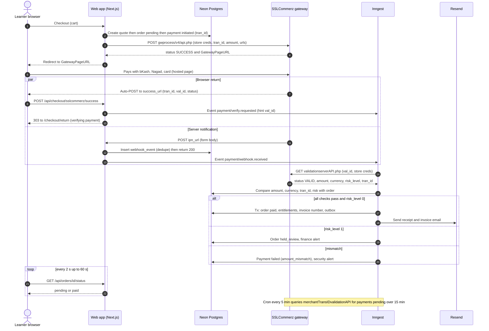
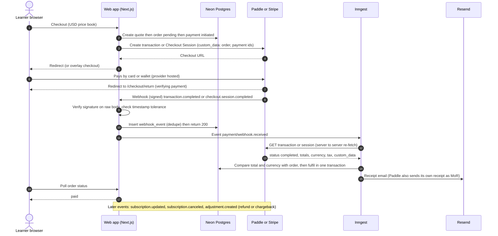
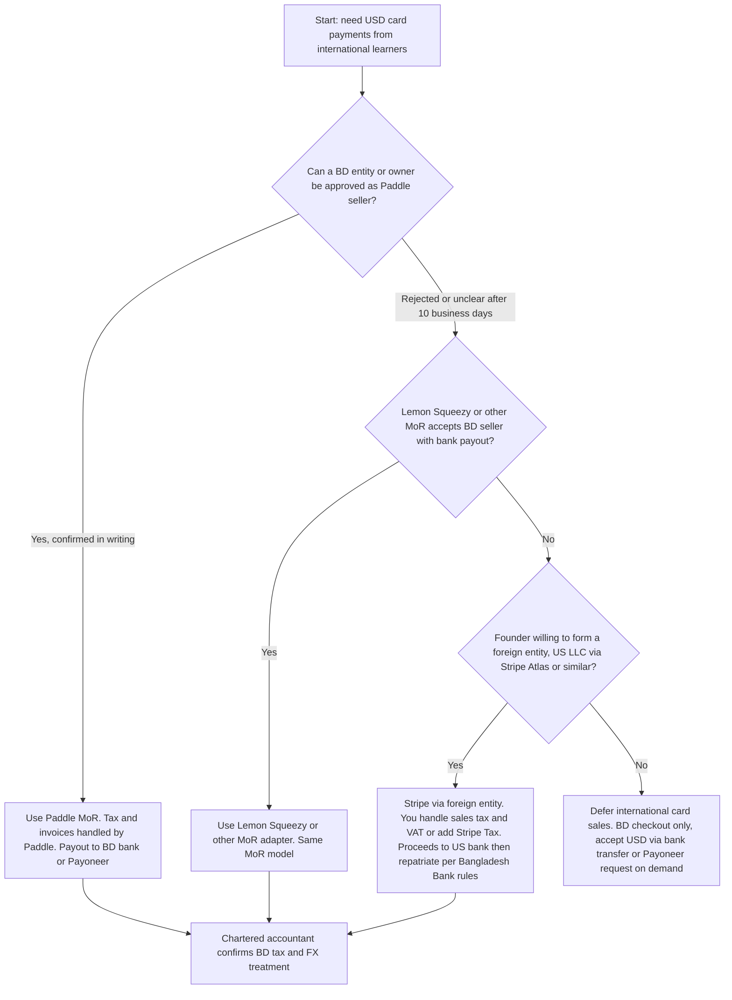
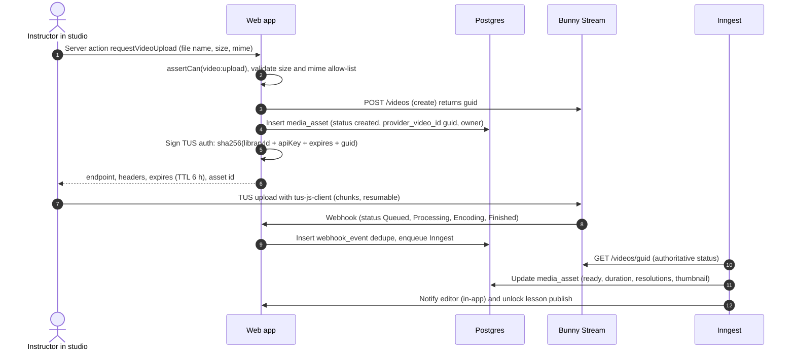

# 10 — Payments, Video & Third-Party Integrations (Implementation Spec)

> Status: draft v1, 2026-11-07. Conforms to `00-DECISIONS.md` (D2 modular monolith, D3 stack, D5 commerce, D7 security). If this file disagrees with `00-DECISIONS.md`, that file wins.
> Audience: AI coding agents (Sonnet implements, Opus reviews anything in the security-critical paths listed in `12-BUILD-PLAN-AGENTS.md`) and the founder (section 15 is the account/env checklist).
> Brand name "Lumen Academy" is a placeholder: read it from `packages/config/brand.ts`, never hard-code it. Examples below use `LA` / `lumen` only as illustrative prefixes.

## 0. How to read this document

### 0.1 Evidence legend (applies to every fact, price, endpoint and rule)

| Tag | Meaning |
|---|---|
| **[V]** | Verified from a fetched source in `research_notes/` (as of 2026-11-07). Source named in section 0.3. |
| **[U]** | Unverified. From background knowledge or inference only. **Must be confirmed against the vendor's current docs or in writing with the vendor before it is relied on.** Agents must not treat a [U] value as a constant; put it in config or a constant with a `// UNVERIFIED` comment and a link to the task that confirms it. |
| **[P]** | Proposed by this spec (design decision, table/column name, threshold). Changeable by editing this file first. |

Rule for agents: never silently "fix" a [U] value from memory. If the sandbox contradicts this doc, stop, record the discrepancy in `docs/PROGRESS.md` under "Integration discrepancies", and continue with the sandbox behaviour behind a named constant.

### 0.2 Database names

`docs/05-DATABASE.md` did **not exist** when this spec was written (checked 2026-11-07). Table names below follow the names in the brief: `order`, `order_item`, `payment`, `refund`, `entitlement`, `invoice`, `webhook_event`, `idempotency_key`, `media_asset`, `speaking_recording`, `evaluation_request`. Their physical names will be plural snake_case per `12-BUILD-PLAN-AGENTS.md` (`orders`, `order_items`, ...). Columns not stated elsewhere are **[P]** and listed in Appendix B so the DB author can reconcile. **When `05-DATABASE.md` lands, it wins on names; update this file's Appendix B accordingly.**

### 0.3 Research sources used

| Short name | File | As of |
|---|---|---|
| PVSC | `research_notes/.../payments_video_security_compliance.md` | 2026-11-07 |
| BDGF | `research_notes/.../bangladesh_market_gapfill.md` | 2026-11-07 |
| UXVG | `research_notes/.../ux_dashboards_video_gapfill.md` | 2026-11-07 |
| OSS | `research_notes/.../oss_stack_templates.md` | 2026-11-07 |

### 0.4 Invariants that apply to everything below

1. Prices, tax, discounts, entitlements and refund eligibility are computed **server-side only** (D2, D5, D7).
2. A browser redirect (success/fail/cancel) **never** fulfils an order. Only a server-verified provider fact does.
3. Every inbound webhook is: persisted raw (`webhook_event`) -> authenticated (signature or validation API) -> idempotent -> acknowledged quickly -> processed in Inngest.
4. Every outbound provider call has a timeout, retry policy, structured log (no secrets/PII), and Sentry scrubbing of `store_passwd`, `AccessKey`, `Authorization`, API keys and query strings of provider URLs.
5. Money is integer minor units + ISO currency. No floats anywhere in money paths. Provider decimal strings are parsed with `parseMajorToMinor()` (section 1.5).
6. Secrets are read only through `packages/config/env.ts` (zod-validated) and only in modules that import `server-only`.
7. All provider adapters are selectable by env and replaceable by a `fake` adapter in tests; no domain code imports a vendor SDK directly.

---

## 1. Provider abstraction layer

### 1.1 Placement and layout (D2)

```
packages/core/src/
  payments/
    index.ts                  # public API: createQuote, createOrder, startCheckout, handleWebhook, reconcile, refund
    provider.ts               # PaymentProvider interface + shared types
    registry.ts               # selection by env + country/currency
    money.ts                  # parseMajorToMinor, formatMinor, assertSameCurrency
    adapters/
      sslcommerz.ts  bkash.ts  paddle.ts  stripe.ts  lemonsqueezy.ts  fake.ts
    contract/payment-provider.contract.ts
  video/        provider.ts  registry.ts  adapters/{bunny.ts,mux.ts,cloudflare-stream.ts,fake.ts}  contract/
  storage/      provider.ts  registry.ts  adapters/{r2.ts,s3.ts,fake.ts}                            contract/
  email/        provider.ts  registry.ts  adapters/{resend.ts,ses.ts,fake.ts}                      contract/
  sms/          provider.ts  registry.ts  adapters/{sslwireless.ts,alphasms.ts,bulksmsbd.ts,fake.ts} contract/
  live/         provider.ts  registry.ts  adapters/{youtube.ts,zoom.ts,livekit.ts,fake.ts}         contract/
packages/ai/src/
  llm/          provider.ts  registry.ts  adapters/{anthropic.ts,gemini.ts,fake.ts}                contract/
  stt/          provider.ts  registry.ts  adapters/{openai.ts,deepgram.ts,fake.ts}                 contract/
  prompts/      registry.ts  <promptId>/v<N>.ts
```

Rules: adapters import their vendor SDK/`fetch` only inside `adapters/`; domain services receive a provider via `registry.ts`; the web app calls domain services only. `LlmProvider` and `SttProvider` live in `packages/ai` (D2 layout); the other six live in `packages/core`.

### 1.2 Env-based selection

All selection variables are validated in `packages/config/env.ts` with `z.enum([...])` and have defaults shown below.

| Env var | Allowed values | Default (dev / prod) | Meaning |
|---|---|---|---|
| `PAYMENT_PROVIDER_BD` | `sslcommerz` `bkash` `fake` | `fake` / `sslcommerz` | Provider for BDT checkout |
| `PAYMENT_PROVIDER_INTL` | `paddle` `stripe` `lemonsqueezy` `fake` | `fake` / `paddle` | Provider for USD / non-BD checkout |
| `VIDEO_PROVIDER` | `bunny` `mux` `cloudflare` `fake` | `fake` / `bunny` | VOD provider |
| `STORAGE_PROVIDER` | `r2` `s3` `fake` | `fake` / `r2` | Object storage |
| `EMAIL_PROVIDER` | `resend` `ses` `fake` | `fake` / `resend` | Transactional email |
| `SMS_PROVIDER` | `sslwireless` `alphasms` `bulksmsbd` `fake` | `fake` / `sslwireless` [U which] | OTP/notification SMS |
| `LLM_PROVIDER_PRIMARY` / `LLM_PROVIDER_FALLBACK` | `anthropic` `gemini` `fake` | `fake` / `anthropic` ; `gemini` | LLM chain |
| `STT_PROVIDER_PRIMARY` / `STT_PROVIDER_FALLBACK` | `deepgram` `openai` `fake` | `fake` / `deepgram` ; `openai` (D3: Deepgram Nova-3 default, `whisper-1` with word timestamps fallback) | Speech-to-text chain |
| `LIVE_PROVIDER` | `zoom_manual` `youtube` `zoom` `livekit` `fake` | `fake` / `zoom_manual` (**P1 pilot cohorts**, D1: ops-run Zoom meetings; app does entitlement and attendance import only); `youtube` or `zoom` Video SDK in P2; `livekit` P3 | Live classes |
| `EMBEDDING_PROVIDER` | provider id (adapter in `packages/ai/src/embeddings`) or `fake` | `fake` / chosen by benchmark NEW-AI-02 (34) | Vector embeddings for RAG (pgvector) |
| `TTS_PROVIDER` | provider id or `fake` | `fake` / chosen by spike NEW-AI-34 | Audio overviews, listening/vocab audio (16 section 5.4) |
| `SUPPORT_BACKEND` | `chatwoot` `native` | `chatwoot` / `chatwoot` (D12 C29) | Helpdesk mode (27) |

Guard: `env.ts` has a `superRefine` that **rejects `fake` in production** (`VERCEL_ENV === 'production'`) and rejects sandbox flags in production (e.g. `SSLCZ_IS_LIVE=false` with `VERCEL_ENV=production` fails boot), so a mis-set env cannot silently mint free access.

Payment routing (the only place that picks BD vs international), `packages/core/src/payments/registry.ts`:

```ts
import 'server-only';
import { env } from '@lumen/config/env';
import type { PaymentProvider, CheckoutRegion } from './provider';

export function resolveCheckoutRegion(input: {
  currency: 'BDT' | 'USD';
  billingCountry?: string; // ISO-3166 alpha-2, from user profile / geo hint, user-editable
}): CheckoutRegion {
  // BDT price book => BD rails. USD price book => international rails.
  // A BD user MAY choose the USD book (e.g., paying by foreign card): allowed, routes to intl provider.
  return input.currency === 'BDT' ? 'bd' : 'intl';
}

const factories: Record<string, () => PaymentProvider> = {
  sslcommerz: () => new (require('./adapters/sslcommerz').SslcommerzProvider)(),
  bkash:      () => new (require('./adapters/bkash').BkashProvider)(),
  paddle:     () => new (require('./adapters/paddle').PaddleProvider)(),
  stripe:     () => new (require('./adapters/stripe').StripeProvider)(),
  lemonsqueezy: () => new (require('./adapters/lemonsqueezy').LemonSqueezyProvider)(),
  fake:       () => new (require('./adapters/fake').FakePaymentProvider)(),
};

const cache = new Map<string, PaymentProvider>();
export function getPaymentProvider(id: string): PaymentProvider {
  const hit = cache.get(id);
  if (hit) return hit;
  const f = factories[id];
  if (!f) throw new Error(`Unknown payment provider: ${id}`);
  const p = f();
  cache.set(id, p);
  return p;
}
export function providerForRegion(region: CheckoutRegion): PaymentProvider {
  return getPaymentProvider(region === 'bd' ? env.PAYMENT_PROVIDER_BD : env.PAYMENT_PROVIDER_INTL);
}
```

(Agents: replace `require` with static imports or `await import()` as the lint rules require; the point is lazy construction so a missing optional vendor key does not crash boot unless that provider is selected.)

### 1.3 `PaymentProvider`

```ts
// packages/core/src/payments/provider.ts
export type Currency = 'BDT' | 'USD';
export type CheckoutRegion = 'bd' | 'intl';
export type ProviderId = 'sslcommerz' | 'bkash' | 'paddle' | 'stripe' | 'lemonsqueezy' | 'fake';

export type NormalizedPaymentStatus =
  | 'paid'          // provider confirms funds captured/validated AND our checks pass
  | 'pending'       // provider says not final yet (or no transaction found yet)
  | 'failed'
  | 'cancelled'
  | 'expired'
  | 'held_review';  // paid at provider but risk flag => do NOT fulfil, route to finance review

export interface CheckoutCustomer {
  userId: string;
  name: string;
  email: string;
  phoneE164?: string;
  address1?: string;
  city?: string;
  postcode?: string;
  country: string; // ISO alpha-2
}

export interface CheckoutLine {
  orderItemId: string;
  title: string;
  category: string;       // maps to provider product_category
  unitAmountMinor: number;
  quantity: number;
  providerPriceId?: string; // Paddle/Stripe price id for the product (null for SSLCommerz/bKash)
}

export interface CreateCheckoutInput {
  orderId: string;
  paymentId: string;               // our payment-attempt id (uuid)
  providerRef: string;             // OUR unique transaction reference (SSLCommerz tran_id). <= 30 chars [U max length]
  amountMinor: number;             // grand total to charge, tax-inclusive
  currency: Currency;
  customer: CheckoutCustomer;
  lines: CheckoutLine[];
  returnUrls: { success: string; fail: string; cancel: string }; // each <= 255 chars for SSLCommerz [V]
  webhookUrl: string;              // IPN / webhook endpoint
  locale: 'en' | 'bn';
  metadata: Record<string, string>; // must include orderId, paymentId, userId
  idempotencyKey: string;
}

export interface CreateCheckoutResult {
  redirectUrl: string;             // GatewayPageURL / bkashURL / Paddle checkout URL
  providerSessionId?: string;      // SSLCommerz sessionkey, bKash paymentID, Paddle txn_...
  expiresAt?: Date;
  raw: unknown;                    // sanitized (no secrets) for webhook_event/payment.provider_payload
}

/** Inbound notification after authentication, before business verification. */
export interface ParsedWebhook {
  provider: ProviderId;
  providerEventId: string;         // dedupe key; stable across provider retries
  eventType: string;               // provider's native type, e.g. 'IPN:VALID', 'transaction.completed'
  providerRef?: string;            // tran_id or custom_data.paymentId
  authenticated: boolean;          // true only if signature verified (Paddle/Stripe); false for SSLCommerz IPN (needs verifyPayment)
  payload: unknown;
}

export interface VerifiedPayment {
  status: NormalizedPaymentStatus;
  providerRef: string;
  providerTxnId?: string;          // bank_tran_id / trxID / txn_id
  amountMinor: number;             // as reported by provider, in `currency`
  currency: Currency;
  paidAt?: Date;
  method?: string;                 // 'bkash' | 'nagad' | 'visa' | ...
  riskLevel?: 0 | 1;
  feeMinor?: number;               // when the provider reports it
  failureReason?: string;
  raw: unknown;
}

export interface RefundInput {
  paymentId: string;
  providerTxnId: string;           // bank_tran_id (SSLCommerz) / trxID (bKash) / txn id (Paddle)
  amountMinor: number;
  currency: Currency;
  reason: string;
  refundRef: string;               // our unique refund reference (-> refund.id)
  idempotencyKey: string;
}
export interface RefundResult {
  status: 'succeeded' | 'processing' | 'failed' | 'manual_required';
  providerRefundId?: string;
  failureReason?: string;
  raw: unknown;
}

export interface PaymentProviderCapabilities {
  refundApi: boolean;
  refundNeedsFixedIp: boolean;     // true for SSLCommerz [V: public IP must be registered]
  partialRefund: boolean;
  recurring: boolean;
  taxHandledByProvider: boolean;   // true for MoR (Paddle, Lemon Squeezy)
  supportsQuery: boolean;          // transaction status query by our providerRef
  currencies: readonly Currency[];
}

export interface PaymentProvider {
  readonly id: ProviderId;
  readonly capabilities: PaymentProviderCapabilities;

  createCheckout(input: CreateCheckoutInput): Promise<CreateCheckoutResult>;

  /** Authenticate (if the provider signs) and normalize. Must NOT touch the DB. Throws WebhookAuthError on bad signature. */
  parseWebhook(req: { headers: Headers; rawBody: string; contentType: string }): Promise<ParsedWebhook>;

  /** Authoritative server-to-server confirmation. Called for EVERY webhook before fulfilment, and by reconciliation.
   *  `hint` carries val_id (SSLCommerz) / paymentID (bKash) / txn id (Paddle). It is untrusted input used only as a lookup key. */
  verifyPayment(args: {
    providerRef: string;
    hint?: Record<string, string>;
    expected: { amountMinor: number; currency: Currency };
  }): Promise<VerifiedPayment>;

  /** Status query without a webhook (reconciliation). Same return as verifyPayment. */
  queryPayment(args: { providerRef: string; expected: { amountMinor: number; currency: Currency } }): Promise<VerifiedPayment>;

  refund(input: RefundInput): Promise<RefundResult>;
  queryRefund?(args: { refundRef: string; providerRefundId?: string }): Promise<RefundResult>;
}

export class WebhookAuthError extends Error {}
export class ProviderTransientError extends Error {}  // retryable (timeouts, 5xx)
export class ProviderPermanentError extends Error {}  // not retryable (4xx, validation)
```

Behavioural contract (enforced by contract tests, section 1.9):

- `verifyPayment` returns `status: 'paid'` **only if** provider status is final-success **and** `amountMinor` and `currency` equal `expected` **and** `riskLevel !== 1`. A mismatch returns `failed` with `failureReason: 'amount_mismatch'` (or `'currency_mismatch'`) and the adapter logs a security event; it never throws for mismatch.
- `parseWebhook` must be pure and must never return `authenticated: true` unless a cryptographic check passed.
- All methods are safe to call twice with the same inputs (no side effects beyond the provider's own idempotency).

### 1.4 `VideoProvider`

```ts
// packages/core/src/video/provider.ts
export type VideoStatus = 'created' | 'uploading' | 'processing' | 'encoding' | 'ready' | 'failed';

export interface TusUploadAuth {
  endpoint: string;                 // e.g. https://video.bunnycdn.com/tusupload [U]
  headers: Record<string, string>;  // AuthorizationSignature, AuthorizationExpire, VideoId, LibraryId (Bunny)
  expiresAt: Date;
  providerVideoId: string;
}

export interface PlaybackRequest {
  providerVideoId: string;
  userId: string;
  ttlSeconds: number;               // 2h..6h for lessons
  startAtSeconds?: number;
  referrerHost?: string;            // for adapters that bind to referrer
}
export interface PlaybackSource {
  kind: 'iframe' | 'hls';
  url: string;                      // signed
  expiresAt: Date;
  captions?: Array<{ lang: string; label: string; url: string }>;
  posterUrl?: string;
}

export interface VideoWebhookEvent {
  providerVideoId: string;
  status: VideoStatus;
  providerEventId: string;          // deterministic: `${videoId}:${statusCode}` when vendor gives none
  raw: unknown;
}

export interface VideoProvider {
  readonly id: 'bunny' | 'mux' | 'cloudflare' | 'fake';
  createVideo(input: { title: string; collectionId?: string }): Promise<{ providerVideoId: string }>;
  createTusUploadAuth(input: { providerVideoId: string; ttlSeconds: number }): Promise<TusUploadAuth>;
  fetchFromUrl(input: { url: string; title: string }): Promise<{ providerVideoId: string }>; // e.g. live recording from R2 presigned GET
  getVideo(providerVideoId: string): Promise<{ status: VideoStatus; durationSeconds?: number; width?: number; height?: number; availableResolutions?: string[]; thumbnailUrl?: string; sizeBytes?: number }>;
  deleteVideo(providerVideoId: string): Promise<void>;
  signPlayback(req: PlaybackRequest): Promise<PlaybackSource>;
  uploadCaptions(input: { providerVideoId: string; lang: string; label: string; vtt: string }): Promise<void>;
  setChapters(input: { providerVideoId: string; chapters: Array<{ title: string; startSeconds: number; endSeconds: number }> }): Promise<void>;
  parseWebhook(req: { headers: Headers; rawBody: string; urlSecret?: string }): Promise<VideoWebhookEvent>;
}
```

### 1.5 `StorageProvider`

```ts
// packages/core/src/storage/provider.ts
export type BucketKey = 'private-uploads' | 'speaking-recordings' | 'public-assets';

export interface PresignPutInput {
  bucket: BucketKey;
  key: string;
  contentType: string;              // allow-listed per use case
  contentLength: number;            // signed into the URL; client MUST send exactly this size
  ttlSeconds: number;               // <= 900 for uploads
  checksumSha256?: string;          // base64, optional integrity pin
  metadata?: Record<string, string>;
}
export interface PresignGetInput {
  bucket: BucketKey; key: string; ttlSeconds: number; downloadFilename?: string;
}
export interface StorageProvider {
  readonly id: 'r2' | 's3' | 'fake';
  presignPut(i: PresignPutInput): Promise<{ url: string; headers: Record<string, string>; expiresAt: Date }>;
  presignGet(i: PresignGetInput): Promise<{ url: string; expiresAt: Date }>;
  head(bucket: BucketKey, key: string): Promise<{ exists: boolean; sizeBytes?: number; contentType?: string; etag?: string }>;
  put(bucket: BucketKey, key: string, body: Uint8Array | ReadableStream, contentType: string): Promise<void>; // server-side writes (PDFs)
  copy(from: { bucket: BucketKey; key: string }, to: { bucket: BucketKey; key: string }): Promise<void>;
  delete(bucket: BucketKey, key: string): Promise<void>;
  publicUrl(key: string): string;   // only for public-assets via custom domain
}
```

### 1.6 `EmailProvider`

```ts
// packages/core/src/email/provider.ts
export type EmailTemplateId =
  | 'verify_email' | 'otp_code' | 'welcome' | 'receipt' | 'invoice' | 'refund_confirmation'
  | 'renewal_reminder_7d' | 'renewal_reminder_1d' | 'pass_expired'
  | 'evaluation_ready' | 'weekly_progress_digest' | 'guardian_report'
  | 'payment_failed' | 'live_class_reminder' | 'certificate_issued';

export interface SendEmailInput<P = unknown> {
  to: string;                       // single recipient per call (no CC leakage)
  template: EmailTemplateId;
  props: P;                         // zod-validated per template in templates/index.ts
  locale: 'en' | 'bn';
  idempotencyKey: string;           // e.g. `receipt:${orderId}`
  stream: 'transactional' | 'notification' | 'marketing'; // selects From + subdomain
  attachments?: Array<{ filename: string; contentType: string; content: Uint8Array }>;
  tags?: Record<string, string>;
}
export type EmailEventType = 'delivered' | 'bounced_hard' | 'bounced_soft' | 'complained' | 'delayed' | 'opened' | 'clicked';
export interface NormalizedEmailEvent { providerMessageId: string; to: string; type: EmailEventType; at: Date; providerEventId: string; raw: unknown }

export interface EmailProvider {
  readonly id: 'resend' | 'ses' | 'fake';
  send(i: SendEmailInput): Promise<{ providerMessageId: string }>;
  parseWebhook(req: { headers: Headers; rawBody: string }): Promise<NormalizedEmailEvent[]>; // verifies signature
}
```

### 1.7 `SmsProvider`

```ts
// packages/core/src/sms/provider.ts
export interface SendSmsInput {
  toE164: string;                   // +8801XXXXXXXXX
  body: string;
  kind: 'otp' | 'transactional' | 'reminder';
  senderId?: string;                // masking sender ID if approved [U]
  templateId?: string;              // gateway-approved template id if the gateway requires it [U]
  idempotencyKey: string;
}
export interface SmsProvider {
  readonly id: 'sslwireless' | 'alphasms' | 'bulksmsbd' | 'fake';
  send(i: SendSmsInput): Promise<{ providerMessageId: string; segments: number; costMinor?: number }>;
  getBalance?(): Promise<{ balanceMinor: number; currency: 'BDT' }>;
  parseDeliveryReport?(req: { headers: Headers; rawBody: string }): Promise<Array<{ providerMessageId: string; status: 'delivered' | 'failed'; at: Date }>>;
}
```

### 1.8 `LlmProvider`, `SttProvider`, `LiveProvider`

```ts
// packages/ai/src/llm/provider.ts
import type { ZodType } from 'zod';
export type ModelTier = 'fast' | 'scoring';  // fast = Haiku-class, scoring = Sonnet-class (D3)

export interface LlmMessage { role: 'user' | 'assistant'; content: string }
export interface GenerateStructuredInput<T> {
  promptId: string;                 // registry id, e.g. 'ielts.writing.task2.score'
  promptVersion: number;
  system: string;
  messages: LlmMessage[];
  schema: ZodType<T>;               // validated server-side; also converted to JSON schema for the vendor
  tier: ModelTier;
  maxOutputTokens: number;
  temperature?: number;             // default 0 for scoring
  timeoutMs: number;
  requestKey: string;               // idempotency / log correlation, e.g. evaluation_request.id
  cacheSystem?: boolean;            // allow vendor prompt caching for long rubric prompts
}
export interface LlmUsage { inputTokens: number; outputTokens: number; cachedInputTokens?: number }
export interface GenerateStructuredResult<T> {
  data: T; usage: LlmUsage; costUsdMicros: number; provider: string; model: string; latencyMs: number; providerRequestId?: string; attempts: number;
}
export interface LlmProvider {
  readonly id: 'anthropic' | 'gemini' | 'fake';
  generateStructured<T>(i: GenerateStructuredInput<T>): Promise<GenerateStructuredResult<T>>;
}

// packages/ai/src/stt/provider.ts
export interface TranscribeInput {
  audioUrl: string;                 // short-lived presigned GET from StorageProvider
  mimeType: string;                 // audio/webm;codecs=opus | audio/mp4 | audio/wav
  language: 'en';                   // IELTS speaking is English
  wantWordTimestamps: boolean;      // needed for pause/fluency metrics
  durationHintSeconds?: number;
  requestKey: string;
}
export interface TranscriptWord { word: string; startSec: number; endSec: number; confidence?: number }
export interface TranscribeResult {
  text: string; words?: TranscriptWord[]; durationSec: number; costUsdMicros: number; provider: string; model: string; latencyMs: number;
}
export interface SttProvider { readonly id: 'deepgram' | 'openai' | 'fake';  // default 'deepgram' (Nova-3), fallback 'openai' (whisper-1)
  transcribe(i: TranscribeInput): Promise<TranscribeResult> }

// packages/core/src/live/provider.ts
export type LiveRole = 'host' | 'cohost' | 'attendee';
export interface LiveProvider {
  readonly id: 'youtube' | 'zoom' | 'livekit' | 'fake';
  createSession(i: { liveSessionId: string; title: string; startsAt: Date; endsAt: Date; maxParticipants?: number; externalRef?: string /* YouTube video id */ }): Promise<{ providerSessionId: string }>;
  issueJoin(i: { providerSessionId: string; userId: string; displayName: string; role: LiveRole; ttlSeconds: number }): Promise<
    | { kind: 'embed'; embedUrl: string }            // YouTube
    | { kind: 'token'; token: string; serverUrl: string } // Zoom/LiveKit client SDK
  >;
  endSession(providerSessionId: string): Promise<void>;
  parseWebhook(req: { headers: Headers; rawBody: string }): Promise<Array<
    | { type: 'participant_joined' | 'participant_left'; providerSessionId: string; userId: string; at: Date; providerEventId: string }
    | { type: 'recording_ready'; providerSessionId: string; recordingUrl: string; providerEventId: string }
  >>;
}
```

`money.ts` (shared, security-relevant, must have property tests):

```ts
// packages/core/src/payments/money.ts
/** "1234.5" -> 123450 for 2-decimal currencies. Rejects NaN, >2 decimals (after trimming trailing zeros), negatives, exponent notation. */
export function parseMajorToMinor(s: string): number {
  const t = s.trim();
  if (!/^\d+(\.\d{1,8})?$/.test(t)) throw new Error(`Bad amount: ${s}`);
  const [whole, frac = ''] = t.split('.');
  const fracTrim = frac.replace(/0+$/, '');
  if (fracTrim.length > 2) throw new Error(`Too many decimals: ${s}`);
  const minor = Number(whole) * 100 + Number((fracTrim + '00').slice(0, 2));
  if (!Number.isSafeInteger(minor)) throw new Error('Amount out of range');
  return minor;
}
export function formatMinorToMajor(minor: number): string {
  if (!Number.isInteger(minor) || minor < 0) throw new Error('Bad minor amount');
  return `${Math.floor(minor / 100)}.${String(minor % 100).padStart(2, '0')}`;
}
```

### 1.9 Contract tests

Location: `packages/core/src/<domain>/contract/*.contract.ts` export `runXContract(name, factory, opts)`. Each adapter's test file calls it. Three tiers:

| Tier | Runs | Backing | Purpose |
|---|---|---|---|
| T1 unit | every PR | `msw` recorded fixtures (JSON bodies copied from sandbox runs, secrets redacted) | Parsing, signature verification, mismatch handling, error mapping |
| T2 sandbox | nightly + manual `pnpm test:sandbox` (needs sandbox secrets in GitHub Actions environment `sandbox`) | Real vendor sandbox | Create session, query, refund where possible; skipped automatically if env keys absent |
| T3 e2e | on preview deploys | Playwright against Preview with sandbox keys | Full browser purchase / playback / email |

Payment contract cases every `PaymentProvider` MUST pass (T1 for all; T2 where sandbox exists):

1. `createCheckout` returns an absolute https `redirectUrl`; rejects amount <= 0; rejects currency not in `capabilities.currencies`.
2. `parseWebhook` with a tampered body/signature throws `WebhookAuthError` (signed providers) or returns `authenticated:false` (SSLCommerz).
3. `verifyPayment` -> `paid` only on exact amount+currency match; `amount_mismatch` and `currency_mismatch` -> `failed`.
4. `verifyPayment` with `riskLevel=1` fixture -> `held_review`.
5. Duplicate delivery of the same event -> same `providerEventId`.
6. `queryPayment` for unknown ref -> `pending` or `failed` (documented per provider), never throws.
7. `refund` over-amount -> `failed` or `ProviderPermanentError`; refund when `refundNeedsFixedIp` and no relay configured -> `manual_required`.
8. No secret value appears in `raw` or in any thrown error message (scan with the secrets from test env).

Equivalent (shorter) contract suites exist for Video (sign -> URL host/params/expiry; token algorithm vectors), Storage (presign contains signed `content-length`; TTL cap), Email (idempotency, webhook signature), Sms (E.164 validation, segment calc), Llm (schema failure -> repair retry -> fallback; usage mapped), Stt (word timestamps flag), Live (join token TTL).

Test vectors for signing code (Bunny token, Paddle HMAC, SSLCommerz `verify_sign`) are committed as JSON in `contract/vectors/` and must be generated from the vendor's own documentation examples, not from our own implementation.

---

## 2. Checkout and fulfilment pipeline

### 2.1 State machines

`order.status`: `pending` -> `paid` | `expired` | `cancelled` | `failed` ; `paid` -> `partially_refunded` | `refunded` ; `pending|paid` -> `held_review` (risk flag) -> `paid` | `refunded`.
`payment.status` (one row per provider attempt): `initiated` -> `pending` -> `succeeded` | `failed` | `cancelled` | `expired` | `held_review`; `succeeded` -> `partially_refunded` | `refunded`.
`refund.status`: `requested` -> `approved` -> `processing` -> `succeeded` | `failed` ; or `approved` -> `manual_pending` -> `succeeded` (SSLCommerz fixed-IP workaround, section 3.9).

An order may have several payment attempts (user retries after a fail). Only the **first** attempt that verifies as `paid` fulfils the order (compare-and-swap in 2.6). A second verified-paid attempt for an already-paid order creates a `finance_alert` of type `duplicate_payment` and a draft refund. **[P]**

### 2.2 Pipeline overview

1. **Cart** (client state or `cart` table for signed-in users): list of `{ productId, quantity }` only. No prices, no tax. Max 20 lines. **[P]**
2. **Quote** `createQuote({ userId, cart, couponCode?, currency, billingCountry })` -> server computes price book lines, coupon, tax, total; persists `price_quote` (id, user_id, currency, lines jsonb, discount_minor, tax_minor, total_minor, coupon_id, expires_at = now + 15 min, hash). **[P]**
3. **Order** `createOrderFromQuote(quoteId, idempotencyKey)` -> inside a transaction: re-validate quote not expired and not consumed, re-check coupon limits with `SELECT ... FOR UPDATE` on the coupon row, insert `order(status='pending')` + `order_item` rows (snapshot: title, sku, unit_amount_minor, discount_minor, tax_minor, currency), mark quote consumed. `idempotency_key` unique on (scope='order.create', key, user_id) returns the same order on replay.
4. **Provider session** `startCheckout(orderId)` -> insert `payment(status='initiated', provider, provider_ref)` where `provider_ref` is our `tran_id`; call `provider.createCheckout`; store `provider_session_id`; set `payment.status='pending'`; return `redirectUrl`.
5. **Redirect** the browser to `redirectUrl` (server action returns the URL; client does `window.location.assign`). Payment pages are provider-hosted (SAQ-A, D7).
6. **Return pages** (section 2.4) show "verifying payment" until the server says `paid`.
7. **IPN / webhook** -> persist -> authenticate -> enqueue Inngest `payment/webhook.received` (section 2.5).
8. **Validation** -> `provider.verifyPayment` with expected amount/currency from OUR order.
9. **Idempotent fulfilment** (2.6): one DB transaction sets order paid, inserts entitlements, allocates the invoice number, writes the outbox event `order.paid`.
10. **Post-fulfilment** (Inngest `order.paid`): render invoice PDF, store in R2, send receipt email (+ SMS if opted in), emit PostHog `purchase_completed` server-side, update coupon redemption, notify guardian if applicable.
11. **Reconciliation** (2.7) closes gaps where IPN never arrived or validation failed transiently.
12. **Refunds** (2.8).

### 2.3 Price quote rules (server-authoritative)

| Rule | Detail |
|---|---|
| Price books | `price` rows keyed (product_id, currency, **region**, valid_from, valid_to) with `region` ∈ {`BD`,`A`,`B`,`C`} (D12 C16). BDT (region `BD`) and USD (regions A/B/C) books are independent (D5); no FX conversion at checkout. |
| Region resolution (D12 C16/C25) | The region is resolved from the **billing country** (collected at checkout; the MoR's own country field wins for Paddle/Stripe) with IP geolocation used only as a **hint** to pre-select what to display before the user has entered a billing country. BD users always see BDT via SSLCommerz; a BD resident may still choose the USD book (routes to the intl rail). Region sets: A = US/UK/EU/CA/AU/NZ/Gulf; B = upper-middle-income (e.g. Malaysia, Türkiye, Latin America); C = South Asia (ex-BD), Africa, SE Asia. **Price floor invariant (C25), enforced in `setPrice` and by a nightly check:** region C price >= the BD price converted to USD (so no non-BD buyer pays less than a Bangladeshi buyer); B ~ 1.5x C; A ~ 2.5x C, rounded to .99/.00. The quote stores `price_region` and `billing_country` on the order snapshot; VPN/IP-mismatch cases are handled by billing country, not blocked. `compare_at_minor` is only returned if that exact price was charged for >= 28 consecutive days in the last 90 (C14). |
| Rounding | Compute per line in minor units, `Math.round` half-up once per line, sum lines. Tax computed on the discounted line (see below). |
| Coupons | Validate: code exists, active window, product/category scope, min spend, max redemptions (global), per-user limit, not stackable unless `stackable=true`, currency match (fixed-amount coupons are currency-specific). Percentage coupon applies to eligible lines only. Discount can never exceed line subtotal; total never below 0; free orders (total 0) skip the provider and fulfil via `source='coupon_100'`. |
| BD VAT display (D5/§6) | BDT prices are **VAT-inclusive** when `TAX_BD_VAT_MODE='inclusive_15'`; `tax_minor = round(total * 15/115)`. If `TAX_BD_VAT_MODE='exempt'` (startup exemption, if confirmed) `tax_minor = 0` and the invoice carries the exemption legend. Mode is a runtime setting (`finance_setting` table, 30; not a generic settings table, D12 C10), audited on change. **[P]** The rate 15% standard and the reported exemption from 1 Jul 2026 are **[V] (PwC Finance Act 2026 via PVSC) but applicability to this business is UNCONFIRMED**; accountant must confirm. |
| International | Via MoR (Paddle/Lemon Squeezy) tax is computed and collected by the MoR; our quote shows "tax calculated at checkout" and our `order.tax_minor` is later overwritten by the provider's reported tax for records. For Stripe via own entity, tax is a separate project (Stripe Tax) **[U]**. |
| Quote TTL | 15 min; the order stores the quote hash; replaying an expired quote returns `QUOTE_EXPIRED`. |
| Min/max | SSLCommerz total_amount must be BDT 10.00-500,000.00 **[V]** (BDGF). Quote rejects below BDT 10 unless free, and above 500,000 with message to contact support. |
| Pass stacking & duplicates | Buying a product the user already holds (same course, active) is blocked with a friendly message; buying another `pass` while one is active is allowed and queues (section 7). |
| Guardian purchase | Guardian pays for a linked student: order.user_id = guardian, `beneficiary_user_id` = student; entitlements go to the beneficiary. **[P]** |

### 2.4 Return pages

Routes (all `dynamic = 'force-dynamic'`):

| Provider redirect | Handler | Behaviour |
|---|---|---|
| SSLCommerz `success_url` / `fail_url` / `cancel_url` | `POST /api/checkout/sslcommerz/{success,fail,cancel}` (route handler) | **Stateless.** Parse form, read only `tran_id` (and `val_id` as a hint). Look up payment by `provider_ref` -> `orderId`. If `val_id` present, enqueue `payment/verify.requested` (speed-up only; verification still goes through the validation API). Respond `303` to `/checkout/return?o=<orderPublicId>&r=<success|fail|cancel>`. Also implement `GET` with the same behaviour (user refresh). |
| bKash `callbackURL` | `GET /api/checkout/bkash/callback?paymentID&status` | Same pattern: enqueue verify (which calls Execute then Query), redirect 303. |
| Paddle / Stripe | success URL set to `/checkout/return?o=<orderPublicId>&r=success` | No provider POST. |

**Why POST handlers are stateless:** SSLCommerz posts to these URLs through the user's browser (cross-site POST). `SameSite=Lax` session cookies (D7) are **not** sent on cross-site POST, so the handler cannot rely on the session and must not require CSRF/Origin tokens; it performs no mutation except an idempotent enqueue. The redirect to a same-site `GET` page restores the cookie.

`/checkout/return` page (server component + small client poller):

- Reads order by `public_id`, enforces `order.user_id === session.user.id` (or guardian link). Never shows another user's order.
- Display is driven **only** by DB `order.status` (and `payment.status`):
  - `paid` -> success screen, receipt link, "Start learning" CTA.
  - `pending` (whatever `r=` says) -> "Verifying your payment..." with spinner; poll `GET /api/orders/{id}/status` every 2 s for 60 s, then every 10 s up to 5 min; after 60 s show "This is taking longer than usual. You can close this page; we will email you and unlock access as soon as the payment is confirmed."
  - `failed|cancelled|expired` -> failure/cancel screen with "Try again" (creates a **new** payment attempt on the same order if quote still valid, else new quote).
  - `held_review` -> "Your payment needs a quick review. We'll contact you within 24 hours."
- `r=fail|cancel` only changes copy while `pending`; if the server later sees `paid` the UI flips to success (users can pay then press Back).
- Rate limit the status endpoint (per user 30/min).

### 2.5 Webhook ingestion (common for all providers)

Route files (all under `apps/web/app/api/webhooks/`): `sslcommerz/ipn/route.ts`, `bkash/route.ts`, `paddle/route.ts`, `stripe/route.ts`, `lemonsqueezy/route.ts`, `bunny/[secret]/route.ts`, `resend/route.ts`, `livekit/route.ts`, `sms/[provider]/route.ts`.

```ts
// apps/web/app/api/webhooks/paddle/route.ts  (pattern shared by all webhooks)
import 'server-only';
import { NextResponse } from 'next/server';
import { ingestWebhook } from '@lumen/core/payments';

export const dynamic = 'force-dynamic';
export const runtime = 'nodejs';       // need node:crypto and raw body
export const maxDuration = 15;

export async function POST(req: Request) {
  const rawBody = await req.text();    // RAW string, never req.json() before verifying
  const result = await ingestWebhook('paddle', { headers: req.headers, rawBody, contentType: req.headers.get('content-type') ?? '' });
  // 401 only for bad signature; 200 for everything else incl. duplicates (so the provider stops retrying)
  return new NextResponse(null, { status: result.kind === 'rejected' ? 401 : 200 });
}
```

`ingestWebhook(providerId, req)`:

1. `provider.parseWebhook` (signature check where applicable). Failure -> insert `webhook_event(status='rejected')` with reason (rate-limit these inserts per IP to avoid log flooding) and return `rejected`.
2. `INSERT INTO webhook_event (provider, provider_event_id, event_type, headers_redacted, payload, received_at, status) ... ON CONFLICT (provider, provider_event_id) DO NOTHING RETURNING id`. Conflict -> `duplicate`, return 200.
3. Send Inngest event `payment/webhook.received` `{ webhookEventId }` (Inngest event id = `webhook:${provider}:${providerEventId}` for dedupe).
4. Return 200 within ~1 s. Nothing heavy in the request.

Inngest function `processPaymentWebhook` (concurrency key = `providerRef`, limit 1, so the same order is never processed twice in parallel; retries: 8 with exponential backoff up to ~1 h):

1. Load `webhook_event`, skip if `processed_at` set.
2. Resolve `payment` by `providerRef` (SSLCommerz `tran_id`; Paddle `custom_data.payment_id`; Stripe `metadata.payment_id`). Unknown ref -> mark `ignored_unknown_ref` + alert (could be probing).
3. `verified = await provider.verifyPayment({ providerRef, hint, expected: { amountMinor: order.total_minor, currency: order.currency } })`.
4. Switch on `verified.status` -> `fulfilOrder` | `markPaymentFailed` | `markHeldReview` | leave pending (retry later via reconciliation).
5. Set `webhook_event.processed_at`, `outcome`.

For SSLCommerz the `idempotency` key is `${tran_id}:${val_id ?? status}`; IPN and the browser-triggered verify both converge on the same `fulfilOrder` which is a no-op the second time (2.6).

### 2.6 `fulfilOrder` (the single choke point)

```ts
// packages/core/src/payments/fulfil.ts
export async function fulfilOrder(args: { orderId: string; paymentId: string; verified: VerifiedPayment; actor: 'system' }) {
  return db.transaction(async (tx) => {
    // 1. Lock + compare-and-swap. Only one concurrent caller gets a row.
    const [order] = await tx.execute(sql`
      UPDATE "order" SET status = 'paid', paid_at = ${args.verified.paidAt ?? new Date()}, updated_at = now()
      WHERE id = ${args.orderId} AND status IN ('pending','held_review')
      RETURNING *`);
    if (!order) {
      // Already paid (replay) or cancelled/expired. If this payment is a SECOND successful one, flag duplicate.
      await maybeFlagDuplicatePayment(tx, args);
      return { kind: 'noop' as const };
    }
    // 2. Payment row
    await tx.update(payment).set({
      status: 'succeeded', provider_txn_id: args.verified.providerTxnId, method: args.verified.method,
      amount_minor: args.verified.amountMinor, fee_minor: args.verified.feeMinor, succeeded_at: new Date(),
    }).where(eq(payment.id, args.paymentId));
    // 3. Entitlements (section 7) — unique(source_order_item_id, grant_index) makes this idempotent even if step 1 were bypassed
    const items = await tx.select().from(orderItem).where(eq(orderItem.orderId, args.orderId));
    for (const item of items) await grantEntitlementsForItem(tx, order, item);
    // 4. Invoice with gapless number (section 6)
    const inv = await issueInvoice(tx, order, items);
    // 5. Coupon redemption finalised
    await finaliseCouponRedemption(tx, order);
    // 6. Outbox → Inngest (sent after commit by the outbox relay, or tx-safe step)
    await tx.insert(outbox).values({ topic: 'order.paid', key: order.id, payload: { orderId: order.id, invoiceId: inv.id } });
    await auditLog(tx, { actor: 'system', action: 'order.fulfilled', target: order.id });
    return { kind: 'fulfilled' as const, invoiceId: inv.id };
  });
}
```

Requirements: (a) unique indexes `entitlement(source_order_item_id, grant_index)` and `invoice(order_id)`; (b) the Inngest `order.paid` handler is itself idempotent (receipt email uses `idempotencyKey = receipt:${orderId}`); (c) unit tests for concurrent double-call (Promise.all of two) producing exactly one entitlement set and one invoice; (d) Opus review mandatory (security-critical path).

### 2.7 Reconciliation job

Inngest cron `*/5 * * * *`, function `reconcilePendingPayments`:

- Select `payment` where `status IN ('initiated','pending')` and `created_at < now() - 15 min` and `created_at > now() - 72 h`, batch 100, oldest first. **[P]**
- For each: `provider.queryPayment({ providerRef, expected })`:
  - `paid` -> same path as webhook (`fulfilOrder`); log `reconciled_via_query` metric (a rising rate signals IPN delivery problems).
  - `failed|cancelled|expired` -> mark payment accordingly; mark order `expired` if all attempts terminal and quote expired.
  - `pending` / unknown -> leave; after 72 h mark `expired`.
  - `held_review` -> mark + create `finance_alert`.
- SSLCommerz: use `merchantTransIDvalidationAPI.php?tran_id=...` **[V]** (BDGF). Its statuses VALID/VALIDATED/PENDING/FAILED **[V]**. Because the query may return multiple elements (retries on the same tran_id), pick the one with VALID/VALIDATED and then call the validation API with its `val_id` for the authoritative amount check **[U on response shape]**.
- Rate: max 10 provider calls/second; backoff on provider 5xx; per-provider circuit breaker.
- Daily 02:00 Asia/Dhaka `settlementReconcile`: finance uploads the provider's settlement CSV (or API where available) in the admin console; job matches by `bank_tran_id`/`provider_txn_id`, reports unmatched either side, and computes fees. **[P]** SSLCommerz settlement timing: BDGF found only a third-party claim of 5-7 business days **[U]**.

### 2.8 Refund flow (provider-neutral)

1. Finance (or support for pre-approved cases up to a threshold) opens an order -> "Refund". Permission `refund:create` (finance, admin, super_admin). Form: items/lines or free amount, reason code, policy check output (D5 + D12 C13b/C28: **7-day no-questions money-back for self-paced digital products** when max(% lessons completed, % included AI credits used, % included mocks taken) < 20% and <= 1 full mock taken; no refund on consumed AI credits; physical books follow 7.7 below; Target/Progress Promise remedies are extensions/re-enrolment, never cash) computed server-side and shown; override requires `refund:override_policy` plus written reason. **[P]** Four-eyes: refunds above `REFUND_APPROVAL_THRESHOLD_BDT` (default 5,000 BDT **[P]**) require a second finance/admin approval.
2. `refund` row `requested` (idempotent by `idempotency_key`). Audit log entry.
3. Approval -> `processing` -> `provider.refund()`:
   - Paddle/Stripe: API call, result async via webhook (`adjustment.updated` / `charge.refunded`).
   - bKash: refund API (section 4) **[U]**.
   - SSLCommerz: see 3.9 (fixed IP). If no relay: result `manual_required` -> task in finance queue: "Refund in SSLCommerz panel, then enter bank reference" -> `manual_pending` -> finance marks `succeeded` with reference and attaches proof.
4a. Chargebacks and card disputes follow the workflow in 27 section 11.6 (evidence pack: access logs, watermark logs, IP; Paddle MoR windows are short) and the finance procedures in 30 (settlement job = T2, tax = G3, FX/export proceeds = section 12). Refund ETA copy (bank/wallet timing) stays **[U]** until the SSLCommerz account manager confirms; support may approve refunds up to the finance-set threshold only (`REFUND_APPROVAL_THRESHOLD_BDT`, 27 S4).
4. On `succeeded`: update `payment.status`, `order.status` (`partially_refunded` if refunded < total), apply entitlement policy (7.5), issue credit note (6.6), send `refund_confirmation` email, emit `refund_issued` analytics.
5. On `failed`: keep entitlements, alert finance.

### 2.9 Sequence diagram: SSLCommerz (BD)



### 2.10 Sequence diagram: Paddle / Stripe (international)



---

## 3. SSLCommerz (primary BD gateway, P1)

### 3.1 Facts and confidence

| Fact | Value | Tag |
|---|---|---|
| Sandbox base | `https://sandbox.sslcommerz.com` | [V] BDGF (developer docs) |
| Live base | `https://securepay.sslcommerz.com` | [V] BDGF |
| Session init | `POST {base}/gwprocess/v4/api.php` -> JSON incl. `GatewayPageURL` | [V] |
| Order validation | `GET {base}/validator/api/validationserverAPI.php` params `val_id`, `store_id`, `store_passwd`, `format` | [V] |
| Transaction query / refund / refund query | `GET {base}/validator/api/merchantTransIDvalidationAPI.php` | [V] |
| `total_amount` | 10.00 - 500000.00 BDT | [V] |
| URL fields | `success_url`, `fail_url`, `cancel_url` each up to 255 chars | [V] |
| IPN | POSTed to listener configured in merchant panel; `ipn_url` param optional but recommended | [V] |
| IPN statuses | VALID, FAILED, CANCELLED, EXPIRED, UNATTEMPTED | [V] |
| Validation statuses | VALID, VALIDATED, INVALID_TRANSACTION | [V] |
| Query statuses | VALID, VALIDATED, PENDING, FAILED | [V] |
| `risk_level` | 1 = high risk, 0 = low; hold service on 1 | [V] |
| Refund API needs registered public IP | yes | [V] |
| Fees | 2.5% all standard channels (bKash, Nagad, Rocket, Visa, Mastercard); AMEX 3.5%; setup BDT 25,500 one-time non-refundable; annual fee not mentioned; local-card rate not separate | [V] sslcommerz.com/pricing (BDGF) |
| Multi-currency (BDT, EUR, GBP, AUD, USD, CAD) | listed by a third-party roundup | [U] secondary source |
| Settlement time | 5-7 business days (third-party directory only) | [U] |
| Recurring/tokenized card billing | third-party tag only | [U]; do not design for it |
| Exact field names beyond those listed above (`emi_option`, `cus_*`, `product_*`, `value_a..d`, IPN field list, `verify_sign` algorithm, refund param names) | from background knowledge of the official SDKs | [U] confirm against `developer.sslcommerz.com/doc/v4/` and sandbox before merge |
| `tran_id` max length (assumed 30) | | [U] |

### 3.2 Init request (POST, `application/x-www-form-urlencoded`)

| Field | Required | Value for this platform | Tag |
|---|---|---|---|
| `store_id` | yes | `SSLCZ_STORE_ID` | [V] required |
| `store_passwd` | yes | `SSLCZ_STORE_PASSWORD` | [V] |
| `total_amount` | yes | `formatMinorToMajor(amountMinor)` e.g. `1500.00`; 10.00-500000.00 | [V] |
| `currency` | yes | `BDT` | [V] |
| `tran_id` | yes | unique per attempt, `payment.provider_ref`, e.g. `LA` + 18 base32 chars (<= 30) | [V] unique; length [U] |
| `success_url` `fail_url` `cancel_url` | yes | `${APP_URL}/api/checkout/sslcommerz/success` etc. Keep <= 255 chars; **no tokens or PII in query**. Order lookup is by `tran_id` | [V] |
| `ipn_url` | recommended | `${APP_URL}/api/webhooks/sslcommerz/ipn` (also configure in merchant panel) | [V] |
| `emi_option` | yes in official examples | `0` (EMI disabled for P1; may enable for large packages) | [U] |
| `cus_name` `cus_email` `cus_add1` `cus_city` `cus_postcode` `cus_country` `cus_phone` | yes | from profile; fall back to `"N/A"`, `Dhaka`, `1000`, `Bangladesh` when absent; phone digits only (+880 stripped as the gateway expects) | [U] required set; fallbacks are [P] |
| `shipping_method` | yes | `NO` | [V per brief] / [U] |
| `product_name` | yes | e.g. `IELTS Complete Course` (<= 100 chars, ASCII-safe) | [U] |
| `product_category` | yes | `Education` | [U] |
| `product_profile` | yes | `non-physical-goods` | [U] allowed values include general, physical-goods, non-physical-goods, airline-tickets, travel-vertical, telecom-vertical |
| `value_a` .. `value_d` | optional | `value_a=orderId`, `value_b=paymentId` (echoed in IPN; **not trusted**, only convenience) | [U] |
| `multi_card_name` | optional | leave empty to show all enabled channels; can pin e.g. `bkash,nagad` | [U] |

Response: JSON; success when `status === 'SUCCESS'` and `GatewayPageURL` present **[U on `status` casing; `GatewayPageURL` is [V]]**. On `FAILED`, the `failedreason` string must be logged (no secrets) and mapped to `ProviderPermanentError`.

### 3.3 IPN and validation algorithm (authoritative)

IPN is `POST` form fields **[U full list]** (indicative): `tran_id, val_id, amount, card_type, store_amount, card_no, bank_tran_id, status, tran_date, currency, card_issuer, card_brand, card_issuer_country, card_issuer_country_code, store_id, verify_sign, verify_key, verify_sign_sha2, currency_type, currency_amount, currency_rate, base_fair, value_a..d, risk_level, risk_title`.

Algorithm in `verifyPayment` (adapter), in this order; **any failure => not `paid`**:

1. Never trust the IPN/redirect body for amounts. Take only `tran_id` (lookup key) and `val_id` (hint). If `val_id` missing (FAILED/CANCELLED IPN), mark payment failed/cancelled **only if** the Transaction Query API also reports it non-valid; otherwise leave pending.
2. Optional defence in depth: verify `verify_sign` locally (MD5 over sorted `key=value` pairs of the fields named in `verify_key` plus `store_passwd=md5(store_passwd)`) **[U algorithm — implement only after confirming with official SDK; it never replaces step 3]**.
3. Call `GET {base}/validator/api/validationserverAPI.php?val_id=...&store_id=...&store_passwd=...&format=json` **[V]**. Timeout 8 s; 2 retries on network/5xx.
4. Require `status ∈ {VALID, VALIDATED}` **[V]**. `INVALID_TRANSACTION` => failed.
5. Require `tran_id` equals our payment's `provider_ref`.
6. Amount: if validation `currency_type === 'BDT'` (or `currency` BDT): `parseMajorToMinor(amount) === order.total_minor`. If the order is in a foreign currency (not used in P1): require `currency_type === order.currency` and `parseMajorToMinor(currency_amount) === order.total_minor`. Compare `amount`, `currency`, `currency_type`, `currency_amount` per **[V]** BDGF.
7. `risk_level === '1'` => `held_review` (do not fulfil; finance verifies customer documents) **[V]**. Anything other than `'0'` or `'1'` => treat as `held_review`.
8. Optionally store `store_amount` (net of fee) as `payment.net_minor` and `bank_tran_id` as `provider_txn_id` (needed for refund) **[U names]**.
9. Return `VerifiedPayment { status:'paid', providerTxnId: bank_tran_id, method: card_type-normalised, riskLevel: 0 }`.

Security notes: the validation URL carries `store_passwd` in the query string **[V flow; GET]** — never log full URLs; scrub in Sentry (`beforeSendTransaction`, `beforeBreadcrumb`) and Vercel log drains. Do not validate against IP allow-lists (IPN source IPs not documented here [U]); the validation API is the trust anchor.

### 3.4 Query API (reconciliation)

`GET {base}/validator/api/merchantTransIDvalidationAPI.php?tran_id=...&store_id=...&store_passwd=...&format=json` **[V endpoint, params `sessionkey` or `tran_id`]**. Response shape `{ APIConnect, no_of_trans_found, element: [ {status, tran_id, val_id, amount, bank_tran_id, ...} ] }` **[U]**. Map: any element VALID/VALIDATED -> call validation with its `val_id`; PENDING -> `pending`; all FAILED -> `failed`; `no_of_trans_found = 0` -> `pending` for 30 min after session creation, then `expired`.

### 3.5 Refund and refund-status API

`GET {base}/validator/api/merchantTransIDvalidationAPI.php` with `bank_tran_id`, `refund_trans_id` (our unique refund reference), `refund_amount`, `refund_remarks`, `store_id`, `store_passwd`, `format=json` **[V param names per BDGF; the response keys (`APIConnect`, `status` success/failed/processing, `refund_ref_id`, `errorReason`) are [U]]**. Poll refund status with `refund_ref_id` **[V]**. Constraint **[V]**: *your public IP must be registered with the live system.* Sandbox behaviour with respect to IP registration is [U].

### 3.6 Fees and unit economics

On a BDT 1,500 course: 2.5% = BDT 37.50 fee **[V rate]**; VAT/other charges on the fee are not stated on the pricing page (BDGF) -> budget a further **[U]** margin and ask the account manager. AMEX 3.5% **[V]**. Setup BDT 25,500 one-time **[V]**. Net per BDT 1,500: ~BDT 1,462 before any extra charges. bKash direct ~1.85% and Nagad ~1.30% are directory numbers only **[U]** (section 4).

### 3.7 Onboarding documents (SSLCommerz) [V] (PVSC)

| Entity | Documents |
|---|---|
| Proprietorship | Updated trade licence; company bank account + cheque leaf; signatory NID + photo; TIN certificate; DBID; signed and sealed Merchant Enrollment Form (MEF); signed undertaking |
| Limited company | Trade licence; certificate of incorporation; MOA/AOA; Form XII; BIN/VAT certificate; bank cheque leaf; TIN; DBID; MEF; NID copies of shareholders listed in Form XII |

Also required before go-live **[P]**: live domain with privacy policy, terms, refund policy, contact page (gateways audit merchant sites **[U]**), working sandbox demo, registered production IPN URL, and the egress IP decision in 3.9. Lead time is unknown **[U]**: start onboarding at P0 week 1, not at P1 launch.

### 3.8 Adapter skeleton

```ts
// packages/core/src/payments/adapters/sslcommerz.ts
import 'server-only';
import { env } from '@lumen/config/env';
import { formatMinorToMajor, parseMajorToMinor } from '../money';
import {
  type PaymentProvider, type CreateCheckoutInput, type CreateCheckoutResult, type ParsedWebhook,
  type VerifiedPayment, type RefundInput, type RefundResult,
  ProviderPermanentError, ProviderTransientError,
} from '../provider';
import { createHash } from 'node:crypto';

const BASE = () => (env.SSLCZ_IS_LIVE ? 'https://securepay.sslcommerz.com' : 'https://sandbox.sslcommerz.com');

async function http(url: string, init: RequestInit & { timeoutMs?: number }, retries = 2): Promise<any> {
  for (let attempt = 0; ; attempt++) {
    const ac = new AbortController();
    const t = setTimeout(() => ac.abort(), init.timeoutMs ?? 8000);
    try {
      const res = await fetch(url, { ...init, signal: ac.signal, cache: 'no-store' });
      if (res.status >= 500) throw new ProviderTransientError(`SSLCommerz ${res.status}`);
      if (!res.ok) throw new ProviderPermanentError(`SSLCommerz ${res.status}`);
      return await res.json();
    } catch (e) {
      if (attempt >= retries || e instanceof ProviderPermanentError) throw e instanceof Error ? e : new ProviderTransientError('net');
      await new Promise((r) => setTimeout(r, 300 * 2 ** attempt));
    } finally { clearTimeout(t); }
  }
}

export class SslcommerzProvider implements PaymentProvider {
  readonly id = 'sslcommerz' as const;
  readonly capabilities = {
    refundApi: true, refundNeedsFixedIp: true, partialRefund: true, recurring: false,
    taxHandledByProvider: false, supportsQuery: true, currencies: ['BDT'] as const,
  };

  async createCheckout(i: CreateCheckoutInput): Promise<CreateCheckoutResult> {
    if (i.currency !== 'BDT') throw new ProviderPermanentError('SSLCommerz adapter is BDT-only in this platform');
    if (i.amountMinor < 1000 || i.amountMinor > 50_000_000) throw new ProviderPermanentError('amount outside 10.00-500000.00 BDT');
    for (const u of Object.values(i.returnUrls)) if (u.length > 255) throw new ProviderPermanentError('return URL > 255 chars');

    const c = i.customer;
    const body = new URLSearchParams({
      store_id: env.SSLCZ_STORE_ID,
      store_passwd: env.SSLCZ_STORE_PASSWORD,
      total_amount: formatMinorToMajor(i.amountMinor),
      currency: 'BDT',
      tran_id: i.providerRef,
      success_url: i.returnUrls.success,
      fail_url: i.returnUrls.fail,
      cancel_url: i.returnUrls.cancel,
      ipn_url: i.webhookUrl,
      emi_option: '0',                                   // [U] required in official samples
      cus_name: c.name.slice(0, 50) || 'Learner',
      cus_email: c.email,
      cus_add1: c.address1 ?? 'N/A',
      cus_city: c.city ?? 'Dhaka',
      cus_postcode: c.postcode ?? '1000',
      cus_country: 'Bangladesh',
      cus_phone: (c.phoneE164 ?? '').replace(/^\+?880/, '0') || '01700000000', // [P] placeholder if absent; collect phone at checkout
      shipping_method: 'NO',
      product_name: i.lines.map((l) => l.title).join(', ').slice(0, 100),
      product_category: 'Education',                     // [U]
      product_profile: 'non-physical-goods',             // [U]
      value_a: i.orderId,
      value_b: i.paymentId,
    });
    const json = await http(`${BASE()}/gwprocess/v4/api.php`, {
      method: 'POST', headers: { 'content-type': 'application/x-www-form-urlencoded' }, body,
    });
    if (json.status !== 'SUCCESS' || !json.GatewayPageURL) {
      throw new ProviderPermanentError(`SSLCommerz init failed: ${String(json.failedreason ?? 'unknown').slice(0, 200)}`);
    }
    return { redirectUrl: json.GatewayPageURL, providerSessionId: json.sessionkey, raw: redact(json) };
  }

  async parseWebhook({ rawBody }: { headers: Headers; rawBody: string; contentType: string }): Promise<ParsedWebhook> {
    const f = Object.fromEntries(new URLSearchParams(rawBody));
    if (!f.tran_id) throw new ProviderPermanentError('IPN without tran_id');
    return {
      provider: 'sslcommerz',
      providerEventId: `${f.tran_id}:${f.val_id ?? 'noval'}:${f.status ?? 'nostatus'}`,
      eventType: `IPN:${f.status ?? 'UNKNOWN'}`,
      providerRef: f.tran_id,
      authenticated: false,                 // IPN is NEVER authenticated by itself; verifyPayment is mandatory
      payload: { tran_id: f.tran_id, val_id: f.val_id, status: f.status, risk_level: f.risk_level }, // store minimal; full body only in encrypted raw column
    };
  }

  async verifyPayment(a: { providerRef: string; hint?: Record<string, string>; expected: { amountMinor: number; currency: 'BDT' | 'USD' } }): Promise<VerifiedPayment> {
    const valId = a.hint?.val_id;
    if (!valId) return this.queryPayment({ providerRef: a.providerRef, expected: a.expected });

    const qs = new URLSearchParams({ val_id: valId, store_id: env.SSLCZ_STORE_ID, store_passwd: env.SSLCZ_STORE_PASSWORD, format: 'json' });
    const v = await http(`${BASE()}/validator/api/validationserverAPI.php?${qs}`, { method: 'GET' });
    const base = { providerRef: a.providerRef, currency: a.expected.currency, amountMinor: 0, raw: redact(v) };

    if (v.status !== 'VALID' && v.status !== 'VALIDATED') {
      return { ...base, status: v.status === 'INVALID_TRANSACTION' ? 'failed' : 'pending', failureReason: String(v.status) };
    }
    if (v.tran_id !== a.providerRef) return { ...base, status: 'failed', failureReason: 'tran_id_mismatch' };

    // Compare against OUR order, not against anything the browser sent.
    const curType = String(v.currency_type ?? v.currency ?? '');
    const reported = curType === 'BDT' ? parseMajorToMinor(String(v.amount)) : parseMajorToMinor(String(v.currency_amount ?? '0'));
    if (curType !== a.expected.currency) return { ...base, amountMinor: reported, status: 'failed', failureReason: 'currency_mismatch' };
    if (reported !== a.expected.amountMinor) return { ...base, amountMinor: reported, status: 'failed', failureReason: 'amount_mismatch' };

    const risk = String(v.risk_level ?? '');
    return {
      ...base, amountMinor: reported,
      status: risk === '0' ? 'paid' : 'held_review',
      riskLevel: risk === '0' ? 0 : 1,
      providerTxnId: v.bank_tran_id, method: String(v.card_type ?? '').toLowerCase() || undefined,
      paidAt: v.tran_date ? new Date(`${v.tran_date.replace(' ', 'T')}+06:00`) : new Date(), // Dhaka UTC+6 [U format]
    };
  }

  async queryPayment(a: { providerRef: string; expected: { amountMinor: number; currency: 'BDT' | 'USD' } }): Promise<VerifiedPayment> {
    const qs = new URLSearchParams({ tran_id: a.providerRef, store_id: env.SSLCZ_STORE_ID, store_passwd: env.SSLCZ_STORE_PASSWORD, format: 'json' });
    const q = await http(`${BASE()}/validator/api/merchantTransIDvalidationAPI.php?${qs}`, { method: 'GET' });
    const els: any[] = Array.isArray(q.element) ? q.element : [];
    const ok = els.find((e) => e.status === 'VALID' || e.status === 'VALIDATED');
    if (ok?.val_id) return this.verifyPayment({ ...a, hint: { val_id: ok.val_id } });
    const anyPending = els.some((e) => e.status === 'PENDING');
    const allFailed = els.length > 0 && els.every((e) => e.status === 'FAILED');
    return { providerRef: a.providerRef, currency: a.expected.currency, amountMinor: 0, raw: redact(q), status: anyPending ? 'pending' : allFailed ? 'failed' : 'pending' };
  }

  async refund(i: RefundInput): Promise<RefundResult> {
    if (!env.SSLCZ_REFUND_RELAY_URL) return { status: 'manual_required', failureReason: 'No fixed-egress relay configured', raw: null };
    // Delegate to the fixed-IP relay (section 3.9). The relay holds the registered IP; this adapter never calls the refund endpoint from Vercel.
    const res = await fetch(env.SSLCZ_REFUND_RELAY_URL, {
      method: 'POST',
      headers: { 'content-type': 'application/json', authorization: `Bearer ${env.SSLCZ_REFUND_RELAY_TOKEN}`, 'idempotency-key': i.idempotencyKey },
      body: JSON.stringify({ bank_tran_id: i.providerTxnId, refund_amount: formatMinorToMajor(i.amountMinor), refund_remarks: i.reason.slice(0, 200), refund_trans_id: i.refundRef }),
      signal: AbortSignal.timeout(15000),
    });
    const j = await res.json().catch(() => ({}));
    if (!res.ok) return { status: 'failed', failureReason: String(j.errorReason ?? res.status), raw: redact(j) };
    return { status: j.status === 'success' ? 'succeeded' : j.status === 'processing' ? 'processing' : 'failed', providerRefundId: j.refund_ref_id, raw: redact(j) };
  }
}

function redact<T>(o: T): T {
  return JSON.parse(JSON.stringify(o, (k, v) => (/pass|secret|token|key|card_no/i.test(k) ? '[redacted]' : v)));
}

/** [U] Defence-in-depth only. Confirm algorithm against the official SDK before enabling. */
export function localVerifySign(f: Record<string, string>, storePasswd: string): boolean {
  if (!f.verify_sign || !f.verify_key) return false;
  const keys = f.verify_key.split(',').sort();
  const parts = keys.map((k) => `${k}=${k === 'store_passwd' ? createHash('md5').update(storePasswd).digest('hex') : f[k] ?? ''}`);
  if (!keys.includes('store_passwd')) parts.push(`store_passwd=${createHash('md5').update(storePasswd).digest('hex')}`);
  parts.sort();
  return createHash('md5').update(parts.join('&')).digest('hex') === f.verify_sign;
}
```

### 3.9 Refund API vs Vercel serverless (fixed egress IP)

Problem **[V]**: SSLCommerz's refund API requires the caller's public IP to be registered with the live system. Vercel serverless functions egress from a shared, changing IP pool.

| Option | How | Pros | Cons | Recommendation |
|---|---|---|---|---|
| A. Merchant panel (manual) | Finance logs into SSLCommerz merchant panel and initiates refund by hand; enters bank ref into admin console | Zero infra, no IP problem; fits low volume | Manual, slower, human error; availability of panel refunds per merchant plan is **[U]** (ask SSLCommerz) | **P1 default** (`manual_required` path) |
| B. Fixed-IP relay worker | Tiny service on a VPS with static IPv4 (Hetzner Singapore **[V exists, OSS]**, or any BD VPS). Exposes `POST /refund` protected by bearer token + IP allow-list (Vercel can't be IP-allow-listed, so use signed JWT with 60 s expiry + mTLS if possible). Forwards to SSLCommerz. Register the VPS IP with SSLCommerz | Automated; small | A server to patch/monitor; one more secret | **P2** when refund volume > ~20/month |
| C. Vercel Static IPs (paid add-on) | Vercel offers static egress IPs on paid plans **[U — verify availability, price, region, plan]** | No extra server | Cost/availability unknown | Evaluate if A is too slow and B undesirable |
| D. Third-party egress proxy (QuotaGuard/Fixie-style) | Route only the refund call through a static-IP proxy | Quick | Another vendor sees `store_passwd` in transit (TLS but proxy is MITM-capable for HTTP CONNECT? it is CONNECT-tunnelled; still increases trust surface) | Avoid |

Relay spec for option B (`apps/refund-relay` or a standalone repo; **not** part of the Next.js deploy): Node 22, one route, env `RELAY_TOKEN_SECRET`, `SSLCZ_STORE_ID`, `SSLCZ_STORE_PASSWORD`, `SSLCZ_IS_LIVE`; verifies HS256 JWT (`aud=refund-relay`, `exp<=60s`, `jti` replay cache), requires `Idempotency-Key`; logs without secrets; firewall allows 443 from anywhere but app-layer auth required; returns SSLCommerz JSON. Document in `11-DEVOPS-OBSERVABILITY.md`. Required for live only; sandbox refunds can be exercised from CI if the sandbox does not enforce IP registration **[U]**.

---

## 4. bKash Tokenized Checkout (P2 direct) and alternate BD gateways

> **Status of facts:** bKash developer docs could not be fetched during research (robots disallow, PVSC/BDGF). The only **[V]** facts are: bKash PGW terms describe an **agreement** flow where the customer's bKash account is linked to their ID with the merchant and later payments need only a PIN; merchant may add an extra fee depending on its arrangement with bKash; bKash is only the PSP (source: bkash.com/page/tokenized_checkout via PVSC). Everything else in this section is **[U] — CONFIRM IN bKASH DEVELOPER PORTAL** (developer.bkash.com) before coding. Merchant fee ~1.85% and "instant" settlement are directory figures only **[U]** (paymentproviders.io via BDGF). Task P2-13 owns confirmation.

### 4.1 Why and when

SSLCommerz 2.5% **[V]** vs bKash ~1.85% **[U]** is ~0.65 percentage points. On BDT 5,000,000 monthly bKash volume that is ~BDT 32,500/month **[illustrative]**. Do the integration only when bKash volume justifies the engineering and maintenance (target trigger: > BDT 2,000,000/month through bKash **[P]**), and bKash merchant onboarding is separate (own documents, **[U]**).

### 4.2 Environment

| Item | Value | Tag |
|---|---|---|
| Sandbox base | `https://tokenized.sandbox.bka.sh/v1.2.0-beta/tokenized/checkout` | [U] confirm version segment |
| Live base | `https://tokenized.pay.bka.sh/v1.2.0-beta/tokenized/checkout` | [U] |
| Credentials | `BKASH_APP_KEY`, `BKASH_APP_SECRET`, `BKASH_USERNAME`, `BKASH_PASSWORD`, `BKASH_IS_LIVE` | names [P] |
| Common headers | `Authorization: <id_token>`, `X-APP-Key: <app_key>`, `Content-Type: application/json` | [U] |

### 4.3 One-time payment flow [U]

1. **Grant token** `POST {base}/token/grant` headers `username`, `password`; body `{ app_key, app_secret }` -> `{ id_token, refresh_token, expires_in }`. Cache the token (Upstash/Redis or DB row) for `expires_in - 60 s`; refresh via `POST /token/refresh` with `refresh_token`. Use a single-flight lock to avoid stampedes.
2. **Create payment** `POST {base}/create` body `{ mode: '0011', payerReference, callbackURL, amount: '1500.00', currency: 'BDT', intent: 'sale', merchantInvoiceNumber: <our tran ref> }` -> `{ paymentID, bkashURL, statusCode: '0000', ... }`. Redirect user to `bkashURL`.
3. **Callback** bKash redirects the browser to `callbackURL?paymentID=...&status=success|failure|cancel`. Our handler (2.4) only enqueues verify.
4. **Execute payment** (server) `POST {base}/execute` body `{ paymentID }` -> `{ trxID, transactionStatus: 'Completed', amount, currency, merchantInvoiceNumber, ... }`. Execute must be called exactly once after `status=success`; on timeout call **Query** before retrying execute.
5. **Query payment** `POST {base}/payment/status` body `{ paymentID }` (some versions use `/general/searchTransaction` by `trxID`) -> authoritative status. Used for reconciliation and after any ambiguous execute.
6. **Verification** (mirror of 3.3): `transactionStatus === 'Completed'`, `merchantInvoiceNumber === providerRef`, `amount`/`currency` equal our order. bKash has no IPN in this flow **[U]**, so reconciliation (2.7) is the safety net for users who close the tab after paying. A bKash "webhook"/notification option may exist **[U]** — check portal.
7. **Refund** `POST {base}/payment/refund` body `{ paymentID, trxID, amount, sku, reason }` -> `{ completedTime, transactionStatus: 'Refunded', refundTrxID }`; refund status `POST /payment/refund` with `{ paymentID, trxID }` or a dedicated status path **[U]**. Network egress IP whitelisting may also be required **[U]** (ask bKash; same relay as 3.9 applies if so).

### 4.4 Agreement (tokenized) flow for repeat purchases [V concept / U endpoints]

- Create agreement: `POST {base}/create` with `mode: '0000'` (agreement), `callbackURL` -> redirect; callback -> `POST {base}/execute` with `paymentID` -> returns `agreementID` (store encrypted in `payment_method_token`: user_id, provider, agreement_id, masked_msisdn, created_at, status). **Requires explicit consent UI** ("Save my bKash for faster checkout"), revocable in account settings (`POST /agreement/cancel`) **[U]**.
- Pay with agreement: `POST /create` with `mode: '0001'`, `agreementID`, amount etc. -> user is redirected to confirm with PIN **[V: only PIN needed]**.
- D5 note: BD subscriptions are prepaid passes with no auto-renew; the agreement flow is for **faster repeat checkout**, not silent auto-debit. Do not charge without a fresh user action in P2. Auto-debit would need bKash written confirmation **[U]** and a separate consent design.

### 4.5 Adapter outline

`BkashProvider implements PaymentProvider`: `createCheckout` (grant token -> create); `parseWebhook` throws "not supported" unless a notification feature is confirmed; `verifyPayment({hint:{paymentID}})` = execute-if-needed then query; `queryPayment` by stored `paymentID`; `refund` via refund endpoint (through relay if IP-restricted). Token cache in DB table `provider_token` (provider, token_enc, expires_at) **[P]**. Contract tests T1 with fixtures; T2 uses bKash sandbox wallet numbers and OTP/PIN published in the portal **[U]**.

### 4.6 Alternates

| Gateway | What research found | Fees | Recurring | Decision |
|---|---|---|---|---|
| Nagad (direct PGW) | No primary docs/fees found (BDGF gap) | ~1.30% directory figure **[U]** | unknown | Revisit P2 after bKash; SSLCommerz already routes Nagad |
| aamarPay | Wallet + cards; "only BDT supported" (secondary) **[U]** | 1.85%-2.75% by plan/method, settlement 2-3 business days **[U]** | not tagged | Fallback aggregator if SSLCommerz onboarding stalls |
| ShurjoPay | Cards and QR (secondary) **[U]** | not found | unknown | Fallback only |
| EPS | bKash/Nagad/Rocket/cards/net banking; claims recurring for subscription businesses; domestic + international collections **[V]** (EPS FAQ via PVSC) | not stated **[U]** | claimed **[V]**, unverified in practice | Ask EPS for a quote if auto-debit becomes a requirement |
| PortWallet | Visa/Mastercard/bKash/Nexus **[U secondary]** | BDT 2/txn Starter or BDT 1/txn Business; setup BDT 5,000 or 0 **[U secondary]** | unknown | Check quote; flat per-txn fee can beat % at high ticket prices |
| Rocket / DBBL Nexus | Reached via SSLCommerz; no direct docs found | n/a | n/a | No direct integration |

Adding any alternate = new adapter + contract tests; no domain changes. Provider choice per order is by `PAYMENT_PROVIDER_BD`; for A/B between gateways add `payment_routing_rule` (percentage split) **[P, P3]**.

---

## 5. International payments

### 5.1 Reality check (as of 2026-11-07)

| Fact | Tag |
|---|---|
| Stripe: Bangladesh-registered businesses cannot open accounts; PayPal has no Bangladesh site; Wise refuses USD details to BD address; Mercury prohibits BD residents; Payoneer publishes withdrawals to bKash (min BDT 1,000) and local banks | [V] GlobalSolo guide 2026 (blog/secondary; verify with providers) via PVSC |
| Paddle docs "Supported countries" table lists Bangladesh (BD) with USD price conversion and tax-inclusive pricing; page does **not** address seller/payout eligibility or fees. May request extra info before releasing payments | [V] page content / [U] seller eligibility |
| Lemon Squeezy supported-countries lists Bangladesh under **bank payouts** | [V] |
| Paddle and Lemon Squeezy fee ~5% + $0.50 per transaction | [U] background knowledge (PVSC gap) |
| Lemon Squeezy was acquired by Stripe (2024) and its product direction may have changed | [U] background — check current status before choosing |
| Stripe Atlas (US LLC) with BD owners: reviewed case by case | [U] (GlobalSolo indirect) |

### 5.2 Decision tree



Action items: P0 week 1 founder submits Paddle seller application (business model, URL, product list, docs) and in parallel opens a Lemon Squeezy seller account; record decision date and outcome in `docs/PROGRESS.md`. Ticket P1-35 is gated by the outcome; `PAYMENT_PROVIDER_INTL=fake` is forbidden in prod so intl checkout stays hidden behind feature flag `intl_checkout` until a real provider is live.

### 5.3 One-time vs subscription

| Product | Intl model | Notes |
|---|---|---|
| course, bundle, test_pack, ai_credits | One-time payment | Paddle transaction with catalog price / one-off price |
| pass (1/3/6/12 months) | **Subscription with auto-renew (default ON for intl, D5)** or one-time prepaid at user's choice | Paddle subscription with `billing_cycle` interval; yearly option cheaper. Cancellation: user self-serve via customer portal link; access continues until period end |
| ai_credits top-up | One-time | |
| org_seat_pack | Invoice/manual (B2B) in P2; Paddle invoices may work **[U]** | |

Subscription lifecycle events -> entitlements: `subscription.activated` -> grant first period; `transaction.completed` for renewal (`origin = subscription_recurring`) -> extend `ends_at` by period (idempotent by transaction id); `subscription.past_due` -> keep access for 7-day grace then expire (dunning emails, P2-14); `subscription.canceled` -> no extension, access to `ends_at`; `adjustment.created` -> refund/chargeback handling (section 7.5).

### 5.4 Webhook signature verification (Paddle Billing) [U on exact header format — confirm in Paddle docs]

Paddle sends `Paddle-Signature: ts=<unix>;h1=<hex>`. `h1` = HMAC-SHA256 over `"<ts>:<rawBody>"` using the notification destination's secret key (`pdl_ntfset_...`). Reject if `ts` older than 5 s (SDK default) — we use a 5-minute tolerance to tolerate queue delays **[P]**.

```ts
// packages/core/src/payments/adapters/paddle.ts (webhook part)
import { createHmac, timingSafeEqual } from 'node:crypto';
import { WebhookAuthError, type ParsedWebhook } from '../provider';

export function verifyPaddleSignature(rawBody: string, header: string | null, secret: string, toleranceSec = 300, now = Date.now()): void {
  if (!header) throw new WebhookAuthError('missing signature');
  const parts = Object.fromEntries(header.split(';').map((kv) => kv.split('=') as [string, string]));
  const ts = parts['ts']; const h1 = parts['h1'];
  if (!ts || !h1) throw new WebhookAuthError('malformed signature');
  if (Math.abs(now / 1000 - Number(ts)) > toleranceSec) throw new WebhookAuthError('timestamp outside tolerance');
  const expected = createHmac('sha256', secret).update(`${ts}:${rawBody}`).digest('hex');
  const a = Buffer.from(expected, 'hex'); const b = Buffer.from(h1, 'hex');
  if (a.length !== b.length || !timingSafeEqual(a, b)) throw new WebhookAuthError('bad signature');
}

export async function parsePaddleWebhook(req: { headers: Headers; rawBody: string }, secret: string): Promise<ParsedWebhook> {
  verifyPaddleSignature(req.rawBody, req.headers.get('paddle-signature'), secret);
  const evt = JSON.parse(req.rawBody) as { event_id: string; event_type: string; data: any };
  return {
    provider: 'paddle', providerEventId: evt.event_id, eventType: evt.event_type,
    providerRef: evt.data?.custom_data?.payment_id, authenticated: true, payload: evt,
  };
}
```

`verifyPayment` for Paddle re-fetches `GET /transactions/{id}` (`https://api.paddle.com` live, `https://sandbox-api.paddle.com` sandbox **[U]**), checks `status in ('completed','paid')`, `details.totals.grand_total` (string minor units) and `currency_code` against the order (for MoR, the customer may pay local-currency equivalents; for P1 we create transactions in USD and require USD) and `custom_data.payment_id === providerRef`. The Paddle adapter must also support: `refund` -> `POST /adjustments` with `action: 'refund'`, `type: 'partial'|'full'`, `items`, `reason` **[U]**; `createCheckout` -> `POST /transactions` with `items:[{price_id, quantity}]`, `custom_data`, `checkout.url` (or overlay via Paddle.js with `customData`) **[U]**. Webhook events to subscribe: `transaction.completed`, `transaction.payment_failed`, `subscription.activated|updated|canceled|past_due|resumed`, `adjustment.created|updated` **[U]**.

Stripe (if used): `stripe.webhooks.constructEvent(rawBody, headers['stripe-signature'], STRIPE_WEBHOOK_SECRET)` (SDK handles HMAC and tolerance); Lemon Squeezy: header `X-Signature` = hex HMAC-SHA256 of raw body with signing secret, compare with `timingSafeEqual` **[U]**.

### 5.5 Tax handling (international)

- MoR (Paddle/Lemon Squeezy): they calculate, collect, remit and invoice consumer VAT/GST/sales tax in buyer jurisdictions; our `invoice` for those orders is a **mirror record** (copy of Paddle's invoice number/PDF URL), not a tax invoice **[U: confirm with Paddle]**.
- Bangladesh's own rules for **imported services**: 15% reverse-charge VAT, deposited by the bank/AD at remittance **[V]** (PwC Finance Act 2026 via PVSC) — applies to what *Bangladeshi entities pay abroad* (e.g., our SaaS bills), not to our exports. A non-resident entity with 100,000+ BD customers can create a permanent establishment **[V]** — irrelevant at launch, relevant if the platform is run from a foreign entity and BD users pay in USD.
- If a BD learner pays through the intl rail (USD card), the MoR may charge local consumption tax if it supports BD **[U]**; Paddle lists BD for "tax-inclusive pricing" **[V]** — verify behaviour in sandbox.

### 5.6 Bangladesh Bank rules for receiving export proceeds (summary, **not legal advice**)

| Rule | Value | Tag |
|---|---|---|
| Circular | FEPD Circular dated 30 July 2026 (consolidated export-trade FX rules, valid one year) | [V] bb.org.bd .../jul302026fepd-126e.pdf (first 100k of 188k chars read) |
| Scope | Exporters of goods and services including freelancers and e-commerce sellers | [V] |
| Repatriation | Within **four months** for goods/services | [V] |
| Accepted channels | Internet acquiring for cards, OPGSPs / licensed PSPs, digital wallets, marketplaces for service income | [V] |
| OPGSP cap | Up to USD 10,000 per transaction | [V] |
| Service inflows without Form-C declaration | Up to USD 20,000 | [V] |
| Retention (ERQ) | Up to prescribed limit; Daily Star 22 Jul 2026: ICT freelancers may retain up to 50% in FX accounts, other service exporters up to 30%; electronic evidence (platform statements, emails) accepted | [V] Daily Star (separate earlier easing; verify which applies to a company) |
| Payoneer | Withdraw to bKash (min BDT 1,000) and local banks | [V] GlobalSolo (secondary) |

Implications for engineering: keep per-transaction USD amounts under the cap by design (courses are far below USD 10,000; org/B2B invoices might exceed — split or use bank wire); store evidence needed for export reporting (`payment.provider_payload`, MoR payout statements) for >= 6 years **[P]**; finance export (6.7) includes USD amount, payout reference and date to support repatriation records. **The founder must consult a chartered accountant and the authorised dealer bank about: entity type for Paddle payouts, whether Payoneer receipts qualify, retention quotas, Form-C, income-tax treatment, and the interplay with the startup VAT exemption.** Nothing here is advice.

---

## 6. Invoices, VAT and finance exports

### 6.1 Mushak-compliant invoice (placeholder field set) — **[U] confirm with accountant / NBR**

The Bangladesh VAT tax invoice is commonly called **Mushak 6.3**; credit note **Mushak 6.7**; debit note **Mushak 6.8** **[U numbers]**. Whether an online education platform must issue Mushak 6.3 per sale, use an EFD/SDC (electronic fiscal device) or NBR e-invoicing, or is exempt (education services, startup exemption from 1 Jul 2026) is **not confirmed** (PwC: no separate education VAT change found; startup supplies VAT-exempt from 1 Jul 2026 **[V]** but eligibility unconfirmed). Build the data model to support the full field set, render it by template, and let the accountant switch templates without code changes.

`invoice` fields (**[P]**; reconcile with `05-DATABASE.md`):

| Column | Notes |
|---|---|
| `id`, `order_id` (unique), `series` (`BD_VAT`, `INTL_MIRROR`, `CREDIT_NOTE`), `fiscal_year` (`2026-27`, July-June **[U]**), `sequence_no` int, `number` text unique e.g. `LA/BD/2026-27/000123` | gapless per (series, fiscal_year) |
| `issued_at` timestamptz, `supply_date` | date and time of issue is a Mushak 6.3 element **[U]** |
| `seller_snapshot` jsonb: legal name, BIN, address, TIN, email, phone | frozen at issue |
| `buyer_snapshot` jsonb: name, address (optional for B2C), BIN (B2B, optional), email, phone | |
| `currency`, `subtotal_minor`, `discount_minor`, `tax_minor`, `total_minor`, `tax_rate_bp` (1500), `tax_mode` (`inclusive_15` / `exempt` / `mor_mirror`) | |
| `lines` jsonb: description (en+bn), HS/service code placeholder **[U]**, qty, unit price excl. VAT, VAT rate, VAT amount, total | |
| `pdf_storage_key`, `pdf_sha256`, `status` (`issued` / `voided` / `credited`), `credit_note_for_invoice_id` | |
| `exemption_legend` text | required text when `tax_mode='exempt'` |

### 6.2 VAT-inclusive display (BD)

All BDT prices shown to consumers are final prices. Cart/checkout shows "incl. 15% VAT" when `inclusive_15` (extractable as 15/115 of total), nothing when `exempt`. Do not add VAT on top at checkout. **[P]** International (USD): "excl./incl. tax" text comes from the MoR; our catalogue shows pre-tax USD with "tax calculated at checkout".

### 6.3 Numbering

Gapless counter table `invoice_sequence(series, fiscal_year, last_no)`; allocate inside the fulfilment transaction:

```sql
INSERT INTO invoice_sequence (series, fiscal_year, last_no) VALUES ($1,$2,1)
ON CONFLICT (series, fiscal_year) DO UPDATE SET last_no = invoice_sequence.last_no + 1
RETURNING last_no;
```

Because this runs inside the same transaction as the order update, rollback releases the number: no gaps from failures. Voiding keeps the number (status `voided`, never reused). Number format string comes from `app_setting` so the accountant can change prefix/year format.

### 6.4 PDF generation (React-PDF)

- `@react-pdf/renderer` `renderToBuffer(<InvoiceDocument invoice={...} />)` in an Inngest step (Node runtime, not Edge). Fonts: embed **Noto Sans Bengali** (and Inter) via `Font.register` from files bundled in the repo (do not fetch fonts at runtime). Bangla shaping in React-PDF requires a font with proper OpenType shaping support; **test with real Bangla names/addresses and conjuncts** **[U on shaping quality]**; fallback plan is rendering HTML to PDF with a headless Chromium job (e.g., a small worker) if React-PDF output is wrong.
- Store at `private-uploads/invoices/{yyyy}/{mm}/{invoiceNumberSlug}.pdf`; compute sha256; email attaches the PDF and also links to a signed download from the account page (TTL 10 min).
- Invoice PDF includes: brand (from `brand.ts`), invoice number, QR code to `/verify/invoice/{publicId}` (shows number, date, total, status; no PII) **[P]**.

### 6.5 Receipts vs invoices

Receipt email (`receipt`) is sent for every paid order immediately; the VAT invoice is attached when `series='BD_VAT'`. For MoR orders the email links to the Paddle receipt as well.

### 6.6 Credit notes on refund

Full or partial refund (status `succeeded`) -> create `invoice(series='CREDIT_NOTE', credit_note_for_invoice_id)` with negative amounts, own number, PDF, email. Chargebacks create a credit note when the dispute is lost **[P]**.

### 6.7 Finance exports (CSV) — `/admin/finance/exports`, permission `finance:export`, audited

| Export | Columns (UTF-8 with BOM for Excel; dates ISO + Asia/Dhaka) |
|---|---|
| `sales_register` | invoice_no, issued_at, order_id, customer_name, customer_email (masked unless `pii:read`), buyer_bin, product, qty, currency, subtotal, discount, vat_rate, vat_amount, total, payment_provider, provider_txn_id, method |
| `vat_return_support` | month, vat_collected, exempt_sales, credit_note_vat, net_vat_payable (informational) |
| `payments_settlement` | payment_id, provider_txn_id, gross, fee, net, settled_on, matched (bool) |
| `refunds` | refund_id, order_id, amount, reason_code, approved_by, provider_ref, issued_at |
| `export_receipts_fx` | USD amount, MoR payout ref, payout date, bank/Payoneer ref, BDT credited — for Bangladesh Bank evidence |

Large exports run as Inngest job -> write CSV to `private-uploads/exports/` -> email a 15-minute signed link; every export is an audit-log entry (D7). Formula-injection guard: prefix cells starting with `= + - @` with `'`.

---

## 7. Entitlement engine

### 7.1 Model (names per brief; columns **[P]**)

`entitlement`:
`id`, `user_id` (nullable for org-level), `org_id` (nullable), `kind` (`course` | `bundle_child` | `test_pack` | `ai_credits` | `pass` | `live_batch` | `org_seat`), `resource_type` + `resource_id` (course id / test set id / live batch id / `*` for pass scope), `scope` jsonb (pass: `{ exam: 'ielts' | 'gre' | 'all', include: ['courses','mock_tests'] }`), `starts_at`, `ends_at` (nullable = lifetime), `quantity_total`, `quantity_used` (packs/credits), `source` (`purchase` | `coupon_100` | `admin_grant` | `support_extension` | `org_seat` | `trial` | `promo`), `source_order_item_id`, `grant_index`, `status` (`active` | `revoked` | `expired` | `exhausted`), `revoked_at`, `revoke_reason`, `created_by`.
Unique: `(source_order_item_id, grant_index)` where not null.
`ai_credit_ledger` append-only (`entitlement_id`, `delta`, `reason`, `evaluation_request_id`, `at`) so consumption is auditable and refundable by arithmetic.

### 7.2 Grant rules by product (D5)

| Product | Grant |
|---|---|
| `course` | One entitlement `resource=course`, `starts_at=now`, `ends_at = now + course.access_days` (or null = lifetime; default lifetime for BD one-time purchases is a **business decision**, placeholder 12 months **[P]**). |
| `bundle` | One `bundle_child` entitlement per child course/test pack, all linked to the same `source_order_item_id` with distinct `grant_index`. |
| `test_pack` | `kind=test_pack`, `quantity_total=N`; consumption on starting an attempt (not on submission) writes `quantity_used++` in the same transaction as attempt creation; abandoned-before-first-answer attempts refund the use **[P]**. |
| `ai_credits` | `quantity_total=N`; ledger +N; credits are **integers in one pool** (D12 C1): writing task = 1, one Speaking part = 1, full Speaking test = 2, GRE AWA = 1; failed evaluation (provider failure) auto-credits back. Free tier: 2 credits at sign-up + 1 per calendar month, no rollover. AI tutor/coach use fair-use meters, not credits (C27). No expiry by default; optional `ends_at` 12 months **[P]**. |
| `pass` | Time-boxed all-access within `scope`; see stacking below. |
| `physical_book` | Not an entitlement: creates a shipment (7.7). A digital companion (PDF) may be bundled as an entitlement. |
| `human_review_credits` / `service` | `quantity_total=N` sessions/reviews with 12-month validity; SLA-miss auto-refund of the credit (17). |
| `live_batch` (P1 pilot cohorts manual-run; P2 in-app) | Resource = batch id; access from `starts_at` of batch minus 0 to batch end + 30 days replay window **[P]**. |
| `org_seat_pack` (P2) | Org-level entitlement with `quantity_total = seats`; seat assignments in `org_seat_assignment` (member -> derived access). |

### 7.3 Pass stacking and extension

- Buying a pass while an active pass of the same scope exists **queues** it: new `starts_at = max(now, latest ends_at among active/queued passes of that scope)`; `ends_at = starts_at + duration`. The UI says "Your new pass begins on {date}".
- Different scopes (IELTS vs GRE) run independently.
- Duration math: months added with calendar arithmetic in `Asia/Dhaka` (end at 23:59:59 local of the same day-of-month, clamp to month end); store UTC. Never use `+ 30 days`.
- Admin/support extension: support may extend <= 7 days (D4), finance/admin more; creates a new entitlement with `source='support_extension'` and mandatory reason; audited.
- International auto-renew: each successful renewal transaction extends the active subscription-linked pass by one interval, idempotent by `provider_txn_id`.

### 7.4 Access check

```ts
// packages/core/src/entitlements/has-access.ts
export type ResourceRef =
  | { type: 'course'; id: string }
  | { type: 'lesson'; id: string; courseId: string }
  | { type: 'mock_test'; id: string; examFamily: 'ielts' | 'gre' }
  | { type: 'ai_evaluation'; kind: 'writing' | 'speaking' | 'awa' }
  | { type: 'live_batch'; id: string };

export async function hasAccess(userId: string, resource: ResourceRef, now = new Date()): Promise<AccessDecision> {
  // 1) Free resources (published lesson flagged is_free_preview, diagnostic test) -> allow without entitlement
  if (await isFreeResource(resource)) return { allowed: true, via: 'free' };
  // 2) Staff/ownership paths are NOT entitlements; they go through assertCan() in the service layer.
  // 3) Load the user's ACTIVE entitlement snapshot (cached). Snapshot = list of {kind, resource, starts_at, ends_at, remaining}.
  const snap = await getEntitlementSnapshot(userId);
  const hit = snap.find((e) => matches(e, resource) && e.startsAt <= now && (e.endsAt === null || e.endsAt > now) && e.remaining > 0);
  if (hit) return { allowed: true, via: hit.kind, entitlementId: hit.id, expiresAt: hit.endsAt };
  // 4) Org seat derived access
  const org = await orgSeatAccess(userId, resource, now);
  if (org) return { allowed: true, via: 'org_seat', entitlementId: org.id, expiresAt: org.endsAt };
  // 5) Guardian-read-only is a separate policy (progress/receipts), not content access.
  return { allowed: false, reason: 'no_entitlement' };
}
```

Caching: snapshot cached per user with tag `entitlements:${userId}` (Next.js `unstable_cache`/`use cache` with `cacheTag` and `revalidateTag`/`updateTag` — **confirm exact API in the installed Next 16.x docs [U]**) and a hard TTL of 60 s. **Every** entitlement write (grant, extend, revoke, credit debit that reaches 0) calls the tag invalidation inside the same request after commit. The cached value never drives paid-content *byte delivery* alone: video signing (`signPlayback`) re-checks `hasAccess` uncached for each token issue (cheap, indexed query), because token TTL is hours and revocation must stop *new* tokens immediately. Test-attempt creation and AI credit debit use the **uncached** DB path with row locks. Indexes: `entitlement(user_id, status, ends_at)`, `entitlement(org_id)`, `entitlement(source_order_item_id)`.

### 7.5 Edge cases and refund/chargeback policy

| Case | Rule |
|---|---|
| Full refund, course/pass/test_pack | Set all entitlements from that `order_item` to `revoked` (`revoke_reason='refund'`), invalidate cache, terminate active signed sessions on next token issue; in-progress test attempts may be finished but no new attempts. |
| Full refund, ai_credits | Refund only unused portion (D5 no refunds on consumed credits): `refundable = unit_price * remaining/total`. Revoke remaining credits; consumed stay. |
| Partial refund | Finance selects per line: `keep_access` (goodwill) / `revoke` / `prorate_pass` (shorten `ends_at` proportionally). Default `keep_access` if partial <= 10% of line, else must choose explicitly. |
| Bundle partial | Revoke only chosen children. |
| Chargeback / dispute (Paddle `adjustment` type chargeback; card networks via MoR) | Immediately set entitlements `revoked` with `revoke_reason='chargeback'`; flag user `risk_flag`; if dispute won later, reinstate (new entitlement `source='reinstated'` with original dates) **[P]**. BD wallet payments have no chargeback; disputes handled via support. |
| Refund fails after revocation | Revocation is applied only on refund `succeeded`; for manual SSLCommerz refunds, on finance marking done. Exception: fraud -> admin `suspend` flag. |
| Duplicate payment | Second payment is refunded in full; entitlements unaffected. |
| `held_review` order | No entitlements until released; if rejected -> refund. |
| Expired pass with in-progress mock test | Attempt already started continues until section deadline (server-held), no new attempts. |
| Entitlement overlaps | `hasAccess` picks the best (latest `ends_at`) for display; consumption (test_pack) debits the earliest-expiring pack first. |

### 7.6 Expiry job and reminders

Inngest cron hourly `expireEntitlements`: `UPDATE entitlement SET status='expired' WHERE status='active' AND ends_at < now() RETURNING id, user_id` -> invalidate caches -> emit `entitlement.expired`. Access checks already honour `ends_at`; the job exists for state, analytics, emails.
Reminders (D5, T-7 and T-1 for BD prepaid passes): cron daily 09:00 Asia/Dhaka selects `ends_at` in (now+7d±12h) and (now+1d±12h); insert into `entitlement_reminder(entitlement_id, kind)` unique to guarantee once; send `renewal_reminder_7d` / `renewal_reminder_1d` via email (+ SMS if opted in and kind=1d). Skip if user already has a queued pass. Intl auto-renew subscribers get provider-driven emails instead.

### 7.7 Physical books: shipping, COD, returns (D5 `physical_book`, 17 section 6)

- **Checkout:** BD only (no international shipping at launch). Address and phone captured and validated (district/upazila list); delivery charge is a server-side line on the quote (flat BDT 70 inside Dhaka / BDT 130 outside; free if the order includes a course or is >= BDT 1,500, per 17). Payment options: prepaid via SSLCommerz (preferred, nudged) or **COD** (`order.payment_method='cod'`).
- **States:** `order.fulfilment_status` for physical lines: `pending_pack -> packed -> handed_to_courier -> in_transit -> delivered | failed_delivery -> returned`. COD orders become `paid` only when the courier remits (settlement import, 30), so entitlement logic never depends on COD cash; a digital companion is granted on `delivered` for COD, on `paid` for prepaid.
- **Courier:** Steadfast (or equivalent) behind a `CourierProvider` interface (manual CSV/portal in P1; API later): create parcel with COD amount, tracking number stored on `shipment`, status webhook `POST /api/webhooks/courier` (signature/secret **[U]**). The 1% COD charge and delivery charge are deducted from the remitted amount: finance records them as fees (30), not as a short payment.
- **Fraud and abuse:** COD cap per phone/address (e.g. 2 open COD orders), phone OTP required before COD confirmation, failed-delivery history raises the bar to prepaid-only.
- **Returns/refunds:** printed books returnable within 7 days of delivery if unopened/unused; buyer pays return shipping unless defective (17); the 7-day digital money-back rule (C13b) does not apply to shipped goods. Consumer-law notices follow the Digital Commerce Guidelines 2021 **[LEGAL]** (delivery window shown at checkout, seller identity, return terms).
- **Tax:** printed-book VAT treatment unconfirmed (17 A21): base case 15% inclusive; accountant to confirm.

---

## 8. Video: Bunny Stream (P1), alternatives

### 8.1 Facts used (with confidence)

| Fact | Tag |
|---|---|
| Bunny Stream pricing: $1 minimum monthly; standard encoding free; storage $0.01/GB (Frankfurt) + $0.01 for 2nd region; delivery per GB: Europe/NA $0.010, **Asia & Oceania $0.030**, South America $0.045, Middle East & Africa $0.060; Volume network $0.005/GB (0-500 TB) | [V] bunny.net/docs/stream/pricing (PVSC) |
| MediaCage Enterprise DRM $99/month per library + $0.005/licence (0-20k), $0.004 (20k-100k), $0.003 (100k-500k); multi-key may bill two licences per device | [V] (PVSC) |
| Embed token auth: when enabled, each embed request needs `token` and `expires` (UNIX seconds). `token = hex(SHA256(tokenSecurityKey + videoId + expires))`, concatenated in that order. Key is on library Security page and differs from the API key. DRM licence URLs use the same token/expires. Generate server-side. Docs say nothing about referrer restriction or IP binding | [V] bunny.net/docs/stream/token-authentication (UXVG) |
| MediaCage Basic: browser support, dynamic clear-key encryption, download protection, unique content key per play session; **no** native platform support, **no** screen-grab protection, **no** custom-player support. Enterprise: Widevine (Chrome/Edge/Firefox/Android) + FairPlay (Safari/iOS), hardware-backed key exchange, native + custom player support, screen-grab protection (not on Widevine L3); **L3 devices limited to 480p** | [V] bunny.net/docs/stream/drm (UXVG) |
| Bunny: "119+ PoPs" claimed but regional table sums to 105 (Asia 24); Dhaka/Mumbai/Singapore not named on that page | [V] with inconsistency noted (UXVG); closest PoP to Dhaka = **[U]** |
| Bunny Basic MediaCage price (is it included?) | [U] check dashboard |
| Referrer restriction (allowed domains) in library settings; hotlink blocking | [U] exists in Bunny Stream library settings; verify |
| API: base `https://video.bunnycdn.com/library/{libraryId}/videos`, header `AccessKey: <library API key>`; create video `POST` body `{title, collectionId?}` -> `{guid}`; TUS endpoint `https://video.bunnycdn.com/tusupload`; TUS auth headers `AuthorizationSignature = hex(SHA256(libraryId + apiKey + expirationTime + videoId))`, `AuthorizationExpire`, `VideoId`, `LibraryId`; embed `https://iframe.mediadelivery.net/embed/{libraryId}/{videoId}` | [U] background knowledge — confirm in Bunny docs |
| Library webhook payload `{VideoLibraryId, VideoGuid, Status}` with Status codes 0 Queued, 1 Processing, 2 Encoding, 3 Finished, 4 ResolutionFinished, 5 Failed, 6-8 presigned upload states, 9 CaptionsGenerated | [U] confirm; **signature verification of Bunny webhooks is not confirmed** (build plan P1-03 says "signature verified": use URL-secret + API re-fetch if no signature exists) |
| Bunny native watermark | **[U] not confirmed** — design assumes none |
| Bunny AI auto-transcription / captions generation | [U] — verify availability and price |

### 8.2 Library setup (founder + agent checklist)

1. Create one Stream **library** per environment: `lumen-prod`, `lumen-staging` (separate API keys; never share prod library with preview deployments).
2. Library settings: enable **Token Authentication** (embed), set **allowed referrers** to production + preview domains (`app.example.com`, `*.vercel.app` only for staging library) **[U UI names]**, disable direct MP4 fallback/original download **[U]**, enable MediaCage (Basic) **[U]**, set encoded resolutions (240p, 360p, 480p, 720p; 1080p only for lectures flagged hd) to bound storage/egress, set webhook URL `https://<domain>/api/webhooks/bunny/<BUNNY_WEBHOOK_URL_SECRET>`.
3. Collections: one collection per course (`course:{slug}`) for dashboard hygiene.
4. Record `BUNNY_STREAM_LIBRARY_ID`, `BUNNY_STREAM_API_KEY`, `BUNNY_TOKEN_KEY`, `BUNNY_WEBHOOK_URL_SECRET`, `BUNNY_CDN_HOSTNAME` (pull zone hostname) in the secret manager.

### 8.3 Upload flow (studio, TUS resumable)



Rules:
- Signature generated server-side only; API key never in the client bundle (`server-only`). TUS expiry <= 6 h so large uploads on slow links can complete **[P]**; authorisation is per video id so a leaked signature affects one asset.
- Client: `tus-js-client` with `retryDelays: [0, 3000, 10000, 30000]`, chunk size 5 MiB, resume via stored upload URL in `localStorage` keyed by asset id.
- `media_asset` columns **[P]**: `id`, `owner_user_id`, `provider`, `provider_video_id`, `status` (`created|uploading|processing|encoding|ready|failed|deleted`), `duration_s`, `width`, `height`, `resolutions` text[], `size_bytes`, `thumbnail_key`, `captions` jsonb (lang -> status), `chapters` jsonb, `course_id`, `lesson_id`, `created_at`, `ready_at`, `failure_reason`, `source` (`studio_upload|live_recording`). A lesson can be published only if its asset is `ready` (DB check enforced in publish service).
- Stuck-upload sweeper: Inngest cron every 30 min: assets in `uploading|processing|encoding` > 3 h -> query Bunny; if gone -> `failed`.
- Webhook ingestion: URL secret compared with `timingSafeEqual`; body never trusted: after receipt the Inngest step calls `GET /videos/{guid}` and only that state updates `media_asset`. Replays are harmless.
- File limits: mp4/mov/mkv/webm; max 5 GB per file **[P]**; reject others by extension + sniffed magic bytes on the first chunk is not possible with TUS direct to Bunny, so rely on Bunny's encode failure -> `failed` status.

### 8.4 Token-authenticated embed (signed playback)

```ts
// packages/core/src/video/adapters/bunny.ts (playback part)
import { createHash } from 'node:crypto';

export function bunnyEmbedToken(tokenKey: string, videoId: string, expiresUnix: number): string {
  // [V] hex SHA256 of: security key + video id + expiration, in that order
  return createHash('sha256').update(`${tokenKey}${videoId}${expiresUnix}`).digest('hex');
}

export async function signPlayback(req: PlaybackRequest): Promise<PlaybackSource> {
  const ttl = Math.min(Math.max(req.ttlSeconds, 600), 6 * 3600);          // clamp 10 min..6 h
  const expires = Math.floor(Date.now() / 1000) + ttl;
  const token = bunnyEmbedToken(env.BUNNY_TOKEN_KEY, req.providerVideoId, expires);
  const u = new URL(`https://iframe.mediadelivery.net/embed/${env.BUNNY_STREAM_LIBRARY_ID}/${req.providerVideoId}`); // [U host path]
  u.searchParams.set('token', token);
  u.searchParams.set('expires', String(expires));
  u.searchParams.set('autoplay', 'false');
  u.searchParams.set('preload', 'false');
  if (req.startAtSeconds) u.searchParams.set('t', String(Math.floor(req.startAtSeconds))); // [U param name]
  return { kind: 'iframe', url: u.toString(), expiresAt: new Date(expires * 1000) };
}
```

Policy:
- TTL: **2-6 h**; default 4 h for lessons; 2 h for premium/DRM-less "pass" content; the page re-requests a token when 80% of TTL has elapsed (player is re-mounted at a natural pause only; never mid-play) **[P]**.
- Token issued by server action/route `POST /api/video/[assetId]/play` after `hasAccess()` uncached (7.4), rate-limit 60/h/user, **device limit** check (max 2 concurrent active playback sessions per user: 1 desktop + 1 mobile; `playback_session` table with heartbeat each 60 s) **[P]**. Over-limit -> 409 with a "sign out other device" prompt (anti account sharing).
- Referrer restriction on the library (8.2) plus token; Bunny's token docs do not state referrer/IP binding **[V]**, so a shared URL works for its TTL from any allowed referrer; the watermark (8.7) is the deterrent.
- Never store signed URLs in DB, logs, analytics or HTML cache; responses `Cache-Control: private, no-store`.

### 8.5 Player choice

| Option | How | Pros | Cons | Verdict |
|---|---|---|---|---|
| **A. Bunny player iframe + Player.js** | `<iframe src=signedUrl>`; control/listen via Player.js protocol (`play`, `pause`, `timeupdate`, `ended`, `setCurrentTime`) **[U]** | Fastest; captions, quality, speed, chapters UI built in; Bunny maintains DRM compatibility | Overlay watermark cannot enter the iframe's fullscreen; limited UI customisation; less analytics detail | **P1 default** |
| **B. Own player: Vidstack + hls.js with signed HLS** | Signed `playlist.m3u8` via Bunny CDN token auth (separate algorithm from embed token **[U]**) or Bunny embed token for DRM | Full control: watermark inside same DOM/fullscreen, keyboard shortcuts, notes, transcript sync, low-bandwidth ABR tuning, analytics | MediaCage Basic explicitly has **no custom player support** **[V]**; Enterprise supports custom players **[V]** => B with DRM needs Enterprise; engineering cost | **P2** after piracy/UX needs |
| C. Mux Player / Cloudflare Stream player | See 8.11 | | | Only if migrating provider |

**Fullscreen/watermark rule for option A (P1):** Fullscreen of the iframe's inner button would hide our overlay. Implement a wrapper `<div ref={box}>` containing the iframe + overlay; render the iframe **without** the `allowfullscreen` attribute (and with `allow="accelerometer; gyroscope; encrypted-media; picture-in-picture"` only) so the inner fullscreen control is inert **[U: confirm Bunny's UI hides or disables it]**, and add our own fullscreen button calling `box.requestFullscreen()`. Verified in Playwright on Chrome, Safari iOS (iOS Safari does not support Element fullscreen for non-video elements **[U]** -> on iPhone use `playsinline` and a pseudo-fullscreen CSS mode (fixed inset-0 z-index) that keeps the overlay).

### 8.6 Captions, chapters, resume, analytics

- **Captions:** upload WebVTT per language: `POST /library/{id}/videos/{guid}/captions/{srclang}` body `{ srclang, label, captionsFile: <base64 VTT> }` **[U endpoint]**. Studio accepts `.vtt`/`.srt` (convert SRT->VTT server-side), validates cues (monotonic, < 7 s each, <= 2 lines), stores copy in `private-uploads/captions/`. Languages: `en`, `bn`. **Auto-transcribe option:** (a) Bunny built-in caption generation if available **[U]**; (b) fallback pipeline: audio -> `SttProvider` (word timestamps via Deepgram when needed) -> VTT -> human review -> upload. Mark AI captions `source='auto'` with a review flag; editors approve before publish. Searchable transcript panel (UXVG: Udemy-style highlighting) reads the stored VTT.
- **Chapters:** stored on `lesson.chapters` (title, start_s, end_s); pushed to Bunny via video update `chapters` field **[U]**; Own UI list under player seeks via Player.js `setCurrentTime`.
- **Resume position:** table `video_progress(user_id, lesson_id, position_s, duration_s, watched_s, completed, updated_at)`; client flushes every 15 s (debounced, `navigator.sendBeacon` on `visibilitychange`/`pagehide`), server clamps `position_s <= duration_s`, marks `completed` at >= 90% watched **[P]**; resume rewinds 5 s. Offline queue in IndexedDB for flaky BD connections.
- **Playback analytics events** (server-ingested to our DB, a subset to PostHog; names registered in `11-DEVOPS-OBSERVABILITY.md` taxonomy): `video_play_started {lesson_id, asset_id, quality_hint, network_class}`, `video_progress {pct: 10/25/50/75/90}`, `video_paused`, `video_seeked`, `video_completed`, `video_speed_changed`, `video_caption_toggled`, `video_error {code}`, `video_buffering {ms}`, `video_quality_changed`. Never include signed URLs. Sampling: progress heartbeat only; debug events behind a flag.
- **Playback token log:** `playback_session(id, user_id, asset_id, issued_at, expires_at, ip_hash, ua_hash, device_id)` for abuse review.

### 8.7 Dynamic visible watermark overlay

Bunny-native watermarking is unconfirmed **[U]**, so implement in the page.

```tsx
// packages/ui/src/video/Watermark.tsx
'use client';
import { useEffect, useRef, useState } from 'react';

export function Watermark({ text, boxRef }: { text: string; boxRef: React.RefObject<HTMLElement> }) {
  const [pos, setPos] = useState({ x: 10, y: 10 });
  const el = useRef<HTMLDivElement>(null);
  useEffect(() => {
    const move = () => setPos({ x: 5 + Math.random() * 70, y: 8 + Math.random() * 78 });
    move();
    const id = setInterval(move, 15_000 + Math.random() * 10_000);   // jitter 15-25 s
    return () => clearInterval(id);
  }, []);
  // Tamper guard: if the node is removed or hidden, the parent pauses playback and logs an event
  useEffect(() => {
    const box = boxRef.current; if (!box) return;
    const mo = new MutationObserver(() => {
      const n = el.current;
      const hidden = !n || !box.contains(n) || getComputedStyle(n).opacity === '0' || getComputedStyle(n).display === 'none' || getComputedStyle(n).visibility === 'hidden';
      if (hidden) box.dispatchEvent(new CustomEvent('watermark-tamper'));
    });
    mo.observe(box, { subtree: true, childList: true, attributes: true });
    return () => mo.disconnect();
  }, [boxRef]);
  return (
    <div ref={el} aria-hidden="true"
      style={{ position: 'absolute', left: `${pos.x}%`, top: `${pos.y}%`, pointerEvents: 'none', zIndex: 2147483000,
               color: 'rgba(255,255,255,.55)', textShadow: '0 0 3px rgba(0,0,0,.7)', font: '600 12px/1.2 system-ui', transition: 'left 1.2s, top 1.2s', userSelect: 'none', mixBlendMode: 'difference' }}>
      {text}
    </div>
  );
}
```

Spec:
- Text = `masked email or phone + short session code`, e.g. `a***n@gmail.com · 7F3K`. Show the **full** email/phone only if the founder decides deterrence outweighs privacy **[P]**; masked version still identifies a leak via the session code looked up in `playback_session`. The user is told in the Terms/UI that a watermark is shown.
- Position changes every 15-25 s; two simultaneous marks (second one static, low opacity, near the bottom third) during premium content **[P]**.
- Tamper handling: on `watermark-tamper` the player pauses and shows "Playback paused. Reload the page." and logs `video_watermark_tamper`; repeated events auto-flag the account for review. It is client-side and **bypassable by a determined user** with devtools or screen recording — it is a deterrent and traceability aid, not DRM (UXVG: Widevine L3 cannot block capture; deterrence = watermark + device limits + sharing detection).
- Also burn-in is **not** available (would require per-user re-encode; out of scope).
- Accessibility: `aria-hidden`, does not intercept pointer events, respects `prefers-reduced-motion` (no transition).

### 8.8 DRM: MediaCage Basic vs Enterprise decision

| Dimension | Basic (P1) | Enterprise (Widevine/FairPlay) |
|---|---|---|
| Cost | Included/low **[U]** | $99/month per library + $0.005 per licence (0-20k), $0.004 (20-100k), $0.003 (100-500k) **[V]**; may bill 2 licences per device with multi-key **[V]** |
| Protection | Token + dynamic clear-key + download protection **[V]** | Hardware-backed keys; screen-grab protection except on Widevine L3 **[V]** |
| Limits | No custom player, no native apps, no screen-grab protection **[V]** | L3 (most low-end Android) capped at **480p** **[V]** |
| Fit | Web at launch | Native apps (P3 Expo) and proven piracy |

**Decision:** P1 = token auth + referrer lock + Basic MediaCage + visible watermark + device limits. **Triggers to move to Enterprise** (any): (1) >= 3 confirmed leaks of premium lessons to Telegram/Facebook within 60 days traced via watermark; (2) premium course revenue at risk > 10x the annual DRM cost (about $1,200 base + licences); (3) Expo app needs protected offline/native playback; (4) a licensor requires DRM. Cost example: 10,000 plays/month x $0.005 = $50 + $99 = ~$149/month **[V rates]**, doubled licences possible. The 480p L3 cap is acceptable on mobile data but must be shown to learners ("HD needs a supported device") **[V cap]**.

### 8.9 Low-bandwidth defaults

- Start at **360p** when `navigator.connection.effectiveType` in (`slow-2g`,`2g`,`3g`) or `saveData === true`, or when the previous session's measured throughput < 1.5 Mbps; otherwise start at **480p** on mobile viewport and **720p** on desktop. With the Bunny iframe the initial quality is player-controlled **[U: URL param/preference availability unknown]**; the own-player route (hls.js `startLevel`, `capLevelToPlayerSize`, `abrEwmaDefaultEstimate`) gives full control (P2). Keep a visible "Data saver" toggle that caps at 360p and disables autoplay/preload.
- Always encode 240p/360p renditions (BD is 57.8% rural, 53% offline, median mobile 36.84 Mbps but variable **[V]** DataReportal via BDGF).
- `preload=false` by default; thumbnails sprite for scrubbing at low cost.
- Offline downloads: not in P1/P2 web; revisit with Expo app + Enterprise DRM **[P]**.

### 8.10 Cost model (Bunny Asia delivery $0.03/GB [V])

Assumptions **[U]** (measure, then replace): average total bitrates 360p 0.5 Mbps, 480p 0.8 Mbps, 720p 1.5 Mbps (PVSC used 1.5 Mbps/0.68 GB per hour for 720p **[V inference]**). GB/hour = Mbps x 3600 / 8 / 1000.

| Quality | GB per viewer-hour | Bunny Asia $0.03/GB | Bunny Volume $0.005/GB* | Mux Plus (720p $0.0008/min) | Cloudflare ($1/1000 min) |
|---|---|---|---|---|---|
| 360p (0.5 Mbps) | 0.225 | **$0.0068** | $0.0011 | $0.048 | $0.060 |
| 480p (0.8 Mbps) | 0.360 | **$0.0108** | $0.0018 | $0.048 | $0.060 |
| 720p (1.5 Mbps) | 0.675 | **$0.0203** | $0.0034 | $0.048 | $0.060 |

*Volume network is cheaper but its PoP coverage/latency for Bangladesh is unknown **[U]**; test before using. Mux free tier 100,000 delivery minutes/month **[V]**.

Worked example: 1,000 active learners x 20 h/month, blended 60% at 480p / 30% at 360p / 10% at 720p: 20,000 h x (0.6x0.360 + 0.3x0.225 + 0.1x0.675 = 0.351 GB) = 7,020 GB -> **~$211/month** delivery. Storage: 150 h of course video x ~1.5 GB/h stored renditions **[U]** = 225 GB x $0.01 = **$2.25/month** (+$0.01/GB for a 2nd region if enabled). Encoding free **[V]**. Add DRM only if triggered (8.8).

### 8.11 Alternatives comparison

| Feature | **Bunny Stream** (chosen) | **Mux** | **Cloudflare Stream** |
|---|---|---|---|
| Signed playback | Embed token: SHA256(key+videoId+expires) + `token`,`expires` **[V]** | RS256 JWT; claims `sub` (playback id), `aud` (v/t/g/s/d), `exp`, `kid`, optional `playback_restriction_id`; signing keys separate from API keys; expiry must exceed asset/live duration **[V]** | `requireSignedURLs`; RS256 tokens; `exp` max 24 h; `nbf`; `downloadable`; up to 5 `accessRules` (ip.src, geoip.country, any); locally signed with signing key recommended at scale (up to 1,000 keys) **[V]** |
| Referrer/hotlink | Library referrer list **[U]** | Referrer allowlist up to 100 domains, wildcards; `allow_no_referrer` trade-off; UA validation **[V]** | `allowedOrigins` **[V]** |
| DRM | Enterprise Widevine/FairPlay $99/mo + $0.003-0.005/licence **[V]** | DRM add-on $100/month + $0.003/licence **[V]** | Not mentioned on pricing page **[V gap]** |
| Delivery price | Asia $0.03/GB **[V]** | $0.0008/min at 720p Plus (first 500k) **[V]** | $1 per 1,000 min delivered **[V]** |
| Storage | $0.01/GB **[V]** | $0.0024/min/month 720p **[V]** | $5/month per 1,000 min **[V]** |
| Encoding | Free **[V]** | Plus $0.025/min 720p; Basic input free **[V]** | Included in storage price **[U]** |
| Per viewer-hour @720p | ~$0.020 | ~$0.048 | ~$0.060 |
| Plans | Pay-as-you-go ($1 min) | Launch $20/mo ($100 usage), Scale $500/mo ($1,000 usage) **[V]** | Prepaid storage |
| Asia PoP evidence | 24 Asian PoPs, none named **[V]**; Dhaka? **[U]** | not researched | not researched |
| Own-player support | Embed or HLS; DRM custom player only on Enterprise **[V]** | Excellent (Mux Player, JWT) | Good |
| Verdict | **Default** (cheapest delivery, simple tokens) | Escape hatch if Bunny underperforms | Escape hatch; token TTL <= 24 h |

Switching provider = new `VideoProvider` adapter + `media_asset.provider` column + a re-ingest job (Mux/Cloudflare accept pull-from-URL). Keep the original uploads in R2 (`private-uploads/video-masters/`) for portability **[P]** (extra storage ~$0.015/GB-month **[V]** R2).

---

## 9. Live classes

### 9.1 Phasing (D1/D3)

| Phase | Mode | Provider |
|---|---|---|
| **P1** | **Manually-run Zoom pilot cohorts** (D1) and the Plus weekly live Q&A (D12 C20/C21): ops create standard Zoom meetings; the app only enrols/entitles learners, shows the join link to entitled users, imports attendance (webhook or CSV) and ingests recordings to Bunny | Zoom (cloud recording on), `LIVE_PROVIDER=zoom_manual` |
| P2 | Scheduled batches embedded in the site | YouTube Live (unlisted) **or** Zoom Video SDK |
| P3 | In-house classroom UI, recording to R2 -> Bunny | LiveKit Cloud (100ms as alternative) |

### 9.2 P2 option A: YouTube Live (unlisted) embed

Facts **[V]** (YouTube Help via UXVG): the uploader can disable embedding (keep it enabled); age-restricted videos generally do not play on third-party sites; **embeds must send an HTTP Referer** or show error 153; child-directed sites must self-designate (disables features/personalised ads) — set "Not made for kids" on the stream **[P]**; privacy-enhanced mode `youtube-nocookie.com` is for websites. Private/unlisted/live embed rules are **not** covered by the page **[V gap]** -> test unlisted live embedding end-to-end before committing.

Implementation **[P]**:
- Streamer uses YouTube Studio/OBS; stores the live video id in `live_session.external_ref`. Embed: `<iframe src="https://www.youtube-nocookie.com/embed/{id}?rel=0&modestbranding=1" referrerpolicy="strict-origin-when-cross-origin" allow="encrypted-media; picture-in-picture" allowfullscreen>`.
- Our site's `Referrer-Policy` must be `strict-origin-when-cross-origin` (not `no-referrer`) on pages with the embed, else error 153 **[V]**. CSP `frame-src https://www.youtube-nocookie.com`.
- Access control: unlisted means anyone with the link can watch, **so the link is only rendered to entitled users and the id never appears in public HTML** (server component, `hasAccess(live_batch)`); leakage risk accepted for P2; no per-user tokens exist. Not suitable for premium paid cohorts that need protection => Zoom/LiveKit.
- Chat/Q&A: YouTube live chat is open to any signed-in YouTube user who has the link; for moderated Q&A use our own Q&A thread (P2 community feature) instead of YouTube chat (disable chat) **[P]**.
- Recording: YouTube auto-archives; instructor downloads the archive or we ingest the VOD via `VideoProvider.fetchFromUrl` once a downloadable file (from YouTube Studio export) is placed in R2 **[P]**. Re-streaming YouTube content via downloader tools is against YouTube ToS — do not automate it.
- Attendance: not measurable precisely (YouTube gives no per-user data) -> approximate via our page: `live_attendance` heartbeat (below).

### 9.3 P2 option B: Zoom Video SDK

Cost **[V]**: 10,000 free minutes/month then $0.0035 per participant-minute (rounded up per participant). A 100-student, 60-minute class = 6,000 participant-minutes ~ **$21** after the free 10,000 minutes/month are used (first ~1.6 such classes free). Cloud recording price not found **[V gap]** -> verify. Flow: server signs a **Video SDK JWT** (HS256 with SDK key/secret; claims `app_key`, `tpc` (session name), `role_type`, `user_identity`, `exp`) **[U]** after `hasAccess`; client uses `@zoom/videosdk`. Webhook events `session.user_joined/left`, `recording.completed` **[U]** feed attendance and recordings. Choose Zoom when you need breakout rooms/whiteboard without building UI.

### 9.4 P3: LiveKit Cloud (in-house classroom)

Pricing **[V]** (livekit.com/pricing via UXVG): Build $0; **Ship from $50/mo**; **Scale from $500/mo**; included WebRTC minutes 5,000 / 150,000 / 1.5M; overage $0.0005/min (Ship), $0.0004/min (Scale); concurrent participants 100 / 1,000 / 5,000; downstream bandwidth included 50 GB / 250 GB / 3 TB, overage $0.12/GB (Ship), $0.10/GB (Scale); track egress $0.001/min; transcode (composite recording/RTMP) $0.02/min (Ship), $0.015/min (Scale); included 600 / 8,000 min; "cloud storage export coming soon" on Ship/Scale (S3 via Assume Role on Enterprise) — **so direct upload to R2 from LiveKit egress on Ship/Scale must be confirmed [U]**. If unavailable: self-host LiveKit Egress or use Zoom/100ms recording and upload manually.

Worked estimate **[U assumptions: 0.5 Mbps per received video stream, class video mostly teacher -> 100 students]**: bandwidth 100 x 0.225 GB/h = 22.5 GB/h => 250 GB included covers ~11 class-hours/month; overage $0.12/GB = **~$2.70 per extra class-hour**; WebRTC minutes 6,000 per class-hour (25 class-hours inside the 150k included). Recording composite transcode 60 min x $0.02 = **$1.20/class**. So Ship ($50) supports ~10-25 classes/month before overage; model per-cohort.

Implementation **[P]**: `livekit-server-sdk` `AccessToken` with `RoomJoin` grants: `roomJoin: true, room: liveSessionId, canPublish: role!=='attendee', canSubscribe: true`, TTL <= class duration + 15 min; room created server-side with `maxParticipants`, `emptyTimeout`. Webhooks `participant_joined`, `participant_left`, `egress_ended` verified via `WebhookReceiver` (JWT in `Authorization`) **[U]**. In-house UI: `@livekit/components-react`; low-bandwidth default: audio + slides; student video off by default; `adaptiveStream`, `dynacast` on.

**100ms alternative** **[V]** pricing: free 10,000 conferencing min + 10,000 live-streaming min + 300 recording min per month; PAYG conferencing $0.004/min/participant, live streaming $0.0012/min/viewer, recording $0.0135/min, RTMP out $0.04/min, encoding $0.04/min; audio-only 75% off; page's calculator had an unexplained inconsistency. For one-to-many classes a hybrid (tutors in WebRTC, viewers on HLS) is cheaper.

### 9.5 Attendance tracking (provider-neutral) — `live_session`, `live_attendance` **[P tables]**

- `live_session(id, batch_id, starts_at, ends_at, provider, provider_session_id, recording_asset_id, status)`.
- `live_attendance(id, live_session_id, user_id, first_join_at, last_leave_at, seconds_present, source ('webhook'|'heartbeat'), counted bool)`.
- Sources: LiveKit/Zoom webhooks (join/leave intervals, merged); for YouTube embed, a client heartbeat every 60 s from the page while the iframe is visible (`document.visibilityState`), server rate-limits one per minute per user/session.
- Present = >= 70% of scheduled minutes or >= 40 minutes **[P]**; instructors can override with reason. Attendance feeds streaks/"live class attended" events and org reports.

### 9.6 Recordings -> Bunny

Inngest function `ingestLiveRecording` on `recording_ready`: (1) copy/finish recording in R2 `private-uploads/live-recordings/{sessionId}.mp4`; (2) `presignGet` TTL 1 h; (3) `VideoProvider.fetchFromUrl({url,title})` -> Bunny fetch (`POST /library/{id}/videos/fetch` **[U]**); (4) create `media_asset(source='live_recording')`, status progresses via the standard webhook; (5) editor reviews and attaches to the batch replay lesson; (6) delete the R2 intermediate 7 days after Bunny `ready`; the lifecycle rule in 10.5 is only a 30-day backstop.

**Live-recording retention (canonical, stated once; resolves 16 R6 and the 9.6 vs 10.5 mismatch).** The viewable replay lives in Bunny as a normal `media_asset` and stays available for **the learner's access period (entitlement `ends_at`) and never less than 30 days** after the session. Raw Zoom cloud copies are **deleted once the Bunny upload is `ready`** (and the R2 copy verified); the R2 intermediate is deleted 7 days after Bunny `ready`. Recording consent and tier eligibility for replays follow 18 and 16 section 8; participants are told recording is on; a learner who withdraws consent is removed from future recordings (camera off / audio-only) and may request deletion of segments per 26.

---

## 10. Storage: Cloudflare R2

### 10.1 Facts

R2: $0.015/GB-month, free egress, free tier 10 GB, 1M Class A and 10M Class B ops/month **[V]** (Cloudflare docs via OSS). S3-compatible API at `https://<ACCOUNT_ID>.r2.cloudflarestorage.com`, region `auto`, SigV4 presigning **[U]**. Presigned URLs work on the S3 API domain, not on custom domains **[U]**. R2 does **not** support presigned POST policies **[U]** => size limits via signed `Content-Length` header. Lifecycle rules by **prefix** and age, plus abort-incomplete-multipart **[U]** (design below assumes prefix only, no tag filter).

### 10.2 Buckets

| Bucket (env var) | Visibility | Contents | Access |
|---|---|---|---|
| `lumen-private-uploads` (`R2_BUCKET_PRIVATE`) | private | video masters, `audio-masters/` and `pdf-masters/` (16 R5: listening masters, printable book PDFs), invoices, certificates, exports, captions, question-bank imports, live recordings (temp), TRF/guarantee documents (quarantine then `trf/`), user avatars pre-processing | presigned GET (short TTL) or server `put` |
| `lumen-speaking-recordings` (`R2_BUCKET_SPEAKING`) | private | learner speaking audio | presigned PUT from the browser, presigned GET only for STT worker/graders |
| `lumen-public-assets` (`R2_BUCKET_PUBLIC`) | public via custom domain `assets.<domain>` | course thumbnails, blog images, OG images, brand files | CDN cached; never user-private data |

Separate buckets enable separate API tokens (least privilege): the STT worker token can read only `speaking-recordings`; the public bucket token is write-only from the studio flow. Create three R2 API tokens: `app-rw-private`, `app-rw-speaking`, `app-rw-public` (Object Read & Write scoped per bucket) — or one token with per-bucket scope if the dashboard allows **[U]**.

### 10.3 Key naming (all lowercase, no PII, no filenames from users)

| Use | Key |
|---|---|
| Speaking audio | `speaking-recordings/transient/{yyyy}/{mm}/{evaluationRequestId}/{uuidv7}.webm` ; consented-retention copy: `speaking-recordings/retained/{userHash}/{evaluationRequestId}/{uuidv7}.webm` |
| Writing attachments (handwriting photos, P2) | `private-uploads/writing/{yyyy}/{mm}/{evaluationRequestId}/{uuidv7}.{ext}` |
| Invoices | `private-uploads/invoices/{yyyy}/{mm}/{invoiceNo-slug}.pdf` |
| Certificates | `private-uploads/certificates/{yyyy}/{certId}.pdf` |
| Video masters | `private-uploads/video-masters/{assetId}/{uuidv7}.{ext}` |
| Live recordings | `private-uploads/live-recordings/{sessionId}.mp4` |
| Exports | `private-uploads/exports/{yyyy}/{mm}/{exportId}.csv` |
| Public image | `public-assets/{kind}/{contentSha256-12}.{ext}` (content-addressed, immutable cache `max-age=31536000, immutable`) |

`userHash` = HMAC-SHA256(user_id, `STORAGE_KEY_HMAC_SECRET`) truncated 16 hex **[P]** so object keys do not reveal user ids.

### 10.4 Presigned URLs and TTLs

| Operation | TTL | Constraints |
|---|---|---|
| PUT (browser upload) | **10 min** (max 15) | Signed headers: `content-type` (allow-listed), `content-length` (exact), optional `x-amz-checksum-sha256`; key chosen by server; one URL per upload; speaking audio max 25 MB / 20 min **[P]** (note gpt-4o-mini-transcribe file limits **[U]** ~25 MB) |
| GET (private) | **5 min** default; 60 min for server-to-vendor fetch (STT/Bunny fetch) | `response-content-disposition` for downloads |
| GET (invoice/certificate) | 10 min | After `assertCan`/ownership |
| Multipart (video master > 100 MB) | per-part URLs, 30 min each | server creates multipart upload, completes it |

```ts
// packages/core/src/storage/adapters/r2.ts
import 'server-only';
import { S3Client, PutObjectCommand, GetObjectCommand, HeadObjectCommand } from '@aws-sdk/client-s3';
import { getSignedUrl } from '@aws-sdk/s3-request-presigner';

const s3 = new S3Client({
  region: 'auto',
  endpoint: `https://${env.R2_ACCOUNT_ID}.r2.cloudflarestorage.com`,
  credentials: { accessKeyId: env.R2_ACCESS_KEY_ID, secretAccessKey: env.R2_SECRET_ACCESS_KEY },
});

export async function presignPut(i: PresignPutInput) {
  if (i.ttlSeconds > 900) throw new Error('PUT TTL too long');
  const cmd = new PutObjectCommand({
    Bucket: bucketName(i.bucket), Key: i.key, ContentType: i.contentType, ContentLength: i.contentLength,
    ChecksumSHA256: i.checksumSha256,
  });
  const url = await getSignedUrl(s3, cmd, { expiresIn: i.ttlSeconds, signableHeaders: new Set(['content-type', 'content-length']) });
  return { url, headers: { 'content-type': i.contentType, 'content-length': String(i.contentLength) }, expiresAt: new Date(Date.now() + i.ttlSeconds * 1000) };
}
```

After upload the client calls `completeUpload(assetId)`: server `HEAD`s the object, checks size/type equals the intent, then marks the row `uploaded` (and, for images, runs magic-byte/ImageMagick-free validation in an Inngest step). Intent rows (`upload_intent(id, user_id, bucket, key, content_type, size, expires_at, status)`) expire after 30 min; orphan sweeper deletes objects without a completed intent after 24 h **[P]**.

**Per-user PDF stamping (16 R5, 17 section 6).** Sellable PDFs (digital books, explanation PDFs, mock booklets) are stored unstamped under `private-uploads/pdf-masters/` and never served directly. Download = `assertCan` + entitlement check -> Inngest/route job `stampPdf` renders a per-user copy (buyer email + order id on every page, plus a tiny hidden text watermark) into `private-uploads/pdf-stamped/{orderItemId}.pdf` -> presigned GET (10 min); download count capped at 5 per order item; every download logged (leak response, GA-026/GA-051). Listening audio masters live under `audio-masters/` (private) and reach learners only through the exam delivery path. Uploads of any kind (including support-ticket attachments and org CSV imports) follow quarantine -> scan -> promote (GA-037): objects land in `quarantine/`, an Inngest job runs the AV/type check and EXIF/PDF sanitisation, then copies to the final prefix; orphan cleanup after 24 h.

### 10.5 Lifecycle rules (R2 object lifecycle, prefix-based **[U]**)

| Bucket / prefix | Rule |
|---|---|
| `speaking-recordings` / `transient/` | **Delete after 90 days** (`SPEAKING_AUDIO_RETENTION_DAYS=90`, D12 C6; audio is kept that long for disputes and human review, not deleted right after transcription; learners may delete earlier in settings; an open dispute places a `dispute_hold` that skips deletion; Inngest `evaluation.purge-audio` does the work, lifecycle is the backstop) |
| `speaking-recordings` / `retained/` | No auto-delete; only objects of users who gave explicit `research_use` consent (calibration set, 31 section 10) — the only route to retention beyond 90 days besides an open dispute; deleted when consent withdrawn or account deleted (PDPO/consent, D7) |
| `private-uploads` / `exports/` | Delete after 7 days |
| `private-uploads` / `live-recordings/` | 30-day backstop only; Inngest deletes the intermediate 7 days after Bunny `ready` (see the live-recording retention paragraph in 9.6) |
| `private-uploads` / `trf/` | Delete 24 months after the guarantee decision (27 section 19.3) |
| `private-uploads` / `support-attachments/` | Quarantine -> scan -> promote; delete with the ticket retention (24 months after close) |
| `private-uploads` / `writing/` | Delete after 90 days unless consented **[P]** |
| All buckets | Abort incomplete multipart uploads after 1 day |
| `private-uploads` / `invoices/`, `certificates/` | Never expire (legal retention, >= 6 years **[P]** — accountant to confirm) |

Consent mechanics: `evaluation_request.recording_retention` = `default_90d | consented | dispute_hold`; when `consented`, the finalise step **copies** the object from `transient/` to `retained/` before lifecycle expiry. Because lifecycle rules are prefix-based, consent is expressed by *moving prefix*, never by tags. Account deletion job removes all keys under `userHash` + DB rows (+ cascade to STT/LLM logs).

### 10.6 CORS (per bucket)

```json
[
  {
    "AllowedOrigins": ["https://app.example.com", "https://staging.example.com"],
    "AllowedMethods": ["PUT", "GET", "HEAD"],
    "AllowedHeaders": ["content-type", "content-length", "x-amz-checksum-sha256", "x-amz-meta-*"],
    "ExposeHeaders": ["ETag"],
    "MaxAgeSeconds": 3600
  }
]
```

Preview deployments use per-PR URLs; do **not** wildcard `*.vercel.app` on the prod bucket (use a separate staging bucket set with a wildcard) **[P]**. `public-assets` CORS: `GET, HEAD` from `*` is fine.

---

## 11. Email, SMS, WhatsApp

### 11.1 Email: Resend + React Email (fallback Amazon SES, D3)

Templates (`packages/core/src/email/templates/*.tsx`, React Email components, `en` + `bn` strings via next-intl message files; each template has a zod props schema, a plain-text version, and a Storybook-less preview route in dev):

| Template id | Trigger | Stream | Notes |
|---|---|---|---|
| `verify_email` | signup / email change | transactional | Verification link expires **60 min** (D12 C8); a 6-digit code variant expires in 5 min |
| `otp_code` | email OTP login | transactional | 6-digit, **5 min** TTL, 5 verify attempts (D12 C8), no link-tracking |
| `welcome` | first verified login | notification | Next steps, diagnostic test CTA |
| `receipt` | `order.paid` | transactional | Items, totals incl. VAT, invoice number, provider ref |
| `invoice` | invoice issued | transactional | PDF attached; link to account |
| `refund_confirmation` | refund succeeded | transactional | Amount, method, ETA (bank/wallet timing unknown **[U]**) |
| `payment_failed` | final failure / dunning | transactional | Retry link |
| `renewal_reminder_7d`, `renewal_reminder_1d`, `pass_expired` | entitlement jobs (7.6) | notification | Renew CTA, prorated offer optional |
| `evaluation_ready` | AI/human evaluation done | notification | Deep link; never include full essay text |
| `weekly_progress_digest` | cron weekly Sun 18:00 Asia/Dhaka | marketing-like (needs opt-out) | Study time, streak, tests, weak areas |
| `guardian_report` | monthly / on request | notification | Only for linked guardian with student consent (D4); no minors' marketing |
| `live_class_reminder` | T-24h (email + in-app), T-1h (SMS/WhatsApp opt-in), T-15m (in-app + push) — 29 X6 | notification (transactional for paid Live/Plus/Mentor) | Calendar .ics attachment |
| `certificate_issued` | cert issued | notification | Verify + LinkedIn link |

Rules: sender domains **`mail.<domain>`** (transactional + notification) and **`news.<domain>`** (marketing digests) to isolate reputation **[P]**; From names from `brand.ts`; reply-to `support@`; every non-transactional email has `List-Unsubscribe` + one-click `List-Unsubscribe-Post` and an in-app preference center **[U: Gmail/Yahoo bulk sender rules since 2024 — verify]**; under-18 users and guardians' kids never receive marketing (D7). Idempotency: `idempotencyKey` is passed as the vendor idempotency header **[U]** and stored in `email_log.dedupe_key` (unique); there is no `email_outbox` table (29 X8). **All sends go through `notifications.dispatch` (29)**, which owns the full template catalogue (this table lists the P1 launch subset); OTP/verification/receipt templates here must match 29 section 3.

Deliverability setup (DNS at Cloudflare; use the **exact records shown in the Resend dashboard**, the shapes below are indicative **[U]**):
- **SPF**: TXT on the sending (sub)domain/return-path subdomain provided by Resend, e.g. `v=spf1 include:<resend-provided> ~all`. Only one SPF record per name.
- **DKIM**: CNAME/TXT `resend._domainkey` (or provider-shown selector).
- **DMARC**: TXT `_dmarc.<domain>` = `v=DMARC1; p=none; rua=mailto:dmarc@<domain>; adkim=s; aspf=s` for the first 2-4 weeks, then `p=quarantine; pct=25 -> 100`, then `p=reject` when reports are clean.
- Optional MTA-STS/TLS-RPT, BIMI later. Warm-up: send gradually, avoid buying lists.
- Monitor: Google Postmaster Tools, Resend dashboard, DMARC report parser (e.g., Postmark DMARC digests or dmarcian free tier **[U]**).

Bounce/complaint webhook (`POST /api/webhooks/resend`): Resend signs webhooks with Svix headers `svix-id`, `svix-timestamp`, `svix-signature` **[U]**; verify against raw body with `RESEND_WEBHOOK_SECRET` (use `resend.webhooks.verify` or the `svix` package), then upsert `webhook_event`. Handling: `email.bounced` (hard) and `email.complained` -> insert `contact_suppression(channel='email', contact_hash, reason, at)` (one table for email, phone and WhatsApp; replaces the earlier `email_suppression`, 29 X8); `notifications.dispatch` and `EmailProvider.send` consult it first (skip + log). Warm-up plan, complaint-rate alert thresholds (> 0.1% warn, > 0.3% stop marketing) and a seed-list inbox test before launch are in 29 section 9 (GA-036). Soft bounces 3x within 7 days -> suppress 30 days. Complaint rate target < 0.1% **[U industry norm]**. Auth OTP emails bypass marketing suppression but not hard-bounce suppression. Surface "email undeliverable" banner in the account page.

Fallback: Amazon SES adapter (`SESv2 SendEmail`) selectable by `EMAIL_PROVIDER=ses`; separate DNS verification; `ap-southeast-1`.

### 11.2 SMS OTP via BD gateway

| Candidate (D3) | Notes | Tag |
|---|---|---|
| SSL Wireless | Same group as SSLCommerz; masking + non-masking, HTTP API; template/sender approval via account manager | [U] details; D3 names it |
| Alpha SMS | HTTP API, prepaid balance | [U] |
| BulkSMSBD | HTTP API, prepaid | [U] |
| Aggregators for international OTP (Twilio, Infobip, Vonage) | Only if non-BD phone login is ever needed; default is **BD numbers only** (+880), others use email/Google | [P] |

Pick on three criteria: delivery rate to Grameenphone/Robi/Banglalink/Teletalk (measure with 200 test sends per operator), p95 latency < 8 s, and masking approval time. **Costs: BDT per SMS placeholder — not researched; obtain written quote [U]** (assume BDT 0.3-0.6 per SMS for planning only). At 20,000 OTPs/month that is BDT 6,000-12,000 **[illustrative]**.

BTRC / sender ID / template process **[U — all to be confirmed with the chosen gateway; no source in research]**:
- **Non-masking** SMS sends from a numeric long code; cheaper; no brand name; OTP deliverability can be lower on some operators.
- **Masking** (brand sender ID like "LUMEN") requires registration through the gateway with the operators/BTRC: expect trade licence, a letter of authorisation on letterhead, brand/domain proof, and operator approval; lead time days to weeks. Start in P0 week 1.
- **Template approval:** some masking routes require pre-approved content templates; keep OTP body fixed: `Your {brand} code is {code}. Valid for 5 min. Do not share it.` and register that exact template.
- Keep OTP SMS in GSM-7 (English) to stay 1 segment (<=160 chars); Bangla Unicode drops to 70 chars/segment and costs more **[U]**.

Abuse controls (SMS pumping/toll fraud): Turnstile on the OTP request (D3), per-phone 5/h and per-IP 20/h limits, per-account daily cap, +880 only, block premium-rate ranges, OTP attempts max 5, 5-minute expiry, a daily SMS spend alarm in Sentry/PostHog (alert at 2x 7-day average), kill switch env `SMS_OTP_ENABLED`. Log `segments` and gateway cost per send.

### 11.3 WhatsApp Business (P2, opt-in only)

Meta WhatsApp Cloud API via a BSP or direct; requires business verification, display name approval and **pre-approved templates** for business-initiated messages outside the 24-hour customer-service window **[U]**. Use for: payment receipt link, class reminders, renewal reminders. Rules: explicit opt-in checkbox stored in `consent_record` (kind `whatsapp`, 29), one-tap "STOP" handling, no marketing to under-18. Pricing per conversation/message category (service/utility/marketing) **[U — varies; obtain current rate card for Bangladesh]**. Outbound templates are **not in P1**; P1 uses WhatsApp only as a **support intake channel** through the Chatwoot shared inbox (D12 C29, 27, GA-031), with no outbound templates and no OTPs.

---

## 12. AI providers (`packages/ai`)

### 12.1 LlmProvider chain

- Primary **Anthropic Claude**: `fast` tier = Haiku-class (feedback, classification, short rewrites), `scoring` tier = Sonnet-class (band/AWA scoring) (D3). Fallback **Gemini** (hot fallback). Model ids are **env-configured, not hard-coded** (they change): `ANTHROPIC_MODEL_FAST`, `ANTHROPIC_MODEL_SCORING`, `GEMINI_MODEL_FAST`, `GEMINI_MODEL_SCORING`. Current ids must be confirmed in vendor docs at implementation time **[U]**.
- Structured output: ask the model for JSON via the vendor's structured-output/tool-use feature **[U which feature]**; always `schema.safeParse` the result (zod). On parse failure: one **repair** attempt (resend with the validation error text), then fail over to fallback provider, then mark `evaluation_request` as `needs_human` (grader queue, D4).
- Retries: network/429/529/5xx -> exponential backoff with jitter (base 500 ms, factor 2, max 3 retries, honour `retry-after`); timeouts: fast 20 s, scoring 60 s; circuit breaker: open for 60 s after 5 consecutive failures per provider, then half-open probe. Fallback is automatic when primary breaker is open or retries exhausted; log `fallback_used`.
- Determinism: `temperature: 0` for scoring; store `prompt_id`, `prompt_version`, `model`, `provider`, `input_hash` for audit/re-grade.
- Safety: user text is data; wrap in delimiters and instruct the model to ignore instructions inside it (prompt-injection from essays); output schema has no free tool-calls; strip PII (names/emails/phones) before sending where feasible; no training on user data (check vendor data-retention terms **[U]**); under-18 consent flow covers AI processing (D7).

```ts
// packages/ai/src/llm/run.ts
export async function runStructured<T>(i: GenerateStructuredInput<T>, chain: LlmProvider[]) {
  let lastErr: unknown;
  for (const p of chain) {
    if (breaker(p.id).isOpen()) continue;
    try {
      const r = await withRetry(() => p.generateStructured(i), { retries: 3, base: 500 });
      await logUsage(i, r); // ai_usage_log
      return r;
    } catch (e) {
      breaker(p.id).record(e);
      lastErr = e;
    }
  }
  throw new AllProvidersFailed(lastErr);
}
```

### 12.2 Prompt registry with versions

```
packages/ai/src/prompts/
  registry.ts                       # id -> versions map, latest pointers, lint: no unversioned prompt in code
  ielts-writing-task2-score/
    v1.ts  v2.ts                    # export { id, version, tier, system, render(input), outputSchema, rubricHash }
  ielts-speaking-score/ ...
  gre-awa-score/ ...
  feedback-rewrite/ ...
```

Rules: prompts are immutable once released (`v2` is a new file); `evaluation_request` stores `(prompt_id, prompt_version)`; changing the "active" version is a config change (`model_release` promotion, 31 (or the `feature_flag` key `ai.active_prompts`; there is no generic settings table, D12 C10)) with an audit entry and an **eval gate**: the eval harness (`packages/ai/eval`) runs a golden set (human-graded sample essays/transcripts) and CI blocks activation if mean absolute band error > 0.5 or schema failure rate > 1% **[P thresholds]**. All band outputs are labelled "estimated" (D6).

### 12.3 Cost logging

Costs per unit come from `packages/ai/src/pricing.ts` (single source, D12 C9: planning values writing ~ $0.06, full speaking test ~ $0.20). Table `ai_usage_log` **[P]**: `id, at, feature ('writing'|'speaking'|'awa'|'chat'|'tutor'|'coach'|'embedding'|'tts'|'eval'|'caption'), prompt_id, prompt_version, provider, model, tier, input_tokens, output_tokens, cached_tokens, cost_usd_micros, latency_ms, attempts, fallback_used bool, user_id, evaluation_request_id, status`. Cost computed from a versioned `ai_price_table` (per-million-token prices stored in DB/config, **not** hard-coded) **[P]**. Dashboards: daily cost, cost per evaluation, cost per paying user; budget alarm via Inngest cron (alert at 80% of `AI_DAILY_BUDGET_USD`; at 100% degrade: queue non-urgent evaluations / switch writing to `fast` tier) **[P]**. Credits (D5) are debited per evaluation; the margin per credit is tracked from this log.

### 12.4 SttProvider

| Provider | Price | Notes |
|---|---|---|
| Deepgram Nova-3 (**default for Speaking**, D3) | **$0.0077/min** monolingual, $0.0092 multilingual; $200 free credit | [V] (OSS notes that Deepgram's own "$200 = 43,000 min" claim doesn't match the rate) |
| OpenAI `whisper-1` (**fallback**, `timestamp_granularities=word`) | ~$0.006/min | [U] verify current price |
| `gpt-4o-mini-transcribe` (only where word timestamps are not needed, e.g. dictation/notes) | $0.003/min | [V] OpenAI pricing (OSS); verify timestamp support before relying on it |
| AssemblyAI | $0.15/hr (Universal-2) | [V] alt |

A 15-minute speaking mock ~ $0.115 (Deepgram Nova-3) or ~$0.09 (whisper-1) **[V arithmetic]**. Design points: (1) **word-level timestamps** are needed for pause/fluency metrics; Deepgram Nova-3 returns word timestamps natively; the fallback `whisper-1` is called with `timestamp_granularities=word`; `gpt-4o-mini-transcribe` is **not** used for Speaking because word-timestamp support is **[U]** -> if `wantWordTimestamps: true` and the selected adapter lacks them, the registry routes to Deepgram/whisper-1. (2) File limit ~25 MB **[U]**: client records Opus/WebM at 24-32 kbps (~15 min ~ 3 MB); chunk if larger. (3) Accents: Bangladeshi English accuracy affects scoring; add an accent-robustness regression set to the eval harness **[P]**. (4) Retention: audio is deleted per 10.5; transcripts are kept with the evaluation (user can delete). (5) Optional **Azure Pronunciation Assessment** (P2) for phoneme/accuracy/fluency/prosody scores: separate `PronunciationProvider` interface (not in the eight core ones) with Azure Speech SDK in region `southeastasia` **[U]**; needs 16 kHz PCM WAV so transcode in an Inngest step; price **[U]**; show as "pronunciation hints", not a band.

### 12.5 Flow for a speaking evaluation

Browser records (MediaRecorder) -> presigned PUT to `speaking-recordings/transient/...` (10.4) -> `completeUpload` -> create `speaking_recording` row + `evaluation_request(status='queued')` -> debit AI credit atomically -> Inngest `evaluation/requested` -> presignGet 60 min -> `SttProvider.transcribe` -> LLM scoring with transcript + metrics -> zod-validated result -> `evaluation_request.status='ready'` -> email `evaluation_ready`. Failure at any step after the debit refunds the credit (ledger +1) unless the failure is user-caused (silent audio).

---

## 13. Certificates

### 13.1 Issuance

Trigger: course completion rule met (all required lessons + final test pass mark; defined in course config) -> `certificate(id, cert_code, user_id, course_id, issued_at, status ('valid'|'revoked'), display_name, pdf_key, revoked_at, revoke_reason)` **[P]**.

- `cert_code` (public id in URLs): 12 chars Crockford base32 from `crypto.randomBytes(8)` + 1 check char, prefixed with brand code from `brand.ts`, e.g. `LA-7K3M9QX2T4VB-C`. Non-sequential, non-guessable (the verify page is public).
- PDF: React-PDF (`renderToBuffer`), A4 landscape, Bangla/English name fonts embedded, QR code (library `qrcode` -> PNG data URL) pointing to `https://<domain>/verify/{certCode}`; stored `private-uploads/certificates/{yyyy}/{certCode}.pdf`; downloads via presigned GET 10 min.
- Display name: user-confirmed legal name field (editable until issuance; after issuance changes require support reissue and revoke the old one).
- Disclaimer: "This certificate attests course completion on this platform; it is not an official IELTS/GRE score" (D6 trademark).

### 13.2 Verification page `/verify/{certCode}` (public, no auth)

Shows: status (Valid/Revoked), recipient display name, course, issue date, issuer, certificate id; no email/phone. `noindex`, rate-limited (60/min/IP), constant-time-ish lookups, returns the same 200 page shape with "Not found" to avoid enumeration clues. Machine-readable: `GET /verify/{certCode}.json` returns minimal JSON **[P]**.

### 13.3 LinkedIn "Add to Profile" **[V]** (addtoprofile.linkedin.com via UXVG)

Base `https://www.linkedin.com/profile/add` with `startTask=CERTIFICATION_NAME`; optional `name`, `organizationId` (if the org has a LinkedIn page) **or** `organizationName` (if not; **never both**), `issueYear`, `issueMonth`, `expirationYear`, `expirationMonth`, `certUrl` (URL-encoded), `certId`. Whether the format remains current in late 2026 is unconfirmed (single source) — test manually once.

```ts
export function linkedInAddToProfileUrl(c: { name: string; orgName?: string; orgId?: string; issuedAt: Date; certUrl: string; certCode: string }) {
  const u = new URL('https://www.linkedin.com/profile/add');
  u.searchParams.set('startTask', 'CERTIFICATION_NAME');
  u.searchParams.set('name', c.name);                       // e.g. "IELTS Academic Complete Course"
  if (c.orgId) u.searchParams.set('organizationId', c.orgId); else u.searchParams.set('organizationName', c.orgName ?? brand.name);
  u.searchParams.set('issueYear', String(c.issuedAt.getUTCFullYear()));
  u.searchParams.set('issueMonth', String(c.issuedAt.getUTCMonth() + 1));
  u.searchParams.set('certUrl', c.certUrl);                 // URLSearchParams encodes it
  u.searchParams.set('certId', c.certCode);
  return u.toString();
}
```

### 13.4 Open Badges 3.0 / W3C VC 2.0 (P3)

Facts **[V]** (1EdTech, W3C via UXVG): an `OpenBadgeCredential` is a digitally signed Verifiable Credential compatible with W3C VC Data Model 2.0 (W3C Recommendation 15 May 2025); secured by Data Integrity (e.g., `ecdsa-rdfc-2019`) or JOSE/COSE (JWT, SD-JWT); `credentialStatus` (e.g., `BitstringStatusListEntry`) supports revocation; presented as JSON/JSON-LD with optional PNG/SVG badge image. Plan **[P]**: issuer DID `did:web:<domain>`; signing key in KMS/secret store (`OB3_SIGNING_KEY_JWK`), `GET /.well-known/did.json`; credential JSON at `/credentials/{certCode}.json`; revocation via a status-list credential regenerated on revoke; "Download Open Badge" button; ensure the public verify page and the VC agree. Not for P1/P2.

---

## 14. Analytics and consent

- **PostHog** (EU or US cloud, D3). Client init **only after consent**: default `opt_out_capturing_by_default: true`, `persistence: 'memory'`, `disable_session_recording: true`; on accept call `posthog.opt_in_capturing()` and `posthog.set_config({ persistence: 'localStorage+cookie' })`. No init for under-18 users (D7; PDPO profiling/behavioural-tracking ban for minors **[V]** Daily Star Oct 2025 pre-gazette draft — status after Feb 2026 amendment unconfirmed). Consent banner categories: necessary (no banner), analytics, marketing; stored in `consent_record` / `cookie_consent_event` (26 section 19.3; replaces `consent_log`)(user_id|anon_id, category, granted, version, at, ip_hash)`. Reverse proxy through the app (`/ingest/*` rewrite) to improve reliability **[U]** and reduce third-party-request blocking.
- **Server-side events** with `posthog-node` (needs no browser consent for *operational* business events about the transaction, but keep PII out; use `distinct_id = analytics_id(user.id)` (HMAC-SHA256 keyed by `ANALYTICS_ID_KEY`, first 32 hex chars; never the DB UUID, 32 Y2); money/exam KPIs are authoritative from Postgres views, so these events are convenience, not the source of truth (32 Y4); consult counsel for EU users **[U]**): `purchase_completed {order_id, currency, total_minor, items[], provider, coupon, is_first_purchase}`, `refund_issued`, `entitlement_granted`, `checkout_started`, `checkout_failed {reason}`, `evaluation_completed {cost_usd_micros}`, `certificate_issued`. Fire from the Inngest `order.paid` handler (exactly-once via `insertId = event:${orderId}` / `uuid`), not from the return page (which users may never reach or may reload).
- Client funnel events: `pricing_viewed`, `add_to_cart`, `checkout_started`, `payment_redirected {provider}`, `return_page_viewed {status}`.
- Never send: emails, phone numbers, free-text essays, signed URLs, coupon codes that identify a person.
- Taxonomy, naming (`snake_case`, past tense), properties, retention and dashboards live in **`32-ANALYTICS-AND-EXPERIMENTATION.md`** (event dictionary, KPI dictionary, consent tiers) with the operational summary in `11-DEVOPS-OBSERVABILITY.md` section 5.4; this section lists the events payments/video need and must stay reconciled with 32.

---

## 15. Integration test & sandbox plan, and founder setup checklist

### 15.1 Test plan per provider

| Provider | T1 (PR, mocked) | T2 (nightly sandbox) | T3 (Playwright e2e on preview) | Manual go-live checks |
|---|---|---|---|---|
| SSLCommerz | Init body builder (golden), IPN parse, validation mapping for VALID / VALIDATED / INVALID / amount mismatch / currency mismatch / risk_level 1 / tran_id mismatch; forged IPN with valid-looking body but validation API returns invalid; replay IPN x3 => 1 entitlement; reconciliation picks up missing IPN; `money` property tests | Create session against `sandbox.sslcommerz.com`, assert `GatewayPageURL`; query by tran_id; (refund if sandbox permits **[U]**) | Browser pays with sandbox test card/wallet from SSLCommerz docs **[U]**; failed + cancelled paths; "verifying payment" UI; closing the tab before return then IPN-only fulfilment | Live BDT 10 purchase + refund (manual via panel), IPN reachable from SSLCommerz IPs (no WAF/Turnstile on the IPN path!), settlement amount matches fee |
| bKash | Token cache/refresh, create/execute/query fixtures, double-execute guard | bKash sandbox with portal test wallet **[U]** | Hosted flow in sandbox | Live low-value payment + refund |
| Paddle | Signature vectors (valid, tampered, stale ts), transaction fixtures, adjustment (refund) mapping, subscription renewals | Paddle Sandbox: create transaction, simulate webhooks (dashboard "Simulate" **[U]**) | Overlay/checkout with Paddle test cards | Live $1 purchase + refund after approval |
| Stripe (if used) | `constructEvent` vectors | Test mode + Stripe CLI `listen` | Test cards | Live test |
| Bunny | Token vectors (from docs example), TUS signature vectors, webhook secret check, status mapping | Create library video on staging library, TUS small file, wait for `ready`, play via signed URL (HTTP 200 on embed), expired token => 403 **[U code]** | Upload in studio, play with watermark, fullscreen overlay behaviour, resume position | Real BD network test from Dhaka/Chattogram/Sylhet on Grameenphone/Robi/Banglalink 4G |
| R2 | Presign URL shape tests | Upload via presigned PUT (exact length), reject wrong length, GET TTL expiry, lifecycle config applied (read-back) | Browser upload with CORS | Prod CORS origin list |
| Resend | Template render snapshots (en+bn), webhook signature, suppression logic | Send to Resend test addresses (delivered/bounced/complained simulators **[U]**) | Signup OTP email arrives in Mailpit-like inbox (use Resend test or a catch-all) | DMARC alignment check (mail-tester.com style), Gmail/Outlook inbox placement |
| SMS | Segment calculator, rate limits | Gateway sandbox/test credits **[U]** | Fake provider only | Real OTP to 3 operators |
| LLM/STT | Fake providers; schema repair/fallback logic; cost calc | Tiny real calls (cost-capped by `AI_DAILY_BUDGET_USD` in CI = $2) | Evaluation e2e with fake | Eval harness golden-set run before prompt activation |
| Live | Token minting vectors (LiveKit/Zoom JWT), attendance merge logic | LiveKit Cloud project dev keys: create room + join token + webhook | Two-browser join in CI is optional | Dry-run class with 20 students |
| PostHog | Consent gate unit tests (no network before consent) | n/a | Playwright asserts zero PostHog requests before accept | Funnel appears |

Local development: `docker compose` provides Postgres, Mailpit, and a **mock payment gateway** (`tooling/mock-gateway`) that imitates SSLCommerz/Paddle flows for offline dev; `PAYMENT_PROVIDER_BD=fake` uses it. Webhook tunnel: `cloudflared tunnel` or `ngrok` for sandbox IPN testing; register the tunnel URL in SSLCommerz sandbox panel.

Definition of done for P1-32 (SSLCommerz), checked by Opus: forged IPN rejected; amount/currency re-verified; replay idempotent; `risk_level=1` holds; reconciliation tested; `store_passwd` absent from logs (grep test over captured logs); 303 redirect handlers tested without cookies.

### 15.2 Vendor account setup checklist (founder)

Order matters (long lead items first). "Env" lists the variables this account produces.

| # | Account / action | Documents & info needed | Output (secrets/env) | Lead time | Phase |
|---|---|---|---|---|---|
| 1 | **Register the business** (proprietorship or Ltd) with trade licence, TIN, BIN/VAT enlistment, business bank account | NID, address proof, RJSC docs for Ltd | Documents for everything below | weeks | before P0 end |
| 2 | **SSLCommerz merchant** | Per 3.7: trade licence, bank account + cheque leaf, signatory NID + photo, TIN, DBID, signed MEF + undertaking (Ltd: incorporation cert, MOA/AOA, Form XII, BIN) ; setup fee BDT 25,500 **[V]**; live domain with policies | `SSLCZ_*` | weeks **[U]** | P0 start; sandbox registration is instant |
| 3 | **Fixed-IP decision for refunds** | VPS with static IP (if option B) or panel-only | `SSLCZ_REFUND_RELAY_*` | days | P1/P2 |
| 4 | **Paddle** (seller application) and/or **Lemon Squeezy**; fallback plan Stripe Atlas | Business details, website, product list, ID, bank/Payoneer; answer follow-ups | `PADDLE_*` | 1-4 weeks **[U]** | P0 start |
| 5 | **Payoneer** (optional receiving account) | ID, business docs | n/a (payout rail) | days | P1 |
| 6 | **bKash merchant (PGW/tokenized)** | Own onboarding docs **[U]** | `BKASH_*` | weeks **[U]** | P2 |
| 7 | **Cloudflare** account (DNS, WAF, Turnstile, R2) | Domain registrar access; payment method | `R2_*`, `TURNSTILE_*` | hours | P0 |
| 8 | **Vercel Pro**, **Neon** (Singapore), **Inngest**, **Sentry**, **PostHog** | Cards; (Vercel Hobby is non-commercial **[V]**) | `DATABASE_URL`, `INNGEST_*`, `SENTRY_*`, `POSTHOG_*` | hours | P0 |
| 9 | **Bunny.net** (Stream library prod + staging, pull zone) | Card; enable token auth, referrers, webhook | `BUNNY_*` | hours | P0/P1 |
| 10 | **Resend** (+ DNS for `mail.` / `news.`, DMARC) | Domain DNS control | `RESEND_*` | hours + DNS propagation | P0 |
| 11 | **SMS gateway** (SSL Wireless / Alpha SMS / BulkSMSBD): masking sender ID registration + template approval | Trade licence, authorisation letter, brand proof **[U]** | `SMS_*` | days-weeks **[U]** | P0 |
| 12 | **Google Cloud project (prod)** OAuth consent screen: app name, logo, home page, privacy policy, domain verified in Search Console; HTTPS redirect URIs | Domain ownership | `GOOGLE_CLIENT_ID/SECRET` | days (publish before launch to avoid the Testing warning and 7-day refresh expiry **[V]**) | P0 |
| 13 | **Anthropic** API key (+ spend limits), **Google AI (Gemini)** key, **Deepgram** key (STT default), **OpenAI** key (STT fallback `whisper-1`) | Cards | `ANTHROPIC_*`, `GEMINI_*`, `OPENAI_*`, `DEEPGRAM_*` | hours | P1 |
| 14 | **LinkedIn**: no account needed; optional company page id for `organizationId` | | `LINKEDIN_ORGANIZATION_ID` (optional) | - | P1 |
| 15 | **Zoom Video SDK** or **LiveKit Cloud** / **YouTube** channel (live-streaming enabled, 24 h wait for first-time enablement **[U]**) | Phone verification for YouTube live | `ZOOM_*` / `LIVEKIT_*` | days | P2 |
| 16 | **Chartered accountant** engaged | Questions in 15.4 | n/a | - | before first sale |
| 17 | **Domain** + corporate email, DMARC mailbox | | `APP_URL` | - | P0 |

Key-handling rules: store secrets in Vercel encrypted env + a team password manager (two founders max); separate values per environment (`development` sandbox, `preview` sandbox, `production` live); rotate on staff change; never commit `.env*` (Gitleaks in CI, G7).

### 15.3 Environment variables (complete list)

All validated in `packages/config/env.ts`. Legend: **S** = secret (server-only), **P** = public (`NEXT_PUBLIC_`, safe in the bundle), **R** = required in production, **O** = optional.

**Core / platform**

| Name | Kind | Description |
|---|---|---|
| `NODE_ENV`, `VERCEL_ENV` | R | Runtime environment flags (`production`/`preview`/`development`); drives the "no fake/sandbox in prod" guards |
| `APP_URL` | R | Canonical origin, e.g. `https://app.example.com`; used to build return/IPN/webhook URLs (<= 255 chars incl. path for SSLCommerz) |
| `NEXT_PUBLIC_APP_URL` | P | Same origin for client code |
| `DATABASE_URL` | S R | Neon pooled connection string (app) |
| `DATABASE_URL_UNPOOLED` | S R | Direct connection for migrations (drizzle-kit) |
| `BETTER_AUTH_SECRET` | S R | >= 32 bytes random; session/cookie signing |
| `BETTER_AUTH_URL` | R | Base URL for Better Auth callbacks |
| `GOOGLE_CLIENT_ID`, `GOOGLE_CLIENT_SECRET` | S R | Google OAuth (prod project, published) |
| `TURNSTILE_SITE_KEY` (`NEXT_PUBLIC_TURNSTILE_SITE_KEY`) | P R | Turnstile widget key |
| `TURNSTILE_SECRET_KEY` | S R | Server verification of Turnstile |
| `ENCRYPTION_KEY_B64` | S R | 32-byte key for field-level encryption (phone/email columns, provider tokens); with `ENCRYPTION_KEY_ID` for rotation |
| `STORAGE_KEY_HMAC_SECRET` | S R | HMAC secret for `userHash` in R2 keys |
| `SENTRY_DSN` (`NEXT_PUBLIC_SENTRY_DSN`) | P R | Sentry DSN |
| `SENTRY_AUTH_TOKEN` | S O | Source-map upload in CI |
| `POSTHOG_KEY` (`NEXT_PUBLIC_POSTHOG_KEY`) | P R | PostHog project key (public) |
| `POSTHOG_HOST` | R | `https://eu.i.posthog.com` or `https://us.i.posthog.com` |
| `POSTHOG_PERSONAL_API_KEY` | S O | Only if server-side flags/admin |
| `APP_ENV` | R | `local` / `preview` / `staging` / `production`; distinct from `NODE_ENV`/`VERCEL_ENV`; seeds and dev 2FA bypass refuse to run unless `local` (28) |
| `DB_DRIVER` | R | `neon` (default, WebSocket driver) or `pg` (local Postgres in Docker); cross-validated against `DATABASE_URL` host (28 NEW-ENV-07, D12 GA-005) |
| `RATE_LIMIT_BACKEND` | R | `redis` or `postgres`; production must be `redis` (28 NEW-ENV-05) |
| `ANALYTICS_ID_KEY` | S R | >= 32 bytes; HMAC-SHA256 key for the PostHog `distinct_id` (first 32 hex chars), never the DB UUID (32 Y2); also keys cookieless flag bucketing |
| `LOG_IP_SALT_SECRET` | S R | >= 32 bytes; salt for IP hashing in logs/audit |
| `INNGEST_EVENT_KEY` | S R | Send events to Inngest Cloud |
| `INNGEST_SIGNING_KEY` | S R | Verify requests to `/api/inngest` |
| `RATE_LIMIT_REDIS_URL`, `RATE_LIMIT_REDIS_TOKEN` | S R | Upstash Redis (Singapore) for hot-path rate limits (`@upstash/ratelimit` slidingWindow) and the provider token cache, per 09 §2.13; business quotas (AI credits, coupons, SMS budget) stay in Postgres. Fail closed on auth/OTP/payment endpoints. Upstash is a decided D3 choice (00 change log 2026-11-07). |

**Provider selection (see 1.2)**: `PAYMENT_PROVIDER_BD`, `PAYMENT_PROVIDER_INTL`, `VIDEO_PROVIDER`, `STORAGE_PROVIDER`, `EMAIL_PROVIDER`, `SMS_PROVIDER`, `LLM_PROVIDER_PRIMARY`, `LLM_PROVIDER_FALLBACK`, `STT_PROVIDER_PRIMARY`, `STT_PROVIDER_FALLBACK`, `LIVE_PROVIDER`, `EMBEDDING_PROVIDER`, `TTS_PROVIDER`, `SUPPORT_BACKEND` (all R, enums; `fake` rejected in production).

> **This section 15.3 is the canonical environment-variable list** (28 section 18.2 and 04 section 8.3 follow it). Retired alternative names: `SSLCOMMERZ_STORE_ID/STORE_PASSWD/MODE`, `BUNNY_TOKEN_AUTH_KEY`, `BUNNY_WEBHOOK_SECRET`, `FIELD_ENCRYPTION_KEY`, `SMS_API_KEY`.

**SSLCommerz**

| Name | Kind | Description |
|---|---|---|
| `SSLCZ_STORE_ID` | S R | Store ID from the (sandbox or live) panel |
| `SSLCZ_STORE_PASSWORD` | S R | Store password (sent as `store_passwd`); scrub from logs |
| `SSLCZ_IS_LIVE` | R | `true` -> `securepay.sslcommerz.com`; `false` -> `sandbox.sslcommerz.com`. Must be `true` iff `VERCEL_ENV=production` |
| `SSLCZ_REFUND_RELAY_URL` | S O | URL of fixed-IP refund relay (3.9); unset => manual refunds |
| `SSLCZ_REFUND_RELAY_TOKEN` | S O | Shared secret / JWT signing key for the relay |

**bKash (P2)**: `BKASH_APP_KEY` S, `BKASH_APP_SECRET` S, `BKASH_USERNAME` S, `BKASH_PASSWORD` S, `BKASH_IS_LIVE`, `BKASH_BASE_URL` O (override once the portal-confirmed base is known).

**Paddle / Stripe / Lemon Squeezy**

| Name | Kind | Description |
|---|---|---|
| `PADDLE_API_KEY` | S | Server API key |
| `PADDLE_ENV` | R | `sandbox` or `production` |
| `PADDLE_WEBHOOK_SECRET` | S | Notification destination secret key (`pdl_ntfset_...`) |
| `NEXT_PUBLIC_PADDLE_CLIENT_TOKEN` | P | Paddle.js client-side token (if overlay checkout) |
| `PADDLE_PRICE_MAP_JSON` | O | Mapping of our price ids to Paddle `pri_` ids (or store in DB `provider_price`) |
| `STRIPE_SECRET_KEY`, `STRIPE_WEBHOOK_SECRET`, `NEXT_PUBLIC_STRIPE_PUBLISHABLE_KEY` | S/S/P O | Only if Stripe via a foreign entity |
| `LEMONSQUEEZY_API_KEY`, `LEMONSQUEEZY_STORE_ID`, `LEMONSQUEEZY_WEBHOOK_SECRET` | S O | Only if chosen |

**Courier (physical books, 7.7)**: `COURIER_PROVIDER` (`manual` default, `steadfast` later), `STEADFAST_API_KEY`, `STEADFAST_SECRET_KEY`, `COURIER_WEBHOOK_SECRET` (S O **[U]**).

**Commerce settings**: `TAX_BD_VAT_MODE` (`inclusive_15`/`exempt`; default from `finance_setting`), `REFUND_APPROVAL_THRESHOLD_BDT` (default 5000 [P]), `INVOICE_SELLER_LEGAL_NAME`, `INVOICE_SELLER_BIN`, `INVOICE_SELLER_TIN`, `INVOICE_SELLER_ADDRESS` (placeholders until the entity exists).

**Bunny Stream**

| Name | Kind | Description |
|---|---|---|
| `BUNNY_STREAM_LIBRARY_ID` | R | Stream library id (per env) |
| `BUNNY_STREAM_API_KEY` | S R | Library API key (AccessKey for video API; also used in TUS signature) |
| `BUNNY_TOKEN_KEY` | S R | Library "Token Authentication Key" (different from API key **[V]**) |
| `BUNNY_CDN_HOSTNAME` | R | Pull-zone hostname, e.g. `vz-xxxx.b-cdn.net` (thumbnails, HLS if used) |
| `BUNNY_WEBHOOK_URL_SECRET` | S R | Random path secret in the webhook URL |
| `BUNNY_ACCOUNT_API_KEY` | S O | Account-level key only if automating library/pull-zone config |
| `BUNNY_CDN_TOKEN_KEY` | S O | Pull-zone token key for signed HLS (own-player route, P2) |

**R2**

| Name | Kind | Description |
|---|---|---|
| `R2_ACCOUNT_ID` | R | Cloudflare account id (S3 endpoint host) |
| `R2_ACCESS_KEY_ID`, `R2_SECRET_ACCESS_KEY` | S R | R2 API token credentials (S3-compatible) |
| `R2_BUCKET_PRIVATE`, `R2_BUCKET_SPEAKING`, `R2_BUCKET_PUBLIC` | R | Bucket names |
| `R2_PUBLIC_BASE_URL` | R | `https://assets.<domain>` |
| `R2_SPEAKING_ACCESS_KEY_ID`, `R2_SPEAKING_SECRET_ACCESS_KEY` | S O | Separate least-privilege credentials for the speaking bucket (recommended) |
| `SPEAKING_AUDIO_RETENTION_DAYS` | O | Default **90** (D12 C6; do not set lower without updating the privacy policy) |

**Email / SMS**

| Name | Kind | Description |
|---|---|---|
| `RESEND_API_KEY` | S R | Send-only key (domain-restricted) |
| `RESEND_WEBHOOK_SECRET` | S R | Svix signing secret for bounce/complaint webhooks |
| `EMAIL_FROM_TRANSACTIONAL`, `EMAIL_FROM_MARKETING`, `EMAIL_REPLY_TO` | R | e.g. `Lumen <no-reply@mail.example.com>` |
| `AWS_SES_REGION`, `AWS_SES_ACCESS_KEY_ID`, `AWS_SES_SECRET_ACCESS_KEY` | S O | Only for SES fallback |
| `SMS_OTP_ENABLED` | R | Kill switch |
| `SSLWIRELESS_API_TOKEN` / `SSLWIRELESS_SID` / `SSLWIRELESS_BASE_URL` | S O | If SSL Wireless chosen (field names depend on their API **[U]**) |
| `ALPHASMS_API_KEY`, `BULKSMSBD_API_KEY`, `SMS_SENDER_ID` | S/S/O | Alternates and approved sender id |
| `WHATSAPP_ACCESS_TOKEN`, `WHATSAPP_PHONE_NUMBER_ID`, `WHATSAPP_VERIFY_TOKEN` | S O | P2 |

**AI**

| Name | Kind | Description |
|---|---|---|
| `ANTHROPIC_API_KEY` | S R | Claude API |
| `ANTHROPIC_MODEL_FAST`, `ANTHROPIC_MODEL_SCORING` | R | Model ids (Haiku-class / Sonnet-class); confirm ids at build time |
| `GEMINI_API_KEY`, `GEMINI_MODEL_FAST`, `GEMINI_MODEL_SCORING` | S R | Fallback LLM |
| `OPENAI_API_KEY` | S R | STT fallback (`whisper-1`) |
| `OPENAI_STT_MODEL` | R | Default `whisper-1` (word timestamps) |
| `DEEPGRAM_API_KEY` | S R | STT default (Nova-3) |
| `DEEPGRAM_STT_MODEL` | R | Default `nova-3` |
| `AZURE_SPEECH_KEY`, `AZURE_SPEECH_REGION` | S O | Pronunciation Assessment (P2) |
| `AI_DAILY_BUDGET_USD` | R | Budget alarm / degrade threshold; the per-provider daily/monthly budgets live in the `ai_budget` table (31) and this env var is only the hard fallback |

**Helpdesk: Chatwoot Cloud (D12 C29, 27 I1/I4)**

| Name | Kind | Description |
|---|---|---|
| `CHATWOOT_BASE_URL` | R | Cloud account URL |
| `CHATWOOT_ACCOUNT_ID` | R | Account id for API calls |
| `CHATWOOT_API_TOKEN` | S R | Agent/bot API token for ticket sync (least privilege) |
| `CHATWOOT_WEBHOOK_SECRET` | S R | Verifies `POST /api/webhooks/chatwoot` |
| `CHATWOOT_IDENTITY_SECRET` | S R | HMAC secret for widget identity validation (`identifier_hash`), computed server-side only |
| `NEXT_PUBLIC_CHATWOOT_BASE_URL`, `NEXT_PUBLIC_CHATWOOT_WEBSITE_TOKEN` | P R | Website widget; loaded after the consent/CSP rules in 09 |

**RAG / embeddings (pgvector, 34)**: `EMBEDDING_PROVIDER` (see 1.2), `EMBEDDING_MODEL` R (id stored on every chunk row as `embedding_model`), `EMBEDDING_API_KEY` S R, `EMBEDDING_DIMENSIONS` R (default 1024 for `halfvec(1024)`; changing it needs a re-embed migration). pgvector is a Neon extension (`CREATE EXTENSION vector` in a migration), no env var. **Text-to-speech (34, 16 section 5.4)**: `TTS_PROVIDER` (see 1.2), `TTS_API_KEY` S O until the vendor spike NEW-AI-34 decides, `TTS_VOICE_ID_EN`, `TTS_VOICE_ID_BN` O.

**Live (P1 pilot / P2 / P3)**: P1 Zoom manual pilot needs only the webhook secret and, if automating recording download, a Server-to-Server OAuth app (`ZOOM_ACCOUNT_ID`, `ZOOM_CLIENT_ID`, `ZOOM_CLIENT_SECRET` S O **[U]**) plus `ZOOM_WEBHOOK_SECRET_TOKEN`. Later: `YOUTUBE_API_KEY` O (only if the Data API is used), `ZOOM_VIDEO_SDK_KEY` S, `ZOOM_VIDEO_SDK_SECRET` S, `ZOOM_WEBHOOK_SECRET_TOKEN` S, `LIVEKIT_URL`, `LIVEKIT_API_KEY` S, `LIVEKIT_API_SECRET` S, `LIVEKIT_WEBHOOK_KEY` S O (webhooks are signed with the API key/secret pair **[U]**), `HUNDREDMS_ACCESS_KEY` / `HUNDREDMS_SECRET` O.

**Certificates / misc**: `LINKEDIN_ORGANIZATION_ID` O, `OB3_SIGNING_KEY_JWK` S O (P3), `ADMIN_ALERT_EMAIL` R, `FINANCE_ALERT_EMAIL` R.

Rule: `.env.example` lists every name above with empty values and a one-line comment; CI test fails if `env.ts` schema and `.env.example` diverge.

### 15.4 Questions for the chartered accountant (before first sale)

1. Entity type and BIN/enlistment; does the startup VAT exemption from 1 Jul 2026 apply, and what legends must appear on invoices? **[PwC: startup supplies exempt from 1 Jul 2026 — V; applicability unconfirmed]**
2. For online course sales to BD consumers: exempt education service, 5% ITES, 15% standard VAT, or turnover tax (4%, BDT 3m enlistment threshold **[V]**)? Is Mushak 6.3 (per sale) or an EFD/e-invoice required?
3. Credit-note rules for refunds (Mushak 6.7 or equivalent) and invoice voiding.
4. Export of services via Paddle/Lemon Squeezy/Stripe: which authorised dealer bank, Payoneer eligibility, Form-C, 4-month repatriation, retention quota (30%/50% per Daily Star 22 Jul 2026) **[V]**, USD 10,000 per-transaction cap **[V]** for OPGSP receipts.
5. Income-tax treatment and the "Private Institute" definition broadened in the Finance Act 2026 **[V]**.
6. Retention periods for invoices, payment records and student data; PDPO 2025/26 obligations (breach reporting to NDGA, cross-border transfers to Bunny/Resend/OpenAI/Anthropic/Paddle, DPO) — commencement date unconfirmed **[V gap]**.

---

## Appendix A. Unverified items register (every [U] that gates implementation)

| # | Item | Why it matters | Owner/task | Resolve by |
|---|---|---|---|---|
| U1 | SSLCommerz exact request/response/IPN field names, `tran_id` max length, `verify_sign` algorithm, refund param/response keys, sandbox refund behaviour | Adapter correctness | P1-32 | Read `developer.sslcommerz.com/doc/v4/` + sandbox run |
| U2 | SSLCommerz settlement time, VAT/charges on fees, panel refund availability, onboarding lead time | Cash-flow & ops | Founder | Ask account manager |
| U3 | bKash entire API (endpoints, versions, headers, agreement flow, IP whitelist for refund, fees ~1.85%) | P2-13 | P2-13 | developer.bkash.com |
| U4 | Nagad/aamarPay/ShurjoPay/EPS/PortWallet fees and recurring | Alternates | Founder | Quotes |
| U5 | Paddle seller eligibility for BD entity; Paddle/LS fees (~5% + $0.50); Lemon Squeezy status after Stripe acquisition; Stripe Atlas viability | Intl route | Founder | Application outcomes |
| U6 | Paddle signature header format, API paths, adjustment endpoints, events | P1-35 | P1-35 | Paddle docs |
| U7 | Bunny API/TUS/webhook shapes and **webhook signing**, referrer settings, Basic MediaCage price, PoP near Dhaka, captions API, chapters field, auto-transcribe | P1-03 | P1-03 | Bunny docs + test |
| U8 | Bunny iframe fullscreen behaviour without `allowfullscreen`; iOS pseudo-fullscreen | Watermark integrity | P1 video task | Device tests |
| U9 | Bunny native watermark existence | Could replace overlay | P1 | Bunny support |
| U10 | Vercel Static IPs availability/price | SSLCommerz refunds | P2 | Vercel docs |
| U11 | R2 lifecycle filters (prefix-only?), presign nuances, multipart limits | Retention design | P1 storage task | Cloudflare docs |
| U12 | Resend DNS record shapes, Svix header names, idempotency header; Gmail/Yahoo bulk sender rules | Deliverability | P0 | Resend docs |
| U13 | BD SMS gateway pricing, masking/template/BTRC process, operator delivery rates | P0-18 | Founder + P0-18 | Gateway quote |
| U14 | WhatsApp Business pricing, BSP choice | P2 | P2 | Meta docs |
| U15 | `whisper-1` word-timestamp behaviour, `gpt-4o-mini-transcribe` timestamp support & file limit; Azure Pronunciation Assessment price/region | Fluency metrics | P1 AI task | OpenAI docs |
| U16 | LiveKit Ship egress-to-R2 ("cloud storage export coming soon") | Recording pipeline | P3-11 | LiveKit docs |
| U17 | YouTube unlisted live embed behaviour in practice | P2 live | P2-01 | Live test |
| U18 | Mushak form numbers/fields, e-invoicing/EFD obligation, fiscal year format, startup exemption eligibility, VAT category for e-learning | Invoices | Founder + accountant | Accountant |
| U19 | Bangladesh Bank rules apply to a company vs freelancer; which retention quota; circular read only partially (first 100k of 188k chars) | FX compliance | Founder + accountant/bank | Bank/accountant |
| U20 | PDPO commencement date and age of "child"; localisation conflict | Data design | Founder + counsel | Counsel |
| U21 | Next.js 16 cache-invalidation API names (`revalidateTag`/`updateTag`) in the installed version | Entitlement cache | P1-34 | Next docs |
| U22 | React-PDF Bangla shaping quality | Invoices/certificates | P1-33 | Visual test |
| U23 | LinkedIn `profile/add` still current | Cert UX | P1 | Manual test |
| U24 | Current Claude/Gemini model ids; Claude structured-output mechanism | AI adapter | P1 AI task | Vendor docs |

## Appendix B. Proposed schema additions (for `05-DATABASE.md` reconciliation)

Beyond the tables named in the brief (`order`, `order_item`, `payment`, `refund`, `entitlement`, `invoice`, `webhook_event`, `idempotency_key`, `media_asset`, `speaking_recording`, `evaluation_request`), this spec introduces **[P]**:
`price_quote`, `invoice_sequence`, `outbox`, `finance_alert`, `finance_setting` (30; replaces `app_setting`), `provider_token`, `payment_method_token`, `ai_credit_ledger`, `ai_usage_log`, `entitlement_reminder`, `org_seat_assignment`, `video_progress`, `playback_session`, `live_session`, `live_attendance`, `upload_intent`, `shipment`, `courier_event`, `contact_suppression` (supersedes `email_outbox` and `email_suppression`, 29), `consent_record` + `policy_version` (supersede `consent_log`, 26), `certificate`, `coupon` / `coupon_redemption` (if not already in 05).
Key constraints: `webhook_event unique(provider, provider_event_id)`; `entitlement unique(source_order_item_id, grant_index)`; `invoice unique(order_id, series)` and `unique(series, fiscal_year, sequence_no)`; `payment unique(provider, provider_ref)`; `idempotency_key unique(scope, key, user_id)`.

## Appendix C. Hand-off checklist for implementing agents

1. Read `00-DECISIONS.md` D2/D5/D7 and sections 1-3 of this file before touching `packages/core/src/payments`.
2. Implement in this order: `money.ts` + tests -> provider interfaces + `fake` adapters + contract suites -> env schema -> `ingestWebhook` + `webhook_event` -> `fulfilOrder` + concurrency tests -> SSLCommerz adapter (sandbox) -> return pages + poller -> reconciliation -> invoices -> entitlements -> refunds.
3. Any change to a [U] constant: record in `docs/PROGRESS.md` "Integration discrepancies" and update Appendix A.
4. Security-critical paths (payments, entitlements, webhooks, uploads, crypto) require Opus review before merge (`12-BUILD-PLAN-AGENTS.md`).
